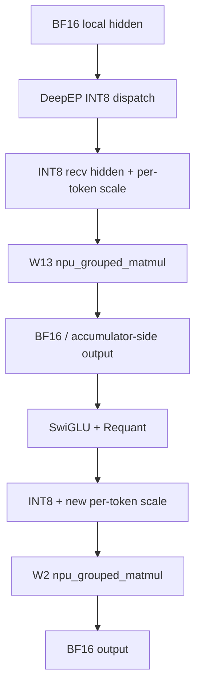
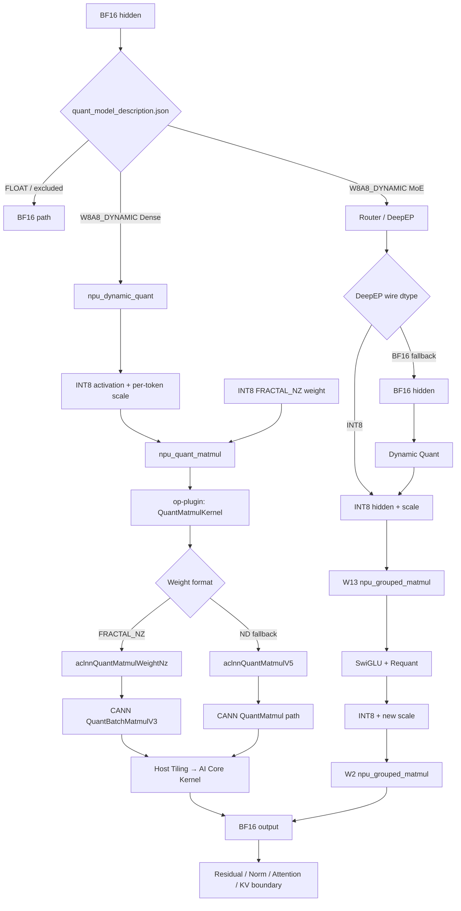

# DeepSeek-V4 W8A8 执行链：从量化权重到 Ascend INT8 算子

`--quantization modelslim` 根据模型的量化描述选择各层实现。DeepSeek-V4-Flash 的 W8A8 动态 Linear 可将 BF16 hidden states 量化为 INT8，再与 INT8 权重计算，并结合 scale 得到输出。Attention、路由和激活函数等仍按各自实现运行。

Dense 和 MoE 的输入准备又有所不同：Dense 可以在算子前量化，MoE 的 DeepEP Dispatch 则可能已提供 INT8 payload 与 per-token scale。下面从 checkpoint 开始，沿两条通路追到 SGLang、ACLNN、CANN。

<details markdown="1">
<summary>版本与源码入口</summary>

使用以下固定源码：

| 组件 | 版本 / 快照 |
| --- | --- |
| SGLang | `b63f8416b3b73bafdec029005c5db36bad207b44` |
| msModelSlim | `85d6c6f0266fd1fd77aa19ac26086670ca92d1db` |
| Ascend op-plugin | `e89cc608309341298193f957fa87c964ee561781` |
| CANN ops-nn | 公开 `8.5.0` / master 代码，核对日期 2026-09-21 |

本文统一称 Ascend 910C，上游资料、CI 中的 Atlas A3 名称只在对应分支条件时保留。

</details>

## 一、从量化描述确认哪些层使用 W8A8

ModelSlim 按模块描述为 Linear、MoE 分别选择量化实现。加载时，`ModelConfig._find_quant_modelslim_config()` 查找模型目录的 `quant_model_description.json` 并解析 `modelslim`，再由 `ModelSlimConfig` 根据模块权重描述选择 Scheme。

固定版本的 Linear 映射如下：

| 量化描述 | Scheme | 执行 Method |
| --- | --- | --- |
| `W8A8` | `ModelSlimW8A8Int8` | `NPUW8A8Int8LinearMethod` |
| `W8A8_DYNAMIC` | `ModelSlimW8A8Int8` | `NPUW8A8Int8DynamicLinearMethod` |
| `FLOAT` | 非量化路径 | `UnquantizedLinearMethod` |

### W8A8 配方覆盖的模型层

固定 `deepseek_v4_flash_w8a8.yaml` 的主配方为：

```yaml
act:
  scope: per_token
  dtype: int8
  symmetric: true

weight:
  scope: per_channel
  dtype: int8
  symmetric: true
```

它选择 `W8A8_DYNAMIC`：激活采用 per-token INT8，权重采用 per-channel INT8，二者均为对称量化。配方再用 include / exclude 决定哪些模块进入这条路径：

- Attention 匹配 `*attn*`，排除 `*wo_a`、`*wo_b`、`*compressor.wgate`、`*compressor.wkv`、`*indexer.weights_proj`、`*indexer.compressor.wgate`、`*indexer.compressor.wkv`。
- FFN 匹配 `*ffn*`，其中排除 `*gate`。

因此，W8A8 描述的是命中模块的计算方式，不能据此将整个模型画成 INT8。公开 Flash-0731 W8A8 部署资料也标为 `W8A8_DYNAMIC`；实际部署仍应读取 checkpoint 自带的描述文件，不同导出流程可能改变逐层 Scheme。

<a id="expert"></a>

### MoE 怎样选择 W13 与 W2 的 Scheme

普通 Linear 调用 `ModelSlimConfig.get_linear_scheme()`，MoE 调用 `ModelSlimConfig.get_moe_scheme()`。MoE 表中的 `W8A8_DYNAMIC` 对应 `ModelSlimW8A8Int8MoE`，进一步接到 `NPUW8A8Int8MoEMethod`。

W13 合并 `gate_proj + up_proj`，W2 对应 `down_proj`，分别构造自己的 Scheme。命中 W8A8 的 Expert 进入 NPU MoE Runner 的 Grouped MatMul，Dense 则走普通 Linear。二者采用同一量化方向，但工作组织和输入形状不同。

## 二、Dense：激活量化、INT8 MatMul 与输出还原

先看普通 Linear `Y = XW`。

设输入、权重为：

```text
X:
[M, K]
BF16

W:
[N, K]
INT8 checkpoint weight
```

### Weight 在加载阶段已经是 INT8

W8A8 Scheme 创建参数时直接分配：

```python
weight = torch.empty(
    (output_size_per_partition,
     input_size_per_partition),
    dtype=torch.int8,
)
```

权重已在离线 ModelSlim 阶段量化，运行时无需每轮将 BF16 权重重新量化。


加载后主要完成以下准备：

```text
[N,K] INT8
   │
   ├── transpose
   ▼
[K,N] INT8
   │
   ├── npu_format_cast
   ▼
FRACTAL_NZ weight
```

`npu_format_cast()` 默认目标为 `ACL_FORMAT_FRACTAL_NZ`，形状不满足 alignment 时回退 ND 并警告。


转置、format cast 都属于加载准备。后续多次 Forward 复用这份离线 INT8 权重，无需在每次 Decode 重做转换。

---

### Activation 是在 Forward 时动态量化的

动态激活在 `W8A8_DYNAMIC` 的 `NPUW8A8Int8DynamicLinearMethod.apply()` 中处理，普通 Tensor 路径如下：

```python
quant_out, dynamic_scale =
    torch.ops.npu.npu_dynamic_quant(x)

output =
    torch.ops.npu.npu_quant_matmul(
        quant_out,
        layer.weight,
        layer.weight_scale,
        pertoken_scale=dynamic_scale.flatten(),
        bias=bias,
        output_dtype=original_dtype,
    )
```

普通 Tensor 的 dtype 变化为：

```text
BF16 X
[M,K]
   │
   ├── npu_dynamic_quant
   ▼
INT8 X
[M,K]

同时生成：
per-token scale
[M]
   │
   ▼
npu_quant_matmul
   │
   ├── X: INT8
   ├── W: INT8
   ├── x scale: per-token
   └── W scale: per-channel
   │
   ▼
BF16 Y
[M,N]
```

这里设置 `output_dtype = original_dtype`。BF16 hidden 输入时，Quant MatMul 可直接输出 BF16。所以后续层未必一直消费 INT8，量化与浮点计算会按模块交替：


```text
BF16
 ↓
INT8 GEMM Island
 ↓
BF16
 ↓
Attention / Residual / Norm
 ↓
INT8 GEMM Island
 ↓
BF16
```

官方 W8A8 配置仍可另外指定 `--kv-cache-dtype bfloat16`。Weight / Activation 位宽与 KV Cache dtype 是不同设计维度。

---

下面沿动态主线进入 MoE，静态路径的 `deq_scale`、`quant_bias` 留到文末对照。

## 三、MoE：DeepEP 的 INT8 数据与 Scale 复用

MoE 同一层的各个 Expert 分别持有权重。

Router 决定本轮各 Token 交给哪些 Expert。

例如路由后形成以下任务：

```text
Expert 0: 12 tokens
Expert 1:  7 tokens
Expert 2:  0 tokens
Expert 3: 19 tokens
...
```

逐专家在 Python 层反复启动小 GEMM 会增加 launch 成本，固定 NPU MoE Runner 用 `torch.ops.npu.npu_grouped_matmul(...)` 统一组织，每专家行数经 `expert_tokens / group_list` 交给 Kernel。


### W13 与 W2 是两次不同的 Grouped GEMM

ModelSlim W8A8 MoE 分别创建：

```text
W13:
[E, 2I, H]
INT8

W2:
[E, H, I]
INT8
```

权重在加载后同样进行转置和 NPU 布局准备。

Ascend Runner 按以下主线计算：

```text
Routed Hidden
    ↓
W13 Grouped MatMul
    ↓
SwiGLU
    ↓
Requant
    ↓
W2 Grouped MatMul
    ↓
BF16 Hidden
```

INT8 Expert 使用 `NPUW8A8Int8MoEMethod`。

内部持有以下组件：

```python
GroupedMatmul()
HiddenStatesDynamicQuant(
    quant_dtype=torch.int8
)
```

普通 GroupedMatmul 最终调用：

```python
torch.ops.npu.npu_grouped_matmul(
    x=[hidden_states],
    weight=[weight],
    scale=[weight_scale],
    per_token_scale=[pertoken_scale],
    group_list=expert_tokens,
    ...
)
```

因此 Dense、MoE 分别对应：

```text
Dense Linear
    ↓
npu_quant_matmul

MoE Expert
    ↓
npu_grouped_matmul
```

二者都可执行 INT8×INT8，但专家分组带来不同的负载形状与调度。

---

### DeepEP INT8 Dispatch 到 W13：什么时候避免二次量化

`NPUW8A8Int8MoEMethod` 虽然持有 `HiddenStatesDynamicQuant(quant_dtype=torch.int8)`，也不代表每次都调用它。要判断 W13 是否重复量化，需将 Dispatcher 的输出和 Method 的输入接起来。

<a id="w8a8-expert-deepep-int8"></a>

W13 权重后处理先将 Dispatcher output dtype 设为 `int8`，要求 DeepEP 使用 INT8 数据面。较新的 Python API 显式接收 `quant_mode="int8"`；Ascend 910C / A3 legacy pybind 若未暴露该参数，则由 vendor runtime 根据环境选择 BF16/INT8。固定 W8A8 CI 为此保留 `DEEP_NORMAL_MODE_USE_INT8_QUANT=1`。

条件满足后，Dispatch 将 BF16 local hidden 转成 INT8 recv hidden 与 per-token scale，再跨 EP Group 传输。

<a id="deepep-scale-payload-ascend-runner"></a>

`DeepEPNormalDispatchOutput` 可携带 `hidden_states`、`hidden_states_scale`、`topk_ids`、`topk_weights` 和 `num_recv_tokens_per_expert`。Buffer 若返回 `(hidden_states, hidden_states_scale)`，SGLang 就拆开二者，交给 Runner；`pre_permute_deepep_normal_to_ascend()` 再将 hidden、scale、`expert_tokens` 放入 `AscendRunnerInput`。

<a id="w13-scale"></a>

W13 Method 最后检查 `pertoken_scale`。只有缺少 scale 时，才调用自己的量化器，判断可简写为：

```python
if pertoken_scale is None:
    hidden_states, pertoken_scale = self.hidden_states_quantizer(hidden_states)
```

因此，只有 DeepEP 实际输出 INT8 payload，并提供匹配的 `hidden_states_scale`，W13 才跳过第二次 activation quant。若配置、Runtime 或 fallback 使输入退回 BF16，且 `hidden_states_scale=None`，W13 仍会补做动态量化。

这次复用只解释 W13 的输入。W13 计算和 SwiGLU 之后，W2 仍有自己的 requant，完整路径如下：



分析性能时，应分别记录模型 GEMM 的量化格式与 Dispatcher dtype：前者说明专家怎样计算，后者说明当前通信实际搬运什么，以及 W13 能否复用上游量化结果。

## 四、从 PyTorch 接口进入 ACLNN 与 CANN

再沿 Dense 动态路径向下，SGLang 调用：


```python
torch.ops.npu.npu_quant_matmul(
    quant_out,
    layer.weight,
    layer.weight_scale,
    pertoken_scale=dynamic_scale,
    output_dtype=torch.bfloat16,
)
```

这只是 PyTorch NPU 入口，继续往下还有：


```text
SGLang
  ↓
torch.ops.npu
  ↓
Ascend op-plugin
  ↓
ACLNN
  ↓
CANN Operator Host / Tiling
  ↓
AI Core Device Kernel
```

<a id="sglang-weight-fractal_nz"></a>
<a id="op-plugin-weight-nz"></a>
<a id="nz-weightnz"></a>

### 权重格式决定 ACLNN 入口

加载时，SGLang 对权重转置，再调用 `npu_format_cast()`，默认目标为 `ACL_FORMAT_FRACTAL_NZ`。形状不满足 alignment 时保留 ND。这个选择会继续影响 op-plugin，而不只改变存储布局。

固定 `QuantMatmulKernelNpuOpApi.cpp` 通过 `is_nz_format(x2)` 判断权重，将 `ACL_FORMAT_FRACTAL_NZ`、`ACL_FORMAT_FRACTAL_NZ_C0_4`、`ACL_FORMAT_FRACTAL_NZ_C0_16` 视为 NZ：

| 权重格式 | op-plugin 选择并检查的接口 |
| --- | --- |
| NZ | `aclnnQuantMatmulWeightNz` |
| ND | `aclnnQuantMatmulV5` |

所以仅记录 `npu_quant_matmul` 还不够。要确定设备入口，需同时保存加载后的 Weight 格式和实际 ACLNN 分支。

### WeightNz 在当前 CANN 里落到 QuantBatchMatmulV3

公开 CANN `ops-nn` 中有以下算子族：

```text
matmul/
└── quant_batch_matmul_v3/
    ├── op_api
    ├── op_host
    ├── op_kernel
    └── tests
```

8.5.0 的 `quant_batch_matmul_v3` README 列出 `aclnnQuantMatmulWeightNz`，API 头也位于该目录；源码树另有承接 `aclnnQuantMatmulV5` 的 `quant_batch_matmul_v4`。因此这里能确认的是下面这条固定关系：

```text
FRACTAL_NZ W8A8
→ aclnnQuantMatmulWeightNz
→ QuantBatchMatmulV3
```

ND 的 V5 由哪个目录或版本实现，还需看实际安装包，不能将它与 V3 永久绑定。

公开说明中，Ascend 910C 对应 Atlas A3 分支支持：

```text
INT8 x1
INT8 x2
FLOAT32 per-token scale
BF16 output
```

与这里的 W8A8_DYNAMIC Dense 路径相符。

将上面的入口接起来：

```text
DeepSeek-V4 Linear
        ↓
ModelSlimW8A8Int8
(W8A8_DYNAMIC)
        ↓
NPUW8A8Int8DynamicLinearMethod
        ↓
npu_dynamic_quant
        ↓
INT8 activation + per-token scale
        ↓
torch.ops.npu.npu_quant_matmul
        ↓
Ascend op-plugin
QuantMatmulKernelNpuOpApi.cpp
        ↓
Weight = FRACTAL_NZ ?
        │
        ├── Yes
        │     ↓
        │  aclnnQuantMatmulWeightNz
        │     ↓
        │  QuantBatchMatmulV3
        │
        └── No
              ↓
           aclnnQuantMatmulV5
              ↓
           version-dependent V5 path
```

### 再往下就是 Host Tiling → AI Core Kernel

`quant_batch_matmul_v3` 公开目录继续分为：

```text
op_host/
op_kernel/
```

ACLNN 进入算子后，由 Host 选择工作划分，再交设备执行：

```text
Host-side shape / dtype / format check
        ↓
Tiling strategy selection
        ↓
Workspace planning
        ↓
Tiling data
        ↓
AI Core device kernel launch
```

固定列表将该算子标为 `AI Core`，不是 AICPU。至此可以把 `Python Linear` 接到 `Ascend 910C AI Core Quantized MatMul`。


---

### Tiling Key 与 Kernel Variant 的选择条件

但一次请求具体采用哪个 Tiling Key、Kernel Variant，还由当前输入与环境共同决定。

需要记录 `M`（当前 Token / Batch 行数）、`N`（投影输出维）、`K`（hidden / 输入宽度），以及权重的 FRACTAL_NZ / ND 格式、INT8 输入、per-token / per-channel Scale、BF16 输出、Ascend 910C 型号和容器中的 CANN build/version。

Prefill、Decode 的 M 也可能相差很大：

```text
Prefill:
M 可能很大

Decode:
M 往往很小
```

同属 `QuantBatchMatmulV3`，内部仍可能选不同 Tiling strategy / Kernel specialization。


因此源码可以确认 API 到算子族的链路，实际选择还需用目标 Ascend 910C 的 Profiler、operator dump 和 tiling metadata 核对。将 `M/N/K`、算子名、Kernel 名、耗时接回 Host Tiling，才能解释本次 Prefill、Decode 的差异。

## 五、串起 Dense 与 MoE 的执行路径

量化描述、激活数据和两条算子通路可合在一起看：



因此，W8A8 Profile 里仍会出现 BF16、RMSNorm、Attention、HCCL / DeepEP、KV Cache 等工作；它们没有因为部分 GEMM 量化就消失。

只有 ModelSlim 选中的层用相应 INT8 Weight、Activation 完成 GEMM，周围 Norm、Attention、缓存和状态交换仍使用各自的数据类型。

### 将源码路径对应到实际部署

核对部署可沿数据流记录逐层 Scheme、加载后 Weight 格式、Dispatcher dtype、实际算子与 Tiling，分别确定量化范围、存储布局、通信 payload 和设备执行。

特殊形状可能退回 ND，通信配置决定是否走 INT8 wire，CANN 与输入再共同决定 Kernel。把这些选择放回请求时间线，才能继续分析各段成本。

## 六、源码入口与版本

自行核对时，可以按下面几条入口追到前文的数据流。完整仓库版本和文件列表放在表后。

<a id="checkpoint-scheme"></a>
<a id="deepseek-v4-flash-w8a8"></a>
<a id="dense-int8"></a>
<a id="moe-int8"></a>
<a id="pytorch-npu-cann"></a>

| 要核对的选择 | 入口 | 继续跟踪什么 |
| --- | --- | --- |
| Checkpoint 到 Scheme | `configs/model_config.py`、`quantization/modelslim/modelslim.py` | `_find_quant_modelslim_config()`、`ModelSlimConfig`、`get_linear_scheme()` / `get_moe_scheme()` |
| 官方量化配方 | `lab_practice/deepseek_v4/deepseek_v4_flash_w8a8.yaml` | `W8A8_DYNAMIC` 与 include / exclude |
| Dense INT8 | `modelslim_w8a8_int8.py`、`NPUW8A8Int8DynamicLinearMethod` | `npu_dynamic_quant` 到 `npu_quant_matmul` |
| MoE INT8 | `modelslim_w8a8_int8_moe.py`、`NPUW8A8Int8MoEMethod` | DeepEP dispatcher 到 `AscendMoeRunner`、`npu_grouped_matmul` |
| PyTorch NPU 到 CANN | `QuantMatmulKernelNpuOpApi.cpp`、`quant_batch_matmul_v3/` | NZ / ND 的 ACLNN 分流，以及 `op_host`、`op_kernel` |

### 参考源码

- [SGLang `b63f8416b3b73bafdec029005c5db36bad207b44`](https://github.com/sgl-project/sglang/tree/b63f8416b3b73bafdec029005c5db36bad207b44)
  - `python/sglang/srt/layers/quantization/modelslim/modelslim.py`
  - `python/sglang/srt/layers/quantization/modelslim/schemes/modelslim_w8a8_int8.py`
  - `python/sglang/srt/layers/quantization/modelslim/schemes/modelslim_w8a8_int8_moe.py`
  - `python/sglang/srt/hardware_backend/npu/quantization/linear_method_npu.py`
  - `python/sglang/srt/hardware_backend/npu/quantization/moe_methods.py`
  - `python/sglang/srt/layers/moe/moe_runner/ascend.py`
  - `python/sglang/srt/layers/moe/token_dispatcher/deepep.py`
- [msModelSlim `85d6c6f0266fd1fd77aa19ac26086670ca92d1db`](https://github.com/Ascend/msmodelslim/tree/85d6c6f0266fd1fd77aa19ac26086670ca92d1db)
  - `lab_practice/deepseek_v4/deepseek_v4_flash_w8a8.yaml`
  - `msmodelslim/core/quant_service/modelslim_v1/save/ascendv1.py`
- [Ascend op-plugin `e89cc608309341298193f957fa87c964ee561781`](https://github.com/Ascend/op-plugin/tree/e89cc608309341298193f957fa87c964ee561781)
  - `op_plugin/ops/opapi/QuantMatmulKernelNpuOpApi.cpp`
- [CANN ops-nn / `quant_batch_matmul_v3`](https://gitcode.com/cann/ops-nn/tree/8.5.0/matmul/quant_batch_matmul_v3)
- [CANN ops-nn / `quant_batch_matmul_v4`](https://gitcode.com/cann/ops-nn/tree/8.5.0/matmul/quant_batch_matmul_v4)

更换版本后，尤其要重新核对 Dispatcher dtype、ACLNN 分流和 Tiling，避免沿旧名字推断新实现。

<details markdown="1">
<summary>补充：静态 W8A8 的 Scale 与 Bias 推导</summary>

### 静态 W8A8 的 Scale 与 Bias

下面补充静态 W8A8 的 ModelSlim 导出公式，用于解释 `deq_scale`、`quant_bias`。它与前文动态配方的激活量化不同，应各自对应参数和算子入口。

### ModelSlim 的导出公式

固定 AscendV1 saver 将激活、权重 scale 相乘，得到 `deq_scale`。若原浮点 Bias 为 `fp_bias`、量化权重为 `Qw`、激活 offset 为 `input_offset`，核心计算如下，省略了参数的维度整形。原模型无 Bias 时，`fp_bias` 使用零向量。[`AscendV1Saver.on_w8a8_static()`](https://github.com/Ascend/msmodelslim/blob/85d6c6f0266fd1fd77aa19ac26086670ca92d1db/msmodelslim/core/quant_service/modelslim_v1/save/ascendv1.py#L289-L312)

```python
deq_scale = input_scale * weight_scale
correction = Qw.to(torch.float32).sum(dim=1) * input_offset.to(torch.float32)
quant_bias = torch.round(fp_bias / deq_scale - correction).to(torch.int32)
```

`quant_bias` 同时包含原浮点 Bias 的缩放和 offset 校正。非零激活 offset 会改变 MatMul 累加值，所以先将量化权重的求和校正折入 quantized bias；参与求和前，`Qw` 与 `input_offset` 都转成浮点。

### 静态 W8A8 在 SGLang 中怎么使用这些量

对应 SGLang 静态执行链为：

```text
BF16 X
   │
   ├── 固定 input_scale / input_offset
   ▼
npu_quantize
   │
   ▼
INT8 X
   │
   ├── INT8 W
   ├── deq_scale
   └── quant_bias
   ▼
npu_quant_matmul
   │
   ▼
BF16 Y
```

随后调用：

```python
torch.ops.npu.npu_quant_matmul(
    x,
    layer.weight,
    layer.deq_scale,
    bias=quant_bias,
    output_dtype=original_dtype,
)
```

BF16 原模型的综合 dequant scale 按对应 BF16 输出路径所需格式导出，SGLang 直接将 checkpoint 的 `deq_scale` 传给 QuantMatmul。

### 动态配方与这组公式的对应范围

本篇官方配方选择 `W8A8_DYNAMIC`，Dense 主线不使用这套静态的 `input_scale`、`input_offset`、`deq_scale`、`quant_bias`。动态 QuantMatmul 使用 `weight_scale`、运行时 per-token scale，以及可选的浮点 Bias。

因此，前文仍沿 `npu_dynamic_quant → INT8 + per-token scale → npu_quant_matmul` 运行。静态公式用于解释其他 ModelSlim checkpoint 的 `deq_scale/quant_bias`，不能混入动态路径推断输出还原。

</details>
