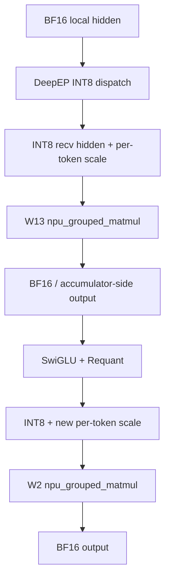
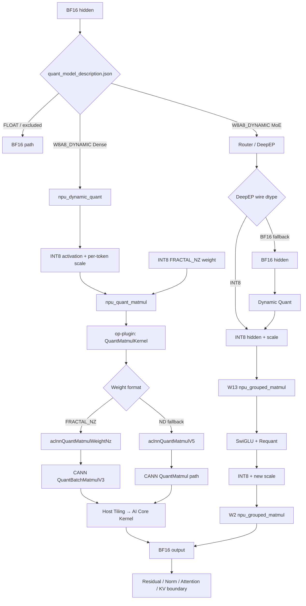

# DeepSeek-V4 W8A8 执行链：从量化权重到 Ascend INT8 算子

`--quantization modelslim` 让加载器按模型目录里的量化描述，为各层选择实现。DeepSeek-V4-Flash 的动态 W8A8 Linear 把 BF16 hidden states 量成 INT8，与 INT8 权重计算，再结合 scale 得到输出。周围的 Attention、路由、激活函数各走自己的实现。

同样的激活，在 Dense 和 MoE 进入矩阵乘以前，准备方式还有差别。Dense 可以当场动态量化，MoE 的 DeepEP Dispatch 却可能已经交来 INT8 payload 和 per-token scale，这时 W13 能复用它们。下面从 Checkpoint 的 Scheme 一直接到 SGLang、ACLNN 与 CANN。

<details markdown="1">
<summary>版本与源码入口</summary>

本篇使用以下固定源码。

| 组件 | 版本 / 快照 |
| --- | --- |
| SGLang | `b63f8416b3b73bafdec029005c5db36bad207b44` |
| msModelSlim | `85d6c6f0266fd1fd77aa19ac26086670ca92d1db` |
| Ascend op-plugin | `e89cc608309341298193f957fa87c964ee561781` |
| CANN ops-nn | 公开 `8.5.0` / master 代码，核对日期 2026-09-21 |

对外统一称 Ascend 910C，上游资料和 CI 的 Atlas A3 名字，只在解释对应分支时保留。

</details>

## 一、从量化描述确认哪些层使用 W8A8

加载时，`ModelConfig._find_quant_modelslim_config()` 找到模型目录的 `quant_model_description.json`，解析 `modelslim`。`ModelSlimConfig` 再按模块权重描述，分别为 Linear、MoE 选 Scheme。

固定版本的 Linear 对应这些实现。

| 量化描述 | Scheme | 执行 Method |
| --- | --- | --- |
| `W8A8` | `ModelSlimW8A8Int8` | `NPUW8A8Int8LinearMethod` |
| `W8A8_DYNAMIC` | `ModelSlimW8A8Int8` | `NPUW8A8Int8DynamicLinearMethod` |
| `FLOAT` | 非量化路径 | `UnquantizedLinearMethod` |

### W8A8 配方覆盖的模型层

`deepseek_v4_flash_w8a8.yaml` 的主配方如下。

```yaml
act:
  scope: per_token
  dtype: int8
  symmetric: true

weight:
  scope: per_channel
  dtype: int8
  symmetric: true
```

配方选 `W8A8_DYNAMIC`，激活为 per-token INT8，权重为 per-channel INT8，都是对称量化。哪些模块采用它，再由 include / exclude 决定。

- Attention 匹配 `*attn*`，排除 `*wo_a`、`*wo_b`、`*compressor.wgate`、`*compressor.wkv`、`*indexer.weights_proj`、`*indexer.compressor.wgate`、`*indexer.compressor.wkv`。
- FFN 匹配 `*ffn*`，其中排除 `*gate`。

W8A8 因而作用于命中模块，其他部分没有全部变为 INT8。公开 Flash-0731 W8A8 部署资料同样标注 `W8A8_DYNAMIC`，实际逐层 Scheme 仍由 Checkpoint 的描述文件确定，不同导出流程可能不同。

<a id="expert"></a>

### MoE 怎样选择 W13 与 W2 的 Scheme

普通 Linear 调 `ModelSlimConfig.get_linear_scheme()`，MoE 调 `ModelSlimConfig.get_moe_scheme()`。MoE 的 `W8A8_DYNAMIC` 对应 `ModelSlimW8A8Int8MoE`，再接到 `NPUW8A8Int8MoEMethod`。

W13 合并 `gate_proj + up_proj`，W2 对应 `down_proj`，两部分各建 Scheme。命中 W8A8 的 Expert 进入 NPU MoE Runner Grouped MatMul，Dense 则进入普通 Linear，同为量化计算，输入形状和组织方式不同。

## 二、Dense：激活量化、INT8 MatMul 与输出还原

从普通 Linear 的 `Y = XW` 开始。

输入和权重形状如下。

```text
X:
[M, K]
BF16

W:
[N, K]
INT8 checkpoint weight
```

### Weight 在加载阶段已经是 INT8

W8A8 Scheme 创建参数时，已经按下面的类型分配。

```python
weight = torch.empty(
    (output_size_per_partition,
     input_size_per_partition),
    dtype=torch.int8,
)
```

权重在离线 ModelSlim 阶段就量好了。运行时每轮直接使用 INT8 权重，不再从 BF16 重量化一遍。

加载以后再做这些准备。

```text
[N,K] INT8
   │
   ├── transpose
   ▼
[K,N] INT8
   │
   ├── npu_format_cast
   ▼
FRACTAL_NZ weight
```

`npu_format_cast()` 默认转到 `ACL_FORMAT_FRACTAL_NZ`，形状不满足 alignment 就回退 ND、发出警告。

转置和 format cast 随加载完成，后面多轮 Forward 复用准备好的权重，Decode 无需逐轮重做。

### Activation 是在 Forward 时动态量化的

动态激活则在 `W8A8_DYNAMIC` 的 `NPUW8A8Int8DynamicLinearMethod.apply()` 中产生，普通 Tensor 路径如下。

```python
quant_out, dynamic_scale =
    torch.ops.npu.npu_dynamic_quant(x)

output =
    torch.ops.npu.npu_quant_matmul(
        quant_out,
        layer.weight,
        layer.weight_scale,
        pertoken_scale=dynamic_scale.flatten(),
        bias=bias,
        output_dtype=original_dtype,
    )
```

沿这条路径，dtype 经历下面的变化。

```text
BF16 X
[M,K]
   │
   ├── npu_dynamic_quant
   ▼
INT8 X
[M,K]

同时生成：
per-token scale
[M]
   │
   ▼
npu_quant_matmul
   │
   ├── X: INT8
   ├── W: INT8
   ├── x scale: per-token
   └── W scale: per-channel
   │
   ▼
BF16 Y
[M,N]
```

`output_dtype = original_dtype` 保留原输入类型。输入 hidden 是 BF16，Quant MatMul 就可直接给出 BF16 输出，后续模块在量化与浮点计算间衔接。

```text
BF16
 ↓
INT8 GEMM Island
 ↓
BF16
 ↓
Attention / Residual / Norm
 ↓
INT8 GEMM Island
 ↓
BF16
```

官方 W8A8 配置仍能另设 `--kv-cache-dtype bfloat16`。权重、激活位宽与 KV Cache dtype 分别配置。

MoE 动态路径还要接上 Dispatch 的输入。静态 `deq_scale`、`quant_bias` 的推导放在文末作对照。

## 三、MoE：DeepEP 的 INT8 数据与 Scale 复用

MoE 一层里，各 Expert 分别持有权重。

Router 决定这批 Token 要去哪些 Expert。

例如路由以后形成下面这些任务。

```text
Expert 0: 12 tokens
Expert 1:  7 tokens
Expert 2:  0 tokens
Expert 3: 19 tokens
...
```

固定 NPU Runner 用 `torch.ops.npu.npu_grouped_matmul(...)` 组织多专家计算，通过 `expert_tokens / group_list` 给 Kernel 各专家的行数，避免在 Python 逐专家反复启动小 GEMM。

### W13 与 W2 是两次不同的 Grouped GEMM

ModelSlim 为 W13、W2 分别创建下面的量化实现。

```text
W13:
[E, 2I, H]
INT8

W2:
[E, H, I]
INT8
```

专家权重加载后同样转置，准备 NPU 布局。

Ascend Runner 的执行主线如下。

```text
Routed Hidden
    ↓
W13 Grouped MatMul
    ↓
SwiGLU
    ↓
Requant
    ↓
W2 Grouped MatMul
    ↓
BF16 Hidden
```

其中 INT8 Expert 使用 `NPUW8A8Int8MoEMethod`。

这个 Method 持有下面的组件。

```python
GroupedMatmul()
HiddenStatesDynamicQuant(
    quant_dtype=torch.int8
)
```

普通 GroupedMatmul 最后进入下面的调用。

```python
torch.ops.npu.npu_grouped_matmul(
    x=[hidden_states],
    weight=[weight],
    scale=[weight_scale],
    per_token_scale=[pertoken_scale],
    group_list=expert_tokens,
    ...
)
```

Dense、MoE 因而分别对应这两类矩阵乘。

```text
Dense Linear
    ↓
npu_quant_matmul

MoE Expert
    ↓
npu_grouped_matmul
```

二者都能做 INT8×INT8，专家分组却带来不同的负载形状与调度方式。

### DeepEP INT8 Dispatch 到 W13：什么时候避免二次量化

Method 持有 `HiddenStatesDynamicQuant(quant_dtype=torch.int8)`，但 W13 不一定每次都调用它。Dispatch 交来的 hidden 与 scale，决定这次还需不需要量化。

<a id="w8a8-expert-deepep-int8"></a>

W13 权重后处理把 Dispatcher output dtype 设为 `int8`，要求 DeepEP 走 INT8 数据面。较新 Python API 显式收 `quant_mode="int8"`；Ascend 910C / A3 legacy pybind 若没暴露该参数，则由 vendor runtime 按环境选择 BF16/INT8，固定 W8A8 CI 保留 `DEEP_NORMAL_MODE_USE_INT8_QUANT=1`。

条件满足，Dispatch 将 BF16 local hidden 变成 INT8 recv hidden 与 per-token scale，跨 EP Group 传输。

<a id="deepep-scale-payload-ascend-runner"></a>

`DeepEPNormalDispatchOutput` 可带 `hidden_states`、`hidden_states_scale`、`topk_ids`、`topk_weights`、`num_recv_tokens_per_expert`。Buffer 返回 `(hidden_states, hidden_states_scale)` 时，SGLang 拆开传给 Runner，`pre_permute_deepep_normal_to_ascend()` 再把 hidden、scale、`expert_tokens` 放到 `AscendRunnerInput`。

<a id="w13-scale"></a>

到 W13 Method，它检查 `pertoken_scale`，缺少时才调用自己的量化器。判断简写如下。

```python
if pertoken_scale is None:
    hidden_states, pertoken_scale = self.hidden_states_quantizer(hidden_states)
```

DeepEP 实际提供 INT8 payload 和匹配的 `hidden_states_scale`，W13 才能跳过第二次 activation quant。配置、Runtime 或 fallback 若退回 BF16，且 `hidden_states_scale=None`，这里仍会补做动态量化。

复用只发生在 W13 输入处。W13、SwiGLU 之后，W2 还要做自己的 requant，完整路径如下。



模型 GEMM 的量化格式描述计算，Dispatcher dtype 描述通信实际搬什么。两者都记录，才能确定 W13 是否用上了 Dispatch 的量化结果。

## 四、从 PyTorch 接口进入 ACLNN 与 CANN

Dense 动态主线从 SGLang 进入下面的 PyTorch NPU 接口。

```python
torch.ops.npu.npu_quant_matmul(
    quant_out,
    layer.weight,
    layer.weight_scale,
    pertoken_scale=dynamic_scale,
    output_dtype=torch.bfloat16,
)
```

接口之下还会经过这些层。

```text
SGLang
  ↓
torch.ops.npu
  ↓
Ascend op-plugin
  ↓
ACLNN
  ↓
CANN Operator Host / Tiling
  ↓
AI Core Device Kernel
```

<a id="sglang-weight-fractal_nz"></a>
<a id="op-plugin-weight-nz"></a>
<a id="nz-weightnz"></a>

### 权重格式决定 ACLNN 入口

加载时转置后的权重，默认经 `npu_format_cast()` 转 `ACL_FORMAT_FRACTAL_NZ`，alignment 不满足则留 ND。这个格式不仅影响存储，还决定 op-plugin 的入口选择。

固定 `QuantMatmulKernelNpuOpApi.cpp` 用 `is_nz_format(x2)` 判断，将 `ACL_FORMAT_FRACTAL_NZ`、`ACL_FORMAT_FRACTAL_NZ_C0_4`、`ACL_FORMAT_FRACTAL_NZ_C0_16` 都归入 NZ。

| 权重格式 | op-plugin 选择并检查的接口 |
| --- | --- |
| NZ | `aclnnQuantMatmulWeightNz` |
| ND | `aclnnQuantMatmulV5` |

同为 `npu_quant_matmul`，加载后的 Weight 格式不同，实际 ACLNN 入口也可能不同，这两项要一起对应。

### WeightNz 在当前 CANN 里落到 QuantBatchMatmulV3

公开 CANN `ops-nn` 包含下面的算子族。

```text
matmul/
└── quant_batch_matmul_v3/
    ├── op_api
    ├── op_host
    ├── op_kernel
    └── tests
```

8.5.0 的 `quant_batch_matmul_v3` README 列有 `aclnnQuantMatmulWeightNz`，API 头也在该目录。源码另有承接 `aclnnQuantMatmulV5` 的 `quant_batch_matmul_v4`，因此这里确认的是下面这条固定关系。

```text
FRACTAL_NZ W8A8
→ aclnnQuantMatmulWeightNz
→ QuantBatchMatmulV3
```

ND 的 V5 要由实际安装包确定目录与版本，不能永久绑定到 V3。

公开说明里，Ascend 910C 对应 Atlas A3 分支支持下面的组合。

```text
INT8 x1
INT8 x2
FLOAT32 per-token scale
BF16 output
```

它与这里的 W8A8_DYNAMIC Dense 条件相符。

API 到算子族的关系接起来如下。

```text
DeepSeek-V4 Linear
        ↓
ModelSlimW8A8Int8
(W8A8_DYNAMIC)
        ↓
NPUW8A8Int8DynamicLinearMethod
        ↓
npu_dynamic_quant
        ↓
INT8 activation + per-token scale
        ↓
torch.ops.npu.npu_quant_matmul
        ↓
Ascend op-plugin
QuantMatmulKernelNpuOpApi.cpp
        ↓
Weight = FRACTAL_NZ ?
        │
        ├── Yes
        │     ↓
        │  aclnnQuantMatmulWeightNz
        │     ↓
        │  QuantBatchMatmulV3
        │
        └── No
              ↓
           aclnnQuantMatmulV5
              ↓
           version-dependent V5 path
```

### 再往下就是 Host Tiling → AI Core Kernel

`quant_batch_matmul_v3` 的公开目录分为下面几部分。

```text
op_host/
op_kernel/
```

ACLNN 进入算子后，Host 划分工作，再交设备执行。

```text
Host-side shape / dtype / format check
        ↓
Tiling strategy selection
        ↓
Workspace planning
        ↓
Tiling data
        ↓
AI Core device kernel launch
```

固定列表将它标为 `AI Core`，并非 AICPU。`Python Linear` 到 `Ascend 910C AI Core Quantized MatMul` 的链路到这里接上。

### Tiling Key 与 Kernel Variant 的选择条件

具体 Tiling Key、Kernel Variant，则还随本次输入与执行环境选择。

其中包括 `M`（Token / Batch 行数）、`N`（投影输出维）、`K`（hidden / 输入宽度）、FRACTAL_NZ / ND 权重格式、INT8 输入、per-token / per-channel Scale、BF16 输出、Ascend 910C 型号，以及容器的 CANN build/version。

Prefill、Decode 的 M 可以差很多。

```text
Prefill:
M 可能很大

Decode:
M 往往很小
```

都属于 `QuantBatchMatmulV3`，内部 Tiling strategy、Kernel specialization 仍可能不同。

源码确认了 API 到算子族，实际选中的 Kernel 还要对应目标设备的 Profiler、operator dump 与 tiling metadata。把 `M/N/K`、算子名、Kernel 名和耗时接到 Host Tiling，才能解释该次 Prefill、Decode 的差别。

## 五、串起 Dense 与 MoE 的执行路径

量化描述、激活准备与两条算子通路，可合在下面的数据流里。



W8A8 Profile 里仍可能看到 BF16、RMSNorm、Attention、HCCL / DeepEP、KV Cache。ModelSlim 选中的层以相应 INT8 Weight、Activation 做 GEMM，周围 Norm、Attention、缓存与交换继续使用各自的数据类型。

### 将源码路径对应到实际部署

一份部署对应到这里，需要逐层 Scheme、加载后 Weight 格式、Dispatcher dtype、实际算子和 Tiling。这些分别确定量化范围、存储、通信 payload 和设备执行。

特殊形状可能留在 ND，通信配置决定 INT8 wire 是否实际生效，CANN 与输入共同决定 Kernel。不同段落的成本，也由这些选择进入请求时间线。

## 六、源码入口与版本

下列入口对应本文的数据流，表后列出固定仓库版本与文件。

<a id="checkpoint-scheme"></a>
<a id="deepseek-v4-flash-w8a8"></a>
<a id="dense-int8"></a>
<a id="moe-int8"></a>
<a id="pytorch-npu-cann"></a>

| 要核对的选择 | 入口 | 继续跟踪什么 |
| --- | --- | --- |
| Checkpoint 到 Scheme | `configs/model_config.py`、`quantization/modelslim/modelslim.py` | `_find_quant_modelslim_config()`、`ModelSlimConfig`、`get_linear_scheme()` / `get_moe_scheme()` |
| 官方量化配方 | `lab_practice/deepseek_v4/deepseek_v4_flash_w8a8.yaml` | `W8A8_DYNAMIC` 与 include / exclude |
| Dense INT8 | `modelslim_w8a8_int8.py`、`NPUW8A8Int8DynamicLinearMethod` | `npu_dynamic_quant` 到 `npu_quant_matmul` |
| MoE INT8 | `modelslim_w8a8_int8_moe.py`、`NPUW8A8Int8MoEMethod` | DeepEP dispatcher 到 `AscendMoeRunner`、`npu_grouped_matmul` |
| PyTorch NPU 到 CANN | `QuantMatmulKernelNpuOpApi.cpp`、`quant_batch_matmul_v3/` | NZ / ND 的 ACLNN 分流，以及 `op_host`、`op_kernel` |

### 参考源码

- [SGLang `b63f8416b3b73bafdec029005c5db36bad207b44`](https://github.com/sgl-project/sglang/tree/b63f8416b3b73bafdec029005c5db36bad207b44)
  - `python/sglang/srt/layers/quantization/modelslim/modelslim.py`
  - `python/sglang/srt/layers/quantization/modelslim/schemes/modelslim_w8a8_int8.py`
  - `python/sglang/srt/layers/quantization/modelslim/schemes/modelslim_w8a8_int8_moe.py`
  - `python/sglang/srt/hardware_backend/npu/quantization/linear_method_npu.py`
  - `python/sglang/srt/hardware_backend/npu/quantization/moe_methods.py`
  - `python/sglang/srt/layers/moe/moe_runner/ascend.py`
  - `python/sglang/srt/layers/moe/token_dispatcher/deepep.py`
- [msModelSlim `85d6c6f0266fd1fd77aa19ac26086670ca92d1db`](https://github.com/Ascend/msmodelslim/tree/85d6c6f0266fd1fd77aa19ac26086670ca92d1db)
  - `lab_practice/deepseek_v4/deepseek_v4_flash_w8a8.yaml`
  - `msmodelslim/core/quant_service/modelslim_v1/save/ascendv1.py`
- [Ascend op-plugin `e89cc608309341298193f957fa87c964ee561781`](https://github.com/Ascend/op-plugin/tree/e89cc608309341298193f957fa87c964ee561781)
  - `op_plugin/ops/opapi/QuantMatmulKernelNpuOpApi.cpp`
- [CANN ops-nn / `quant_batch_matmul_v3`](https://gitcode.com/cann/ops-nn/tree/8.5.0/matmul/quant_batch_matmul_v3)
- [CANN ops-nn / `quant_batch_matmul_v4`](https://gitcode.com/cann/ops-nn/tree/8.5.0/matmul/quant_batch_matmul_v4)

版本改变后，Dispatcher dtype、ACLNN 分流、Tiling 也可能变化，入口名称相同不保证内部实现相同。

<details markdown="1">
<summary>补充：静态 W8A8 的 Scale 与 Bias 推导</summary>

### 静态 W8A8 的 Scale 与 Bias

静态 W8A8 的导出公式解释另一套 `deq_scale`、`quant_bias`。它和前面的动态激活量化，使用不同参数与算子入口。

### ModelSlim 的导出公式

固定 AscendV1 saver 将激活、权重 scale 相乘得到 `deq_scale`。设原浮点 Bias 为 `fp_bias`，量化权重为 `Qw`，激活 offset 为 `input_offset`，省去维度整形后，核心计算如下。原模型没有 Bias，就用零向量作为 `fp_bias`。[`AscendV1Saver.on_w8a8_static()`](https://github.com/Ascend/msmodelslim/blob/85d6c6f0266fd1fd77aa19ac26086670ca92d1db/msmodelslim/core/quant_service/modelslim_v1/save/ascendv1.py#L289-L312)

```python
deq_scale = input_scale * weight_scale
correction = Qw.to(torch.float32).sum(dim=1) * input_offset.to(torch.float32)
quant_bias = torch.round(fp_bias / deq_scale - correction).to(torch.int32)
```

`quant_bias` 同时放进浮点 Bias 的缩放结果和 offset 校正。非零激活 offset 会改变 MatMul 累加值，因而将量化权重求和对应的校正折入 quantized bias；`Qw`、`input_offset` 参与求和前都转浮点。

### 静态 W8A8 在 SGLang 中怎么使用这些量

SGLang 的对应静态执行链如下。

```text
BF16 X
   │
   ├── 固定 input_scale / input_offset
   ▼
npu_quantize
   │
   ▼
INT8 X
   │
   ├── INT8 W
   ├── deq_scale
   └── quant_bias
   ▼
npu_quant_matmul
   │
   ▼
BF16 Y
```

接着调用下面的接口。

```python
torch.ops.npu.npu_quant_matmul(
    x,
    layer.weight,
    layer.deq_scale,
    bias=quant_bias,
    output_dtype=original_dtype,
)
```

BF16 原模型的综合 dequant scale，按 BF16 输出路径需要的格式导出，SGLang 将 Checkpoint 的 `deq_scale` 直接交给 QuantMatmul。

### 动态配方与这组公式的对应范围

本文主配方是 `W8A8_DYNAMIC`，Dense 不使用静态的 `input_scale`、`input_offset`、`deq_scale`、`quant_bias`，而用 `weight_scale`、运行时 per-token scale 和可选浮点 Bias。

动态主线仍是 `npu_dynamic_quant → INT8 + per-token scale → npu_quant_matmul`。静态公式用于解释其他 ModelSlim Checkpoint 的 `deq_scale/quant_bias`，两套输出还原方式分别对应各自的路径。

</details>
