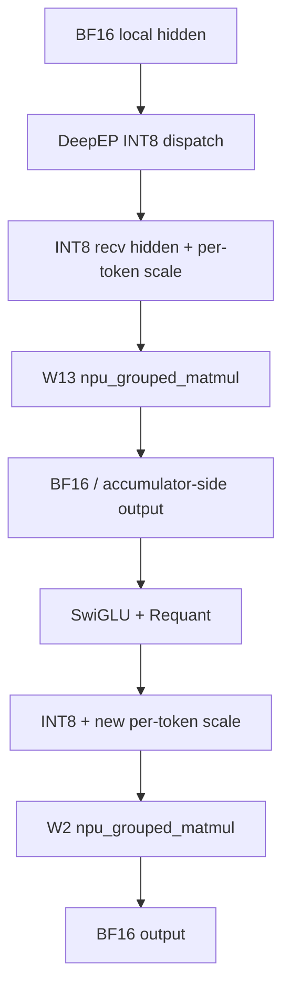
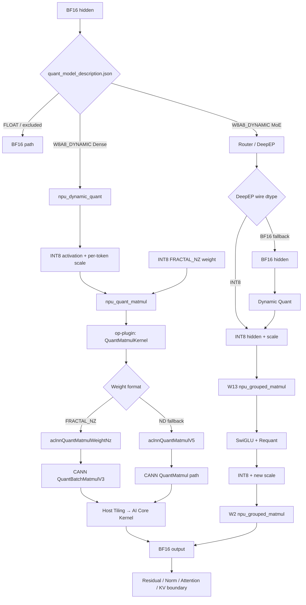

# DeepSeek-V4 W8A8 执行链：从量化权重到 Ascend INT8 算子

`--quantization modelslim` 决定模型按量化描述加载哪些层。对 DeepSeek-V4-Flash 的 W8A8 动态量化路径，一份 BF16 hidden states 进入 Linear 后，会先被量化成 INT8，再与 INT8 权重做矩阵乘法，最后结合 scale 得到后续计算需要的输出。Attention、路由、激活函数等环节仍有各自的 dtype 和实现。

沿着这份 hidden states 往下追，Dense 和 MoE 会走出两条不同的数据通路：Dense 在算子前处理激活量化，MoE 的 DeepEP Dispatch 还可能提前生成 INT8 数据和 per-token scale。下面从 checkpoint 的量化描述开始，说明这些数据怎样进入 SGLang、ACLNN 和 CANN。

<details markdown="1">
<summary>版本与源码入口</summary>

本文固定到以下源码版本：

| 组件 | 版本 / 快照 |
| --- | --- |
| SGLang | `b63f8416b3b73bafdec029005c5db36bad207b44` |
| msModelSlim | `85d6c6f0266fd1fd77aa19ac26086670ca92d1db` |
| Ascend op-plugin | `e89cc608309341298193f957fa87c964ee561781` |
| CANN ops-nn | 公开 `8.5.0` / master 代码，核对日期 2026-09-21 |

这里使用“Ascend 910C”作为统一硬件称呼。上游文档和 CI 中仍可能使用 Atlas A3 系列名称；本文只在引用源码分支条件时保留上游语义。

</details>

## 一、从量化描述确认哪些层使用 W8A8

SGLang 的 ModelSlim 根据逐层量化描述选择 Linear 与 MoE 实现。

决定某一层如何运行的是模型目录中的：`quant_model_description.json`

SGLang 启动时会在 `ModelConfig._find_quant_modelslim_config()` 中寻找这个文件，并将量化方法解析为 `modelslim`。随后 `ModelSlimConfig` 再根据每个模块的权重描述选择具体 Scheme。

当前映射包括：

```text
"W8A8"
    ↓
ModelSlimW8A8Int8
    ↓
NPUW8A8Int8LinearMethod

"W8A8_DYNAMIC"
    ↓
ModelSlimW8A8Int8
    ↓
NPUW8A8Int8DynamicLinearMethod

"FLOAT"
    ↓
UnquantizedLinearMethod
```

判断某个 Linear 的执行路径时，读取该层的 Scheme，再对应到 SGLang 选择的 Quantization Method。

### W8A8 配方覆盖的模型层

当前 msModelSlim 的 `deepseek_v4_flash_w8a8.yaml` 给出的主配方非常明确：

```yaml
act:
  scope: per_token
  dtype: int8
  symmetric: true

weight:
  scope: per_channel
  dtype: int8
  symmetric: true
```

也就是：

```text
Activation:
per-token INT8

Weight:
per-channel INT8
```

对应的正是：`W8A8_DYNAMIC`

配方对 Attention 使用：

```yaml
include:
  - "*attn*"
```

但明确排除：

```text
*wo_a
*wo_b
*compressor.wgate
*compressor.wkv
*indexer.weights_proj
*indexer.compressor.wgate
*indexer.compressor.wkv
```

对 FFN 使用：

```yaml
include:
  - "*ffn*"
```

并排除：`*gate`

官方 DeepSeek-V4-Flash W8A8 配方按层选择量化与保留精度：

```text
Attention / FFN 中命中的 Linear
        ↓
W8A8_DYNAMIC

wo_a / wo_b
compressor 某些投影
indexer 某些投影
FFN gate
        ↓
保持非该 W8A8_DYNAMIC 路径
```

公开的 DeepSeek-V4-Flash-0731 W8A8 部署资料也明确标注其 `quant_model_description.json` 为 `W8A8_DYNAMIC`。

具体 checkpoint 的逐层 Scheme 记录在它自己的 `quant_model_description.json` 中。同名模型经过不同流程重新导出后，这份描述也会变化，加载时应读取随权重提供的文件。

### Expert 又落到哪里？

ModelSlim 对普通 Linear 和 MoE Expert 是两套路径。

普通 Linear：`ModelSlimConfig.get_linear_scheme()`

MoE：`ModelSlimConfig.get_moe_scheme()`

当前 MoE Scheme 表中：

```text
W8A8_DYNAMIC
    ↓
ModelSlimW8A8Int8MoE
    ↓
NPUW8A8Int8MoEMethod
```

并且 W13 与 W2 会各自建立一个 Scheme：

```text
W13:
gate_proj + up_proj

W2:
down_proj
```

因此官方配方里命中的 FFN / Expert W8A8 并不是调用普通 `npu_quant_matmul` 循环执行很多次，而是后面进入 NPU MoE Runner 的 Grouped MatMul 路径。

这已经给出了全文第一条关键结论：

> **DeepSeek-V4-Flash W8A8 的主路径是“逐模块 W8A8_DYNAMIC”，Dense Linear 和 MoE Expert 最终进入不同 NPU Kernel family。**

## 二、Dense：激活量化、INT8 MatMul 与输出还原

先看最简单的普通 Linear：`Y = XW`

假设运行时：

```text
X:
[M, K]
BF16

W:
[N, K]
INT8 checkpoint weight
```

### Weight 在加载阶段已经是 INT8

ModelSlim 的 W8A8 Scheme 创建 Parameter 时，直接申请：

```python
weight = torch.empty(
    (output_size_per_partition,
     input_size_per_partition),
    dtype=torch.int8,
)
```

这意味着权重不是每次 Forward 才从 BF16 在线量化。

量化动作已经发生在离线 ModelSlim 阶段。

运行时加载后主要做两件事：

```text
[N,K] INT8
   │
   ├── transpose
   ▼
[K,N] INT8
   │
   ├── npu_format_cast
   ▼
FRACTAL_NZ weight
```

当前 SGLang 的 `npu_format_cast()` 默认目标是：`ACL_FORMAT_FRACTAL_NZ`

只有 shape 不满足 NZ alignment 时才退回 ND，并打印性能警告。

所以 Weight 的 steady-state 状态更接近：

```text
离线 INT8 Weight
        ↓
加载时转换为 NPU-friendly FRACTAL_NZ
        ↓
后续多次 Forward 复用
```

而不是每轮 Decode 都重新转置和 format cast。

---

### Activation 是在 Forward 时动态量化的

对 `W8A8_DYNAMIC`，当前 SGLang 进入：

```python
NPUW8A8Int8DynamicLinearMethod.apply()
```

核心逻辑非常短：

```python
quant_out, dynamic_scale =
    torch.ops.npu.npu_dynamic_quant(x)

output =
    torch.ops.npu.npu_quant_matmul(
        quant_out,
        layer.weight,
        layer.weight_scale,
        pertoken_scale=dynamic_scale.flatten(),
        bias=bias,
        output_dtype=original_dtype,
    )
```

所以真实 dtype 时间线是：

```text
BF16 X
[M,K]
   │
   ├── npu_dynamic_quant
   ▼
INT8 X
[M,K]

同时生成：
per-token scale
[M]
   │
   ▼
npu_quant_matmul
   │
   ├── X: INT8
   ├── W: INT8
   ├── x scale: per-token
   └── W scale: per-channel
   │
   ▼
BF16 Y
[M,N]
```

注意最后这一点：

```python
output_dtype = original_dtype
```

如果进入这一层的 hidden 是 BF16，Quant MatMul 最终直接返回 BF16。

所以 W8A8 并不意味着：`INT8 → INT8 → INT8 → INT8`

而更像很多离散的“量化计算岛”：

```text
BF16
 ↓
INT8 GEMM Island
 ↓
BF16
 ↓
Attention / Residual / Norm
 ↓
INT8 GEMM Island
 ↓
BF16
```

这也是为什么官方 DeepSeek-V4-Flash W8A8 配置仍然可以使用：

```bash
--kv-cache-dtype bfloat16
```

W8A8 Weight / Activation 与 KV Cache dtype 是两套完全独立的设计维度。

---

静态 W8A8 的 `deq_scale`、`quant_bias` 推导放在文末对照中；下面继续沿本篇动态配方进入 MoE。

## 三、MoE：DeepEP 的 INT8 数据与 Scale 复用

DeepSeek-V4 的 MoE 与普通 Linear 有一个根本区别：

同一层不是只有一个 Weight Matrix，而是很多 Expert：

```text
Expert 0
Expert 1
Expert 2
...
Expert E-1
```

Router 会把当前 Token 分给不同 Expert。

假设路由之后：

```text
Expert 0: 12 tokens
Expert 1:  7 tokens
Expert 2:  0 tokens
Expert 3: 19 tokens
...
```

如果逐 Expert 在 Python 层调用很多次 `npu_quant_matmul`，会产生大量小 GEMM 和 launch overhead。

所以当前 NPU MoE Runner 使用：

```python
torch.ops.npu.npu_grouped_matmul(...)
```

并通过：`expert_tokens / group_list`

告诉 Kernel 每个 Expert 有多少行。

### W13 与 W2 是两次不同的 Grouped GEMM

ModelSlim W8A8 MoE 创建：

```text
W13:
[E, 2I, H]
INT8

W2:
[E, H, I]
INT8
```

经过加载后，权重同样会转置并进入 NPU-friendly layout。

Ascend Runner 的主执行链是：

```text
Routed Hidden
    ↓
W13 Grouped MatMul
    ↓
SwiGLU
    ↓
Requant
    ↓
W2 Grouped MatMul
    ↓
BF16 Hidden
```

对 W8A8 INT8 Expert，当前 Kernel class 是：`NPUW8A8Int8MoEMethod`

其内部持有：

```python
GroupedMatmul()
HiddenStatesDynamicQuant(
    quant_dtype=torch.int8
)
```

而普通 GroupedMatmul 最终就是：

```python
torch.ops.npu.npu_grouped_matmul(
    x=[hidden_states],
    weight=[weight],
    scale=[weight_scale],
    per_token_scale=[pertoken_scale],
    group_list=expert_tokens,
    ...
)
```

因此 Dense 与 MoE 可以非常清楚地区分：

```text
Dense Linear
    ↓
npu_quant_matmul

MoE Expert
    ↓
npu_grouped_matmul
```

两者都可以是 INT8×INT8，但 Kernel 的 workload shape 和调度方式完全不同。

---

### DeepEP INT8 Dispatch 到 W13：什么时候完全避免二次量化

是否会再次量化，要把 Dispatcher 的输出和 MoE Method 的输入接起来看。单看下面这个类还不够：

```python
NPUW8A8Int8MoEMethod
```

会发现它内部有：

```python
HiddenStatesDynamicQuant(
    quant_dtype=torch.int8
)
```

于是很容易认为：

```text
DeepEP Dispatch:
BF16 → INT8

到了 Expert:
INT8 → 又 quant 一次？
```

当前官方 W8A8 + DeepEP 正常路径**不会这样做**。

### 第一步：W8A8 Expert 会要求 DeepEP 输出 INT8

`NPUW8A8Int8MoEMethod` 在 W13 Weight 后处理阶段会把 Dispatcher output dtype 设置为：`int8`

DeepEP dispatcher 因此选择 INT8 数据面。

在当前 Python API 较新的 DeepEP Buffer 上，SGLang 会传：`quant_mode = "int8"`

旧的 Ascend 910C / A3 legacy pybind 如果不暴露这个参数，SGLang 则让 vendor DeepEP runtime 根据运行环境选择 BF16/INT8；官方 DeepSeek-V4-Flash W8A8 CI 当前仍设置：

```bash
DEEP_NORMAL_MODE_USE_INT8_QUANT=1
```

用于这一兼容链路。

所以 Dispatch 可以把：`BF16 local hidden`

直接变成：

```text
INT8 recv hidden
+
per-token scale
```

然后跨 EP Group 传输。

### 第二步：DeepEP 把 scale 和 payload 一起交给 Ascend Runner

`DeepEPNormalDispatchOutput` 本身就包含：

```text
hidden_states
hidden_states_scale
topk_ids
topk_weights
num_recv_tokens_per_expert
```

如果 DeepEP 返回的是 tuple：`(hidden_states, hidden_states_scale)`

SGLang 会把它拆出来并一直传给 Ascend Runner。

`pre_permute_deepep_normal_to_ascend()` 没有丢掉这个 scale，而是构造：

```text
AscendRunnerInput:
  hidden_states
  hidden_states_scale
  expert_tokens
```

### 第三步：W13 只有在 scale 缺失时才重新量化

`NPUW8A8Int8MoEMethod.apply()` 的关键判断是：

```python
if pertoken_scale is None:
    hidden_states, pertoken_scale =
        self.hidden_states_quantizer(hidden_states)
```

```text
DeepEP 已经输出：
INT8 hidden + scale
        ↓
pertoken_scale != None
        ↓
跳过 HiddenStatesDynamicQuant
        ↓
直接进入 W13 GroupedMatmul
```

所以正确配置下完整路径是：



这里 DeepEP Dispatch → W13 之间确实避免了第二次 activation quant。

但必须加上条件：

> **只有当 DeepEP 实际按 INT8 dispatch，并且返回了匹配的 `hidden_states_scale` 时，W13 才完全跳过二次量化。**

如果因为配置、runtime 能力或 fallback 路径导致 DeepEP 输出 BF16：`hidden_states_scale = None`

W13 就会在 GEMM 前调用自己的 `HiddenStatesDynamicQuant`。

所以最准确的结论是：

```text
正确的 INT8 DeepEP 路径：
一次量化，不二次量化

BF16 fallback：
Expert 前补做一次动态量化
```

因此，Profile 时要将模型的量化格式与 DeepEP dispatcher dtype 对照：前者描述 GEMM，后者决定当前通信路径搬运的数据类型。

## 四、从 PyTorch 接口进入 ACLNN 与 CANN

现在进入本文最底层。

对 DeepSeek-V4-Flash W8A8 的 Dense 动态量化路径，SGLang 最终调用：

```python
torch.ops.npu.npu_quant_matmul(
    quant_out,
    layer.weight,
    layer.weight_scale,
    pertoken_scale=dynamic_scale,
    output_dtype=torch.bfloat16,
)
```

这还不是最终 NPU Kernel。

真实链路至少还有三层：

```text
SGLang
  ↓
torch.ops.npu
  ↓
Ascend op-plugin
  ↓
ACLNN
  ↓
CANN Operator Host / Tiling
  ↓
AI Core Device Kernel
```

### SGLang 先把 Weight 转成 FRACTAL_NZ

前面已经看到：

```python
weight = weight.transpose(...)
weight = npu_format_cast(weight)
```

而默认目标：`ACL_FORMAT_FRACTAL_NZ`

这一步非常关键，因为它直接影响 op-plugin 后面选择哪个 ACLNN 接口。

### op-plugin 会先检查 Weight 是不是 NZ

当前 Ascend op-plugin 的：`QuantMatmulKernelNpuOpApi.cpp`

并不是无条件调用一个固定接口。

它先判断：

```cpp
if (is_nz_format(x2)) {
    ...
} else {
    ...
}
```

其中 NZ 包括：

```text
ACL_FORMAT_FRACTAL_NZ
ACL_FORMAT_FRACTAL_NZ_C0_4
ACL_FORMAT_FRACTAL_NZ_C0_16
```

如果 Weight 是 NZ，op-plugin 会要求：`aclnnQuantMatmulWeightNz`

可用。

如果 Weight 是普通 ND，则检查：`aclnnQuantMatmulV5`

### NZ 权重进入 WeightNz 路径

对 SGLang 正常成功完成 FRACTAL_NZ format cast 的 INT8 Weight：`x2 format = FRACTAL_NZ`

于是实际 dispatch 是：

```text
torch.ops.npu.npu_quant_matmul
        ↓
op-plugin
QuantMatmulKernelNpuOpApi.cpp
        ↓
is_nz_format(x2) == true
        ↓
aclnnQuantMatmulWeightNz
```

这是比“`torch.ops.npu` 往下进入 CANN QuantMatmul”更精确的一层。

如果 Weight shape 不满足 NZ requirement，SGLang 的 `npu_format_cast()` 会退回 ND。

这种情况下链路会变成：

```text
npu_quant_matmul
    ↓
op-plugin
    ↓
aclnnQuantMatmulV5
```

`npu_quant_matmul` 根据 Weight 格式进入不同的 ACLNN 分支：

```text
FRACTAL_NZ Weight
→ aclnnQuantMatmulWeightNz

ND Weight
→ aclnnQuantMatmulV5
```

### WeightNz 在当前 CANN 里落到 QuantBatchMatmulV3

CANN 公开 `ops-nn` 代码中：

```text
matmul/
└── quant_batch_matmul_v3/
    ├── op_api
    ├── op_host
    ├── op_kernel
    └── tests
```

在 CANN 8.5.0 的 `quant_batch_matmul_v3` README 中，`aclnnQuantMatmulWeightNz` 被明确列为该算子的调用入口，且对应 API 头仍位于 `quant_batch_matmul_v3`。当前源码树同时存在专门承载 `aclnnQuantMatmulV5` 的 `quant_batch_matmul_v4`，因此本文只把下面这条关系钉死：

```text
FRACTAL_NZ W8A8
→ aclnnQuantMatmulWeightNz
→ QuantBatchMatmulV3
```

至于 ND Weight 下的 `aclnnQuantMatmulV5` 最终由哪个 CANN 版本/实现目录承载，应以实际安装版本为准，不把它和 V3 写成永久绑定。

对 Ascend 910C 所属的 Atlas A3 产品分支，公开算子说明支持：

```text
INT8 x1
INT8 x2
FLOAT32 per-token scale
BF16 output
```

与 SGLang W8A8_DYNAMIC Dense 路径吻合。

因此一条典型执行链可以明确写成：

```text
DeepSeek-V4 Linear
        ↓
ModelSlimW8A8Int8
(W8A8_DYNAMIC)
        ↓
NPUW8A8Int8DynamicLinearMethod
        ↓
npu_dynamic_quant
        ↓
INT8 activation + per-token scale
        ↓
torch.ops.npu.npu_quant_matmul
        ↓
Ascend op-plugin
QuantMatmulKernelNpuOpApi.cpp
        ↓
Weight = FRACTAL_NZ ?
        │
        ├── Yes
        │     ↓
        │  aclnnQuantMatmulWeightNz
        │     ↓
        │  QuantBatchMatmulV3
        │
        └── No
              ↓
           aclnnQuantMatmulV5
              ↓
           version-dependent V5 path
```

### 再往下就是 Host Tiling → AI Core Kernel

CANN `quant_batch_matmul_v3` 公开目录明确包含：

```text
op_host/
op_kernel/
```

也就是说 ACLNN 接口进入算子后，仍要经历：

```text
Host-side shape / dtype / format check
        ↓
Tiling strategy selection
        ↓
Workspace planning
        ↓
Tiling data
        ↓
AI Core device kernel launch
```

CANN 当前算子列表也将 `quant_batch_matmul_v3` 标记为：`AI Core`

而不是 AICPU 算子。

这一步终于把我们从：`Python Linear`

追到了：`Ascend 910C AI Core Quantized MatMul`

---

### Tiling Key 与 Kernel Variant 的选择条件

算子入口确定以后，具体 Tiling Key 与 Kernel Variant 由本次输入和运行环境共同选择。

参与选择的变量包括：

```text
M:
当前 Token / Batch rows

N:
当前投影输出维

K:
hidden / input width

Weight format:
FRACTAL_NZ or ND

Input dtype:
INT8

Scale mode:
per-token / per-channel

Output dtype:
BF16

SoC:
Ascend 910C

CANN build/version:
实际容器中的版本
```

而 Prefill 和 Decode 的 M 差异尤其巨大：

```text
Prefill:
M 可能很大

Decode:
M 往往很小
```

所以即便它们都叫：`QuantBatchMatmulV3`

内部也可能进入完全不同的 tiling strategy / kernel specialization。

这条源码链已经串起 SGLang API、op-plugin、ACLNN、CANN 算子族与 AI Core 执行。定位某次请求的具体分支时，可以在目标 910C 环境采集 Profiler、operator dump 和 tiling metadata，再用 `M/N/K`、算子名、kernel 名与耗时反查 host tiling。这样得到的是本次执行的选择，也能解释 Prefill 与 Decode 在同一算子族内的差异。

## 五、串起 Dense 与 MoE 的执行路径

把量化描述、激活路径和算子入口放在一起，可以得到下面这张执行图：



这张图也解释了为什么一个 W8A8 模型仍然会在 profiler 里看到大量：

```text
BF16
RMSNorm
Attention
HCCL / DeepEP
KV Cache
```

ModelSlim 指定的量化层使用 INT8 Weight 和 Activation 完成 GEMM；GEMM 前后的 Norm、Attention、缓存与状态交换仍按各自的数据类型运行。

### 将源码路径对应到实际部署

复核部署时，按数据进入执行链的顺序记录四项信息：checkpoint 的逐层 Scheme、加载后的 Weight 格式、DeepEP dispatcher dtype，以及 CANN 选择的算子和 Tiling。它们分别回答“量化了哪些层”“权重怎样存”“通信搬什么”和“设备怎样算”。

例如，特殊 shape 可能使 NZ cast 退回 ND，通信配置决定是否采用 INT8 wire path，输入形状与 CANN 版本再决定 Kernel Variant。性能分析沿这些实际选择展开，并把各段耗时放回整轮请求。

## 六、源码入口与版本

如果要自己复核，建议按下面顺序追：

### Checkpoint 到 Scheme

```text
SGLang:
configs/model_config.py
    ↓
_find_quant_modelslim_config()

quantization/modelslim/modelslim.py
    ↓
ModelSlimConfig
    ↓
get_linear_scheme()
get_moe_scheme()
```

### 官方 DeepSeek-V4-Flash W8A8 量化规则

```text
msModelSlim:
lab_practice/deepseek_v4/
deepseek_v4_flash_w8a8.yaml
```

重点看：

```text
W8A8_DYNAMIC
include
exclude
```

### Dense INT8

```text
modelslim_w8a8_int8.py
    ↓
NPUW8A8Int8DynamicLinearMethod
    ↓
npu_dynamic_quant
    ↓
npu_quant_matmul
```

### MoE INT8

```text
modelslim_w8a8_int8_moe.py
    ↓
NPUW8A8Int8MoEMethod
    ↓
DeepEP dispatcher
    ↓
AscendMoeRunner
    ↓
npu_grouped_matmul
```

### PyTorch NPU 到 CANN

```text
Ascend/op-plugin:
QuantMatmulKernelNpuOpApi.cpp
    ↓
FRACTAL_NZ?
    ├── aclnnQuantMatmulWeightNz
    └── aclnnQuantMatmulV5

CANN ops-nn:
quant_batch_matmul_v3/
    ├── op_host
    └── op_kernel
```

---

### 参考源码

- [SGLang `b63f8416b3b73bafdec029005c5db36bad207b44`](https://github.com/sgl-project/sglang/tree/b63f8416b3b73bafdec029005c5db36bad207b44)
  - `python/sglang/srt/layers/quantization/modelslim/modelslim.py`
  - `python/sglang/srt/layers/quantization/modelslim/schemes/modelslim_w8a8_int8.py`
  - `python/sglang/srt/layers/quantization/modelslim/schemes/modelslim_w8a8_int8_moe.py`
  - `python/sglang/srt/hardware_backend/npu/quantization/linear_method_npu.py`
  - `python/sglang/srt/hardware_backend/npu/quantization/moe_methods.py`
  - `python/sglang/srt/layers/moe/moe_runner/ascend.py`
  - `python/sglang/srt/layers/moe/token_dispatcher/deepep.py`
- [msModelSlim `85d6c6f0266fd1fd77aa19ac26086670ca92d1db`](https://github.com/Ascend/msmodelslim/tree/85d6c6f0266fd1fd77aa19ac26086670ca92d1db)
  - `lab_practice/deepseek_v4/deepseek_v4_flash_w8a8.yaml`
  - `msmodelslim/core/quant_service/modelslim_v1/save/ascendv1.py`
- [Ascend op-plugin `e89cc608309341298193f957fa87c964ee561781`](https://github.com/Ascend/op-plugin/tree/e89cc608309341298193f957fa87c964ee561781)
  - `op_plugin/ops/opapi/QuantMatmulKernelNpuOpApi.cpp`
- [CANN ops-nn / `quant_batch_matmul_v3`](https://gitcode.com/cann/ops-nn/tree/8.5.0/matmul/quant_batch_matmul_v3)
- [CANN ops-nn / `quant_batch_matmul_v4`](https://gitcode.com/cann/ops-nn/tree/8.5.0/matmul/quant_batch_matmul_v4)

版本变化后，请重新核对这些入口；尤其是 DeepEP dispatcher dtype、QuantMatmul ACLNN 分流和 CANN tiling。

<details markdown="1">
<summary>补充：静态 W8A8 的 Scale 与 Bias 推导</summary>

### 静态 W8A8 的 Scale 与 Bias

下面用 ModelSlim 的静态 W8A8 导出公式说明 `deq_scale` 与 `quant_bias` 的来源。它们用于和前文的动态配方对照；两条路径的激活量化方式不同，参数含义和算子入口需要分别对应。

### ModelSlim 的导出公式

当前 msModelSlim 的 AscendV1 saver 对静态 W8A8 明确执行：

```python
deq_scale =
    input_scale * weight_scale
```

如果原始浮点 Bias 为 `fp_bias`，量化权重为 `Qw`，激活 zero-point / offset 为 `input_offset`，还会计算：

```python
correction =
    Qw.float().sum(dim=1)
    * input_offset.float()
```

最终：

```python
quant_bias =
    round(
        fp_bias / deq_scale
        - correction
    ).int32()
```

所以更完整的关系是：

```text
deq_scale
=
activation_scale × weight_scale
```

以及：

```text
quant_bias
=
round(
    fp_bias / deq_scale
    -
    Σ(Qw) × input_offset
)
```

`quant_bias` 同时包含浮点 Bias 的缩放和激活 offset 对权重求和的校正项：

因为当 activation quantization 有非零 offset 时，需要把 offset 对 MatMul 累加结果造成的系统性偏移预先折进 quantized bias。

### 静态 W8A8 在 SGLang 中怎么使用这些量

静态路径是：

```text
BF16 X
   │
   ├── 固定 input_scale / input_offset
   ▼
npu_quantize
   │
   ▼
INT8 X
   │
   ├── INT8 W
   ├── deq_scale
   └── quant_bias
   ▼
npu_quant_matmul
   │
   ▼
BF16 Y
```

SGLang 调用：

```python
torch.ops.npu.npu_quant_matmul(
    x,
    layer.weight,
    layer.deq_scale,
    bias=quant_bias,
    output_dtype=original_dtype,
)
```

对 BF16 原模型，ModelSlim 会把综合 dequant scale 以对应 BF16 输出路径可消费的格式导出；SGLang 再直接把 checkpoint 中的 `deq_scale` 传给 NPU QuantMatmul。

### 动态配方与这组公式的对应范围

因为官方 W8A8 配方实际选择的是：`W8A8_DYNAMIC`

动态路径不携带这套：

```text
input_scale
input_offset
deq_scale
quant_bias
```

作为 Dense Linear 主执行参数。

动态路径传进 Quant MatMul 的是：

```text
weight_scale
+
runtime per-token scale
+
optional floating bias
```

因此本文后面默认讨论的 Dense 主线应该是：

```text
npu_dynamic_quant
        ↓
INT8 + per-token scale
        ↓
npu_quant_matmul
```

静态 W8A8 只作为“为什么某些其他 ModelSlim checkpoint 会出现 `deq_scale/quant_bias`”的补充理解。

</details>
