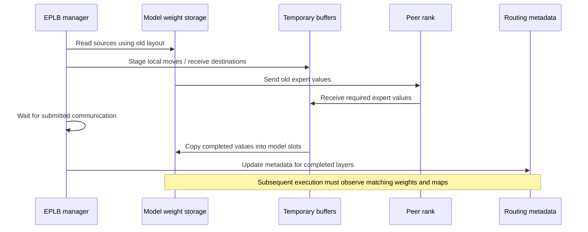
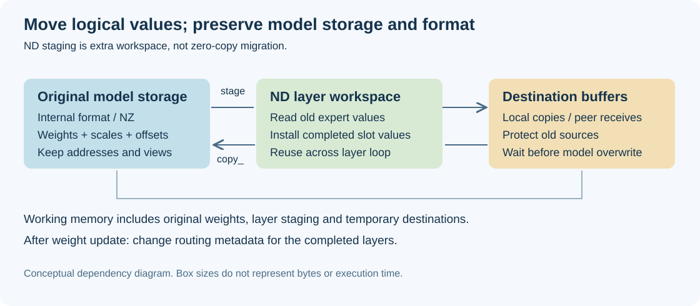

# 静态 EPLB 之后：动态专家负载均衡怎样安全地迁移权重？

> 版本提示：本文记录旧 ND 中转路径及其问题。后续实现改用[原权重物理字节视图](../performance/ascend-eplb-physical-storage-migration.md)，阅读当前方案请接着看该文。

静态 EPLB 在加载模型时安排专家的位置。动态 EPLB 得在服务运行中搬动权重：原来放在 rank 0 的专家，下一轮可能改放 rank 1，空出的槽位再交给别的专家。

难点在切换顺序。新路由先启用，可能把 token 送到还装着旧专家的槽位；旧槽位先覆盖，又可能破坏尚未发完的源数据。这两种错误都不一定让服务立即退出，却会让后续计算用错权重。

这篇接着[场景静态 EPLB](../performance/ascend-910c-prefill-scenario-static-eplb.md)往下看，沿一次更新追踪负载计数、权重迁移和路由生效。源码固定为 AkiYangDev/sglang @ 70d8a7a43b52826377618efa618730d4634fb9ac，对应社区 [PR #46233](https://github.com/sgl-project/sglang/pull/46233) 的公开快照，查阅时尚未合并。这里使用固定 EP 拓扑，Elastic EP 扩缩容、故障恢复和任意后台热更新不在这条流程内。[源码与验证范围摘录](../../assets/ascend-dynamic-eplb-weight-migration/evidence.json)保留了相关材料。

## 一、专家身份没有变，变的是物理槽位

Router 选择逻辑专家，设备槽位存放它的物理副本。动态迁移改的是后者的位置。

把模型缩小到 A、B、C、D 四个逻辑专家，两张设备各放两个槽位，交换 B、C 就能看清整个过程：

| 位置 | 旧布局 | 新布局 |
| --- | --- | --- |
| rank 0 / slot 0 | A | A |
| rank 0 / slot 1 | B | C |
| rank 1 / slot 0 | C | B |
| rank 1 / slot 1 | D | D |

交换之后，Router 仍然根据模型选择 B 或 C，dispatch 再查新布局找到权重。增加冗余槽位也遵循这个关系：增加的是副本，同一个逻辑专家的身份不变。

`physical_to_logical_map` 记录槽位里的专家，反向映射列出每位专家的可用物理位置。CPU 副本、有效副本数、按 rank 分发的映射也要随之更新，具体字段在 [ExpertLocationMetadata](https://github.com/AkiYangDev/sglang/blob/70d8a7a43b52826377618efa618730d4634fb9ac/python/sglang/srt/eplb/expert_location.py#L312-L340) 中。

`ep_dispatch_algorithm=static` 决定怎样使用当前 dispatch map，`--enable-eplb` 则让管理器根据负载重算布局，二者可以同时开启。后面的单机 OFF/ON 对照保留了相同 static dispatch 和冗余预算，只切换 EPLB。

在图中的交换里，rank 0 要先拿到完整的 C，rank 1 先拿到完整的 B，再让后续分发使用新映射。A、D 虽然没搬，也需要保住原值，尤其要防止整块存储复制波及它们。

## 二、先知道谁真的忙，才能决定搬谁

布局规划用的是逻辑专家负载。物理 slot 3 搬完后可能住进另一位专家，它的旧计数必须先归回当时的逻辑身份。

实现先统计有效 TopK 的物理专家选择，按当前布局合并成逻辑专家计数，再在参与进程间求和。Ascend 适配随后调用社区 `rebalance_experts()`，由逻辑负载、槽位预算和拓扑生成新布局。对应代码是[计数转换与归约](https://github.com/AkiYangDev/sglang/blob/70d8a7a43b52826377618efa618730d4634fb9ac/python/sglang/srt/eplb/expert_distribution.py#L1042-L1064)和[规划入口](https://github.com/AkiYangDev/sglang/blob/70d8a7a43b52826377618efa618730d4634fb9ac/python/sglang/srt/eplb/expert_location.py#L175-L223)。

采集时排除图捕获补齐行，并按 shared expert 规则处理，才能得到 routed expert 的真实计数。Draft、Target 可能共用进程级 recorder，管理器却只迁移 Target 权重；[Draft 隔离上下文](https://github.com/AkiYangDev/sglang/blob/70d8a7a43b52826377618efa618730d4634fb9ac/python/sglang/srt/model_executor/model_runner.py#L1603-L1615)因此阻止 Draft 写入 Target 的计数 buffer。

逐层做统计也有开销。适配里的 `BatchedTopKStatisticsMixin` 把各层 route 先写进预分配 buffer，再集中计数；容量不足或同层调用次数超出边界时，退回原精确计数，保留全部 route。Graph warmup/capture 还可能绕过普通 reset，因此完整捕获 forward 开始时要重置 Python 写入偏移，设备 buffer 的地址则继续保持稳定。[实现](https://github.com/AkiYangDev/sglang/blob/70d8a7a43b52826377618efa618730d4634fb9ac/python/sglang/srt/eplb/npu_statistics.py#L24-L67)给出了这两部分处理。

副本个数和物理位置如何从负载中算出来，可以继续看[16 个冗余专家分配实例](eplb-redundant-expert-allocation.md)。

这套计数能回答“路由分布是否更均匀”。日志里的 balancedness 也建立在分发计数上；NPU 实际执行多久、吞吐是否提高，还要看后面的性能测量。

## 三、先搬完整的专家数据，再覆盖模型槽位

回到 B、C 交换：rank 0 发 B、收 C，rank 1 发 C、收 B。如果 rank 0 直接把 C 接收到 B 的模型槽位，而发送还在读取 B，对端就可能收到被覆盖后的数据。

本地交换也有同样的问题。把 `[A, B]` 改成 `[B, A]`，第一步若直接 `slot0 ← slot1`，A 就没了，后一步已无源值可用。

Updater 因此先为接收目标准备临时 buffer。每层先分析需求、建立发送操作、完成通信，最后才写回模型。来源从旧布局中查找：未变槽位直接跳过；本设备有副本就本地复制；同 rank 要新增多个副本时，可以复用已接收结果；其余再选同机或跨机来源。这些分支都在[单层入口与接收分支](https://github.com/AkiYangDev/sglang/blob/70d8a7a43b52826377618efa618730d4634fb9ac/python/sglang/srt/eplb/expert_location_updater.py#L246-L427)中。

图里的箭头对应执行依赖。通信返回 Work 后，代码还要 `wait()`，随后才做接收回填和 buffer-to-weight 复制；Python 已创建 `isend/irecv` 时，目标权重还未必可读。[通信与回填](https://github.com/AkiYangDev/sglang/blob/70d8a7a43b52826377618efa618730d4634fb9ac/python/sglang/srt/eplb/expert_location_updater.py#L549-L582)可以看到具体先后顺序。

一个专家也不止两块矩阵。W8A8 后处理后的 routed expert 包含 `w13`、`w2` 及其 scale、offset，共六张量，都要沿专家维度一起搬。矩阵来自 B、scale 却留着 C，形状完全正确也会算错。[迁移检查脚本](https://github.com/AkiYangDev/sglang/blob/70d8a7a43b52826377618efa618730d4634fb9ac/test/manual/ep/test_eplb_weight_migration.py#L53-L129)通过真实后处理和注册接口构造这组数据，并区分 routed view、完整存储、fused shared 区域；它是逐值检查的入口，目前没有覆盖所有模型和所有层。

## 四、Ascend 的特殊之处：逻辑切片不等于可直接传输的存储

在连续张量上，`weights[expert_id]` 看起来就是一个专家的数据。Ascend 内部格式还有一层底层存储关系，逻辑切片的大小并不等于实际传输或复制范围。

例如 NZ view 的逻辑形状只含一个专家，backing storage 却仍可能属于整层。本次适配直接操作这类 view 时，遇到了 offset view 的通信限制；某些 NZ-to-NZ 切片复制还可能作用于整个 backing storage，把旁边未迁移的槽位一起改掉。只核对 shape 看不出这种问题。

解决路径先将内部格式权重整层复制到普通 ND 工作区，在 ND 上迁移各槽位，再用 `copy_` 写回原模型张量。P2P 仍保留必要的内部格式 staging。[ND buffer、逐层复用与写回](https://github.com/AkiYangDev/sglang/blob/70d8a7a43b52826377618efa618730d4634fb9ac/python/sglang/srt/eplb/expert_location_updater.py#L135-L243)展示了工作区建立、跨层复用和回填过程。

写回沿用原 Parameter 的存储和内部格式，让已有 view、Graph 仍能引用原地址；映射张量也原位更新。地址稳定解决了引用失效的问题，设备何时读到新内容则由执行顺序保证。

这条路径同时占用原权重、ND 层工作区和接收临时 buffer。一次更新按样本层建立兼容工作区，再在待更新层之间复用，避免为每层长期留一份，也减少反复物化整层存储。格式转换和复制的内存、带宽成本仍然存在。

通信也有一份专用资源。固定快照中，NPU 的 `get_eplb_device_group()` 沿用 WORLD 成员，新建并缓存 HCCL group，设置 `hccl_buffer_size=32` MiB、host expansion，隔离前向通信的设备展开资源和较大 MoE buffer 配置。[组创建代码](https://github.com/AkiYangDev/sglang/blob/70d8a7a43b52826377618efa618730d4634fb9ac/python/sglang/srt/eplb/comm_utils.py#L15-L36)里的 32 MiB 只是一项通信配置，不能当成整次迁移的内存开销。

## 五、什么时候让新路由生效？

权重就位后，`ExpertLocationUpdater.update()` 才调用旧 metadata 对象的 `update()`，原位修改本次选中层的双向映射。已经更新的层使用新权重、新映射，其他层继续使用旧状态。[Updater 的提交顺序](https://github.com/AkiYangDev/sglang/blob/70d8a7a43b52826377618efa618730d4634fb9ac/python/sglang/srt/eplb/expert_location_updater.py#L38-L81)把这个先后关系写在同一条路径里。

调用发生在 forward 尾部。`ModelRunner` 推进 EPLB manager，达到约定迭代数后，manager 读取统计、规划、更新。默认不分层分块时，重平衡前后都同步设备；分层更新的 generator 则在不同推进边界处理层块，不能把它看成全模型同时切换。入口分别在[forward 尾部](https://github.com/AkiYangDev/sglang/blob/70d8a7a43b52826377618efa618730d4634fb9ac/python/sglang/srt/model_executor/model_runner.py#L1905-L1907)和[manager 更新循环](https://github.com/AkiYangDev/sglang/blob/70d8a7a43b52826377618efa618730d4634fb9ac/python/sglang/srt/eplb/eplb_manager.py#L145-L222)。

所以“服务运行中迁移”仍然受执行边界约束。当前流程依赖设备顺序、通信等待和逐层 metadata 提交；若改成异步迁移流、并发执行器或双版本权重，必须重新安排读写依赖，原位 `copy_` 本身不能解决并发。

各 rank 还必须拿到一致计划，让发送接收配对。单层操作按逻辑专家编号组织，并按相同编号区间提交批次。本地没有 token 的 rank 仍可能需要参加归约和更新；改成 EP 子组时，也要重新核对 WORLD 编号、成员和映射假设。

正常流程的顺序成立，并不提供失败后的自动回滚：部分层已写入新值、后续通信再失败，旧 metadata 也恢复不了被覆盖的权重。Elastic EP 的缺失专家恢复另有条件，不能直接挪来当作通用保证。

## 六、验证要覆盖数据、地址和执行窗口

日志出现“rebalance end”，只能确认执行到了那里。要验证迁移，还得看到布局变化、目标槽位的正确值、未变槽位的原值，以及接下来真正使用新状态的模型执行。

公开材料分成三类：

| 范围 | 已有证据 | 证明边界 |
| --- | --- | --- |
| 固定社区移植快照的 CPU 检查 | 8 组、39 项：计数、Draft 隔离、阈值、通信组复用、W8A8 注册、首次周期等 | mock 与 CPU 逻辑通过，不代表实机吞吐 |
| 同次移植的 NPU 计数探针 | 8 个 replay 场景与独立整数 oracle 相等，2 个 eager overflow 场景不丢计数，buffer 指针稳定 | 使用真实 capture 回调及 model/attention stub，不是完整模型迁移性能 |
| 较早集成版本的模型与 PD | 单机 16/16 复制检查；PD 两臂共 192 条计划请求成功、64 对正式输出一致，ON 窗口 P/D 各 rank 有真实布局更新 | 固定源版本的功能覆盖，不是完整任务精度或社区新基线的重测 |

[社区移植报告](https://github.com/AkiYangDev/sglang/blob/70d8a7a43b52826377618efa618730d4634fb9ac/test/manual/ep/reports/ascend_dynamic_eplb_upstream_20261024.md)与[早期集成报告](https://github.com/chenxu214/ci_sglang/blob/f040177346d5eca8ea38ce8d569444f4a5176206/test/manual/ep/reports/ascend_dynamic_eplb_delivery_20261024.md)各自记录了版本和验证范围，下面使用的都是这些已有结果。

逐值测试需要让专家之间、张量内不同位置之间都有可辨认的值。若所有专家都填同一个常数，B、C 搬反也能通过。未变槽位、shared 区域、量化辅助张量、内部格式和原指针都应检查到，才能覆盖图中这次交换的主要风险。

PD 功能测试中，OFF 的每个 rank 都没有更新；ON 在包含准备请求的统计窗口内，P 每 rank 更新 4 次、D 每 rank 更新 10 次，均有非零布局变化。窗口没有混入启动前或请求结束后的日志。正式输入只有 689–708 token、输出 128，验证的是短请求上的迁移功能；它没有覆盖 16K 长测，复制输出一致也尚不足以评价通用任务精度。

## 七、搬得正确之后，还要偿还迁移成本

动态 EPLB 新增了 route 采集、负载归约、规划、暂存迁移和 metadata 更新，还会占用前向调度时间。迁移后的布局需要在后续请求中省回这些成本。

短测中，第一次学习何时发生尤其关键。本快照只在 NPU、单节点、static dispatch、trivial 初始布局、关闭 Elastic EP 等条件下，把首周期缩到 64 次推进；之后恢复配置周期，并要求重平衡间隔不小于统计窗口。[首次周期与窗口约束](https://github.com/AkiYangDev/sglang/blob/70d8a7a43b52826377618efa618730d4634fb9ac/python/sglang/srt/eplb/eplb_manager.py#L49-L95)列出了条件。首次短窗口可依赖未写区域初始为零，因为此时尚未换过多套布局；后续若残留旧布局的物理计数，新映射就可能把负载归给错误专家。

较早的冻结集成版本做过单节点复制负载对照：Ascend 910C、DeepSeek-V4-Flash W8A8，16 个逻辑设备，TP/EP/attention-DP=16、DP1。N320/C128、目标 6 req/s，实际输入 16388、输出 1024、cache 0%，关闭 DSpark/Compact。每臂都用新进程和 trivial 布局，源码、环境相同，只改 EPLB 开关。

| 执行顺序 | whole 输出总吞吐（token/s） | TTFT 平均（s） | TPOT 平均（ms） | E2E 平均（s） |
| --- | ---: | ---: | ---: | ---: |
| 第一次 ON | 1397.65 | 19.79 | 55.10 | 76.19 |
| 全新 OFF | 1311.01 | 25.62 | 55.80 | 82.67 |
| 全新 ON | 1385.85 | 20.45 | 55.20 | 76.90 |

三轮各有 320 个成功请求、0 失败，两轮 ON 的吞吐分别比 OFF 高约 6.61%、5.71%。这是固定负载复核，没有置信区间，也没有重测当前社区移植版。表里使用整机总吞吐；这次关闭投机，AL 和严格草稿接受率不适用，卡数也不能套用其他 P8+D8 场景的 PD16 分母。

两边正式请求前都先发 16 条准备请求，各输出 64 token。ON 可能已经在这段时间学习并迁移，正式测试开始时的布局因此未必与 OFF 相同。这组对照衡量整套适配策略，而非固定新布局的纯前向速度。准备加正式时间降低约 3.17%，范围里仍没有加载、AIS 初始化和编排收集。

PD 的已有结果更不稳定：早期版本正序比较约 +7.39%，反序约 −7.35%；后来的短功能测试刻意提高迁移频率，准备加正式窗口为 OFF 31.867 秒、ON 36.623 秒。PD 能真正搬动专家已经得到验证，当前材料却还不足以证明它有稳定净收益。单机上的正向结果也不能直接替代 PD 测量。

更新周期决定这笔成本何时发生、由多少后续请求分摊。周期太短可能只学到少量样本，太长又可能让整段短负载都来不及换布局。迁移次数、字节数和路由均衡度用来解释原因，是否保持开启则要由相同口径下的服务耗时决定。

迁移过程中还有一个显存问题：即使 Python 逐层提交，异步执行也可能让多层临时存储积压。后续[显存优化一文](../performance/ascend-eplb-memory-bounded-staging.md)用完成事件和分配记录继续追踪这段生命周期。

[返回 EPLB 专题](eplb-study-guide.md)。
