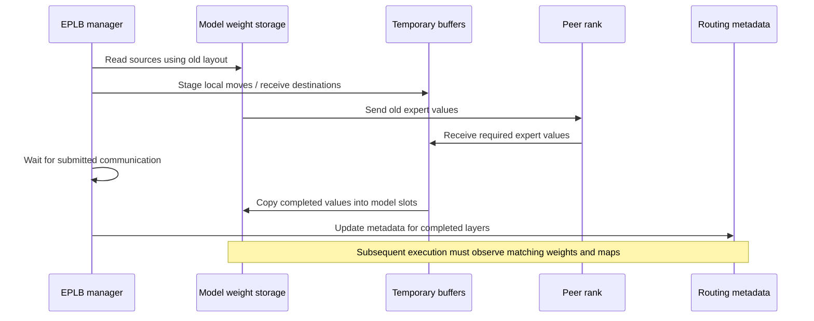

# 静态 EPLB 之后：动态专家负载均衡怎样安全地迁移权重？

静态专家布局在加载模型时确定权重位置。动态 EPLB 则需要在服务运行中改动布局：某个专家原在 rank 0，更新后可能放到 rank 1，原槽位也可能交给另一位专家。

切换时，权重和路由必须对应。如果路由先指向新槽位，而槽位仍装着旧专家，服务可能继续输出错误结果。如果过早覆盖旧槽位，又可能破坏尚未发送的源权重。因此需要先说明迁移怎样保持模型语义，再讨论均衡收益。

本文接着[场景静态 EPLB](../performance/ascend-910c-prefill-scenario-static-eplb.md)，解释一次 Ascend 动态适配中的负载计数、权重迁移和路由更新。源码固定为 AkiYangDev/sglang @ 70d8a7a43b52826377618efa618730d4634fb9ac，是社区 [PR #46233](https://github.com/sgl-project/sglang/pull/46233) 的公开快照，查阅时尚未合并。讨论范围限于固定 EP 拓扑，不包含 Elastic EP 扩缩容、故障恢复或任意后台热更新。对应材料保存在[源码与验证范围摘录](../../assets/ascend-dynamic-eplb-weight-migration/evidence.json)。

## 一、专家身份没有变，变的是物理槽位

Router 选的是逻辑专家，设备上存放的则是该专家的物理副本。迁移首先要区分这两个对象。

用一个缩小的教学例子说明：一层有 A、B、C、D 四个逻辑专家，两张设备各有两个槽位，现在要交换 B、C 的位置。

| 位置 | 旧布局 | 新布局 |
| --- | --- | --- |
| rank 0 / slot 0 | A | A |
| rank 0 / slot 1 | B | C |
| rank 1 / slot 0 | C | B |
| rank 1 / slot 1 | D | D |

Router 仍按模型计算选择 B 或 C，分发阶段才根据新布局找到相应权重。若设置冗余专家，同一逻辑专家可以有多个物理副本，模型中的专家身份并未因此增加。

`physical_to_logical_map` 记录每个槽位对应的逻辑专家，反向映射记录一个逻辑专家可用的物理位置。运行时还维护 CPU 副本、有效副本数和按 rank 分发的映射。迁移后这些字段必须一起更新，[ExpertLocationMetadata](https://github.com/AkiYangDev/sglang/blob/70d8a7a43b52826377618efa618730d4634fb9ac/python/sglang/srt/eplb/expert_location.py#L312-L340)列出了具体字段。

配置中的 `ep_dispatch_algorithm=static` 描述如何使用当前 dispatch map，而 `--enable-eplb` 决定是否根据负载重算并更新布局。两者可以同时启用。已有单机 OFF/ON 对照保留相同 static dispatch 和冗余预算，只切换 EPLB 开关。

在上述例子中，rank 0、rank 1 应先分别拿到 C、B 的完整权重，后续分发再使用新映射。A、D 保持原位，整块存储复制时也不能破坏这两个未迁移槽位。

## 二、先知道谁真的忙，才能决定搬谁

规划器需要知道逻辑专家的负载。物理 slot 3 可能在本次迁移后换成另一位专家，不能把它的历史计数永久归给原主人。

该实现先根据有效 TopK 选择统计物理专家，再按当前布局合并为逻辑专家计数，并在参与进程间求和。社区 `rebalance_experts()` 随后结合逻辑负载、槽位预算和拓扑规划布局，Ascend 适配沿用这一算法。代码分别见[计数转换与归约](https://github.com/AkiYangDev/sglang/blob/70d8a7a43b52826377618efa618730d4634fb9ac/python/sglang/srt/eplb/expert_distribution.py#L1042-L1064)及[规划入口](https://github.com/AkiYangDev/sglang/blob/70d8a7a43b52826377618efa618730d4634fb9ac/python/sglang/srt/eplb/expert_location.py#L175-L223)。

这里需要排除图捕获补齐行，并按 shared expert 的规则处理，避免将它们算作普通 routed expert 负载。Draft、Target 还可能共用进程级 recorder，但管理器迁移的是 Target 权重，因此 Draft 不能写入 Target 计数 buffer。[Draft 隔离上下文](https://github.com/AkiYangDev/sglang/blob/70d8a7a43b52826377618efa618730d4634fb9ac/python/sglang/srt/model_executor/model_runner.py#L1603-L1615)处理了这个边界。

为了降低统计成本，适配中的 `BatchedTopKStatisticsMixin` 先将各层 route 写到预分配 buffer，再集中计数。容量不足或同层调用次数超出边界时，会回到原精确计数，保留全部 route。Graph warmup/capture 可能绕过普通运行时 reset，所以完整捕获 forward 开始时，还要重新设置 Python 写入偏移，同时保持设备 buffer 地址稳定，详见[实现](https://github.com/AkiYangDev/sglang/blob/70d8a7a43b52826377618efa618730d4634fb9ac/python/sglang/srt/eplb/npu_statistics.py#L24-L67)。

副本数量与物理放置的完整算法，可结合[16 个冗余专家分配实例](eplb-redundant-expert-allocation.md)逐步核对。

这些步骤提供了是否迁移、如何迁移的依据。日志中的 balancedness 同样来自分发计数估计，不能直接解释为 NPU 计算利用率；分布更均匀之后，是否提高吞吐还需测量。

## 三、先搬完整的专家数据，再覆盖模型槽位

回到 B、C 交换。rank 0 发送 B、接收 C，rank 1 正好相反。如果接收 C 时直接覆盖 B 的模型槽位，而发送尚未读完 B，对端可能收到 C 的数据。

同设备交换也会丢失源值。将 `[A, B]` 改为 `[B, A]`，若先做 `slot0 ← slot1`，A 就被覆盖了，因此必须先保存后续还要用的源数据。

Updater 为接收目标准备临时 buffer。单层先分析接收需求、创建发送操作并完成通信，再写回模型权重。它按旧布局寻找来源，跳过未变化槽位；本设备有副本时本地复制，同 rank 需要多个新副本时可复用已接收结果，否则选择同机或跨机来源。[单层入口与接收分支](https://github.com/AkiYangDev/sglang/blob/70d8a7a43b52826377618efa618730d4634fb9ac/python/sglang/srt/eplb/expert_location_updater.py#L246-L427)保留了这些路径。

图示仅描述执行依赖，没有提供自动回滚的分布式事务。实现会对通信 Work 调用 `wait()`，之后才接收回填、执行 buffer-to-weight 复制，不能将 Python 创建 `isend/irecv` 当作权重已可用。[通信与回填](https://github.com/AkiYangDev/sglang/blob/70d8a7a43b52826377618efa618730d4634fb9ac/python/sglang/srt/eplb/expert_location_updater.py#L549-L582)中可核对这段顺序。

迁移还需覆盖专家的全部相关数据。W8A8 后处理后的 routed expert 包含 `w13`、`w2` 及其 scale、offset，均需按专家维度一起搬移。若矩阵来自 B、scale 却留着 C，即使形状相同，计算也已错误。[迁移检查脚本](https://github.com/AkiYangDev/sglang/blob/70d8a7a43b52826377618efa618730d4634fb9ac/test/manual/ep/test_eplb_weight_migration.py#L53-L129)通过真实后处理和注册接口构造这组六张量，并区分 routed view、完整存储与 fused shared 区域。脚本提供了检查入口，并不表示所有模型和层都已完成逐值导出验收。

## 四、Ascend 的特殊之处：逻辑切片不等于可直接传输的存储

连续张量上的 `weights[expert_id]` 容易被看作一段可独立传输的数据。但 Ascend 内部格式还要检查底层存储，逻辑切片不足以说明实际复制范围。

NZ 等格式同时具有逻辑形状和 backing storage。一个只包含某个专家的 view，底层仍可能引用整层存储。本次适配中，直接通信或转换这类 view，会遇到 offset view 传输限制；某些 NZ-to-NZ 切片复制还可能作用到整个 backing storage，影响旁边没有迁移的槽位。因此检查 shape 之外，还需确认复制实际触及哪里。

该路径先准备普通 ND buffer，用逻辑值复制跨越格式边界。内部格式权重先整层复制到 ND 工作区，在 ND 上完成槽位迁移，再用 `copy_` 写回原模型张量；P2P 仍保留必要的内部格式 staging。核心代码见[ND buffer、逐层复用与写回](https://github.com/AkiYangDev/sglang/blob/70d8a7a43b52826377618efa618730d4634fb9ac/python/sglang/srt/eplb/expert_location_updater.py#L135-L243)。

写回保留原 Parameter 存储和内部格式，也保留已有 view 与 Graph 可能引用的地址，映射张量同样原位更新。指针不变只能满足其中一项条件；内容和设备执行顺序仍需核对，不能由地址稳定推断并发读写安全。

内部格式路径会同时保有原权重、ND 层工作区和目标临时 buffer。一次更新中，代码按样本层建立兼容工作区，再跨待更新层复用，避免每层保留独立副本，也减少发送切片时反复物化整层存储。但格式转换和复制仍消耗内存与带宽，这套迁移没有实现零拷贝。

固定快照中，NPU 的 `get_eplb_device_group()` 使用原 WORLD 成员，新建并缓存专用 HCCL group，设 `hccl_buffer_size=32` MiB、host expansion，以隔离前向通信的设备展开资源和较大 MoE buffer 配置。[组创建代码](https://github.com/AkiYangDev/sglang/blob/70d8a7a43b52826377618efa618730d4634fb9ac/python/sglang/srt/eplb/comm_utils.py#L15-L36)中的隔离只针对通信资源；成员仍有约束，迁移总内存也远不止 32 MiB。

## 五、什么时候让新路由生效？

`ExpertLocationUpdater.update()` 先更新权重，再调用旧 metadata 对象的 `update()`，只修改本次选中层的物理到逻辑、逻辑到物理等映射。这样，完成更新的层使用匹配的新权重和映射，其他层仍保留旧状态。[Updater 的提交顺序](https://github.com/AkiYangDev/sglang/blob/70d8a7a43b52826377618efa618730d4634fb9ac/python/sglang/srt/eplb/expert_location_updater.py#L38-L81)中可直接核对。

调用位置在 forward 尾部：`ModelRunner` 推进 EPLB manager，manager 达到约定迭代数后读取统计、规划并更新。默认不分层分块的路径会在重平衡前后同步设备；启用分层更新时，generator 在不同推进边界处理层块，因此不构成一次全模型原子切换。执行入口见[forward 尾部](https://github.com/AkiYangDev/sglang/blob/70d8a7a43b52826377618efa618730d4634fb9ac/python/sglang/srt/model_executor/model_runner.py#L1905-L1907)与[manager 更新循环](https://github.com/AkiYangDev/sglang/blob/70d8a7a43b52826377618efa618730d4634fb9ac/python/sglang/srt/eplb/eplb_manager.py#L145-L222)。

服务保持运行，并不意味着后台线程可以任意改写 Kernel 正在读取的权重。当前正确性依赖模型执行边界、设备顺序、通信等待及逐层 metadata 提交。增加异步迁移流、并发执行器或双版本权重后，必须重新检查读写依赖，仅保留原位 `copy_` 不足以沿用结论。

所有 rank 还需使用一致计划，配对发送和接收。单层操作按逻辑专家编号组织，并按相同编号区间提交批次；本地没有 token 的 rank，仍可能必须参加统计归约和更新。改用 EP 子组之前，也要核对原 WORLD 编号、成员及映射假设。

原位更新没有通用的失败原子性。如果部分层已写入新值，后续通信才失败，旧 metadata 无法恢复被覆盖的权重。Elastic EP 的缺失专家恢复有独立条件，不能用作任意异常的自动回滚保证。正常迁移的输出一致性和中途硬件失败的可恢复性，需要分别验证。

## 六、验证要覆盖数据、地址和执行窗口

“rebalance end”只能说明流程走到日志位置。还需确认布局真正改变、目标槽位收到正确专家、未改槽位保持完整，并由后续模型执行读取新状态。

公开材料对应以下三种验证范围：

| 范围 | 已有证据 | 证明边界 |
| --- | --- | --- |
| 固定社区移植快照的 CPU 检查 | 8 组、39 项：计数、Draft 隔离、阈值、通信组复用、W8A8 注册、首次周期等 | mock 与 CPU 逻辑通过，不代表实机吞吐 |
| 同次移植的 NPU 计数探针 | 8 个 replay 场景与独立整数 oracle 相等，2 个 eager overflow 场景不丢计数，buffer 指针稳定 | 使用真实 capture 回调及 model/attention stub，不是完整模型迁移性能 |
| 较早集成版本的模型与 PD | 单机 16/16 复制检查；PD 两臂共 192 条计划请求成功、64 对正式输出一致，ON 窗口 P/D 各 rank 有真实布局更新 | 固定源版本的功能覆盖，不是完整任务精度或社区新基线的重测 |

[社区移植报告](https://github.com/AkiYangDev/sglang/blob/70d8a7a43b52826377618efa618730d4634fb9ac/test/manual/ep/reports/ascend_dynamic_eplb_upstream_20261024.md)和[早期集成报告](https://github.com/chenxu214/ci_sglang/blob/f040177346d5eca8ea38ce8d569444f4a5176206/test/manual/ep/reports/ascend_dynamic_eplb_delivery_20261024.md)分别记录版本和验证范围。本文使用已有结果，没有新发验证请求。

检查迁移数值时，构造值要能区分专家与张量内位置。所有专家都填相同常数，即使 B、C 搬反也可能通过。检查还应包含未变槽位、shared 区域、量化辅助张量、格式与原指针；发送接收没有报错，只是最低条件。

PD 功能测试的请求窗口也需明确。OFF 每个 rank 都没有更新；ON 在包含准备请求的窗口中，P 每 rank 更新 4 次、D 每 rank 更新 10 次，均记录到非零布局变化。统计未混入启动前或请求结束后的日志。正式输入只有 689–708 token、输出 128，不能作为 16K 长测；复制输出一致，也不能代替通用任务精度评估。

## 七、搬得正确之后，还要偿还迁移成本

开启动态 EPLB 后，route 采集、负载归约、布局计算、权重暂存迁移和 metadata 更新都会增加成本，也会影响前向调度。后续计算减少的等待时间覆盖这些开销后，才形成净收益。

首次学习对短测尤其重要。本快照只在 NPU、单节点、static dispatch、trivial 初始布局且关闭 Elastic EP 等条件下，将首周期缩到 64 次推进；之后恢复配置周期，并要求重平衡间隔不小于统计窗口。条件见[首次周期与窗口约束](https://github.com/AkiYangDev/sglang/blob/70d8a7a43b52826377618efa618730d4634fb9ac/python/sglang/srt/eplb/eplb_manager.py#L49-L95)。首次短窗口依赖未写区域初始为零，且尚未经过多套布局。后续若让旧布局物理计数残留，新映射可能将它解释成另一位专家的负载。

较早的冻结集成版本曾做过单节点复制负载对照：Ascend 910C、DeepSeek-V4-Flash W8A8，16 个逻辑设备，TP/EP/attention-DP=16、DP1；N320/C128、目标 6 req/s，实际输入 16388、输出 1024，cache 0%，关闭 DSpark/Compact。每臂使用新进程和 trivial 布局，源码与环境一致，仅改变 EPLB 开关。

| 执行顺序 | whole 输出总吞吐（token/s） | TTFT 平均（s） | TPOT 平均（ms） | E2E 平均（s） |
| --- | ---: | ---: | ---: | ---: |
| 第一次 ON | 1397.65 | 19.79 | 55.10 | 76.19 |
| 全新 OFF | 1311.01 | 25.62 | 55.80 | 82.67 |
| 全新 ON | 1385.85 | 20.45 | 55.20 | 76.90 |

三轮均有 320 个成功请求、0 失败，两轮 ON 相对 OFF 的吞吐分别提高约 6.61%、5.71%。这是固定负载复核，没有置信区间，也未重测当前社区移植版。表中为整机总吞吐，不按其他 P8+D8 场景的 PD16 物理卡数折算。此次关闭投机，AL 和严格草稿接受率不适用。

每臂均先做相同的 16 条准备请求，各输出 64 token。ON 可能在准备期间就学习并迁移，因此正式测试起点的布局未必与 OFF 相同。结果评价的是整套适配策略，无法隔离固定新布局的纯计算速度。准备加正式时间降低约 3.17%，这个时间范围仍未包含加载、AIS 初始化和编排收集。

PD 记录则没有给出一致的净收益。早期版本按正序比较约为 +7.39%，反序约为 −7.35%；后来的短功能测试刻意提高迁移频率，准备加正式窗口分别为 OFF 31.867 秒、ON 36.623 秒。这些结果证明 PD 能执行真实迁移，尚不能证明迁移划算。单机正向结果也无法替代不同版本、不同场景的测量。

选择更新周期时，需要按同一口径比较后续前向节省与新增统计、规划、迁移成本，还要考虑负载在此期间的变化。过早更新可能样本不足，过晚则可能让短负载始终使用初始布局。迁移次数、字节数和路由均衡度能解释局部开销，最终仍需核对服务耗时。

实际检查可以先确认一次更新后，权重、量化辅助数据、物理槽位与路由是否在指定边界重新对应；再测新布局给后续负载节省多少时间。确认功能正确之后，才能用成本与收益决定是否保持开启。

后续[显存优化一文](../performance/ascend-eplb-memory-bounded-staging.md)继续追踪迁移临时张量：逐层提交仍可能因异步执行积压多层存储，完成事件和分配记录用于解释这项修复。
