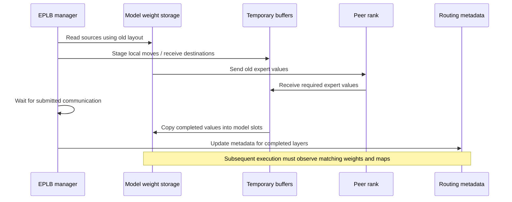
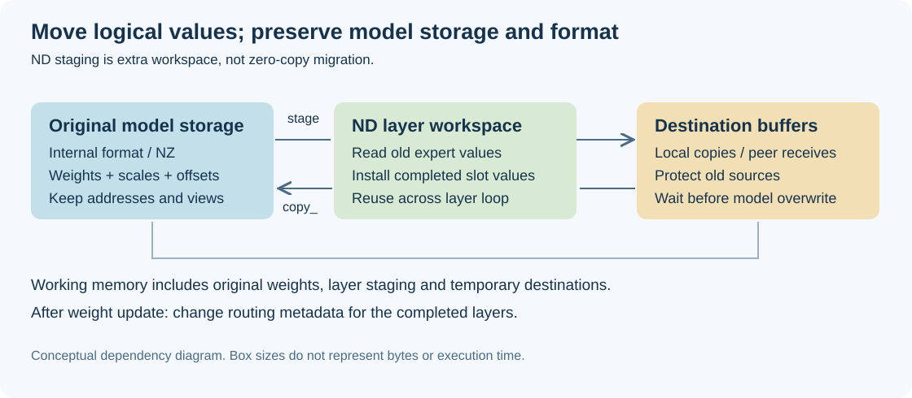

# 静态 EPLB 之后：动态专家负载均衡怎样安全地迁移权重？

一份静态专家布局，可以在模型加载时把权重放进对应位置。动态 EPLB 则要在服务运行期间改变这个位置：前一轮还在 rank 0 的专家，后一轮可能需要出现在 rank 1，原来的槽位也可能被别的专家接管。

真正困难的地方出现在切换中间。如果路由已经指向新位置，那里却还是旧专家的权重，服务可能继续返回结果，却算了另一套模型。如果先覆盖旧位置，又可能把稍后还要发送的源权重毁掉。动态均衡能否成立，先取决于这段迁移能否保持模型语义。

这篇承接[场景静态 EPLB](../performance/ascend-910c-prefill-scenario-static-eplb.md)，沿一次 Ascend 动态适配解释从计数到权重、再到路由的更新过程。源码固定为 AkiYangDev/sglang @ 70d8a7a43b52826377618efa618730d4634fb9ac，对应社区 [PR #46233](https://github.com/sgl-project/sglang/pull/46233) 的一个公开快照；查阅时 PR 尚未合并。重点是固定 EP 拓扑下的迁移，不把 Elastic EP 扩缩容、故障恢复和任意后台热更新混在一起。[源码与验证范围摘录](../../assets/ascend-dynamic-eplb-weight-migration/evidence.json)随文保存。

## 一、专家身份没有变，变的是物理槽位

先把 Router 选择的逻辑专家，与设备上存放权重的物理位置分开。

假设一层有 A、B、C、D 四个逻辑专家，两张设备各放两个槽位。旧布局与目标布局如下，这是用于讲解的缩小示例：

| 位置 | 旧布局 | 新布局 |
| --- | --- | --- |
| rank 0 / slot 0 | A | A |
| rank 0 / slot 1 | B | C |
| rank 1 / slot 0 | C | B |
| rank 1 / slot 1 | D | D |

Router 仍然根据模型计算选择 B 或 C。变化发生在后面的分发：B 应该被送到哪里，那个位置装的是不是 B 的权重。增加冗余专家时，一个逻辑专家还可能对应多个物理副本，它们不是新训练出的专家。

代码通过 `physical_to_logical_map` 描述“某槽位装着哪个专家”，通过逻辑到物理的映射描述“一个逻辑专家有哪些可用位置”。它还维护 CPU 副本、有效副本数和按 rank 分发的映射。迁移不能只改一张打印出来的表，其余运行时映射也必须跟着更新。[ExpertLocationMetadata](https://github.com/AkiYangDev/sglang/blob/70d8a7a43b52826377618efa618730d4634fb9ac/python/sglang/srt/eplb/expert_location.py#L312-L340)列出了这些更新字段。

这里还有一个容易误解的配置名：`ep_dispatch_algorithm=static` 不等于关闭动态 EPLB。前者描述如何使用当前 dispatch map，`--enable-eplb` 控制是否根据观测重算并更新这份布局。已有单机 OFF/ON 实验正是在相同 static dispatch 和冗余预算下，只改变 EPLB 开关。

对上面的例子，正确的最终状态是：两个设备分别拿到 C、B 的完整权重，再让后续分发使用新映射。A、D 没有搬迁需求，不能在顺手复制整块存储时把它们改坏。

## 二、先知道谁真的忙，才能决定搬谁

动态规划器需要的是逻辑专家负载。物理槽位会换主人，直接把“slot 3 最近很忙”永久归给同一个专家，会让下一轮规划建立在错误数据上。

这条实现先记录有效的 TopK 分发选择，形成物理专家计数，再按当前布局转换成逻辑专家计数，并在参与进程间求和。规划器复用社区的 `rebalance_experts()`，结合逻辑负载、物理槽位预算和拓扑生成新布局；本次 Ascend 适配没有另外发明一套负载规划算法。[计数转换与归约](https://github.com/AkiYangDev/sglang/blob/70d8a7a43b52826377618efa618730d4634fb9ac/python/sglang/srt/eplb/expert_distribution.py#L1042-L1064)、[规划入口](https://github.com/AkiYangDev/sglang/blob/70d8a7a43b52826377618efa618730d4634fb9ac/python/sglang/srt/eplb/expert_location.py#L175-L223)对应这两步。

“有效”二字决定了统计能不能用于迁移。图捕获可能为 batch 补齐行，shared expert 也有自己的处理规则；这些位置不能误算成正常 routed expert 的负载。Draft 与 Target 又可能共用进程级 recorder，但这个管理器迁移的是 Target 专家权重，Draft 执行不能往 Target 的计数 buffer 里写。[Draft 隔离上下文](https://github.com/AkiYangDev/sglang/blob/70d8a7a43b52826377618efa618730d4634fb9ac/python/sglang/srt/model_executor/model_runner.py#L1603-L1615)为此保留了明确边界。

统计本身也可能很贵。适配中的 `BatchedTopKStatisticsMixin` 先把各层 route 写进预分配 buffer，再集中统计；容量不足或同层重复调用超过边界时，回到原始精确计数，不能为了减少算子而丢掉超出的 route。Graph warmup/capture 还会绕过普通运行时 reset，因此每次完整捕获 forward 开始，都要重新设置 Python 写入偏移，同时保持设备 buffer 的地址稳定。[实现](https://github.com/AkiYangDev/sglang/blob/70d8a7a43b52826377618efa618730d4634fb9ac/python/sglang/srt/eplb/npu_statistics.py#L24-L78)展示了这种区分。

这些工作不直接搬运权重，却决定“该不该搬”和“搬成什么样”。日志里的 balancedness 也来自分发计数的估计，不能把它当作实测 NPU 计算利用率，更不能仅凭分布更均匀就宣称吞吐提高。

## 三、先搬完整的专家数据，再覆盖模型槽位

回到 B、C 交换的例子。rank 0 要把 B 发出去，同时接收 C；rank 1 刚好相反。如果接收 C 时直接覆盖 B 的模型槽位，而发送还没读完 B，就可能把 C 发给原本等待 B 的对端。

本地交换也有同样问题。把 `[A, B]` 改成 `[B, A]` 时，先执行 `slot0 ← slot1` 会丢掉 A。至少要先保存需要的源值，再写目标位置。

当前 Updater 为目标准备临时 buffer。单层处理顺序是：分析接收需求、创建发送操作、执行通信，最后把临时结果写回模型权重。它按旧布局寻找来源，不变的槽位跳过；同设备已有副本时走本地复制，同 rank 需要多个新副本时可以复用已经接收的临时结果，否则选择同机或跨机来源。[单层入口与接收分支](https://github.com/AkiYangDev/sglang/blob/70d8a7a43b52826377618efa618730d4634fb9ac/python/sglang/srt/eplb/expert_location_updater.py#L246-L427)保留了这些不同情况。

图表示有依赖的执行顺序，不表示这是一套带自动回滚的分布式事务。代码对提交的通信 Work 调用 `wait()`，随后执行接收回填和 buffer-to-weight 复制；它不会仅因 Python 已经创建了 `isend/irecv` 就认为权重可用。[通信与回填](https://github.com/AkiYangDev/sglang/blob/70d8a7a43b52826377618efa618730d4634fb9ac/python/sglang/srt/eplb/expert_location_updater.py#L549-L582)是这个依赖的具体落点。

一个专家也不是只有一块矩阵。W8A8 后处理后的 routed expert 数据，需要把 `w13`、`w2` 及对应 scale、offset 一起按专家维度迁移。若矩阵来自 B、scale 却还是 C，即使形状完全匹配，数值语义也已经错了。专门的[迁移检查脚本](https://github.com/AkiYangDev/sglang/blob/70d8a7a43b52826377618efa618730d4634fb9ac/test/manual/ep/test_eplb_weight_migration.py#L53-L129)调用真实后处理与权重注册接口构造这组六张量，并区分 routed view 与完整存储、fused shared 区域。它提供验证入口，不代表所有模型和全部层都已经做过逐值导出验收。

## 四、Ascend 的特殊之处：逻辑切片不等于可直接传输的存储

普通连续张量里，`weights[expert_id]` 很容易被理解成一段独立数据。Ascend 的内部格式让这一步需要更小心。

NZ 等内部格式的张量有物理布局和 backing storage。一个逻辑上只包含某个专家的 view，底层仍可能属于整层权重存储。当前适配所处理的场景中，直接对内部格式的专家 view 做通信或格式转换，会遇到 offset view 的传输限制；某些 NZ-to-NZ 切片复制还可能波及整块 backing storage，影响相邻未迁移的槽位。不能只看到 shape 正确就认定复制范围正确。

因此，这条路径先准备普通 ND buffer，通过逻辑值复制跨过格式边界。对于内部格式的模型权重，外层先将整层数据复制到 ND 工作区，在 ND 上完成槽位迁移，再用 `copy_` 写回原模型张量；P2P 操作还保留了必要的内部格式 staging 处理。[ND buffer、逐层复用与写回](https://github.com/AkiYangDev/sglang/blob/70d8a7a43b52826377618efa618730d4634fb9ac/python/sglang/srt/eplb/expert_location_updater.py#L135-L243)是此次设备适配的核心。

写回使用原存储，而不是给 Parameter 换一个新张量。这样既保留模型需要的内部格式，也保留已有 view 与 Graph 可能依赖的地址。映射更新同样对原有张量做原位赋值。指针稳定是必要条件之一，内容和执行顺序仍然要正确；地址没变，并不自动证明所有并发访问都安全。

工作区也需要记账。在内部格式路径，原模型权重、ND 层工作区和目标临时 buffer 会同时存在。代码在一次更新调用中，按样本层创建兼容的工作区，再跨待更新层循环复用，避免为每层都保留一套副本，也避免每次发送专家切片都反复物化整层存储。它仍然消耗额外内存和复制带宽，不能称为零拷贝迁移。

通信组也做了隔离。NPU 的 `get_eplb_device_group()` 沿用原 WORLD 成员集合，缓存一份单独的 HCCL group，配置 `hccl_buffer_size=32` MiB 和 host expansion，以免直接共享前向通信的设备展开资源及较大的 MoE buffer 配置。[组创建代码](https://github.com/AkiYangDev/sglang/blob/70d8a7a43b52826377618efa618730d4634fb9ac/python/sglang/srt/eplb/comm_utils.py#L15-L38)很短，但这里的“独立”是通信资源隔离，不是成员任意变化，也不是迁移总内存只用 32 MiB。

## 五、什么时候让新路由生效？

`ExpertLocationUpdater.update()` 先调用权重更新，再调用旧 metadata 对象的 `update()`。后者只更新本次指定层的物理到逻辑、逻辑到物理等映射。这个顺序让完成更新的层拥有匹配的权重和映射，其他层继续保持原状态。[Updater 的提交顺序](https://github.com/AkiYangDev/sglang/blob/70d8a7a43b52826377618efa618730d4634fb9ac/python/sglang/srt/eplb/expert_location_updater.py#L38-L81)可以直接核对。

从调用者看，`ModelRunner` 在 forward 尾部推进 EPLB manager；manager 到约定迭代数后读取统计、规划并执行更新。默认不按层分块的这条 manager 路径，在重平衡前后还有设备同步。配置为分层更新时，则通过 generator 在不同推进边界处理层块，不能再把它描述成一次全模型原子切换。[forward 尾部入口](https://github.com/AkiYangDev/sglang/blob/70d8a7a43b52826377618efa618730d4634fb9ac/python/sglang/srt/model_executor/model_runner.py#L1905-L1907)、[manager 更新循环](https://github.com/AkiYangDev/sglang/blob/70d8a7a43b52826377618efa618730d4634fb9ac/python/sglang/srt/eplb/eplb_manager.py#L145-L222)给出了执行位置。

所以，服务进程仍在运行，不意味着迁移可以随时从后台线程改写正在被 Kernel 使用的权重。这套实现依靠模型执行边界、设备操作顺序、通信等待和逐层 metadata 提交。若另外增加异步迁移流、并发执行器或双版本权重，就需要重新证明读写依赖，不能仅保留一次 `copy_` 就沿用结论。

多 rank 之间还必须有一致的更新计划与通信配对。单层发送与接收按逻辑专家编号组织、按相同编号区间提交批次；一个 rank 没有本地 token，不代表它可以跳过协议中要求参与的统计归约或更新。也不能任意把当前 WORLD 换成另一个 EP 子组，而不检查编号、成员与映射的共同假设。

这种原位更新没有提供通用的失败原子性。若某些层已经写入新值，随后通信失败，保留一份旧 metadata 并不等于恢复旧权重。代码中 Elastic EP 的缺失专家恢复另有条件与路径，不能当作任意异常的自动回滚保证。正常迁移的输出一致性，与硬件错误中途发生后的可恢复性，需要分别验收。

## 六、验证要覆盖数据、地址和执行窗口

仅看到“rebalance end”不够。至少要知道布局确实改变过、搬过去的是正确专家、未改槽位没有损坏，以及后续模型执行使用了新状态。

这次公开材料分成三个范围，避免把一次探针扩大成整套服务验收：

| 范围 | 已有证据 | 证明边界 |
| --- | --- | --- |
| 固定社区移植快照的 CPU 检查 | 8 组、39 项：计数、Draft 隔离、阈值、通信组复用、W8A8 注册、首次周期等 | mock 与 CPU 逻辑通过，不代表实机吞吐 |
| 同次移植的 NPU 计数探针 | 8 个 replay 场景与独立整数 oracle 相等，2 个 eager overflow 场景不丢计数，buffer 指针稳定 | 使用真实 capture 回调及 model/attention stub，不是完整模型迁移性能 |
| 较早集成版本的模型与 PD | 单机 16/16 复制检查；PD 两臂共 192 条计划请求成功、64 对正式输出一致，ON 窗口 P/D 各 rank 有真实布局更新 | 固定源版本的功能覆盖，不是完整任务精度或社区新基线的重测 |

对应的[社区移植报告](https://github.com/AkiYangDev/sglang/blob/70d8a7a43b52826377618efa618730d4634fb9ac/test/manual/ep/reports/ascend_dynamic_eplb_upstream_20261024.md)与[早期集成报告](https://github.com/chenxu214/ci_sglang/blob/f040177346d5eca8ea38ce8d569444f4a5176206/test/manual/ep/reports/ascend_dynamic_eplb_delivery_20261024.md)分别记录源版本与范围。本文复用这些已完成记录，没有再启动验证请求。

对权重迁移本身，检查值应能区分专家和张量内位置，而不是给所有专家都填同一个常数。否则 B、C 交换错了也可能通过。还要检查未变化的槽位、shared 区域、量化辅助张量、格式和原始指针；只有发送方和接收方都没有报错，不足以证明迁移正确。

PD 的请求窗口也要单独确定。上述短功能测试中，OFF 每个 rank 没有更新，ON 在包含准备请求的窗口里，P 每 rank 更新 4 次、D 每 rank更新 10 次，并记录非零布局变化。它没有把启动前、请求结束后的日志混进窗口。正式输入只有 689–708 token、输出 128，不能写成 16K 长测；复制输出一致也不能替代通用任务精度评估。

## 七、搬得正确之后，还要偿还迁移成本

动态 EPLB 多了一条持续运行的成本链：采集 route、归约负载、计算布局、暂存与搬运权重、更新 metadata，以及这些操作对前向调度的影响。省下的负载不均时间，需要覆盖这条链，才有净收益。

首次学习尤其容易影响短测试。当前适配只在 NPU、单节点、static dispatch、trivial 初始布局且未启用 Elastic EP 等条件满足时，把首个周期缩短到 64 次推进；后续仍使用配置周期，并保留“重平衡间隔不小于统计窗口”的约束。[首次周期与窗口约束](https://github.com/AkiYangDev/sglang/blob/70d8a7a43b52826377618efa618730d4634fb9ac/python/sglang/srt/eplb/eplb_manager.py#L49-L95)说明这不是无条件把更新频率改成 64。首次允许短窗口，依赖初始化时未写区域为零、尚未经历多套布局；后续不能让旧布局的物理计数残留，被新映射解释成另一位专家的负载。

较早冻结集成版本曾在固定单节点复制负载上得到下面的结果。使用 Ascend 910C、DeepSeek-V4-Flash W8A8、16 个逻辑设备，TP/EP/attention-DP=16、DP1；N320/C128、目标 6 req/s，实际输入 16388、输出 1024，cache 0%，DSpark/Compact 关闭。每臂从新进程、trivial 布局开始，源与环境相同，只差 EPLB 开关。

| 执行顺序 | whole 输出总吞吐（token/s） | TTFT 平均（s） | TPOT 平均（ms） | E2E 平均（s） |
| --- | ---: | ---: | ---: | ---: |
| 第一次 ON | 1397.65 | 19.79 | 55.10 | 76.19 |
| 全新 OFF | 1311.01 | 25.62 | 55.80 | 82.67 |
| 全新 ON | 1385.85 | 20.45 | 55.20 | 76.90 |

三轮均为 320 成功、0 失败。报告中的两轮 ON 相对 OFF 吞吐提高约 6.61% 和 5.71%，是一次固定负载上的复核，没有置信区间；也不是当前社区移植版的新性能结果。这里报告整机总吞吐，不按此前 P8+D8 的 PD16 物理卡数折算。没有投机，AL 和严格草稿接受率均不适用。

所有臂都做了相同的 16 条、各输出 64 token 的准备。ON 在准备阶段就可能学习并迁移，因此正式开始时的布局不保证与 OFF 相同。对照回答的是整套适配策略有没有帮助，不是“固定新布局的纯计算速度”。准备加正式时间降低约 3.17%，也仍未包含加载、AIS 初始化和编排收集的全生命周期。

负向记录必须一起留下。早期 PD 版本曾出现正序约 +7.39%、反序约 −7.35% 的结果；后来的短 PD 功能配置又刻意提高迁移频率，准备加正式窗口为 OFF 31.867 秒、ON 36.623 秒。它证明真实迁移可以在 PD 中执行，不能证明 PD 净收益。单机正向结果也不能覆盖这些不同版本、不同场景的限制。

决定下一轮更新周期时，需要比较同一口径下，后续前向节省的关键路径时间，能否覆盖新增统计、规划和迁移成本；还要看负载在这段时间里是否已经变了。更新太早可能样本不足，太晚又可能让一整轮短负载都跑在初始布局上。单纯减少迁移次数、减少字节或让计数更均匀，都只能解释局部变化。

我会先检查一次切换有没有让权重、量化辅助数据、物理槽位和路由在正确的执行边界上重新对应，再看它为下一段真实负载省了多少时间。前一个条件让动态 EPLB 能正确工作，后一个条件才决定它值不值得保持开启。

后续的临时张量生命周期优化见[一次 Ascend EPLB 显存优化](../performance/ascend-eplb-memory-bounded-staging.md)：逐层迁移仍会因异步执行积压存储，文中用完成事件与分配记录解释后续修复。
