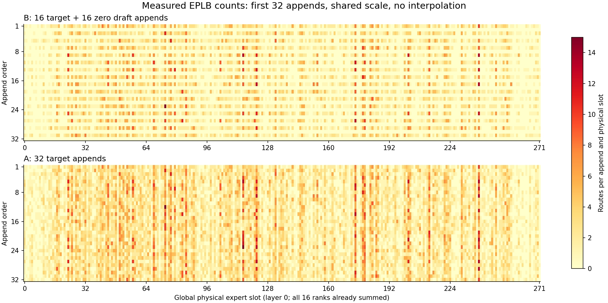

# 热度表到底记录了什么？把 NPZ 里的专家计数读明白

把 EPLB 的 NPZ 发给同事，对方问“这个文件就是热力表吗”，回答“是”很容易留下更多误会。NPZ 保存的是多维原始数组，热力图是从这些数组选维度、做汇总、再映射成颜色的结果。换一种汇总或色标，同一份数据就能呈现出不同观感。

下面打开两份已经公开的 NPZ，顺着一个问题读：第 0 层、物理槽位 0 的累计值，究竟由哪些记录加出来？沿途需要知道三个轴、target / draft 身份、是否已经跨 rank 求和，以及当时槽位里装着哪位专家。这些信息确定以后，数字才有明确的含义。

## 一、先确认这份文件来自哪次实验

材料来自 2026-10-31 的 DeepSeek-V4-Flash-0731 W8A8 实验：Ascend 910C 单节点，8 张双芯片物理卡、16 个逻辑设备，TP16、EP16、attention DP16，DSpark gamma5/verify6，开启图回放与动态 EPLB。每层配置 16 个冗余专家，I4000/W1000。

实验保存了两次独立执行。A 排除 draft 对统计窗口的推进；B 保留当时社区 recorder 的生命周期。每组采集 200 次实际 append。A 的 200 条全是 target，B 为 100 条 target、100 条 draft，全零的是这些 draft 记录。两组使用相同请求集合，但不是 token 对齐的两次 forward。

这次采集直接展示了两种生命周期怎样改变窗口组成。对应版本为 `59565b93d17a6e5f176b64335b1978993a223e5f`，B 的 recorder 方法与社区 `de7055f59645ebe03784b0980e1f222789f468a3` 对齐。修复机制见[零记录与滚动窗口](../performance/eplb-zero-record-rolling-window.md)。

[原始公开包](https://github.com/AkiYangDev/sglang/releases/download/eplb-spec-decode-window200-20261105/eplb-spec-decode-200-records.zip)中的两个 NPZ，本篇重新下载并与保存的 SHA256 校验值逐字核对。下面的数字由原数组重算，不从截图上抄取。

## 二、打开文件，先看字段，再看 shape

NumPy 的 [`savez_compressed`](https://numpy.org/doc/2.2/reference/generated/numpy.savez_compressed.html)可以把多个命名数组放入一个压缩 NPZ。读取时用字段名取数组；本实验全部是数值或字符串数组，采用 `allow_pickle=False` 即可。

```python
import numpy as np

with np.load("B_community_global_counts.npz", allow_pickle=False) as data:
    print(data.files)
    counts = data["counts"]
    roles = data["roles"]
    print(counts.shape, counts.dtype)
```

本次主要字段如下：

| 字段 | shape | 含义 |
|---|---|---|
| `counts` | `[200,43,272]` | 每条记录、每层、每个物理槽位的路由次数 |
| `roles` | `[200]` | 这次入窗来自 target 还是 draft |
| `forward_pass_ids` | `[200]` | 对应执行的 forward 标识 |
| `slots` | `[200]` | 当时写入环形缓冲的槽位下标 |
| `record_indices` | `[200]` | 本次导出的记录顺序，1 到 200 |
| `physical_to_logical_map` | `[43,272]` | 各层物理槽位对应的逻辑专家 |

`counts` 保存的是 16 个 rank 求和后的结果，数组里只有记录、层和物理槽位三个轴。因此，读取一个格子就得到了相应位置的全局计数，后续直接使用即可。若想分析某个物理槽属于哪张设备，可以再查当时的布局；若想知道每个来源 rank 分别贡献多少，则需要额外保存未归约的记录，这份文件已经合并了那一维。

272 来自 256 个逻辑专家的基本副本加 16 个额外副本；43 是这次导出的层轴长度。读另一份文件时，先打印它自己的 shape 和布局元数据，就能确定该按多少层、多少槽位解释。

把 `counts[0,0,0]` 按轴读一遍：它是导出的第 1 条记录、第 0 层、物理槽位 0 的计数。把第一个下标换成 1，换的是一条观察记录；把第二个换成 1，换的是模型层；把第三个换成 1，才是看同一层的另一个专家位置。后面的求和，都只是在决定保留哪几个下标。

## 三、三个 sum，回答的是三个不同问题

先固定第 0 层，查看每条记录在这一层总共有多少路由：

```python
layer0_per_record = counts[:, 0, :].sum(axis=1)
all_layers_per_record = counts.sum(axis=(1, 2))
layer0_per_slot = counts[:, 0, :].sum(axis=0)
```

第一项沿 272 个物理槽位求和，得到 200 个数。第二项再把全部 43 层纳入，每条记录只剩一个总数。第三项沿 200 条记录求和，保留 272 个物理槽位，适合画一层的累计专家分布。

在这份 B 数据里，前几条 target 的第 0 层总计为 576，全部层合计为 24768；draft 则都是 0。`576 × 43 = 24768` 与文件吻合。576 是全局记录里的 token→expert 路由条目，不是客户端请求数，也不是这轮输出 token 数；一个 token 可以选择多位专家。

这里不根据 576 倒推出客户端 batch。计数已经跨 rank 聚合，目标验证还包含候选位置，具体有效行数与 Top-K 应查采集配置和执行元数据。几种单位混用，会把完全正常的计数误报为多算了若干倍。

环形槽位也不是全局时间。B 的前四条写入槽位为 197、198、199、200，A 从 101、102、103、104 开始。它们描述各自运行的写入位置，不意味着 B 比 A 多执行了 96 个 target forward。buffer 循环后还会回到开头，排序应依据导出顺序和相关执行标识。

forward ID 也要结合角色读。本次 B 的前四条 ID 是 `103、96、104、97`，角色依次是 target、draft、target、draft。把它们简单按数值排序，会打乱真实入窗顺序。文件另存 `record_indices`，正是为了保留这次观察到的第几条 append；要分析时间新鲜度，还需要另外的时间戳，ID 本身不是毫秒。

读取时可以先做两条守恒检查：所有物理槽位累计应等于所有逻辑专家累计；按角色分别求和后再相加，应等于整个 counts 的总和。这些检查能抓到漏层、错轴与角色筛选错误。它们不能独立证明每条统计都正确，但能在开始画图前发现不少后处理问题。

## 四、为什么不能直接把两列累计数比大小

先看第 0 层最前面的四个物理槽位。下面完整保留它们的顺序，没有按热度挑选：

| 物理槽位 | B：100 条 target 累计 | B：每条 target 平均 | A：200 条 target 累计 | A：每条 target 平均 |
|---|---:|---:|---:|---:|
| 0 | 150 | 1.500 | 288 | 1.440 |
| 1 | 31 | 0.310 | 44 | 0.220 |
| 2 | 38 | 0.380 | 69 | 0.345 |
| 3 | 76 | 0.760 | 212 | 1.060 |

槽位 0 的 A 累计数比 B 大，按 target 记录归一化后却略小。原因很直接：A 观察了 200 条 target，B 只观察了 100 条。用不同条数的累计量比较热点强弱，会把样本数与分布变化混在一起。

归一化之后，可以比较两次采集各自观察到的 target 平均分布。两组属于独立执行，生成前缀和组批也各自推进，因此槽位差异包含负载本身的变化。若要单独测隔离代码的影响，还需要把输入轨迹与执行状态对齐，再做同状态对照。

还要区分两个平均值。B 对全部 200 条记录平均，会把 100 条 draft 零记录也纳入分母；对其中 100 条 target 平均，则回答“每次 target 观察了多少路由”。哪一个有意义取决于问题，不能先把零删掉，再把结果称为原始窗口平均。

本次 A 全部记录累计为 4953600，B 为 2476800，恰好相差两倍：A 的窗口里有两倍数量的 target 记录。这个比值描述了同样 200 个位置装进多少有效历史，单个专家的分布则继续按上面的 target 均值查看。

## 五、物理槽位的热度，怎样变成逻辑专家热度

如果专家 A 有三个副本，它们占三个物理槽位。Planner 需要知道 A 的总需求，就要把这三个位置上的计数加起来。这里用 `physical_to_logical_map` 决定谁归谁，不能把槽位编号直接当作逻辑专家编号。

比如某层映射是 `[A,B,A,C]`，物理计数为 `[6,4,8,2]`，逻辑计数就是 `A=14、B=4、C=2`。某个 A 副本仅收到 6 次，不表示 A 不热；还要加上另一个副本的 8 次。

本次采集切片的初始映射相同，并且整个切片没有换布局，因此一份 `[层,槽位]` 映射能解释全部 200 条记录。如果采集跨过了 update，情况就不同了：槽位 0 前半段可能装 A，后半段装 B。拿最后的映射去解释前半段，会把 A 的计数错分给 B。

因此，连续诊断文件应把每条记录与正确的布局版本关联，或者在每次切换处拆段。若导出文件没有这层关系，只看 `counts` 的 shape 无法补回丢失的信息。当前 SGLang 的[物理转逻辑与归约](https://github.com/sgl-project/sglang/blob/2914be608009b65099c4c52ba118a597bf1b1421/python/sglang/srt/eplb/expert_distribution.py#L1017-L1045)也需要明确的物理映射。

用逻辑热度看总需求，用物理热度看副本分担，再按设备汇总看负载倾斜。这三个层次连起来，才能解释“热门专家已经有副本，为什么某张卡仍然最忙”。计数是否转化成耗时差异，还要继续对齐执行时间线。

还要记录计数 dtype。本 NPZ 是 int64，能安全容纳这次约五百万的总计；生产环形 buffer 的计数实现可能使用其他 dtype。后处理先转 int64 再求和，只能避免后处理阶段溢出，不能修复设备上早已溢出的原始数。窗口很长或单次 batch 很大时，应从采集端一起核查范围。

逐记录平均也不等于按实际时间平均。连续两条记录分别花 10 ms、100 ms，却在普通 mean 中各占一半。若想回答“服务在某种负载上停留了多久”，需要时间戳与持续时间；若想回答“planner 这次看到了哪些历史”，则应复用 planner 实际采用的记录与汇总方式。

## 六、图应该让读者看见什么

下面从 B 的第 0 层取连续前 32 条入窗，展示所有 272 个物理槽位。下方是 A 的同样长度切片，两张图使用共同色标，不插值。两图用于查看各自的记录组成与热点位置，保持真实入窗顺序。



热力图行轴是入窗顺序，列轴是物理槽位。B 中交替的空行对应 draft 零记录，A 保留的都是 target。颜色展示原始路由数，不代表毫秒、带宽或设备利用率。静态图片只显示这段切片，下载中的 NPZ 保留全部 200 条、43 层和 272 个位置。

如果希望比较单个 target 的平均热点，可以另外画归一化图，但应写明分母。若把每组图分别自动缩放到自己的最大值，低负载和高负载都会出现同样深的颜色，读者只能比较形状，无法比较绝对数值。窗口总和、单条平均和占比图，也应该分别命名。

交付数据时，我会一起保留这几项：原始数组与校验值、字段维度解释、角色与记录顺序、rank 是否已归约、布局版本、采集配置，以及画图脚本。这样同事拿到的不只是一张“看起来有热点”的图片，还能回答每个颜色是怎样算出来的。

## 下载与复算

[本篇数据与脚本 ZIP](https://raw.githubusercontent.com/AkiYangDev/llm-inference-notes/main/assets/eplb-count-npz-reading/examples.zip)包含原始两个 NPZ、校验值和读取脚本。安装 NumPy 后，在解压目录执行：

```bash
python -m pip install numpy==2.4.1
python examples/eplb-count-npz-reading/read_counts.py --output count-summary.json
```

脚本检查 shape、角色、总和和两组映射，输出前 16 个物理槽位的累计值与 target 均值；绘图脚本另需 Matplotlib，参数及版本放在同目录的说明中。[完整汇总 JSON](../../assets/eplb-count-npz-reading/count-summary.json)可以直接与原始数组交叉检查。

[返回 EPLB 专题](eplb-study-guide.md)。
