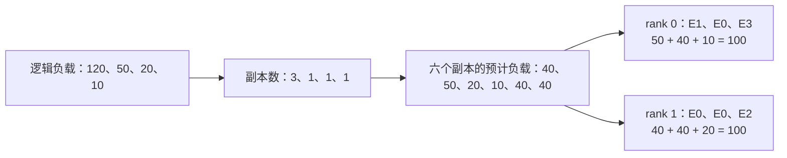

# 16 个冗余专家怎么分：从专家热度到副本，再到物理布局

配置 16 个冗余专家后，这些位置怎样分配？固定算法并不是给最热的 16 个专家各复制一次：一个热点专家可以连续获得多个副本。副本数确定后，还要将它们放进各 Rank 的固定槽位。

Planner 因而分两步工作：先按逻辑负载分配副本数，再安排各副本的物理位置。第一步估计如何分摊单个专家的工作，第二步处理各 Rank 的容量和总负担，两者需要分别推演。

下面按固定 SGLang DeepSeek 求和策略，用四专家、两冗余的例子走完算法，再对照 DeepSeek-V4-Flash、Ascend 910C 真实负载。小例子执行生产原函数，中间结果随文保存。

## 一、16 个位置，是每层的总预算

逻辑专家是模型中的专家函数，例如 E0、E1；物理专家则是某个 Rank 槽位中保存的一份专家权重。同一逻辑专家可以有多份相同副本。

本配置有 256 个路由逻辑专家，加上 16 个冗余副本后，每个相关 MoE 层的物理位置总数为：

```text
256 个逻辑专家的基本副本 + 16 个额外副本 = 272 个物理位置
272 个物理位置 / EP16 = 每个 rank 17 个位置
```

16 是每层整个 EP 组的额外预算，不是每 rank 新增，也不是全部层共用。各层独立按负载分配，43 个统计层便有 43 套布局。

每个逻辑专家先保留一份基础副本，再逐个分配额外的 16 个位置。因此，最终得到额外副本的逻辑专家不必恰好有 16 个。

接口 `deepseek.rebalance_experts` 的 `num_replicas` 指全部物理位置，本例传 272，冗余为 `272 - 256`，见[配置与元数据](https://github.com/AkiYangDev/sglang/blob/bf8fa56315f86388f1941ff2358ea0fccec65741/python/sglang/srt/eplb/expert_location.py)。

## 二、热度是路由次数，不是路由权重

求和策略先将窗口时间维累计为 `[层数, 逻辑专家数]`，再逐层分配。

假设某层四位专家的累计路由为：

```text
E0：120    E1：50    E2：20    E3：10
```

120 表示 120 次 token→expert 选择。一个 Token 可以选择多个专家，所以这组计数合计为 200，并不表示客户端输出了 200 Token。

源码称该矩阵为 `weight`，但它用于估计工作量，与合并专家输出的 `topk_weights` 不同。负载除副本数不会改模型 gate 权重。

规划前还需合并同一逻辑专家的物理副本计数，避免把 E0 的三个位置误当成三个独立专家。有效 token、窗口与 draft 身份同样影响输入，详见[有效路由](../performance/deepep-received-vs-valid-routes.md)和[零记录](../performance/eplb-zero-record-rolling-window.md)。

本文分析非分层的 `deepseek` 求和策略。分层策略和保留时间维度的 `deepseek_vec` 各有选择规则，不能因为都叫 EPLB 就套用同一算法，见[入口](https://github.com/AkiYangDev/sglang/blob/bf8fa56315f86388f1941ff2358ea0fccec65741/python/sglang/srt/eplb/eplb_algorithms/__init__.py)。

## 三、为什么两个额外副本都给 E0

四个逻辑专家各保留一份，再加两个额外位置，总共可以放六份权重。初始副本数为 `[1,1,1,1]`。

每次按逻辑负载/当前副本数估计单份负担，将下一个位置给最大项，再更新副本数：

```python
# 摘录 replicate_experts；weight 是各逻辑专家的累计负载。
for i in range(num_log, num_phy):
    expert = (weight / logcnt).max(dim=-1).indices
    phy2log[:, i] = expert
    rank[:, i] = logcnt[arangen, expert]
    logcnt[arangen, expert] += 1
```

函数中的 `rank` 是副本在该逻辑专家内部的编号，不是分布式 rank。设备位置要到 packing 才决定。

| 分配时刻 | E0 每份预计负载 | E1 | E2 | E3 | 下一个位置给谁 |
| --- | ---: | ---: | ---: | ---: | --- |
| 初始各一份 | 120 | 50 | 20 | 10 | E0 |
| E0 变成两份 | 60 | 50 | 20 | 10 | E0 |
| E0 变成三份 | 40 | 50 | 20 | 10 | 预算用完 |

第一个额外位置给 E0。它变成两份后，每份预计负载仍为 60，高于 E1 的 50，因此第二个位置也给 E0，最终得到：

```text
E0：3 份    E1：1 份    E2：1 份    E3：1 份
```

若只复制最热两位，得到 `[2,2,1,1]`，E0 仍有单份 60；本算法分为三份后，最大单份已是 E1 的 50。

`120/3=40` 是规划中的均分估计，需要实际流量能够分到三个副本。它不表示一次 Token 计算只执行原专家的三分之一；运行时如何选择副本，还要检查 dispatch 与请求分布。

## 四、六个副本怎样放进两组槽位

副本数确定后，中间列表为：

| 中间位置 | 逻辑专家 | 副本内部编号 | 预计负载 |
| ---: | --- | ---: | ---: |
| 0 | E0 | 0 | 40 |
| 1 | E1 | 0 | 50 |
| 2 | E2 | 0 | 20 |
| 3 | E3 | 0 | 10 |
| 4 | E0 | 1 | 40 |
| 5 | E0 | 2 | 40 |

两个 Rank 各有三个槽位。`balanced_packing` 按单份预计负载降序处理，每次选择尚未满额、累计负载最低的 Rank。

未满是硬约束：某 rank 三个位置用尽，即使累计较低也不能继续接收。模型权重本来就按固定槽容量分配。

本次 CPU 先放 E1 的 50，再放 E0 三份 40，最后 E2 的 20、E3 的 10，得到：



三个 40 并列，图示为固定源码在该 CPU 环境的一种顺序。并列可能改变具体槽位，但此例的副本数和两端预计负载相同。

Rank1 可以放两份 E0，因为这个固定算法没有“每 Rank 只能放同一专家一份副本”的额外约束。它限制的是槽数，并尝试平衡累计负载，所以三个副本不必分布在三个不同 Rank。

一般情况下，这种固定槽数的贪心放置并不保证各 Rank 负载恰好相等。本例的 100/100 也只是规划计数，没有测出每个设备耗时 100ms。实际 Forward 还受计算、访存、通信和图形状影响。

## 五、两张映射表，把布局交给执行路径

`physical_to_logical_map`按 rank0 所有槽、rank1 所有槽展开，本例为：

```text
物理位置 p：  0   1   2  |  3   4   5
逻辑专家：   E1  E0  E3  | E0  E0  E2
所属 rank：       0      |      1
```

`logical_to_all_physical_map`列出可用位置：E0 为 `[3,4,1]`，E1 `[0]`，E2 `[5]`，E3 `[2]`。它按副本内部编号排列，不要求物理升序，填充 `-1` 不是可用副本。

Router 仍选择逻辑专家。假设一个 Token 选中 E0、E2，dispatch 会为 E0 选择一份物理权重，再找到 E2 的位置；它不会把 E0 的三个副本全部运行后相加。副本用于分流，原专家函数及其合并权重的语义保持不变。

固定 static 使用预生成的 rank 映射，dynamic 从可用列表选择并处理跨 rank 一致要求。在线 EPLB 更新布局与 `ep_dispatch_algorithm="dynamic"` 独立，见[分发源码](https://github.com/AkiYangDev/sglang/blob/bf8fa56315f86388f1941ff2358ea0fccec65741/python/sglang/srt/eplb/expert_location_dispatch.py)。

表生成后还需搬对权重。slot3 标 E0 却存旧参数，映射正确仍会计算错误函数；已捕获图还引用原地址。权重与映射生效顺序见[动态迁移](ascend-dynamic-eplb-weight-migration.md)。

因此 planner 交付的是计划，仍由 dispatch、迁移和图回放共同执行。

## 六、真实的 16 个位置：专家 107 为什么拿到四份

一次真实 D 更新保留两份同刻负载：实际窗口 500 条 target，参考窗口 1000 条。参考只用于离线，服务未执行其布局。

两份计数都用于给 256 个专家分配 272 个位置。下表取第二轮、层下标 32，副本数包含基础副本：

| 专家 | 500 条历史：路由次数 / 占比 / 副本 | 1000 条历史：路由次数 / 占比 / 副本 |
| --- | --- | --- |
| 107 | 133,427 / 7.06% / 4 | 214,270 / 5.11% / 3 |
| 117 | 67,166 / 3.55% / 2 | 229,093 / 5.46% / 3 |
| 177 | 89,325 / 4.73% / 3 | 148,526 / 3.54% / 2 |

两窗口总路由为 1,889,604、4,193,604。107 在短历史更热，获得四份、其中三份冗余；117 在长历史占比高，得到三份。

这三个专家没有固定配额，而是与其余 253 个专家一起竞争额外的 16 个位置。要判断最终副本数，需要对整个负载向量逐轮计算 `weight / logcnt`，只看谁最热还不够。

随文 CPU 复算使用固定 `replicate_experts`，覆盖七轮两负载、14 份 43 层分配，逐专家与原布局直方图一致，每层副本减一合计 16。层 32 原 256 维负载和逐步分配均保存。

输入历史改变，即使算法和预算相同，副本数也会变。讨论预算是否足够前，应先保证统计描述目标负载。

增至 32 可以扩大分配，同时增加专家及辅助权重。256→272 仅表示路由副本增加 6.25%，不能当成全模型显存+6.25%，KV、Attention、通信需另算。固定槽实现还要求物理总数被 EP 整除。

更多副本也未保证等比例提速，实际小 batch 分流、跨卡通信和访存可能限制效果。先查热点单份负载、实际路由和 MoE 关键路径，再测完整服务，参见[收益测量](../performance/dynamic-eplb-decode-benefit-measurement.md)。

这 16 个位置提供了每层分摊热点的预算。它是否有效，还要沿逻辑负载、副本数和物理位置核对到真实执行，配置值本身无法给出答案。

## 源码与计算结果

本文固定源码为 `bf8fa56315f86388f1941ff2358ea0fccec65741` 的 [`deepseek.py`](https://github.com/AkiYangDev/sglang/blob/bf8fa56315f86388f1941ff2358ea0fccec65741/python/sglang/srt/eplb/eplb_algorithms/deepseek.py)，该文件由 SGLang 从 DeepSeek EPLB 实现引入。本文详解非分层求和策略；分层版本会先安排专家组到节点，再在节点内复制和放置，受分组及拓扑约束。

小例子在 PyTorch 2.5.1+cpu 上执行上述原函数；真实输入来自 2026-10-30 的 DeepSeek-V4-Flash W8A8、Ascend 910C 服务记录，本次只做 CPU 复算。[小例子的全部中间结果](../../assets/eplb-redundant-expert-allocation/toy-allocation.json)、[真实层 32 的负载与 16 步分配](../../assets/eplb-redundant-expert-allocation/real-layer32.json)、[源码与原始材料校验值](../../assets/eplb-redundant-expert-allocation/evidence.json)可直接核对文中的表格和映射。
