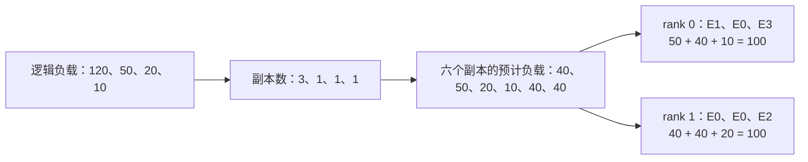

# 16 个冗余专家怎么分：从专家热度到副本，再到物理布局

给 EPLB 配 16 个冗余专家，不是给最热的 16 位各加一份。有的热点专家会连续拿到多个副本；分完副本，还要把它们装进各 rank 的固定槽位。

Planner 分两步处理这件事：按逻辑负载决定每个专家有几份，再按容量安排物理位置。前一步分摊单个专家的工作，后一步平衡各 rank 的总负担。

下面用四专家、两冗余跑一遍固定 SGLang DeepSeek 求和策略，再看 DeepSeek-V4-Flash、Ascend 910C 真实负载里的 16 个位置。小例子直接执行生产原函数，中间结果都保留了下来。

## 一、16 个位置，是每层的总预算

逻辑专家指模型函数，例如 E0、E1；物理专家是一份保存在某个 rank 槽位里的权重。多份物理权重可以对应同一逻辑专家。

本配置有 256 个路由逻辑专家，加 16 个冗余副本，每个相关 MoE 层共有：

```text
256 个逻辑专家的基本副本 + 16 个额外副本 = 272 个物理位置
272 个物理位置 / EP16 = 每个 rank 17 个位置
```

这 16 个是每层整个 EP 组的额外预算。它既不按 rank 各给一份，也不由全部层共用。43 个统计层各按自己的负载生成一套布局。

算法先给每个逻辑专家保底一份，再逐个分配额外 16 个位置。最后拿到冗余副本的专家，可能少于 16 位。

接口 `deepseek.rebalance_experts` 中的 `num_replicas` 也指全部物理位置，此处传 272，冗余数才是 `272 - 256`，对应[配置与元数据](https://github.com/AkiYangDev/sglang/blob/bf8fa56315f86388f1941ff2358ea0fccec65741/python/sglang/srt/eplb/expert_location.py)。

## 二、热度是路由次数，不是路由权重

求和策略先沿窗口时间维累计，得到 `[层数, 逻辑专家数]`，再按层分配。

假设某层四位专家累计收到这些路由：

```text
E0：120    E1：50    E2：20    E3：10
```

120 表示 120 次 token→expert 选择，一个 token 可以选多个专家。因此总计 200 次选择，并不意味着客户端生成了 200 token。

源码把这份工作量估计叫 `weight`，它与输出合并用的 `topk_weights` 是两份数据。用负载除以副本数，不会修改模型的 gate 权重。

规划前先合并同一逻辑专家的物理副本计数，否则 E0 的三个位置会被当成三个独立专家。输入还受有效 token、窗口、draft 身份影响，可分别看[有效路由](../performance/deepep-received-vs-valid-routes.md)、[零记录](../performance/eplb-zero-record-rolling-window.md)。

这里推演的是非分层 `deepseek` 求和策略。分层策略与保留时间维的 `deepseek_vec` 采用不同选择规则，入口在[入口](https://github.com/AkiYangDev/sglang/blob/bf8fa56315f86388f1941ff2358ea0fccec65741/python/sglang/srt/eplb/eplb_algorithms/__init__.py)。

## 三、为什么两个额外副本都给 E0

四位专家先各留一份，初始副本数为 `[1,1,1,1]`，加上两个额外位置后总共放六份。

每次以“逻辑负载 / 当前副本数”估计单份负担，给最大项加一个副本，再重新比较：

```python
# 摘录 replicate_experts；weight 是各逻辑专家的累计负载。
for i in range(num_log, num_phy):
    expert = (weight / logcnt).max(dim=-1).indices
    phy2log[:, i] = expert
    rank[:, i] = logcnt[arangen, expert]
    logcnt[arangen, expert] += 1
```

函数里的 `rank` 指某个逻辑专家内部的副本编号。副本在哪个分布式 rank 上，要等后面的 packing 才决定。

| 分配时刻 | E0 每份预计负载 | E1 | E2 | E3 | 下一个位置给谁 |
| --- | ---: | ---: | ---: | ---: | --- |
| 初始各一份 | 120 | 50 | 20 | 10 | E0 |
| E0 变成两份 | 60 | 50 | 20 | 10 | E0 |
| E0 变成三份 | 40 | 50 | 20 | 10 | 预算用完 |

第一份额外副本给 E0。分成两份后，每份预计仍有 60，高于 E1 的 50，于是第二份继续给 E0：

```text
E0：3 份    E1：1 份    E2：1 份    E3：1 份
```

若简单复制最热两位，得到 `[2,2,1,1]`，E0 单份仍为 60。这里把 E0 分成三份，最大单份负载变成了 E1 的 50。

`120/3=40` 假定请求能分流到三个副本，是规划估计。一次 token 仍执行完整专家函数，不会只算三分之一。能否按此分流，还要看 dispatch 和实际请求分布。

## 四、六个副本怎样放进两组槽位

确定副本数后，先得到一份待放置列表：

| 中间位置 | 逻辑专家 | 副本内部编号 | 预计负载 |
| ---: | --- | ---: | ---: |
| 0 | E0 | 0 | 40 |
| 1 | E1 | 0 | 50 |
| 2 | E2 | 0 | 20 |
| 3 | E3 | 0 | 10 |
| 4 | E0 | 1 | 40 |
| 5 | E0 | 2 | 40 |

两 rank 各有三个槽位。`balanced_packing` 先按单份预计负载降序，再逐个放到尚未满、累计负载最低的 rank。

槽位数是硬约束：三个位置已用完，即使该 rank 累计负载较低，也不能继续放，模型存储没有给它额外容量。

这次 CPU 执行先放 E1 的 50，再放 E0 的三份 40，最后放 E2 的 20、E3 的 10：



三个 40 并列，图中是固定源码在本次 CPU 环境给出的顺序。并列排序可以改变具体槽位，但在这个例子里，副本数和两端预计负载相同。

rank 1 放了两份 E0。这个算法没有规定“同一 rank 只能有同一专家的一份副本”，它约束槽数，并尝试平衡累计负载。因此三份副本不必分到三个不同 rank。

固定槽数的贪心放置也未必得到完全相等的负载。本例刚好是 100/100，单位仍是规划计数，并非设备各花 100ms。真实 forward 还受计算、访存、通信和图形状影响。

## 五、两张映射表，把布局交给执行路径

把 rank 0 全部槽位、再把 rank 1 全部槽位展开，就得到 `physical_to_logical_map`：

```text
物理位置 p：  0   1   2  |  3   4   5
逻辑专家：   E1  E0  E3  | E0  E0  E2
所属 rank：       0      |      1
```

反向的 `logical_to_all_physical_map` 列出各专家的可用位置：E0 `[3,4,1]`，E1 `[0]`，E2 `[5]`，E3 `[2]`。顺序来自副本内部编号，不要求物理升序；填充用的 `-1` 也不能当成可用位置。

Router 若为一个 token 选中 E0、E2，dispatch 为 E0 选一份物理权重，再找到 E2。它不会把 E0 的三份都执行后相加，副本只负责分流，专家函数和合并权重的语义保持原样。

固定 static 使用预生成 rank 映射，dynamic 从可用列表选择，并处理跨 rank 一致性。`ep_dispatch_algorithm="dynamic"` 和在线 EPLB 布局更新仍是独立开关，代码见[分发源码](https://github.com/AkiYangDev/sglang/blob/bf8fa56315f86388f1941ff2358ea0fccec65741/python/sglang/srt/eplb/expert_location_dispatch.py)。

接着要让槽位真的装上对应权重。slot3 即使标成 E0，若还留着旧参数，计算仍会用错专家；捕获图也继续读原地址。[动态迁移](ascend-dynamic-eplb-weight-migration.md)解释了权重、映射何时一起生效。

至此 planner 完成计划，dispatch、迁移、图回放才把计划变成实际执行。

## 六、真实的 16 个位置：专家 107 为什么拿到四份

真实 D 更新中，保留过同一时刻的两份负载：实际窗口 500 条 target，参考窗口 1000 条。参考只用于离线复算，服务没有执行它的布局。

两份输入都把 256 专家分配到 272 位置。下面取第二轮的层下标 32，副本数包含基础的一份：

| 专家 | 500 条历史：路由次数 / 占比 / 副本 | 1000 条历史：路由次数 / 占比 / 副本 |
| --- | --- | --- |
| 107 | 133,427 / 7.06% / 4 | 214,270 / 5.11% / 3 |
| 117 | 67,166 / 3.55% / 2 | 229,093 / 5.46% / 3 |
| 177 | 89,325 / 4.73% / 3 | 148,526 / 3.54% / 2 |

两窗口总路由分别为 1,889,604、4,193,604。107 在短历史中更热，得到四份，其中三份冗余；117 在长历史中占比更高，拿到三份。

表里三位专家也没有自己的固定配额，它们与其余 253 位一起竞争额外的 16 个位置。最终数量要在完整向量上逐轮算 `weight / logcnt`，只看热度排名无法确定。

随文 CPU 复算用固定 `replicate_experts` 处理七轮、两种负载，共 14 份 43 层分配，逐专家与原布局直方图一致。每层副本数减一后的和都是 16，层 32 的原 256 维负载与每一步分配也已保存。

算法、预算没变，仅输入历史改变就分出了不同副本。预算够不够之前，需要先确认这份历史描述的是目标负载。

预算加到 32 会多出可分位置，也会增加专家及辅助权重。原来的 256→272 只说明路由副本增加 6.25%，不是全模型显存增加 6.25%；KV、Attention、通信各有开销。固定槽实现还要求物理总数能被 EP 整除。

副本增加后，实际小 batch 能否分流、是否多了跨卡通信、访存是否受限，都可能影响速度。可以从热点单份负载、实际路由、MoE 关键路径追到[收益测量](../performance/dynamic-eplb-decode-benefit-measurement.md)中的完整服务结果。

## 源码与计算结果

源码固定为 `bf8fa56315f86388f1941ff2358ea0fccec65741` 的 [`deepseek.py`](https://github.com/AkiYangDev/sglang/blob/bf8fa56315f86388f1941ff2358ea0fccec65741/python/sglang/srt/eplb/eplb_algorithms/deepseek.py)，该文件由 SGLang 从 DeepSeek EPLB 引入。上述推演只覆盖非分层求和策略；分层版本先安排专家组到节点，再在节点内复制、放置，还受分组和拓扑约束。

小例子在 PyTorch 2.5.1+cpu 上执行原函数。真实输入取自 2026-10-30 的 DeepSeek-V4-Flash W8A8、Ascend 910C 服务，本次仅 CPU 复算。[小例子的全部中间结果](../../assets/eplb-redundant-expert-allocation/toy-allocation.json)、[真实层 32 的负载与 16 步分配](../../assets/eplb-redundant-expert-allocation/real-layer32.json)和[源码与原始材料校验值](../../assets/eplb-redundant-expert-allocation/evidence.json)保留了表格、映射和逐步结果，可逐项对照。

[返回 EPLB 专题](eplb-study-guide.md)。
