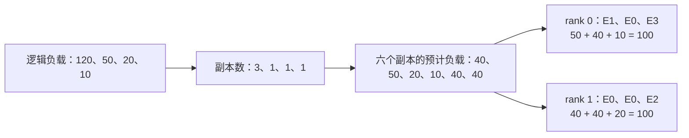

# 16 个冗余专家怎么分：从专家热度到副本，再到物理布局

给动态 EPLB 配置 16 个冗余专家以后，它们会平均分给最热的 16 个专家吗？还是每张卡各放一份？为什么同一个专家在一次更新里拿到四个副本，下一次又变成三个？

答案要沿着 planner 的两步走：先根据逻辑专家的负载决定副本数量，再把这些副本装进各个 rank 的物理槽位。副本数解决“这一份专家工作由几份权重承接”，放置解决“这些权重分别由哪张卡承接”。两步的输入有关联，约束却不同。

本文核对 SGLang 中的 DeepSeek EPLB 求和策略，用四个逻辑专家、两个冗余位置走完整个过程，再接上 DeepSeek-V4-Flash 在 Ascend 910C 上的一组真实负载。小例子直接执行固定版本的生产算法，文末保留每一步的结果。

## 一、16 个位置，是每层的总预算

先把“专家”拆成两个身份。逻辑专家是模型训练出来的函数，例如 E0、E1；物理专家是某个 rank、某个槽位里保存的一份专家权重。同一个逻辑专家可以对应多个物理副本，它们的权重相同。

我们这组 DeepSeek-V4-Flash 配置有 256 个路由逻辑专家。增加 16 个冗余专家后，每个相关 MoE 层的物理位置总数是：

```text
256 个逻辑专家的基本副本 + 16 个额外副本 = 272 个物理位置
272 个物理位置 / EP16 = 每个 rank 17 个位置
```

这里的 16 是每层、整个 EP 组的额外位置总数，不是每个 rank 再加 16 个，也不是给整个模型所有层共用 16 份权重。各层分别根据自己的负载分配这份预算；43 个被统计的 MoE 层，对应 43 套布局。

每个逻辑专家先有一个基本副本。额外的 16 个位置再逐个分配，同一个热专家可以连续获得多个位置。因此，“16 个冗余专家”并不要求恰好复制 16 个不同的逻辑专家。

有个接口名称也容易看错：`deepseek.rebalance_experts` 的 `num_replicas` 接收的是物理位置总数。这份配置传入的是 272，额外预算则由 `272 - 256` 得到。[对应配置与元数据源码](https://github.com/AkiYangDev/sglang/blob/bf8fa56315f86388f1941ff2358ea0fccec65741/python/sglang/srt/eplb/expert_location.py)。

## 二、热度是路由次数，不是路由权重

planner 接收的是统计窗口内各逻辑专家的负载。DeepSeek 求和策略先把窗口的时间维求和，得到 `[层数, 逻辑专家数]` 的矩阵，然后逐层处理。

对某一层，假设四个专家的累计路由次数是：

```text
E0：120    E1：50    E2：20    E3：10
```

这里的 120 表示统计到 120 次 token→expert 选择。一个 token 可以选择多个专家，所以四项相加的 200 不是客户端输出了 200 个 token。

源码把这个负载矩阵命名为 `weight`。它与 TopK 输出中的 `topk_weights` 不是同一个量：前者用于估计专家有多少工作，后者用于把专家输出加权合并回 token。后面出现的“负载除以副本数”，也不会修改模型的 gate 权重。

有冗余副本时，还要先把同一逻辑专家在各物理位置上的计数合回来。否则 E0 分散在三个位置，planner 可能把它误读成三个互不相关的小专家。统计窗口、有效 token 和 draft 隔离的语义也要正确，前面几篇关于[有效路由](../performance/deepep-received-vs-valid-routes.md)和[零记录占位](../performance/eplb-zero-record-rolling-window.md)讨论的就是这个输入环节。

本例采用非分层的 `deepseek` 策略。SGLang 还提供分层版本，以及保留时间维的 `deepseek_vec` 等策略；不能只根据都叫 EPLB，就把它们当成同一套算法。对应入口会明确选择是否先对时间维求和。[策略选择源码](https://github.com/AkiYangDev/sglang/blob/bf8fa56315f86388f1941ff2358ea0fccec65741/python/sglang/srt/eplb/eplb_algorithms/__init__.py)。

## 三、为什么两个额外副本都给 E0

四个逻辑专家，配置两个额外位置，总共六个物理位置。开始时每个专家都有一份，副本数量为 `[1,1,1,1]`。

算法用“逻辑专家负载 ÷ 当前副本数”估计每份副本承担的负载。每次把下一个额外位置分给当前估计最忙的专家，再更新它的副本数量。关键循环只有几行：

```python
# 摘录 replicate_experts；weight 是各逻辑专家的累计负载。
for i in range(num_log, num_phy):
    expert = (weight / logcnt).max(dim=-1).indices
    phy2log[:, i] = expert
    rank[:, i] = logcnt[arangen, expert]
    logcnt[arangen, expert] += 1
```

这个函数里的 `rank` 保存副本在逻辑专家内部的编号，不是分布式 rank。真正决定放到哪张卡，是后面的 packing 步骤。

| 分配时刻 | E0 每份预计负载 | E1 | E2 | E3 | 下一个位置给谁 |
| --- | ---: | ---: | ---: | ---: | --- |
| 初始各一份 | 120 | 50 | 20 | 10 | E0 |
| E0 变成两份 | 60 | 50 | 20 | 10 | E0 |
| E0 变成三份 | 40 | 50 | 20 | 10 | 预算用完 |

第一份给 E0 很直观。第二份仍然给 E0，是因为它即使已经有两份，每份预计还有 60，仍然大于 E1 的 50。最终副本数是：

```text
E0：3 份    E1：1 份    E2：1 份    E3：1 份
```

如果简单地给最热两个专家各加一份，会得到 `[2,2,1,1]`，E0 的每份预计负载仍是 60；当前方案把最大的副本负载压到了 E1 的 50。

这一步的计算模型是假设同一逻辑专家的请求可以分摊给它的副本。120 除以 3 得到的是规划用的每份负载 40，不是把一次 token 的输出乘上三分之一。实际分流是否接近这个估计，还要由后续 dispatch 和真实请求分布验证。

## 四、六个副本怎样装进两张卡

决定副本数以后，中间列表可以写成：

| 中间位置 | 逻辑专家 | 副本内部编号 | 预计负载 |
| ---: | --- | ---: | ---: |
| 0 | E0 | 0 | 40 |
| 1 | E1 | 0 | 50 |
| 2 | E2 | 0 | 20 |
| 3 | E3 | 0 | 10 |
| 4 | E0 | 1 | 40 |
| 5 | E0 | 2 | 40 |

现在有两个 rank，每个必须装三个物理专家。`balanced_packing` 先按预计负载从大到小排序，再把每个副本放到“尚未装满、当前累计负载最小”的 rank。

注意“尚未装满”这个约束。负载再轻的 rank，三个位置用完以后，也不能继续往里塞专家。真实服务中，每 rank 的专家权重张量就是按固定槽位容量准备的。

这次 CPU 执行先放负载 50 的 E1，再放三个负载 40 的 E0 副本，最后是 20 的 E2、10 的 E3。得到的物理布局为：



三个负载 40 的副本之间存在排序并列，上图是固定源码在本次 CPU 环境中得到的一份结果。相等负载的顺序变化，可以改变具体槽位，但不改变这个例子的副本数量和两端预计负载。

rank 1 放了两份 E0，这并没有违反此算法的约束。它要求每 rank 的位置数相同，并尝试平衡预计工作量，没有额外加入“同一逻辑专家每张卡只能放一份”的约束。把“有三个副本”直接理解成“必须占三张卡”，就会读错物理布局。

更一般的配置中，packing 是带固定位置数约束的贪心放置，结果不保证每张卡的预计负载恰好相等。本例的 100/100 也只是规划负载，不是实测两张卡各运行了 100 ms。专家计算、访存、通信和图形状仍会影响真正的 forward 时间。

## 五、两张映射表，把布局交给执行路径

算法最终返回的 `physical_to_logical_map`，按“rank 0 的所有本地位置、rank 1 的所有本地位置”展开。本例是：

```text
物理位置 p：  0   1   2  |  3   4   5
逻辑专家：   E1  E0  E3  | E0  E0  E2
所属 rank：       0      |      1
```

另一张 `logical_to_all_physical_map` 反过来描述每个逻辑专家有哪些可用位置。这次算法输出中，E0 的位置列表为 `[3,4,1]`，E1 为 `[0]`，E2 为 `[5]`，E3 为 `[2]`。列表按副本内部编号组织，不要求按物理位置升序；填充用的 `-1` 也不是一个可用副本。

模型的 router 仍然选择逻辑专家。例如一个 token 选中 E0、E2，dispatch 再为 E0 选一个物理副本，同时找到 E2 的物理位置。它不会因为 E0 有三份，就让这个 token 执行三次 E0、把三份结果相加。这样，模型选择的专家函数和合并权重保持原来的含义。

副本选择还分不同路径。固定版本的 static dispatch 使用预先生成的、与 rank 对应的映射；dynamic dispatch 从可用副本列表选择，并处理各 rank 是否必须选择一致的情况。“动态 EPLB 更新布局”和 `ep_dispatch_algorithm="dynamic"` 是两个配置维度，不应混为一谈。[逻辑到物理的 dispatch 源码](https://github.com/AkiYangDev/sglang/blob/bf8fa56315f86388f1941ff2358ea0fccec65741/python/sglang/srt/eplb/expert_location_dispatch.py)。

布局表生成后，权重更新器还要让每个物理位置真正装上对应的专家参数。slot 3 标为 E0，却仍保存旧专家的权重，路由表再正确也无法执行正确函数。迁移完成后才能让后续 forward 使用新布局；已捕获的图还依赖原权重地址，这部分见[动态 EPLB 权重迁移](ascend-dynamic-eplb-weight-migration.md)。

所以 planner 的输出是一份放置计划。路由选择、权重搬运和图回放共同把它变成可执行状态。

## 六、真实的 16 个位置：专家 107 为什么拿到四份

在 DeepSeek-V4-Flash 的一次 D 端更新中，我们保留了同一时刻的两份负载：实际窗口中有 500 条 target 记录，额外保存的参考窗口有 1000 条。参考窗口只用于离线比较，服务没有执行它算出的布局。

两份输入都对 256 个逻辑专家分配 272 个位置。下面是第二轮更新、层下标 32 的结果，“副本数”包含基本副本：

| 专家 | 500 条历史：路由次数 / 占比 / 副本 | 1000 条历史：路由次数 / 占比 / 副本 |
| --- | --- | --- |
| 107 | 133,427 / 7.06% / 4 | 214,270 / 5.11% / 3 |
| 117 | 67,166 / 3.55% / 2 | 229,093 / 5.46% / 3 |
| 177 | 89,325 / 4.73% / 3 | 148,526 / 3.54% / 2 |

两个窗口中该层的总路由数分别为 1,889,604 和 4,193,604。专家 107 在较短历史里占比更高，最终拿到四份，其中三份来自冗余预算；专家 117 在较长历史里更热，最终拿到三份。

这些专家没有单独的固定配额，它们与同层其他 253 个专家一起竞争 16 个额外位置。看某个专家的最终份数，要看整个向量的逐轮 `weight / logcnt` 比较，不能只看它是不是热度排名第一。

这次写作重新用固定版本的 `replicate_experts` 在 CPU 上计算了原始七轮、每轮两套负载，共 14 份 43 层的副本数量，逐专家均与保存布局的直方图一致。每层 `(副本数 - 1)` 的总和都是 16。层 32 两份原始 256 维负载，以及每个额外位置依次分给谁，都随文章保存。

这个例子也说明，统计历史改变以后，算法没有改，预算没有改，副本分配仍然会变。想讨论“16 够不够”，先要确认输入描述的是你想优化的那段真实需求。

增加到 32 个位置，确实给了 planner 更大的分配空间，同时也增加专家权重和辅助数据占用。256→272 是路由专家副本数量增加 6.25%，不是整个模型显存增加 6.25%；KV、Attention 和通信资源各有自己的账。固定槽位实现还要求物理总数能被 EP 大小整除，不能任意选一个冗余数。

更大的预算也不会保证 forward 等比例变快。窗口负载只是需求估计，副本分流未必在小 batch 中充分展开，跨卡放置还会改变通信和访存。应先确认热专家的单份负载是否被压低，再看实际路由、MoE 关键路径和整服务结果。关于这条测量链路，见[从一次 forward 到稳态吞吐](../performance/dynamic-eplb-decode-benefit-measurement.md)。

16 个额外位置的意义，是让每层多出 16 次拆分热点的机会。它们如何发挥作用，要从逻辑负载、副本数量、物理位置一直跟到真实执行。

## 源码与计算结果

本文固定源码为 `bf8fa56315f86388f1941ff2358ea0fccec65741` 的 [`deepseek.py`](https://github.com/AkiYangDev/sglang/blob/bf8fa56315f86388f1941ff2358ea0fccec65741/python/sglang/srt/eplb/eplb_algorithms/deepseek.py)，该文件由 SGLang 从 DeepSeek EPLB 实现引入。本文详解非分层求和策略；分层版本会先安排专家组到节点，再在节点内复制和放置，受分组及拓扑约束。

小例子在 PyTorch 2.5.1+cpu 上执行上述原函数；真实输入来自 2026-10-30 的 DeepSeek-V4-Flash W8A8、Ascend 910C 服务记录，本次只做 CPU 复算。[小例子的全部中间结果](../../assets/eplb-redundant-expert-allocation/toy-allocation.json)、[真实层 32 的负载与 16 步分配](../../assets/eplb-redundant-expert-allocation/real-layer32.json)、[源码与原始材料校验值](../../assets/eplb-redundant-expert-allocation/evidence.json)可直接核对文中的表格和映射。
