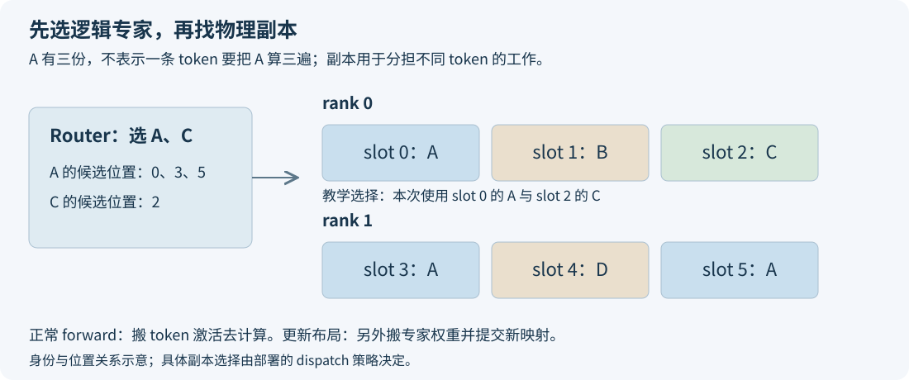

# EPLB 到底改了什么？从一次路由到一次专家搬家

第一次接触 EPLB，很容易把几件事混在一起：给热门专家增加副本，是不是改了模型？把专家搬到另一张卡，是不是每个 token 都要搬权重？配置了 16 个冗余专家，是不是每张卡都多放 16 份？

先抓住日常执行和偶尔更新这两条线。日常执行时，Router 为一条 token 选专家，系统把这条 token 的输入送到相应副本计算。EPLB 在一段时间后查看各专家的工作量，决定要不要调整副本；决定调整以后，才搬动权重、切换位置映射。先沿同一条 token 走完，再回来看更新，就能分清每一步动了什么。

下面用一个小模型说明这条链，再对应到 SGLang 的实现。源码以 [`2914be60`](https://github.com/sgl-project/sglang/tree/2914be608009b65099c4c52ba118a597bf1b1421) 为固定快照，讨论固定 EP 拓扑、PP=1 的普通动态更新。小模型的计数和耗时都是教学设定，配套代码可以在 CPU 上复算。

## 一、逻辑专家是函数，物理槽位是存放它的地方

假设一层 MoE 有四个逻辑专家 A、B、C、D。每个专家有自己的权重，可以理解为一个确定的计算函数。Router 给某个 token 选出 A 和 C，表示这个 token 要分别通过 A、C，再按路由权重合并输出。

物理槽位描述的是权重实际放在哪里。两张卡每张分配三个槽位，一共有六个位置，可以这样装：

```text
rank 0：[A，B，C]
rank 1：[A，D，A]
```

这里四个逻辑专家占六个物理位置，A 有三份，B、C、D 各一份。额外的两份 A 是冗余副本。它们保存相同的专家参数，用来把 A 的请求分到多个位置。

同一个 token 选中 A 后，通常只去 A 的某一个副本，执行一次完整的 A。三个副本没有把 A 切成三块，也不要求这条 token 把 A 算三遍。副本让不同 token 有机会分开执行，能否分得均匀还取决于具体 dispatch 策略。

这里的副本可以理解为多处存着同一套参数。若两条 token 都选中 A，系统可以把第一条送到一处、第二条送到另一处，让两边同时处理不同工作；对于其中任何一条 token，A 的完整计算都没有省略。它增加的是可分担工作的执行位置。

因此，副本数量和 Router 的 Top-K 分别管理两件事。Top-K 决定这枚 token 使用哪些逻辑专家，副本数决定选中某位专家后可以去哪些位置执行。多放几份 A，是给同一个 A 增加可用执行位置，模型使用的逻辑专家仍然相同。



## 二、正常 forward 搬 token，更新布局才搬权重

继续跟踪刚才的 token。Router 输出逻辑专家 A、C，位置映射查出它们有哪些物理副本，dispatch 决定本次使用哪一个。输入激活随后传给相应设备，专家计算完成，combine 再把结果放回这条 token 的正确位置。

```text
token → Router 选 A、C → 查物理位置
      → dispatch 输入激活 → 执行专家 → combine 输出
```

这条路径每次 forward 都会发生。这里传输的是 token 对应的激活与执行所需的相关信息，并不是每次把 A、C 的全部权重发送过去。专家权重通常已经常驻在目标设备上，等着接收工作。

当 EPLB 决定把 A 的一份副本从 rank 1 调整到另一处时，才需要运行权重迁移。它发生在更新流程中，与日常 MoE dispatch 属于不同的通信。两者都可能出现在 HCCL 或其他通信后端的时间线上，分析 profiling 时应按调用位置区分。

固定源码的[逻辑 ID 到物理 ID 转换](https://github.com/sgl-project/sglang/blob/2914be608009b65099c4c52ba118a597bf1b1421/python/sglang/srt/eplb/expert_location_dispatch.py#L98-L120)也把这两层分开：映射根据 dispatch 策略寻找物理位置，随后模型按该位置执行。看到物理 ID 改变，先查逻辑专家是否仍相同，不能直接认定 Router 改了选择。

位置表可以用很小的例子检查。若物理槽位到逻辑专家的表是 `[A,B,C,A,D,A]`，逻辑 A 的候选位置就是 0、3、5。假设每 rank 三个槽位，0 属于 rank 0，3、5 属于 rank 1。执行系统还要根据这次分流决定具体使用哪份 A，而不是把逻辑编号 A 当作物理位置 0 永远使用。

这也说明副本数与设备数并不相同。A 虽然有三份，但其中两份挤在 rank 1，不会凭空得到三张设备的算力。Planner 需要连同 B、C、D 的负载考虑整个放置结果，部署也需要确认实际分流有没有把副本用起来。

## 三、为什么“换个位置”能让一轮计算更快

假设一个统计区间内，A、B、C、D 分别收到 `[120,50,20,10]` 次路由。若只有四个基本副本，两张卡各装两位专家，原布局为 `[A,D]` 与 `[B,C]`，预计工作量分别是 130 和 70。两边需要会合时，较轻的设备要等更重的一边。

现在允许两个额外副本。按“逻辑负载除以副本数”估算每份负担，A 第一份额外副本能把 120 分成 60、60；再增加一份，变成 40、40、40。此时最大的单份预计工作量是 B 的 50。

把六份专家分进两张卡，可以得到：

```text
rank 0：[B，A，D] → 50 + 40 + 10 = 100
rank 1：[A，A，C] → 40 + 40 + 20 = 100
```

这份账假定 A 的请求能分流到三份副本，并用路由次数代表工作量。这份计数账展示了最忙 rank 的预计负担怎样下降。真实专家计算还受分组形状、上下文、通信和算子效率影响。[完整副本分配过程](eplb-redundant-expert-allocation.md)与[相同 token 数为何耗时不同](../performance/moe-equal-token-counts-unequal-latency.md)分别展开这两件事。

还要注意，给 A 三份以后，没有必要每次都重新装这六份权重。目标设备已经有 A，就优先复用；同一槽位仍是同一专家，可以直接保留。迁移成本取决于旧、新布局之间实际缺少哪些数据，不等于“全部专家数乘权重大小”。

## 四、一次动态更新，按什么顺序完成

一次普通更新可以沿五步理解。

首先记录真实执行。各 rank 收集相关层的路由计数，窗口保留近期历史。计数对应哪些 forward、是否包含 padding、是否混入 draft，会影响后面的判断。这个阶段得到的是工作量观测，还没有开始搬模型。

接着在检查点导出统计。物理副本的计数按映射合回逻辑专家，再在参与 rank 间归约。Planner 要知道“A 总共多热”，不能把 A 的三个物理副本误当作三个互不相关的逻辑专家。

然后生成新布局。算法决定每个逻辑专家有几份，并把这些副本放进有限的物理槽位。槽位容量是已经分配好的模型存储约束，不能因为某张卡热度低，就无限向它塞专家。

之后才比较旧、新布局，保护还会被读取的源数据，完成必要的本地复制和跨卡迁移。主权重、scale 等辅助参数要对应同一个逻辑专家一起到位。遇到循环换位时，源数据必须先保住，避免前一次覆盖破坏后一次还要读取的专家。

最后提交位置映射，让后续 token 按新布局执行。固定源码的 [updater](https://github.com/sgl-project/sglang/blob/2914be608009b65099c4c52ba118a597bf1b1421/python/sglang/srt/eplb/expert_location_updater.py#L66-L83)先更新权重，再更新相关层的位置元数据。图回放涉及的原位存储和设备依赖也必须正确，详见[图捕获与权重地址](../performance/graph-capture-tensor-storage.md)。

这个顺序解释了为什么只改一张映射表不够：表可以很小，表所指向的专家数据却必须已经在那里。也解释了为什么搬完没有通信异常，还需要检查模型输出——地址合法不代表专家内容正确。

## 五、静态、动态、冗余与 dispatch，分别控制什么

“静态 EPLB”通常指预先根据代表性负载生成布局，在模型初始化或部署时加载它。服务之后沿这份布局执行，不靠周期迁移持续追踪热点。动态 EPLB 则在运行中持续记录、检查并更新布局。静态布局的采样场景与当前业务是否一致，是效果的重要前提。

冗余专家决定可用物理位置的额外预算。以 256 位逻辑专家、16 个额外副本、EP16 为例，每层共有 272 个物理槽位，每个 rank 17 个。16 是整个相关 EP 组在每层的预算，并不是每张卡加 16。没有冗余时也能通过重新放置已有专家改善分布，只是无法用额外副本进一步拆分同一热点。

I 和 W 则属于动态流程。I 控制 manager 的检查节奏，W 控制保留多少条统计记录。它们都不是请求数；DSpark 一次 verify 产生多个 token，也不让这些参数自动变成输出 token 间隔。

还有一个名字容易混淆：`--ep-dispatch-algorithm static` 中的 static，是逻辑专家到物理副本的选择策略名称，不表示动态 EPLB 已关闭。固定源码在启用 EPLB 时会[解析 recorder 与 dispatch 配置](https://github.com/sgl-project/sglang/blob/2914be608009b65099c4c52ba118a597bf1b1421/python/sglang/srt/arg_groups/parallel_hook.py#L764-L815)；是否周期更新，应查 EPLB 开关、manager 和实际更新日志。

这些参数要成套记录。仅写“ON 比 OFF 快”，却没有说明两边冗余数、初始布局、实际 KV 容量与统计设置，读者无法判断比较的是运行时更新，还是另一组模型存储和调度条件。

从配置走到执行，还需要留一份最终生效记录。动态开关控制运行时重平衡；recorder 模式决定怎样收集；冗余数决定模型要分配多少额外权重；I、W 决定检查与历史。如果启动参数被上层脚本覆盖，或者加载了另一份静态布局，只看最初写下的命令就会误解结果。

显存也由这些不同阶段共同构成。额外专家是常驻模型数据，统计 buffer 随 W、层数和专家维度增长，迁移还需要 scratch，通信后端可以在首次使用时分配资源。开关前后只比较一次空闲显存，不能自动分清每一项来自哪里。应在相同实际 KV 容量与相同采样阶段对照，再结合分配与通信证据解释。

## 六、怎样确认自己看到了 EPLB 的收益

先问布局改之前有没有值得改善的倾斜。如果最忙 rank 与其他 rank 的路由负载已经接近，新布局的空间就有限。即使 MoE 确实更均匀，Attention、Dense 层、调度或 P 端排队仍可能支配整条请求。

再问这份布局是否及时。Planner 使用过去的统计，搬完以后才服务新负载。热点已经变化，旧统计生成的布局就可能落后；I、W 和 update 时间需要放在同一条时间线上分析。

验证时可以固定一次执行状态，对比正常 forward、一次 update、更新后正常 forward，并恢复旧布局复查。这里要固定真实输入、batch、上下文与 KV，不能把相邻两步自然增长的 Decode 当作同状态对照。完整服务再用一致负载测 OFF/ON，保留 TTFT、TPOT、E2E、输出吞吐、失败和 DSpark 接受计数。

两种测试分别回答“布局改善了多少计算”和“服务最终得到多少收益”。前者帮助找机制，后者帮助做部署决定。update 更快、显存更低、均衡度更高，都有价值，但各自需要对应的计量证据。

配套的[小模型计算](../../examples/eplb-study-lab/eplb_models.py)会实际核对 130/70 到 100/100 的负载账，输出对应上面的布局、计数和副本分担过程。专题中接下来的文章分别讨论[热度表怎么读](eplb-count-npz-reading.md)、[如何少搬权重](eplb-minimize-weight-movement.md)，以及[整轮收益上限](../performance/eplb-speedup-upper-bound.md)。

[返回 EPLB 专题](eplb-study-guide.md)。
