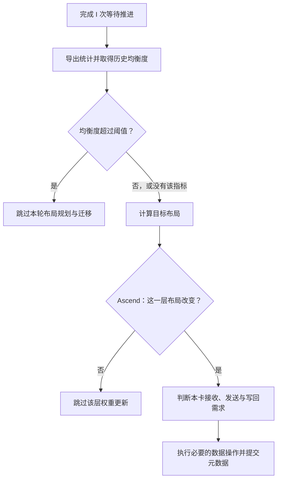

# 到了更新间隔，为什么不一定要搬专家？

EPLB 配置为每 1000 步更新，日志中却不一定每隔 1000 步就出现权重通信。有时刚打印 `rebalance start`，便立即跳过，甚至还没规划新布局。这时要先查清：流程在哪一步退出了？

到达更新间隔，只是开始检查。随后还要判断当前是否已经足够均衡、新旧布局是否不同，以及本 Rank 是否需要发送或接收权重，最后才可能发生实际搬运。

这些条件可以跳过整个周期，也可以只跳过一层或某个 Rank 的权重操作。区分退出范围，才能说明为什么没搬，以及此前已经花了哪些成本、后续又省下什么。

## 一、I 计算的是执行步，不是请求数

`ModelRunner`在 forward 后推进 manager，生成器等待指定次数后进入 `rebalance()`，参数 `eplb_rebalance_num_iterations` 以下记 I。[forward 调用](https://github.com/sgl-project/sglang/blob/fb9846d3e2d66811b372b28c73229e9dbbf54288/python/sglang/srt/model_executor/model_runner.py#L1896-L1898)与[生成器](https://github.com/sgl-project/sglang/blob/fb9846d3e2d66811b372b28c73229e9dbbf54288/python/sglang/srt/eplb/eplb_manager.py#L88-L94)分别对应两步。

一批 256 请求执行一次 forward，manager 仍推进一次；DSpark 一轮提交多 token，也不能按输出数换算。ROCm 特定模式还有额外条件，计数应按实际执行路径理解。

执行原函数、设置 I=4 时，前四次调用分别停在 `yield`，第 5 次才首次重平衡，之后为第 9、13 次。首次触发偏移来自生成器的启动控制流，相邻检查仍间隔四次调用；排查时应核对实际触发位置。

进入后先处理停用与弹性阶段，再导出统计。普通固定拓扑如下：



均衡度由社区 manager 检查，整层筛选来自本文核对的 Ascend PR。位置不同，能省的成本也不同。

## 二、均衡度已经达标，就不用再算一份新布局

一层两 rank 各 100 次路由时均匀，改为 180/20 则前者更忙。社区按下面比例评分：

```text
balancedness = (各 rank 路由数的均值 + 1e-5)
               / (最忙 rank 的路由数 + 1e-5)
```

100/100 得到 1，180/20 则约为 0.5556。实现对每条记录先逐层计算，再求层均值放入历史，manager 使用这些历史评分的平均值判断，见[指标](https://github.com/sgl-project/sglang/blob/fb9846d3e2d66811b372b28c73229e9dbbf54288/python/sglang/srt/eplb/expert_distribution.py#L824-L855)与[公式](https://github.com/sgl-project/sglang/blob/fb9846d3e2d66811b372b28c73229e9dbbf54288/python/sglang/srt/eplb/expert_distribution.py#L1156-L1171)。

日志 `utilization` 来自路由计数，不是 `npu-smi`、`nvidia-smi` 的设备忙碌时间。路由均匀后，Attention、访存和通信仍可能决定整步耗时。

省略日志与配置读取后，manager 的条件为：

```python
if average_utilization_rate_over_window is None:
    return True
if average_utilization_rate_over_window > threshold:
    return False
return True
```

返回 `True` 才继续规划。以阈值 0.90 为例：

| 历史均衡度 | 是否继续 | 原因 |
| ---: | --- | --- |
| 0.70 | 是 | 尚未达到设定的均衡程度 |
| 0.90 | 是 | 代码使用严格大于，相等时继续 |
| 0.95 | 否 | 已超过阈值，跳过本轮 |
| 没有该指标 | 是 | 缺少指标不会自动阻止重平衡 |

日志只显示两位小数，打印 0.90 不代表实际恰等阈值，比较仍用原数值。

阈值越低，越容易跳过；阈值越高，越容易继续。它评估的是当前路由均匀程度，还没有计算新方案。0.90 也不表示“预计提速超过 10% 才更新”，见[判断](https://github.com/sgl-project/sglang/blob/fb9846d3e2d66811b372b28c73229e9dbbf54288/python/sglang/srt/eplb/eplb_manager.py#L225-L239)。

## 三、默认配置并没有打开这道门

实际启用时，还要同时检查 report，不能只改 threshold。

`expert_balancedness_report_mode` 默认是 `off`，此时不维护评分历史，导出 `None` 后 manager 继续。阈值采用默认 `1.0` 时也会专门返回 `None`，是否接近 1 由 `math.isclose` 判断。[默认项](https://github.com/sgl-project/sglang/blob/fb9846d3e2d66811b372b28c73229e9dbbf54288/python/sglang/srt/arg_groups/fields/exec_.py#L929-L953)、[历史条件](https://github.com/sgl-project/sglang/blob/fb9846d3e2d66811b372b28c73229e9dbbf54288/python/sglang/srt/eplb/expert_distribution.py#L779-L815)和[导出](https://github.com/sgl-project/sglang/blob/fb9846d3e2d66811b372b28c73229e9dbbf54288/python/sglang/srt/eplb/expert_distribution.py#L1015-L1038)共同决定是否有效。

以下普通 `stat` 片段追加到已有启动命令，保留模型和并行，仅以 0.90 演示：

```bash
--enable-eplb \
--eplb-rebalance-num-iterations 4000 \
--expert-distribution-recorder-mode stat \
--expert-distribution-recorder-buffer-size 1000 \
--expert-balancedness-report-mode server_log \
--eplb-min-rebalancing-utilization-threshold 0.90
```

这里要区分检查周期、路由历史和评分历史。I4000 设置检查频率，W1000 设置 planner 的路由窗口；均衡度另外维护容量为 10、100、1000 的队列，判断时使用最后一组的平均值，并不随 W 任意改变容量。

dump 后的 reset 会清除计数和评分，即使随后因阈值跳过，这次重置也已经发生。评分队列只有 50 条时，就对已有 50 条求均值，不会等待填满 1000。若设置 I4000、W200，planner 读取最后 200 条路由记录，评分却可覆盖本周期末至多 1000 条，二者的时间范围不同，见[求均值](https://github.com/sgl-project/sglang/blob/fb9846d3e2d66811b372b28c73229e9dbbf54288/python/sglang/srt/eplb/expert_distribution.py#L883-L896)与[reset](https://github.com/sgl-project/sglang/blob/fb9846d3e2d66811b372b28c73229e9dbbf54288/python/sglang/srt/eplb/expert_distribution.py#L363-L367)。

平均的先后也会改变决策，以下为教学负载：

| 执行步 | rank 0 路由数 | rank 1 路由数 | 本步均衡度 |
| --- | ---: | ---: | ---: |
| 大 batch | 900 | 900 | 1.0000 |
| 小 batch | 18 | 2 | 0.5556 |

先逐步评分再平均，约为 0.7778；先把两步路由合并成 `[918,902]` 再评分，约为 0.9913。在 0.90 阈值下，前者继续更新，后者跳过。当前实现采用前一种方法，每条记录等权。

全零时分子分母都为 `1e-5`，得 1，混入空记录便会抬高历史均值。应先修有效路由与身份，再调阈值，详见[零记录](../performance/eplb-zero-record-rolling-window.md)。

## 四、通过了阈值，也可能没有需要改变的布局

通过评分后，planner 才按逻辑负载、副本及拓扑生成映射，预算分配见[副本与物理布局](eplb-redundant-expert-allocation.md)。

计数小幅变化未必改变副本或放置，所以新旧映射仍可能相同。此时重复 NZ→ND、迁移准备和回填，没有得到新的专家布局。

核对的 Ascend 路径在 staging 之前比较各层完整的 `physical_to_logical_map_cpu`，只处理映射改变的层；如果整块相同，就直接返回。到这里统计、阈值检查与规划都已完成，省下的是后续权重准备和迁移，见[层筛选](https://github.com/AkiYangDev/sglang/blob/9f4ee2cc165b2072890fac5c90afa2a4550fefce/python/sglang/srt/hardware_backend/npu/eplb.py#L92-L127)。

该快捷路径属于 PR 中的 Ascend 实现。社区通用更新器先建 buffer，再按槽分析，虽已有不变槽位返回，成本仍不同，不能写成所有后端都已提前跳整层，参见[buffer](https://github.com/sgl-project/sglang/blob/fb9846d3e2d66811b372b28c73229e9dbbf54288/python/sglang/srt/eplb/expert_location_updater.py#L146-L175)与[槽位](https://github.com/sgl-project/sglang/blob/fb9846d3e2d66811b372b28c73229e9dbbf54288/python/sglang/srt/eplb/expert_location_updater.py#L260-L287)。

相等要比较完整物理映射，单看副本数不够，例如：

```text
原布局：[E0, E1 | E2, E3]
新布局：[E1, E0 | E2, E3]
```

竖线划分两个 Rank。每个专家仍有一份副本，但 Rank0 的两个槽位已经交换，即使无需 P2P，也要做本地重排。执行原通用单层 CPU 例子时，Rank0 写回两次；完全相同的布局则两端都不写目标权重。

## 五、本卡没变化，还可能是别人的发送端

全局层变化时，本地不变也可能要发送。以下四 rank 各两槽：

```text
          rank 0   rank 1   rank 2   rank 3
原布局：  [0, 1]   [2, 3]   [4, 5]   [0, 2]
新布局：  [0, 1]   [0, 3]   [4, 5]   [2, 2]
```

rank0 保留 E0 不变，但 rank1 新槽需要 E0，直接退出可能切断来源。

Rank2 的 E4、E5 没有被任何改变后的目标槽位需要，因此可以跳过。Ascend 的参与判断会保留本地有变化的 Rank，以及旧权重可能为改变目标提供来源的 Rank。后者只是候选发送者，最终从哪里取权重，仍由公共迁移算法决定。

只负责发送、本地布局不变的 Rank，发送后无需再重复写回自身权重。[候选来源](https://github.com/AkiYangDev/sglang/blob/9f4ee2cc165b2072890fac5c90afa2a4550fefce/python/sglang/srt/hardware_backend/npu/eplb.py#L130-L137)与[写回判断](https://github.com/AkiYangDev/sglang/blob/9f4ee2cc165b2072890fac5c90afa2a4550fefce/python/sglang/srt/hardware_backend/npu/eplb.py#L57-L83)负责不同阶段。

ElasticEP 需要另行处理，映射不变时故障可用来源仍可能变化。因此该实现检测弹性状态后，不走整层相等和本地无需求退出，保留恢复路径。

跳过权重搬运，并不意味着可以退出此前要求全体参加的统计归约，metadata 也有自己的提交步骤。可以减少的是相应数据操作，通信与状态协议仍须保持一致。

## 六、跳过省的是后续工作，判断本身也有账

`rebalance start`打印在 dump 与评分前，只说明流程开始；随后 `Skipped ep rebalancing` 才说明评分挡下本轮。

评分阶段跳过时，stat 映射与 `all_reduce` 已经执行；report 还需要逐步归约、维护历史，默认不分块路径也会在判断前同步设备。省下的是后续规划、权重搬运与 metadata 更新，这次检查本身仍有成本。

不同退出点对应的成本为：

| 退出位置 | 已经完成 | 主要省掉 |
| --- | --- | --- |
| 均衡度超过阈值 | 统计维护、导出与归约 | 布局规划及后续更新 |
| Ascend 整层布局相同 | 统计与布局规划 | 该层权重 staging、迁移 |
| 某卡无需接收或作为候选发送者 | 全局布局与本地参与分析 | 本卡该层的数据准备与操作 |
| 某个目标槽位没变 | 层级准备与槽位检查 | 该槽位接收、本地重排和写回 |

评分没有预测迁移何时回本。用一个教学例子看，update 花 600ms、后续每步省 0.1ms，需要 6000 步才能抵消；若 4000 步后又换布局，只省回 400ms。达到失衡阈值，还不能证明这次搬运划算。

threshold 判断当前均衡程度，I 决定检查频率，也影响收益能够持续摊销多久。是否值得更新，还要测固定状态 Forward 的变化、收益持续时间，以及服务时延与吞吐，参见[decode 测量](../performance/dynamic-eplb-decode-benefit-measurement.md)，其中保留了小收益与长尾变差。

查没搬时，先判断是否跳过整周期，再看目标物理映射，最后沿具体 rank 检查接收、发送、本地交换和写回。这样才能确定退出位置及其实际节省。

## 源码版本与可核对的例子

社区行为固定于 SGLang [`fb9846d3`](https://github.com/sgl-project/sglang/tree/fb9846d3e2d66811b372b28c73229e9dbbf54288)。Ascend 整层与本地参与筛选固定于 [`9f4ee2cc`](https://github.com/AkiYangDev/sglang/blob/9f4ee2cc165b2072890fac5c90afa2a4550fefce/python/sglang/srt/hardware_backend/npu/eplb.py)，对应写作时仍在评审的 [PR #47574](https://github.com/sgl-project/sglang/pull/47574)；该版本的 manager 与本文引用的社区 manager 内容一致。

文中的阈值、历史平均、生成器边界和布局例子，均在 PyTorch 2.5.1+cpu 上抽取原函数执行。验证包含 10 个阈值分支、4 个指标返回空值的配置、5 个负载评分、8 个 Ascend 参与选择、4 个本地权重更新，以及弹性状态下保留参与的对照。输入是教学数据，测试未执行跨设备传输，也没有把这些结果当作服务吞吐收益。[完整 CPU 结果](../../assets/eplb-skip-unnecessary-migration/cpu-examples.json)和[源码校验信息](../../assets/eplb-skip-unnecessary-migration/evidence.json)随文保存。
