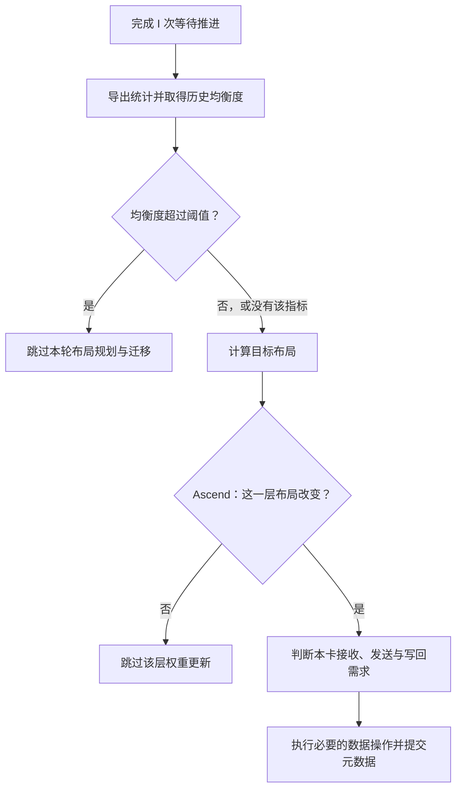

# 到了更新间隔，为什么不一定要搬专家？

动态 EPLB 配置了每 1000 步更新一次，日志里却没有每 1000 步都出现权重通信。还有一种情况：已经打印 `rebalance start`，后面跟着一条跳过日志，根本没有进入布局规划。这两种现象都能从执行路径里找到解释。

更新间隔决定多久进入一次重平衡流程。真正执行到权重搬运之前，还要经过均衡度判断、布局规划和迁移需求分析。到达检查时机，并不等于已经决定搬家。

读这条路径时，最容易混淆的是三个范围：整个重平衡周期、一层专家布局、某个 rank 的权重。它们各有自己的退出条件。把这三个范围分开，才能回答“这次为什么没搬”，也才能知道跳过到底省掉了什么。

## 一、I 计算的是执行步，不是请求数

SGLang 的 `ModelRunner` 在 forward 结束后推进 EPLB manager；manager 内部用生成器等待指定数量的推进，再进入 `rebalance()`。这里的间隔参数是 `eplb_rebalance_num_iterations`，下文记为 I。[forward 完成后的调用](https://github.com/sgl-project/sglang/blob/fb9846d3e2d66811b372b28c73229e9dbbf54288/python/sglang/srt/model_executor/model_runner.py#L1896-L1898)、[生成器入口](https://github.com/sgl-project/sglang/blob/fb9846d3e2d66811b372b28c73229e9dbbf54288/python/sglang/srt/eplb/eplb_manager.py#L88-L94)对应这两段。

一个 decode batch 中同时有 256 条请求，一轮 forward 仍然是一次执行，不会直接给计数器加 256。开启 DSpark 后，一轮 verify 又可能提交多个输出 token，也不能拿客户端输出 token 数替代 manager 的推进次数。特定 ROCm 模式还有单独的推进条件，说明这个计数本身就要跟执行路径一起读。

生成器还存在启动边界：把 I 缩成 4，用原函数连续推进，第一次进入重平衡发生在第 5 次调用，之后是第 9、13 次。最初四次调用停在四个 `yield` 上。这是源码的控制流，不代表两次检查之间多出了一个完整周期。定位日志时，应跟踪真实触发记录，不能仅凭请求数倒推。

进入 `rebalance()` 以后，管理器先处理停用状态、弹性扩缩容阶段，再导出统计。普通定长拓扑的主路径可以画成这样：



图中的均衡度判断属于社区 manager；整层筛选来自本文核对的 Ascend PR。它们处于不同位置，省掉的工作也不同。

## 二、均衡度已经达标，就不用再算一份新布局

假设一层的两个 rank 分别承担 100、100 次有效路由，两边很均匀；换成 180、20，前者就成了慢端。社区代码用下面的比值描述这一点：

```text
balancedness = (各 rank 路由数的均值 + 1e-5)
               / (最忙 rank 的路由数 + 1e-5)
```

100/100 的结果是 1，180/20 的结果约为 0.5556。每次记录先逐层计算这个值，再对层取平均，写入历史队列。到了检查时机，manager 根据历史平均值决定是否继续。[指标计算](https://github.com/sgl-project/sglang/blob/fb9846d3e2d66811b372b28c73229e9dbbf54288/python/sglang/srt/eplb/expert_distribution.py#L824-L855)、[均值与最大值公式](https://github.com/sgl-project/sglang/blob/fb9846d3e2d66811b372b28c73229e9dbbf54288/python/sglang/srt/eplb/expert_distribution.py#L1156-L1171)给出了完整定义。

这不是 `npu-smi` 或 `nvidia-smi` 采到的设备利用率。源码和日志中的 `utilization` 容易让人误会，但它来自专家路由计数，没有测量计算单元忙了多久。路由均匀以后，Attention、权重访存和通信仍然可能限制整步速度。

manager 的判断很直接，下面把配置读取简写为 `threshold`，省略日志：

```python
if average_utilization_rate_over_window is None:
    return True
if average_utilization_rate_over_window > threshold:
    return False
return True
```

`True` 表示继续重平衡。阈值设为 0.90 时，结果如下：

| 历史均衡度 | 是否继续 | 原因 |
| ---: | --- | --- |
| 0.70 | 是 | 尚未达到设定的均衡程度 |
| 0.90 | 是 | 代码使用严格大于，相等时继续 |
| 0.95 | 否 | 已超过阈值，跳过本轮 |
| 没有该指标 | 是 | 缺少指标不会自动阻止重平衡 |

跳过日志只保留两位小数，打印 0.90 不代表原始数值恰好等于 0.90；分支比较使用实际值。

因此，阈值调低，会更容易跳过；阈值调高，会允许更多检查继续进入规划。它没有表达“只有预计提速超过 10% 才更新”。[判断分支源码](https://github.com/sgl-project/sglang/blob/fb9846d3e2d66811b372b28c73229e9dbbf54288/python/sglang/srt/eplb/eplb_manager.py#L225-L239)只比较现有布局的路由均衡度，尚未计算新布局。

## 三、默认配置并没有打开这道门

这项机制最容易踩的配置点，是只改阈值、没有启用均衡度报告。

社区代码把历史均衡度的维护放在 report 路径里。`expert_balancedness_report_mode` 默认为 `off`，此时不维护这项指标；导出时返回 `None`，manager 继续重平衡。阈值默认是 `1.0`，代码也会专门返回 `None`，不利用历史均衡度跳过。实现使用 `math.isclose` 识别接近 1 的阈值。[默认参数](https://github.com/sgl-project/sglang/blob/fb9846d3e2d66811b372b28c73229e9dbbf54288/python/sglang/srt/arg_groups/fields/exec_.py#L929-L953)、[历史指标的启用与返回条件](https://github.com/sgl-project/sglang/blob/fb9846d3e2d66811b372b28c73229e9dbbf54288/python/sglang/srt/eplb/expert_distribution.py#L779-L815)、[导出分支](https://github.com/sgl-project/sglang/blob/fb9846d3e2d66811b372b28c73229e9dbbf54288/python/sglang/srt/eplb/expert_distribution.py#L1015-L1038)共同决定这个行为。

以普通 `stat` 路径为例，下面是追加到已有模型启动命令中的参数片段。0.90 用于说明机制，模型路径和并行配置沿用原服务：

```bash
--enable-eplb \
--eplb-rebalance-num-iterations 4000 \
--expert-distribution-recorder-mode stat \
--expert-distribution-recorder-buffer-size 1000 \
--expert-balancedness-report-mode server_log \
--eplb-min-rebalancing-utilization-threshold 0.90
```

这里有三段历史，不能只记住一个“窗口 1000”。I=4000 管理检查节奏；recorder buffer 的 W=1000 保存 planner 使用的最近路由计数；均衡度还维护容量分别为 10、100、1000 的队列，判断使用最后一个队列的均值。后者不会跟着 W 任意改变。

导出记录后，recorder 会执行 reset，清理计数和均衡度历史。检查因阈值跳过，也已经发生了这次导出与重置。若两次检查之间只有 50 条记录，容量为 1000 的均衡度队列就对已有的 50 条求平均，并不会等满 1000 条才有结果。若 I=4000、W=200，planner 只看到最后 200 条计数，均衡度判断则能看到该周期最后至多 1000 条评分。两者描述的时间范围不同。[队列求均值](https://github.com/sgl-project/sglang/blob/fb9846d3e2d66811b372b28c73229e9dbbf54288/python/sglang/srt/eplb/expert_distribution.py#L883-L896)、[dump 后重置](https://github.com/sgl-project/sglang/blob/fb9846d3e2d66811b372b28c73229e9dbbf54288/python/sglang/srt/eplb/expert_distribution.py#L363-L367)说明了这两个细节。

平均方式也会改变判断。用两个执行步做教学例子：

| 执行步 | rank 0 路由数 | rank 1 路由数 | 本步均衡度 |
| --- | ---: | ---: | ---: |
| 大 batch | 900 | 900 | 1.0000 |
| 小 batch | 18 | 2 | 0.5556 |

按源码先逐步计算、再平均，结果约为 0.7778。若把路由次数先合并成 `[918,902]` 再算，会得到约 0.9913。阈值为 0.90 时，两者会作出相反决定。当前实现使用前一种算法，每条记录在历史平均中权重相同。

全零路由在公式下也得到 1：分子分母都是 `1e-5`。所以空记录混入历史，能够把均衡度往上拉。应先保证有效路由和记录身份正确，再讨论阈值；这条影响路径在[统计窗口中的零记录](../performance/eplb-zero-record-rolling-window.md)里有完整推演。

## 四、通过了阈值，也可能没有需要改变的布局

通过阈值以后，planner 才根据逻辑负载、副本预算和拓扑生成目标映射。关于 16 个额外位置怎样分配，见[从专家热度到副本，再到物理布局](eplb-redundant-expert-allocation.md)。

新一轮计数变化，不要求映射一定变化。比如热度略有波动，却没有改变副本分配和放置顺序，目标布局就能与原布局相同。这时继续做 NZ→ND、准备迁移、ND→NZ 和回填，只是在重复处理同一组专家。

本文核对的 Ascend 实现在进入 staging 前，对每层的完整 `physical_to_logical_map_cpu` 做相等比较，只保留改变的层；整块都没变时直接返回。它省掉的是这些层的权重 staging 和迁移准备，之前的统计导出、阈值判断和布局规划已经执行过。[Ascend 层筛选源码](https://github.com/AkiYangDev/sglang/blob/9f4ee2cc165b2072890fac5c90afa2a4550fefce/python/sglang/srt/hardware_backend/npu/eplb.py#L92-L127)。

这项筛选属于 PR 中的 Ascend 路径，不能写成社区所有后端都已经跳过整层。核对的社区通用更新器会先创建临时 buffer，再逐层分析；它已有“目标槽位的逻辑专家没有变化就返回”的分支，避免该槽位的接收和写回，但与进入整层准备之前退出，成本不同。[通用 buffer 创建](https://github.com/sgl-project/sglang/blob/fb9846d3e2d66811b372b28c73229e9dbbf54288/python/sglang/srt/eplb/expert_location_updater.py#L146-L175)、[不变槽位分支](https://github.com/sgl-project/sglang/blob/fb9846d3e2d66811b372b28c73229e9dbbf54288/python/sglang/srt/eplb/expert_location_updater.py#L260-L287)可以对照阅读。

判断相等时，要比较物理映射，不能只比较每个专家的副本数量。例如：

```text
原布局：[E0, E1 | E2, E3]
新布局：[E1, E0 | E2, E3]
```

竖线两侧是两个 rank。每个专家依然只有一份，rank 0 的两个槽位却交换了内容。路由使用物理位置，权重也得对应到新槽位。这个例子不需要跨 rank 通信，仍然需要本地重排。执行原通用单层函数的 CPU 例子中，rank 0 完成两次目标权重写回；布局完全相同时，两端均没有目标权重写回。没有 P2P，并不等于没有数据操作。

## 五、本卡没变化，还可能是别人的发送端

一层的全局布局改变后，不能让所有“本地槽位没变”的 rank 直接退出。看这份四 rank、每卡两个槽位的例子：

```text
          rank 0   rank 1   rank 2   rank 3
原布局：  [0, 1]   [2, 3]   [4, 5]   [0, 2]
新布局：  [0, 1]   [0, 3]   [4, 5]   [2, 2]
```

rank 0 的两个位置没变，但它保存着 E0，rank 1 的新位置需要 E0。若仅因为本地没变就退出，可能切断计划中的发送来源。

rank 2 的位置也没变，它保存的 E4、E5 又没有被任何改变的目标位置需要，就能跳过该层的数据准备。Ascend 路径据此构造本地参与计划：本地位置变化，或者旧权重中有专家被改变的目标位置需要，就继续参与。后一个条件保留的是候选发送者，实际由谁发送，仍由公共迁移算法选择。

对于只参与发送、本地位置不变的 rank，发送结束后不需要把本地权重再写回一遍。[候选发送者判断](https://github.com/AkiYangDev/sglang/blob/9f4ee2cc165b2072890fac5c90afa2a4550fefce/python/sglang/srt/hardware_backend/npu/eplb.py#L130-L137)、[按本地变化决定写回](https://github.com/AkiYangDev/sglang/blob/9f4ee2cc165b2072890fac5c90afa2a4550fefce/python/sglang/srt/hardware_backend/npu/eplb.py#L57-L83)分别负责这两件事。

弹性 EP 是另一个边界。物理映射没变，不代表故障后的可用来源没变。该 Ascend 实现检测到 ElasticEP 状态时，不使用上述整层相等和本地无参与需求的快捷退出，保留恢复流程。不能把固定拓扑下的优化直接套到成员故障或扩缩容路径。

此外，某个 rank 不需要搬权重，不代表它可以跳过此前要求全体参与的统计归约。元数据提交也有自己的路径。数据操作可以按参与需求减少，整个分布式协议仍要保持一致。

## 六、跳过省的是后续工作，判断本身也有账

在 manager 中，`rebalance start` 先于统计导出和均衡度判断打印。看到 start，只能说明进入了流程；随后出现 `Skipped ep rebalancing`，才说明这次被均衡度条件拦下。

这次跳过已经支付了统计成本。普通 `stat` 导出要把物理计数转换成逻辑计数、执行 `all_reduce`；启用均衡度报告还会在记录时归约每步负载，维护历史。默认不分层分块的计时路径，也在阈值判断前同步设备。跳过主要省掉后续规划、权重处理和元数据更新，而不是让本轮检查变成零开销。

可以按阶段区分省下的内容：

| 退出位置 | 已经完成 | 主要省掉 |
| --- | --- | --- |
| 均衡度超过阈值 | 统计维护、导出与归约 | 布局规划及后续更新 |
| Ascend 整层布局相同 | 统计与布局规划 | 该层权重 staging、迁移 |
| 某卡无需接收或作为候选发送者 | 全局布局与本地参与分析 | 本卡该层的数据准备与操作 |
| 某个目标槽位没变 | 层级准备与槽位检查 | 该槽位接收、本地重排和写回 |

均衡度阈值也没有自动算出“这次搬家能否回本”。用一组教学数字：一次 update 花 600 ms，新布局每步只快 0.1 ms，要保持 6000 步才能抵消更新成本；如果 4000 步后又换布局，这段期间只省回 400 ms。路由失衡足以通过阈值，并不自动证明这次迁移划算。

阈值和 I 因而承担不同任务：阈值筛掉当前已足够均匀的周期；I 控制检查频率，也给布局收益留下摊销时间。真正的决策还要看更新前后相同状态的普通 forward、布局能维持多久，以及整服务的吞吐和延迟。[decode 收益测量](../performance/dynamic-eplb-decode-benefit-measurement.md)把这些实验分开，并保留了收益较小和长尾变差的结果。

排查一次“没有搬专家”时，先确认它是否被均衡度跳过；如果进入了规划，再比较完整物理映射；只有映射改变，才继续找具体 rank 的接收、发送、本地重排和写回。沿着这条顺序看，才能把一次检查、一次计划和一次真实迁移对应起来。

## 源码版本与可核对的例子

社区行为固定于 SGLang [`fb9846d3`](https://github.com/sgl-project/sglang/tree/fb9846d3e2d66811b372b28c73229e9dbbf54288)。Ascend 整层与本地参与筛选固定于 [`9f4ee2cc`](https://github.com/AkiYangDev/sglang/blob/9f4ee2cc165b2072890fac5c90afa2a4550fefce/python/sglang/srt/hardware_backend/npu/eplb.py)，对应写作时仍在评审的 [PR #47574](https://github.com/sgl-project/sglang/pull/47574)；该版本的 manager 与本文引用的社区 manager 内容一致。

文中的阈值、历史平均、生成器边界和布局例子，均在 PyTorch 2.5.1+cpu 上抽取原函数执行。验证包含 10 个阈值分支、4 个指标返回空值的配置、5 个负载评分、8 个 Ascend 参与选择、4 个本地权重更新，以及弹性状态下保留参与的对照。输入是教学数据，测试未执行跨设备传输，也没有把这些结果当作服务吞吐收益。[完整 CPU 结果](../../assets/eplb-skip-unnecessary-migration/cpu-examples.json)和[源码校验信息](../../assets/eplb-skip-unnecessary-migration/evidence.json)随文保存。
