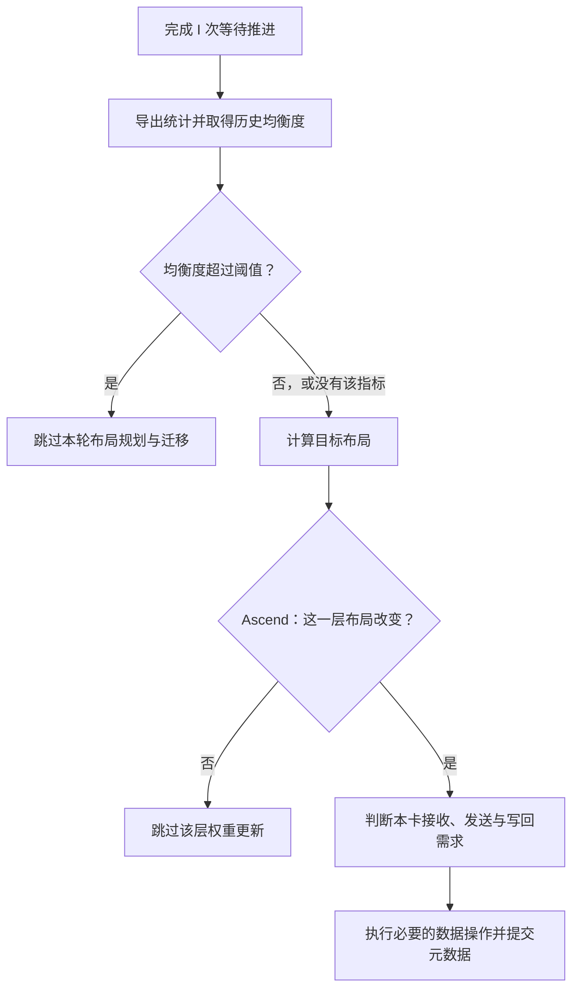

# 到了更新间隔，为什么不一定要搬专家？

EPLB 每 1000 步更新一次，并不保证每隔 1000 步就搬一次权重。`rebalance start` 打出来之后，流程可能还没计算新布局就结束了；也可能已经算完布局，发现这一层原样不动。

即使全局布局有变化，一个 Rank 也未必需要接收权重。它本地没变，又可能正好要给另一个 Rank 发送旧权重。日志里看起来都是“没搬”，退出的位置却各不相同。

<a id="i"></a>

## I 到了以后，manager 做什么

`ModelRunner` 在 forward 后推进 manager，生成器等待指定次数，才进入 `rebalance()`。这个间隔参数是 `eplb_rebalance_num_iterations`，下文记为 I。[forward 调用](https://github.com/sgl-project/sglang/blob/fb9846d3e2d66811b372b28c73229e9dbbf54288/python/sglang/srt/model_executor/model_runner.py#L1896-L1898)与[生成器](https://github.com/sgl-project/sglang/blob/fb9846d3e2d66811b372b28c73229e9dbbf54288/python/sglang/srt/eplb/eplb_manager.py#L88-L94)能对上这两处动作。

一批 256 条请求做一次 forward，manager 仍只推进一次；DSpark 一轮提交多个 token，也不会按输出 token 数推进。ROCm 特定模式还有额外条件，计数得落到实际执行路径上。

抽取原函数、设 I=4，前四次调用分别停在 `yield`，第一次重平衡出现在第 5 次，后续是第 9、13 次。首次偏移是生成器启动控制流带来的，相邻检查之间仍隔四次调用。

进入 `rebalance()` 后，manager 先处理停用与弹性阶段，再导出统计。普通固定拓扑会走过下面这些判断。



评分挡下整轮时，planner 还没运行。图中整层布局相等的判断则来自本文核对的 Ascend PR，在更靠后的权重更新路径上。

<a id="_2"></a>

## threshold 只看当前的路由均衡度

一层的两个 Rank 各有 100 次路由，分配是均匀的；变成 180/20，前一个 Rank 就会更忙。社区实现用下面的比例评分。

```text
balancedness = (各 rank 路由数的均值 + 1e-5)
               / (最忙 rank 的路由数 + 1e-5)
```

100/100 得到 1，180/20 约为 0.5556。每条记录先逐层计算，再求层均值写进历史，manager 最后对这些历史评分求平均。[指标](https://github.com/sgl-project/sglang/blob/fb9846d3e2d66811b372b28c73229e9dbbf54288/python/sglang/srt/eplb/expert_distribution.py#L824-L855)和[公式](https://github.com/sgl-project/sglang/blob/fb9846d3e2d66811b372b28c73229e9dbbf54288/python/sglang/srt/eplb/expert_distribution.py#L1156-L1171)记录了计算过程。

日志把它称为 `utilization`，数据来自路由计数，和 `npu-smi`、`nvidia-smi` 的设备忙碌时间不同。路由均匀了，Attention、访存或通信仍可能决定一步要跑多久。

manager 的判断省略日志与配置读取后是这样。

```python
if average_utilization_rate_over_window is None:
    return True
if average_utilization_rate_over_window > threshold:
    return False
return True
```

返回 `True` 才继续规划。阈值设 0.90，各分支如下。

| 历史均衡度 | 是否继续 | 原因 |
| ---: | --- | --- |
| 0.70 | 是 | 尚未达到设定的均衡程度 |
| 0.90 | 是 | 代码使用严格大于，相等时继续 |
| 0.95 | 否 | 已超过阈值，跳过本轮 |
| 没有该指标 | 是 | 缺少指标不会自动阻止重平衡 |

它用严格大于比较，所以恰好 0.90 还会继续。日志只打印两位小数，看到 0.90，也得留意原值是否已经略高于阈值。

降低阈值，更容易跳过；提高阈值，更容易继续。这时尚未计算新方案，0.90 表达的是当前均衡程度，推不出“预计提速超过 10% 才更新”。对应的[判断](https://github.com/sgl-project/sglang/blob/fb9846d3e2d66811b372b28c73229e9dbbf54288/python/sglang/srt/eplb/eplb_manager.py#L225-L239)在 manager 里。

<a id="_3"></a>

## report 没开，阈值就拿不到评分

默认的 `expert_balancedness_report_mode` 是 `off`，不维护评分历史，导出 `None` 后仍然继续规划。阈值本身采用默认 `1.0` 时，也会专门返回 `None`，是否接近 1 用 `math.isclose` 判断。只改 threshold，未必就启用了这项筛选，[默认项](https://github.com/sgl-project/sglang/blob/fb9846d3e2d66811b372b28c73229e9dbbf54288/python/sglang/srt/arg_groups/fields/exec_.py#L929-L953)、[历史条件](https://github.com/sgl-project/sglang/blob/fb9846d3e2d66811b372b28c73229e9dbbf54288/python/sglang/srt/eplb/expert_distribution.py#L779-L815)和[导出](https://github.com/sgl-project/sglang/blob/fb9846d3e2d66811b372b28c73229e9dbbf54288/python/sglang/srt/eplb/expert_distribution.py#L1015-L1038)要一起看。

下面是追加到已有启动命令的普通 `stat` 片段，模型与并行配置沿用原命令，0.90 仅作演示。

```bash
--enable-eplb \
--eplb-rebalance-num-iterations 4000 \
--expert-distribution-recorder-mode stat \
--expert-distribution-recorder-buffer-size 1000 \
--expert-balancedness-report-mode server_log \
--eplb-min-rebalancing-utilization-threshold 0.90
```

I4000 决定检查频率，W1000 决定 planner 读取的路由窗口。评分历史另外有容量 10、100、1000 的队列，manager 使用最后一组的平均值，容量并不跟 W 任意变化。

比如设 I4000、W200，planner 取最后 200 条路由记录，评分却可以覆盖本周期末至多 1000 条；评分队列只有 50 条时，就对已有的 50 条求均值，不等填满 1000。dump 后还会 reset，清掉计数和评分，随后即使因阈值跳过，本轮重置也已经发生。[求均值](https://github.com/sgl-project/sglang/blob/fb9846d3e2d66811b372b28c73229e9dbbf54288/python/sglang/srt/eplb/expert_distribution.py#L883-L896)与[reset](https://github.com/sgl-project/sglang/blob/fb9846d3e2d66811b372b28c73229e9dbbf54288/python/sglang/srt/eplb/expert_distribution.py#L363-L367)分别对应这些行为。

平均的顺序也有影响。用两步教学负载看，大 batch 均匀，小 batch 偏斜。

| 执行步 | rank 0 路由数 | rank 1 路由数 | 本步均衡度 |
| --- | ---: | ---: | ---: |
| 大 batch | 900 | 900 | 1.0000 |
| 小 batch | 18 | 2 | 0.5556 |

当前实现每条记录等权，逐步评分再平均，约得 0.7778，会在 0.90 阈值下继续更新。若先把路由合成 `[918,902]` 再评分，约为 0.9913，就会跳过。同样两步数据，换个平均顺序，决策已经不同。

全零记录的分子、分母都是 `1e-5`，评分为 1，混进去会把历史均值抬高。[零记录](../performance/eplb-zero-record-rolling-window.md)那篇展开了有效路由与身份问题，阈值调整以前得先把统计修对。

<a id="_4"></a>

## Ascend 可以提前跳过没变的层

通过评分，planner 才根据逻辑负载、副本和拓扑生成目标映射，分配过程见[副本与物理布局](eplb-redundant-expert-allocation.md)。计数变了一点，副本数和放置未必跟着变，最终映射仍可能完全相同。

这份 Ascend 实现在 staging 之前比较各层完整的 `physical_to_logical_map_cpu`，只给变化的层准备权重。整块都相同就直接返回，省下 NZ→ND、迁移准备和回填。此时统计、评分检查和规划早已完成，[层筛选](https://github.com/AkiYangDev/sglang/blob/9f4ee2cc165b2072890fac5c90afa2a4550fefce/python/sglang/srt/hardware_backend/npu/eplb.py#L92-L127)省的是它们后面的工作。

社区通用更新器会先建 buffer，再逐槽分析，已经支持不变槽位返回，但准备成本和 Ascend 提前筛层不同。对照[buffer](https://github.com/sgl-project/sglang/blob/fb9846d3e2d66811b372b28c73229e9dbbf54288/python/sglang/srt/eplb/expert_location_updater.py#L146-L175)与[槽位](https://github.com/sgl-project/sglang/blob/fb9846d3e2d66811b372b28c73229e9dbbf54288/python/sglang/srt/eplb/expert_location_updater.py#L260-L287)，能看见两个退出点的先后。

要比较的是完整物理映射。只看副本数，下面的变化会被漏掉。

```text
原布局：[E0, E1 | E2, E3]
新布局：[E1, E0 | E2, E3]
```

竖线分开两个 Rank。每个专家仍各有一份，Rank0 的两个槽位却交换了。可以不做 P2P，本地仍要重排。原通用单层函数的 CPU 例子中，Rank0 写回两次；布局完全相同的对照，两端都不写目标权重。

<a id="_5"></a>

## Rank0 不接收，也可能需要发送

全局层有变化时，本地映射相同还不足以让一个 Rank 退出。四个 Rank 各两槽的例子里，rank0 就保留着别人需要的 E0。

```text
          rank 0   rank 1   rank 2   rank 3
原布局：  [0, 1]   [2, 3]   [4, 5]   [0, 2]
新布局：  [0, 1]   [0, 3]   [4, 5]   [2, 2]
```

rank1 的新槽需要 E0，rank0 本地虽然不变，直接退出可能切断来源。rank2 的 E4、E5 没被任何变化后的目标槽需要，它才可以跳过。

Ascend 的参与判断保留本地有变化的 Rank，也保留持有潜在来源的 Rank。后者只是候选发送者，实际从哪取权重仍由公共迁移算法决定。只发送、本地布局没变的 Rank，发完不必再写回自身权重，[候选来源](https://github.com/AkiYangDev/sglang/blob/9f4ee2cc165b2072890fac5c90afa2a4550fefce/python/sglang/srt/hardware_backend/npu/eplb.py#L130-L137)与[写回判断](https://github.com/AkiYangDev/sglang/blob/9f4ee2cc165b2072890fac5c90afa2a4550fefce/python/sglang/srt/hardware_backend/npu/eplb.py#L57-L83)处理的是这两个阶段。

ElasticEP 不走这些退出路径。弹性状态下，映射不变，可用来源仍可能因故障而变化，所以实现会保留整层相等或本地无需求情况下的参与。

此前要求全体参加的统计归约也得照常完成，metadata 有自己的提交步骤。减少某个 Rank 的权重操作，不会顺带取消这些协议。

<a id="_6"></a>

## 600ms 的更新，多久能省回来

`rebalance start` 在 dump 和评分之前打印，只能说明流程进入了。后面的 `Skipped ep rebalancing` 才表示评分挡下本轮。

即便评分决定跳过，stat 映射和 `all_reduce` 已经发生；report 还增加逐步归约与历史维护，默认不分块路径在判断前也会同步设备。规划、权重搬运和 metadata 更新可以省掉，检查本身仍然要花时间。

| 退出位置 | 已经完成 | 主要省掉 |
| --- | --- | --- |
| 均衡度超过阈值 | 统计维护、导出与归约 | 布局规划及后续更新 |
| Ascend 整层布局相同 | 统计与布局规划 | 该层权重 staging、迁移 |
| 某卡无需接收或作为候选发送者 | 全局布局与本地参与分析 | 本卡该层的数据准备与操作 |
| 某个目标槽位没变 | 层级准备与槽位检查 | 该槽位接收、本地重排和写回 |

再看一个教学算例，update 花 600ms，布局调整后每步省 0.1ms，需要 6000 步才能抵消。若 4000 步后又换布局，只省回 400ms。这时路由确实失衡，搬运却还没回本。

threshold 评估当前均衡程度，I 决定多久检查一次，也影响收益能摊多久。[decode 测量](../performance/dynamic-eplb-decode-benefit-measurement.md)继续测固定状态 Forward 的变化、收益持续时间和服务时延、吞吐，其中也保留了小收益与长尾变差的结果。

<a id="_7"></a>

## 源码版本与 CPU 验证

社区部分固定在 SGLang [`fb9846d3`](https://github.com/sgl-project/sglang/tree/fb9846d3e2d66811b372b28c73229e9dbbf54288)，Ascend 整层与本地参与筛选固定在 [`9f4ee2cc`](https://github.com/AkiYangDev/sglang/blob/9f4ee2cc165b2072890fac5c90afa2a4550fefce/python/sglang/srt/hardware_backend/npu/eplb.py)，对应写作时仍在评审的 [PR #47574](https://github.com/sgl-project/sglang/pull/47574)。这份 Ascend 版本的 manager 与本文引用的社区 manager 内容一致。

阈值、历史平均、生成器边界和布局例子，都在 PyTorch 2.5.1+cpu 上抽取原函数执行。验证含 10 个阈值分支、4 个指标返回空值的配置、5 个负载评分、8 个 Ascend 参与选择、4 个本地权重更新，以及弹性状态保留参与的对照。输入是教学数据，没有跨设备传输或服务吞吐测试。[完整 CPU 结果](../../assets/eplb-skip-unnecessary-migration/cpu-examples.json)和[源码校验信息](../../assets/eplb-skip-unnecessary-migration/evidence.json)随文保存。
