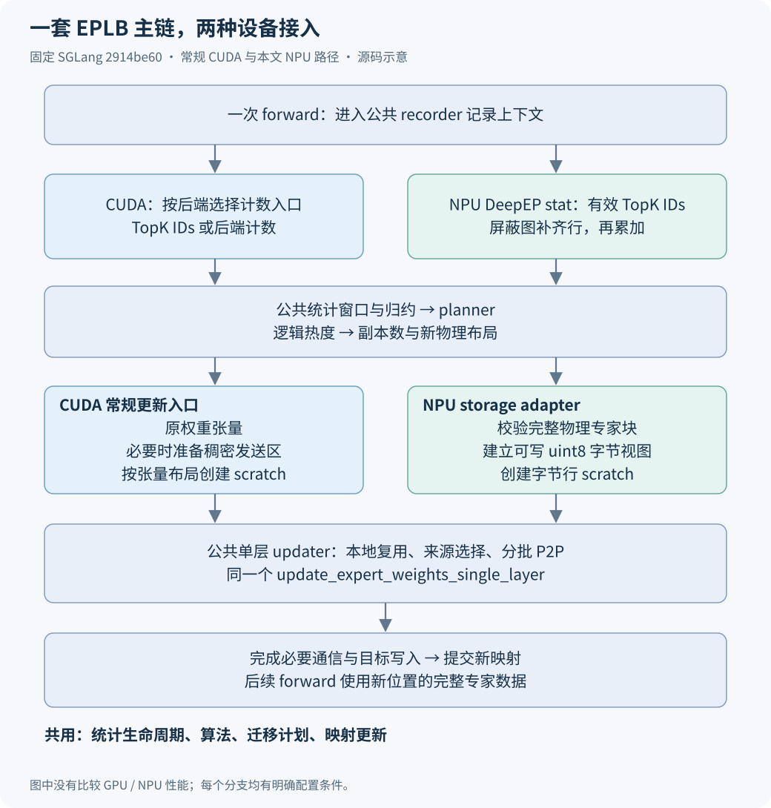
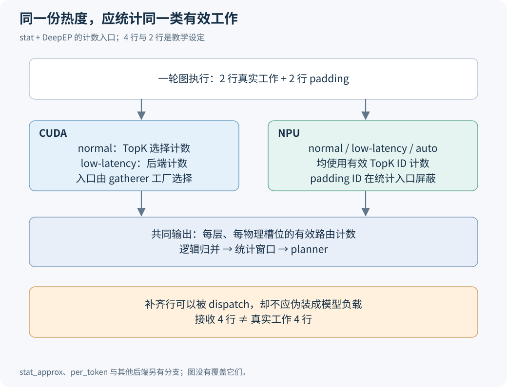
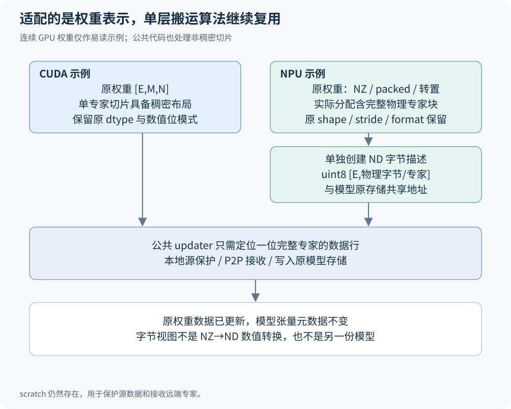
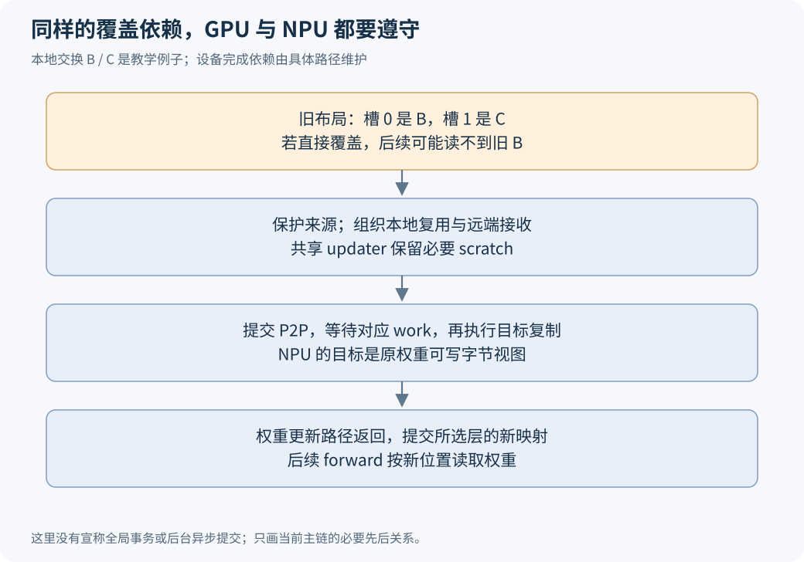

# SGLang 的动态 EPLB：GPU 和 NPU 到底共用了什么，又差在哪里？

把动态 EPLB 接到 Ascend 上，是否意味着要另写一套负载均衡？沿 SGLang 的调用链看，主要算法和迁移计划并没有分成 GPU、NPU 两份。两边共用 recorder、窗口累积、布局算法、单层搬运流程和映射提交；差异集中在有效路由怎样计数、权重怎样暴露给搬运器、通信使用哪个组，以及设备图入口的处理。

这篇文章以 PR #49701 整理后的 `2914be608009b65099c4c52ba118a597bf1b1421` 为源码截面，比较常规 CUDA GPU 路径与该 NPU 路径。GPU 侧存在多种通信和量化后端，下面会写清每个分支的条件，避免把一个配置说成所有 GPU 实现。四张图都根据这个固定版本绘制，是源码示意图。

## 一、先把整条链放在一起

一轮更新可以按数据流分成四步：记录专家被路由到的工作量；把窗口计数交给算法，产生新物理布局；把对应权重搬到新槽位；最后让模型使用新映射。



这里“规划”与“搬运”各自有输入输出。Planner 看逻辑专家的负载，决定每位专家放多少份、分到哪些物理槽位。Updater 看到新旧映射，找出本卡可复用的权重、远端需要的来源和覆盖前要保护的数据。换成 NPU，不需要因此重新发明副本分配算法。

[`EPLBManager`](https://github.com/sgl-project/sglang/blob/2914be608009b65099c4c52ba118a597bf1b1421/python/sglang/srt/eplb/eplb_manager.py#L115-L177)读取统计、判断本轮是否需要重平衡，再调用布局更新入口。`ExpertLocationUpdater.update()` 先执行权重更新，之后更新当前 metadata。这个先后顺序对两种设备相同：新映射生效时，它指向的数据应当已就位。

同样，更新间隔 I、窗口 W、冗余预算和算法选择都是公共概念。NPU 的 P50/W50、D4000/W1000 是某次服务的参数选择，不是硬件实现里强制写死的数字。它们是否适合当前请求长度和 batch，应由各端真实执行节奏决定。

## 二、计数目标一致，计数入口不必一样

两边要提供的都是有效路由热度。但不同 dispatch 后端能提供的信息不同，padding 的处理也不同，因此公共 gatherer 工厂并不是“设备不同就复制一个 recorder 类”。

在 `stat` 配合 DeepEP 的路径中，固定源码有两类入口：CUDA 的 normal 模式使用 `_SelectExpertsSinglePassGatherer`，从选择的专家 ID 计数；CUDA 的 low-latency 模式使用 `_DeepepLowLatencySinglePassGatherer`，接收后端提供的计数。NPU DeepEP 的 normal、low-latency 与 auto 则选择前者，使用已屏蔽无效行的 TopK ID。`stat_approx` 有另外的近似统计分支，不应与这张图混用。对应[工厂选择](https://github.com/sgl-project/sglang/blob/2914be608009b65099c4c52ba118a597bf1b1421/python/sglang/srt/eplb/expert_distribution.py#L418-L455)。



为什么 NPU 要这样选？图执行可能把输入补到捕获档位，补齐行仍保留可 dispatch 的专家 ID，后端接收数量包含这些行。把这些行的路由权重置零，可以让补齐行不影响数值输出；计数若只看收到多少条，却仍会把它们算成负载。

图里用四行说明这个区别：两行真实工作，加两行 padding；接收路径看到四行，均衡器需要的有效工作是两行。这里的 4/2 是教学例子。此前双设备实测的 64/64 接收与 64/0 有效计数，保留在[接收数量与有效路由的对照文章](../performance/deepep-received-vs-valid-routes.md)中。

公共 `_SelectExpertsSinglePassGatherer` 自己也有执行分支：`topk_ids.is_cuda` 为真时调用计数 kernel；为假时将 ID 展平、屏蔽越界项，再用 `scatter_add_` 累加。复用统计对象和生命周期之后，具体计数操作仍由这个入口选择。见[计数实现](https://github.com/sgl-project/sglang/blob/2914be608009b65099c4c52ba118a597bf1b1421/python/sglang/srt/eplb/expert_distribution.py#L643-L659)。

CUDA 的部分 TopK 后处理还有融合路径：当 recorder 提供当前层计数 buffer，且映射方式满足融合入口的条件时，逻辑到物理 ID 映射与计数一起完成，随后跳过重复的 recorder hook。没有命中融合路径时，才继续常规后处理。对应 [TopK 调用处](https://github.com/sgl-project/sglang/blob/2914be608009b65099c4c52ba118a597bf1b1421/python/sglang/srt/layers/moe/topk.py#L2634-L2662)和[融合映射的选择条件](https://github.com/sgl-project/sglang/blob/2914be608009b65099c4c52ba118a597bf1b1421/python/sglang/srt/eplb/expert_location_dispatch.py#L123-L137)。所以，图中“TopK 计数”描述的是数据来源，不能据此推断每一层必然多启动一个独立计数 kernel。

因此，维护上的目标是相同的统计含义。强行使用同一个事件字段，并不自动得到相同的有效负载。

## 三、最主要的权重差异，发生在进入 updater 以前

GPU 常规路径从模型拿到专家权重列表，按这些张量创建 scratch，再把它们交给 `update_expert_weights_single_layer()`。以连续 `[E,M,N]` 权重为例，取 `weight[e]` 就是一位专家的完整数据。

公共代码也处理非稠密专家切片：它检查单专家布局，必要时建立连续发送区，并在满足条件时使用 int64 view 搬运。不能把 GPU 路径概括成“所有权重天然连续、永远没有暂存”。完整分支见[公共 raw 更新与单层准备](https://github.com/sgl-project/sglang/blob/2914be608009b65099c4c52ba118a597bf1b1421/python/sglang/srt/eplb/expert_location_updater.py#L148-L296)。

NPU 权重还可能带有 NZ 存储描述、物理 padding、内层转置和量化打包。逻辑 `numel()` 描述的是可见张量，不一定等于要搬走的完整物理专家块。旧 NPU 方案先转换成连续 ND 工作权重，迁移后再转换、写回；当前方案则建立原存储的字节别名。



`_ExpertWeightAdapter` 输出 `[路由专家数,每专家物理字节数] uint8`。每一行对应一位完整专家，写这一行就会写到模型原存储；原张量的 shape、stride、dtype 和 NZ 描述不被改成 ND。

图里的“ND 字节描述”只属于新增的通信视图。底层数据没有经过数值解码、矩阵重排或重新量化。它类似把一箱完整物品装上搬运车，箱内如何分格留给原来的计算内核解释。箱子的边界必须先验证，不能从“都是字节”推出任意 view 都安全。

ND 打包路径按专家 stride 与元素大小计算字节边界，NZ 路径还依赖完整专家轴来处理物理块。两类细节分别见[合法 int32 view 的修复](../performance/eplb-packed-nd-byte-boundaries.md)与[FP4 格式和严格块检查](../performance/eplb-fp4-nz-format-validation.md)。

## 四、进入单层搬运后，源保护和 P2P 计划共用

NPU 的接入方式可以用一段简化调用表达，以下省略参数准备：

```python
update_layer_fn(
    routed_experts_weights=adapter.make_weight_views(weights),
    temp_buffers=temp_buffers,
    old_physical_to_logical_map=old_placement,
    new_physical_to_logical_map=new_placement,
    group=group,
    # 其余拓扑与诊断参数省略
)
```

这里传入的 `update_layer_fn` 就是公共单层更新函数。NPU 没有另外复制同机来源选择、跨机来源选择和 batch P2P 逻辑；适配层改变的是权重表示及通信组。真实调用见 [NPU 迁移入口](https://github.com/sgl-project/sglang/blob/2914be608009b65099c4c52ba118a597bf1b1421/python/sglang/srt/hardware_backend/npu/eplb.py#L57-L106)。



假设本卡旧位置是 B、C，新位置是 C、B。直接把 C 覆盖到 B 的位置，再从旧 B 位置读 B，就已经丢掉源数据。公共流程先保护要用的来源，把本地和远端接收结果放进临时区，执行通信与等待，再按计划写目标。字节视图没有消除这个依赖。

远端专家需要用 `P2POp` 组织发送和接收，再经 `batch_isend_irecv` 提交。函数按 expert ID 区间分批，等待相应 work，然后执行 buffer 到权重的复制。这里的 P2P 是更新期间搬专家权重，与 forward 中 dispatch token 的 all-to-all 是两套不同工作。

NPU 还在入口筛选变化层及本 rank 是否参与，但不能仅看本卡新旧槽位相同就退出：本卡可能不接收，却是别卡所需专家的来源。`_rank_may_send_experts` 因此参与判断。它减少不必要准备，不取代公共算法对实际发送对象的选择。

## 五、通信器不同，预热的目的相同

固定版本里，GPU 的 `get_eplb_group()` 返回 `None`，表示相关 PyTorch 通信走默认组；NPU 在非弹性、PP=1、TP 覆盖 WORLD 的条件下返回已有 TP 的 device group。NPU 迁移入口还检查 TP、EP、EPLB 组与 WORLD 的规模一致。

这不是“GPU 不用 TP、NPU 不用 WORLD”的整体架构结论。模型 forward 自己还有其他通信组与专用通信器；这里比较的是这条 EPLB 统计和迁移路径。组选择源码见 [`get_eplb_group`](https://github.com/sgl-project/sglang/blob/2914be608009b65099c4c52ba118a597bf1b1421/python/sglang/srt/eplb/expert_location.py#L41-L50)。

复用 TP 的理由，是使用已有成员与资源，避免另外激活默认 WORLD 的设备通信资源。复用条件不能只看“都是 HCCL”：如果 TP 是 WORLD 的子组，rank 编号与 root 语义就需要重新定义，不能原样替换。该版本没有通过放宽检查来宣称支持 PP。

GPU 也有初始化资源的处理。固定 `bootstrap.py` 为符合条件的 CUDA/NCCL、静态完整 EP 路径预热默认组 EPLB P2P；NPU 则在开启 EPLB 且非对应弹性分支时预热 TP 的 P2P 与归约。两边都要让资源分配进入 KV 容量规划，而非等第一次重平衡才突然出现。见[初始化与预热入口](https://github.com/sgl-project/sglang/blob/2914be608009b65099c4c52ba118a597bf1b1421/python/sglang/srt/distributed/bootstrap.py)。

NPU 预热里的 4 MiB 是每 peer 测试 payload，不是 HCCL 缓冲区上限。早期专用小组的 32 MiB 配置，也不能继续套在复用 TP 的最终版本上。讨论显存要按当前通信器、首次使用与持续 OFF/ON 的阶段对齐，详见[TP 与 WORLD 资源实验](../performance/ascend-eplb-tp-world-memory.md)。

## 六、图与 draft 的约束，也不能按设备名省略

无论哪种设备，模型图回放都要读到迁移后的正确权重。当前 NPU 字节视图写入原分配，保留模型张量元数据；这有利于维持捕获后的权重地址关系。但地址没换，只回答“读哪里”，还必须保证写入与后续读取有正确设备依赖。

draft 计数隔离则属于统计生命周期。公共 `ModelRunner.forward` 根据 `is_draft_worker` 进入 recorder 的禁用上下文；recorder 在禁用状态不重置、不发布 target 的统计。这个修复在公共入口适用，不能把它说成只有 NPU 才有的规则。

NPU 图后端额外保护捕获入口，是因为部分捕获回调直接调用模型，绕过上述 `ModelRunner.forward`。保护包含 warmup 和 capture，使用的仍是同一个 recorder 上下文。读[图后端 capture 方法](https://github.com/sgl-project/sglang/blob/2914be608009b65099c4c52ba118a597bf1b1421/python/sglang/srt/hardware_backend/npu/graph_runner/npu_cudagraph_backend.py)时，应沿真实入口判断覆盖范围，而不是因文件名里有 cudagraph 就认定它在运行 CUDA。

这几处边界放在一起，才能判断代码应该在哪里：公共窗口、算法和搬运计划继续复用；存储 descriptor、借用地址、设备图回调等放在 NPU；公共工厂保留能说明统计语义的最小选择。减少设备分支的数量，要以接口含义仍然清楚为前提。

## 七、已有实验支持哪些比较

| 问题 | CUDA 常规路径 | 本文固定的 NPU 路径 |
|---|---|---|
| 统计对象和窗口 | 公共 recorder / accumulator | 同一套对象与窗口 |
| Planner | 公共副本分配与布局算法 | 复用相同算法入口 |
| 交给 updater 的权重 | 原张量，必要时做稠密发送准备 | 原存储的可写 uint8 专家行 |
| 单层来源、通信、写入 | 公共 updater | 调用同一个 updater |
| 本条 EPLB 通信组 | 默认组 | 满足约束时复用 TP device group |
| 当前 NPU 拓扑约束 | 不能据此列举全部 GPU 支持范围 | PP=1，TP=EP=组规模=WORLD |

此前公开的 P 更新 696→611 ms、D 更新 730→658 ms，是同为 NPU、旧 ND 路径与新物理路径的对照；P / D 采样 HBM 减少中位数 839.5 / 1641.5 MiB，也来自同实际 KV 容量下的那组实验。它们不回答“GPU 和 NPU 哪边搬得快”。两次运行的迁移计划也并非逐字相同，完整条件见[原始存储路径文章](../performance/ascend-eplb-physical-storage-migration.md)。

如果要比较两边的迁移实现，应至少固定布局变化、每专家实际字节数、源与目的分布、参与 rank、网络拓扑、计时完成边界。比较整服务，则还要对齐实际 batch、上下文、KV、投机配置与请求负载。本文先把实现边界说清，避免在没有同条件硬件对照时制造一个百分比。

四张图的 [SVG 原文件与固定源码索引](https://raw.githubusercontent.com/AkiYangDev/llm-inference-notes/main/assets/sglang-eplb-gpu-npu-implementation/diagrams.zip)可以下载。向同事解释时，从第一张共用主链开始，再用第三张说明 NPU 适配器；若问题在计数或通信组，分别回到对应分支，读者不必先背完所有文件。

[返回 EPLB 专题](eplb-study-guide.md)。
