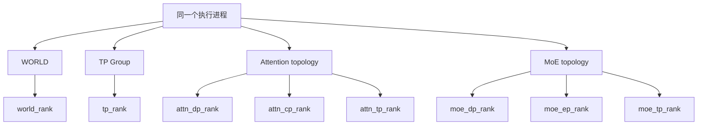
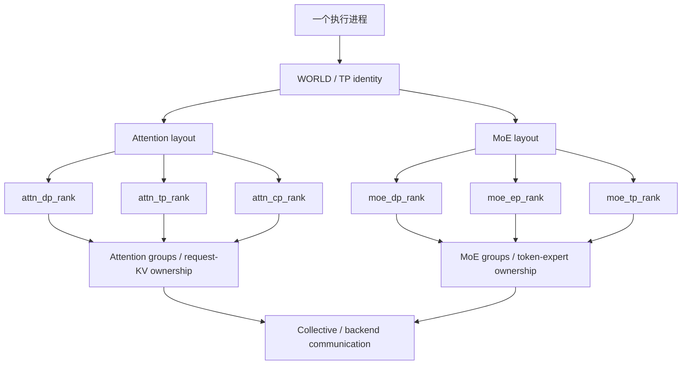

# SGLang Rank 与 Group：读懂 TP、DP Attention 和 EP 坐标

日志里写 `rank=2`，它可能是 WORLD 的全局编号，也可能是某个子组里的第三个进程。同一个 SGLang 进程还保存 `tp_rank`、`attn_tp_rank`、`attn_dp_rank`、`moe_ep_rank`，数字相同未必指同一种身份。

Attention 分请求和 head，MoE 分专家，可以让同一批进程在两个阶段采用不同坐标。下面从四进程小例子展开到 `TP16 / DP8`。普通设备 Worker 按 PP1、一进程一卡讨论，弹性变化单独说明。

<details markdown="1">
<summary>版本与源码入口</summary>

以下源码都固定在同一版本。

```text
sgl-project/sglang
commit: 176dbcb85d3b7737564e4911947035cc0af65f0a
核对日期：2026-09-21
```

涉及的入口如下。

- [`runtime_context.py`](https://github.com/sgl-project/sglang/blob/176dbcb85d3b7737564e4911947035cc0af65f0a/python/sglang/srt/runtime_context.py)
- [`distributed/parallel_state.py`](https://github.com/sgl-project/sglang/blob/176dbcb85d3b7737564e4911947035cc0af65f0a/python/sglang/srt/distributed/parallel_state.py)
- [`managers/data_parallel_controller.py`](https://github.com/sgl-project/sglang/blob/176dbcb85d3b7737564e4911947035cc0af65f0a/python/sglang/srt/managers/data_parallel_controller.py)
- [`layers/dp_attention.py`](https://github.com/sgl-project/sglang/blob/176dbcb85d3b7737564e4911947035cc0af65f0a/python/sglang/srt/layers/dp_attention.py)
- [`entrypoints/engine.py`](https://github.com/sgl-project/sglang/blob/176dbcb85d3b7737564e4911947035cc0af65f0a/python/sglang/srt/entrypoints/engine.py)
- [`managers/scheduler.py`](https://github.com/sgl-project/sglang/blob/176dbcb85d3b7737564e4911947035cc0af65f0a/python/sglang/srt/managers/scheduler.py)

这里解释这个提交的启动与坐标语义，后续版本的类名和参数组合可能变化。

</details>

## 一、同一个进程的多套编号

让 A、B、C、D 四个执行进程组成 WORLD，`world_size = 4`，组内位置如下。

```text
A → world_rank = 0
B → world_rank = 1
C → world_rank = 2
D → world_rank = 3
```

Rank 是进程在通信集合里的位置。设备 ID、PCIe 序号、操作系统 PID，分别属于另外的编号体系。

例如假设某进程 `PID=40580`、`device_id=3`、`world_rank=6`，对应的是操作系统进程、本机设备、分布式参与者。哪怕几个数碰巧相同，所指也不会变成同一类编号。

扩到八进程，再按 WORLD Rank 分成两个 Group。

```text
WORLD
0 1 2 3 4 5 6 7

Group A = [0, 1, 2, 3]
Group B = [4, 5, 6, 7]
```

WORLD Rank 6 在 Group B 的组内位置为 2，全局编号仍是 6。

```text
Group B

WORLD rank:  4   5   6   7
local rank:  0   1   2   3
                     ↑
```

`get_tensor_model_parallel_rank()` 取 TP Group 的 `rank_in_group`，`get_moe_expert_parallel_rank()` 取 MoE EP Group 的组内位置。[`parallel_state.py`](https://github.com/sgl-project/sglang/blob/176dbcb85d3b7737564e4911947035cc0af65f0a/python/sglang/srt/distributed/parallel_state.py#L3088-L3168)

因此日志的 `rank=2` 还得配上 Group 和有序成员。Group B 的局部 2 对应 WORLD Rank6，若按全局 Rank2 查，就会找错进程。

同一批 DeepSeek-V4 进程在 Attention、MoE 中还会采用不同坐标。



图里两套布局对应原来同一批进程，变化的是数据分工和通信方式。

## 二、Native DP 与 DP Attention 的区别

TP Rank 始终是当前进程在 TP Group 的位置，`dp_rank` 则有两种启动语境。

固定版本的 `--dp-size` 支持这两种模式。

Native DP 创建完整模型副本，由不同 replica 接不同请求。DP Attention / DPA 则在一个 TP world 内划分请求与 KV，MoE 阶段再转换布局。

`enable_dp_attention` 开关决定这里的 `dp_rank` 是启动时分配的 replica 身份，还是从 TP 坐标派生的 Attention 位置。

### Native DP：`dp_rank` 是第几个完整 replica

DPA 未开启，`DataParallelController` 进入 `launch_dp_schedulers()`。

```python
for dp_rank in range(get_parallel().dp_size):
    ...
    launch_tensor_parallel_group(..., dp_rank)
```

实现位于 [`data_parallel_controller.py`](https://github.com/sgl-project/sglang/blob/176dbcb85d3b7737564e4911947035cc0af65f0a/python/sglang/srt/managers/data_parallel_controller.py#L366-L428)。

例如这组启动宽度。

```text
tp_size = 4
dp_size = 2
enable_dp_attention = False
PP = 1
```

它启动两套完整的 4-way TP replica。

```text
Native DP replica 0
TP ranks: 0 1 2 3

Native DP replica 1
TP ranks: 0 1 2 3
```

两份副本的 TP Rank 都从 0 数到 3，因而有两个 TP Rank0。`dp_rank=0/1` 再指出它们属于哪份 replica。

`runtime_context.py` 将这里的 `dp_rank` 定义为 Controller spawn 时分配的 replica identity，并没有把它当作统一 DP process group 的 `rank_in_group`。[`runtime_context.py`](https://github.com/sgl-project/sglang/blob/176dbcb85d3b7737564e4911947035cc0af65f0a/python/sglang/srt/runtime_context.py#L197-L211)

### DPA：`dp_rank` 会由 `tp_rank` 派生

启用 `--enable-dp-attention`，Controller 改调 `launch_dp_attention_schedulers()`，只启动一次 `launch_tensor_parallel_group(...)`，再在 TP Rank 循环里派生 Attention DP shard。[`data_parallel_controller.py`](https://github.com/sgl-project/sglang/blob/176dbcb85d3b7737564e4911947035cc0af65f0a/python/sglang/srt/managers/data_parallel_controller.py#L548-L600) [`data_parallel_controller.py`](https://github.com/sgl-project/sglang/blob/176dbcb85d3b7737564e4911947035cc0af65f0a/python/sglang/srt/managers/data_parallel_controller.py#L641-L672)

传到 Scheduler 的坐标由下面这段逻辑产生。

```python
_, _, dp_rank, _ = compute_dp_attention_world_info(
    enable_dp_attention,
    tp_rank,
    tp_size,
    dp_size,
    attn_cp_size,
)
```

普通 DPA 启动里的 `dp_rank`，因而已对应当前进程的 Attention 拓扑位置。

Scheduler 初始化时，还会另算并保存 `attn_dp_rank`。[`scheduler.py`](https://github.com/sgl-project/sglang/blob/176dbcb85d3b7737564e4911947035cc0af65f0a/python/sglang/srt/managers/scheduler.py#L519-L548)

普通非 elastic 启动，两者使用相同映射，数值常相等，但用途不同。

`dp_rank` 是 Controller / Scheduler 路由请求用的 DP worker slot，`attn_dp_rank` 是当前 Attention 拓扑的逻辑 DP 坐标。

源码还允许 elastic scale-up 时移动 `attn_dp_rank`，它从 TP 拓扑派生，没有建模成普通 group getter。[`runtime_context.py`](https://github.com/sgl-project/sglang/blob/176dbcb85d3b7737564e4911947035cc0af65f0a/python/sglang/srt/runtime_context.py#L184-L205)

各自用途放在一起如下。

| 名称 | 当前 SGLang 中更准确的理解 |
| --- | --- |
| `tp_rank` | 当前 TP Group 中的位置 |
| `dp_rank` | Controller / spawn 层的 DP worker / replica identity；DPA 路径下由 Attention shard 映射得到 |
| `attn_dp_rank` | Attention 拓扑中的 DP 维坐标 |
| `moe_dp_rank` | MoE 拓扑中的 DP 维坐标 / 对应 MoE DP Group 的位置语义 |
| `moe_ep_rank` | MoE EP Group 中的位置 |

Controller 按 DP 身份路由，Attention 坐标则参与请求和 KV 布局。弹性扩展改变映射时，原来相等的数值还需要重新对到当前 Group。

## 三、展开 TP16 / DP8 的坐标

把下面的配置代入。

```text
tp_size = 16
dp_size = 8
enable_dp_attention = True
attn_cp_size = 1
PP = 1
```

Native DP 的 TP16、DP8 会用 `16 × 8 = 128` 个设备 Worker。这里开启 DPA，8 划分已有 TP Rank 中的 Attention 请求，设备数不再乘一次。

Attention 宽度的固定派生规则如下。

```python
attn_dp_size = dp_size if enable_dp_attention else 1
attn_tp_size = tp_size // attn_dp_size // attn_cp_size
```

规则在 [`runtime_context.py`](https://github.com/sgl-project/sglang/blob/176dbcb85d3b7737564e4911947035cc0af65f0a/python/sglang/srt/runtime_context.py#L249-L281)。

本例得到下面的宽度。

```text
attn_dp_size = 8
attn_tp_size = 16 / 8 / 1 = 2
```

16 个 TP Rank 在 Attention 阶段组织成这些组。

```text
8 个 Attention-DP shard
×
每个 shard 2 个 Attention-TP rank
```

组内成员如下。

```text
                         attn_tp_rank

                         0      1
                       ┌──────┬──────┐
attn_dp_rank = 0       │ TP0  │ TP1  │
attn_dp_rank = 1       │ TP2  │ TP3  │
attn_dp_rank = 2       │ TP4  │ TP5  │
attn_dp_rank = 3       │ TP6  │ TP7  │
attn_dp_rank = 4       │ TP8  │ TP9  │
attn_dp_rank = 5       │ TP10 │ TP11 │
attn_dp_rank = 6       │ TP12 │ TP13 │
attn_dp_rank = 7       │ TP14 │ TP15 │
                       └──────┴──────┘
```

每个 Rank 的坐标对应如下。

| `tp_rank` | `attn_dp_rank` | `attn_tp_rank` |
| ---: | ---: | ---: |
| 0 | 0 | 0 |
| 1 | 0 | 1 |
| 2 | 1 | 0 |
| 3 | 1 | 1 |
| 4 | 2 | 0 |
| 5 | 2 | 1 |
| 6 | 3 | 0 |
| 7 | 3 | 1 |
| 8 | 4 | 0 |
| 9 | 4 | 1 |
| 10 | 5 | 0 |
| 11 | 5 | 1 |
| 12 | 6 | 0 |
| 13 | 6 | 1 |
| 14 | 7 | 0 |
| 15 | 7 | 1 |

一维编号按这个公式展开。

```text
tp_rank
=
(attn_dp_rank × attn_cp_size + attn_cp_rank)
× attn_tp_size
+
attn_tp_rank
```

`attn_tp_rank` 变化最快，对应 [`derive_attention_ranks()`](https://github.com/sgl-project/sglang/blob/176dbcb85d3b7737564e4911947035cc0af65f0a/python/sglang/srt/runtime_context.py#L262-L281)。

`attn_cp_size=1` 时，公式简化为下面这样。

```text
tp_rank
=
attn_dp_rank × attn_tp_size
+
attn_tp_rank
```

以 `tp_rank=10` 为例。

```text
attn_dp_rank = 5
attn_tp_rank = 0
```

TP10、TP11 在 Attention-DP 组 5，组内 TP 编号是 0、1，一起处理该组请求；TP12、TP13 属于下一组。模型并行域仍是原来的 16 个 Rank。

### 相同 TP / DP 数字对应的两种设备规模

保持下面的 TP、DP 宽度。

```text
tp_size = 16
dp_size = 8
PP = 1
```

如果关闭 DPA，即 `enable_dp_attention = False`，启动方式就不同了。

`launch_dp_schedulers()` 会按八个 `dp_rank` 各启动完整 16-way TP，得到 `8 replicas × 16 TP workers = 128 device workers`。

同为 `TP16 / DP8`，在 PP=1 下两种规模相差很大，DPA 开关必须一起记录。

| 配置 | 拓扑含义（PP=1） | device worker 直觉 |
| --- | --- | ---: |
| `TP16 + DP8`，DPA 关闭 | 8 套完整的 16-way TP replica | 128 |
| `TP16 + DP8 + --enable-dp-attention` | 1 个 16-way TP world，被 Attention 解释为 `DP8 × ATTN_TP2` | 16 |

后面的 Attention、MoE 分组，也分别沿这两种启动坐标建立。

## 四、MoE 怎样划分专家与张量分片

Attention DP 分请求与 KV，组内 Attention TP 协作计算这些请求。

MoE 根据路由找到专家权重，从同一 TP Rank 派生另一套 DP、EP、TP 坐标，Attention DP 的编号不能直接拿来代替。

launcher 按下面的层次组织 MoE。

```text
Attention:
Global(TP) → DP → ATTN_CP → ATTN_TP

MoE:
Global(TP) → MOE_DP → EP → MOE_TP
```

两个入口是 [`engine.py`](https://github.com/sgl-project/sglang/blob/176dbcb85d3b7737564e4911947035cc0af65f0a/python/sglang/srt/entrypoints/engine.py#L1906-L1928) 和 [`data_parallel_controller.py`](https://github.com/sgl-project/sglang/blob/176dbcb85d3b7737564e4911947035cc0af65f0a/python/sglang/srt/managers/data_parallel_controller.py#L682-L704)。

展开顺序为 `MOE_DP → EP → MOE_TP`，MOE_TP 最快变化。

递增 `tp_rank`，先变 `moe_tp_rank`，该维用完才增加 `moe_ep_rank`，最后增加 `moe_dp_rank`。后面的公式与表都按这个次序。

各维宽度满足下面的关系。

```text
moe_tp_size
=
tp_size / moe_dp_size / moe_ep_size
```

一个 `tp_rank` 因而可展开为 `(moe_dp_rank, moe_ep_rank, moe_tp_rank)`。

常规布局的三个坐标按下面的公式计算。

```python
moe_tp_rank = tp_rank % moe_tp_size
moe_ep_rank = (tp_rank // moe_tp_size) % moe_ep_size
moe_dp_rank = tp_rank // (moe_ep_size * moe_tp_size)
```

反向也能合成原 TP Rank。

```text
tp_rank
=
(moe_dp_rank × moe_ep_size + moe_ep_rank)
× moe_tp_size
+
moe_tp_rank
```

`derive_spawn_ranks()` 的 `moe_dp_rank`、`moe_ep_rank` 使用同一个展开次序。[`runtime_context.py`](https://github.com/sgl-project/sglang/blob/176dbcb85d3b7737564e4911947035cc0af65f0a/python/sglang/srt/runtime_context.py#L299-L330)

### 用 8 个 Rank 看最清楚

先只算坐标，backend 是否接受这组参数另外确认。

```text
tp_size     = 8
moe_dp_size = 2
ep_size     = 4
```

本例宽度计算如下。

```text
moe_tp_size
= 8 / 2 / 4
= 1
```

得到下面这些组。

```text
                           moe_ep_rank

                         0    1    2    3
                      ┌────┬────┬────┬────┐
moe_dp_rank = 0       │ 0  │ 1  │ 2  │ 3  │
                      ├────┼────┼────┼────┤
moe_dp_rank = 1       │ 4  │ 5  │ 6  │ 7  │
                      └────┴────┴────┴────┘
```

这里 `moe_tp_size=1`，第三维暂时只有一个取值。

沿 EP 维形成这些成员。

```text
MOE_EP Group 0 = [0, 1, 2, 3]
MOE_EP Group 1 = [4, 5, 6, 7]
```

固定 EP、跨 DP 维，得到 MoE DP Groups。

```text
MOE_DP Group 0 = [0, 4]
MOE_DP Group 1 = [1, 5]
MOE_DP Group 2 = [2, 6]
MOE_DP Group 3 = [3, 7]
```

代入 `tp_rank=6`。

```text
moe_dp_rank = 1
moe_ep_rank = 2
moe_tp_rank = 0
```

同一进程的几项身份便能对应起来。

```text
一维坐标：6

三维坐标：
(dp=1, ep=2, tp=0)
```

再换一组宽度，让 MoE TP 也有两个取值。

```text
tp_size     = 16
moe_dp_size = 2
ep_size     = 4
```

这次 `moe_tp_size = 2`，前几个 Rank 的坐标如下。

| `tp_rank` | `moe_dp_rank` | `moe_ep_rank` | `moe_tp_rank` |
| ---: | ---: | ---: | ---: |
| 0 | 0 | 0 | 0 |
| 1 | 0 | 0 | 1 |
| 2 | 0 | 1 | 0 |
| 3 | 0 | 1 | 1 |
| 4 | 0 | 2 | 0 |
| 5 | 0 | 2 | 1 |
| 6 | 0 | 3 | 0 |
| 7 | 0 | 3 | 1 |
| 8 | 1 | 0 | 0 |
| 9 | 1 | 0 | 1 |
| 10 | 1 | 1 | 0 |
| 11 | 1 | 1 | 1 |

TP0、TP1 的 MoE-DP/EP 相同，分别拿 MoE-TP 分片 0、1，TP2 才进入下一 EP。TP10 的 MoE 坐标是 `(moe_dp=1, moe_ep=1, moe_tp=0)`；若 Attention 仍为 DP8、CP1，它的 Attention 坐标是 `(attn_dp=5, attn_tp=0)`。同一进程的两个 DP 数字不同，来自两个阶段的划分。

### 用 Group 成员核对坐标展开顺序

Group 构造也按这个顺序取成员。

`_MOE_TP` 固定 `(moe_dp, moe_ep)`，取连续的 `moe_tp_size` 个 Rank。`_MOE_EP` 固定 `(moe_dp, moe_tp)`，按 `moe_tp_size` 步长跨 EP；`_MOE_DP` 固定 `(moe_ep, moe_tp)`，按 `moe_tp_size × moe_ep_size` 步长跨 DP。

构造实现见 [`parallel_state.py`](https://github.com/sgl-project/sglang/blob/176dbcb85d3b7737564e4911947035cc0af65f0a/python/sglang/srt/distributed/parallel_state.py#L2809-L2895)。

还存在复用分支，`attn_cp_size > moe_dp_size` 时，`_MOE_DP` 直接 alias `_ATTN_CP`，通过 CP partners 共享 MoE 所需 Token。最终成员因而也要看这个条件。

由 `tp_size / moe_dp_size / ep_size` 算出 `moe_tp_size`，可以展开常规坐标关系，最后还要对应实际创建或复用的 Group。

## 五、EP 与 TP 宽度相同，Group 仍可能不同

两组有完全相同的有序成员，也可以有独立句柄和通信上下文。

例如下面的配置。

```text
tp_size = 8
ep_size = 8
moe_dp_size = 1
```

它得到 `moe_tp_size = 1`。

TP、MoE EP 的成员都可能是 `[0, 1, 2, 3, 4, 5, 6, 7]`。

NPU 路径仍然会为 MoE EP 单建 Group。参与者相同，不保证 `_MOE_EP == _TP`。

固定版本的条件如下。

```python
if moe_ep_size == tensor_model_parallel_size and not _is_npu:
    _MOE_EP = _TP
else:
    _MOE_EP = init_model_parallel_group(...)
```

对应源码为 [`parallel_state.py`](https://github.com/sgl-project/sglang/blob/176dbcb85d3b7737564e4911947035cc0af65f0a/python/sglang/srt/distributed/parallel_state.py#L2837-L2865)。

旁边的注释写着 `NPU requires a standalone group for MOE expert parallelism`。

在 Ascend 910C / NPU 上，TP、MoE EP 因而需要分别对应 Group Handle 与 communicator。把两套独立上下文的 collective 配到一起，就会误读调用顺序。

`_MOE_EP` 保存专家并行进程组，DeepEP、FuseEP 在相应拓扑上组织各自 dispatch / combine 数据路径，通信实现还要沿这些入口往下。

## 六、沿源码确认 Rank 的含义

Scheduler 的 `ParallelState` 汇集当前进程在各阶段的身份，执行代码从这里取得坐标。

固定结构保存的字段如下。

```text
tp_rank / tp_size
pp_rank / pp_size

dp_rank / dp_size

attn_tp_rank / attn_tp_size
attn_cp_rank / attn_cp_size
attn_dp_rank / attn_dp_size

moe_ep_rank / moe_ep_size
moe_dp_rank / moe_dp_size
```

这些字段由 [`scheduler.py`](https://github.com/sgl-project/sglang/blob/176dbcb85d3b7737564e4911947035cc0af65f0a/python/sglang/srt/managers/scheduler.py#L519-L548) 构造。

与当前进程放在一起，是下面的对应关系。



日志中的 `tp_rank` 是 TP 组内位置，`attn_dp_rank` 是 Attention 坐标，`dp_rank` 由 Native DP 或 DPA 启动模式解释。同一进程携带这些身份，实际通信参与者则由当次调用的 Group 决定。
