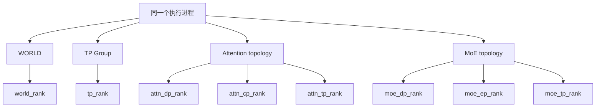
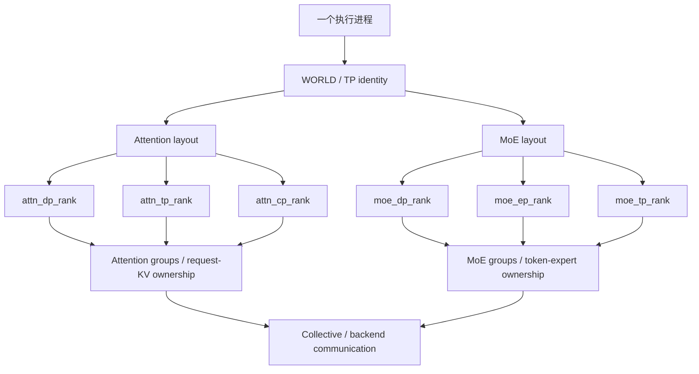

# SGLang Rank 与 Group：读懂 TP、DP Attention 和 EP 坐标

SGLang 同一进程会保存 `tp_rank`、`attn_tp_rank`、`attn_dp_rank`、`moe_ep_rank` 等编号。Attention 按请求和 head 分工，MoE 按专家归属分工，因此它们可以使用同一批进程，却采用不同坐标和通信组。

例如 `rank=2` 可能是 WORLD 全局编号，也可能只是子组内第三个进程。如果直接把它当作设备 ID，日志里的通信参与者就会对不上。下面先区分这些编号，再展开 `TP16 / DP8`。设备 Worker 示例采用 PP1、一进程一卡的普通启动布局，弹性情况另行说明。

<details markdown="1">
<summary>版本与源码入口</summary>

代码固定在以下版本：

```text
sgl-project/sglang
commit: 176dbcb85d3b7737564e4911947035cc0af65f0a
核对日期：2026-09-21
```

后文主要沿这些入口阅读：

- [`runtime_context.py`](https://github.com/sgl-project/sglang/blob/176dbcb85d3b7737564e4911947035cc0af65f0a/python/sglang/srt/runtime_context.py)
- [`distributed/parallel_state.py`](https://github.com/sgl-project/sglang/blob/176dbcb85d3b7737564e4911947035cc0af65f0a/python/sglang/srt/distributed/parallel_state.py)
- [`managers/data_parallel_controller.py`](https://github.com/sgl-project/sglang/blob/176dbcb85d3b7737564e4911947035cc0af65f0a/python/sglang/srt/managers/data_parallel_controller.py)
- [`layers/dp_attention.py`](https://github.com/sgl-project/sglang/blob/176dbcb85d3b7737564e4911947035cc0af65f0a/python/sglang/srt/layers/dp_attention.py)
- [`entrypoints/engine.py`](https://github.com/sgl-project/sglang/blob/176dbcb85d3b7737564e4911947035cc0af65f0a/python/sglang/srt/entrypoints/engine.py)
- [`managers/scheduler.py`](https://github.com/sgl-project/sglang/blob/176dbcb85d3b7737564e4911947035cc0af65f0a/python/sglang/srt/managers/scheduler.py)

以下解释的是固定提交的启动和坐标语义，类名与参数组合仍会随实现演进。

</details>

## 一、同一个进程的多套编号

先让 A、B、C、D 四个执行进程组成 WORLD。这个作业的 `world_size = 4`，各进程在 WORLD 中的位置如下：

```text
A → world_rank = 0
B → world_rank = 1
C → world_rank = 2
D → world_rank = 3
```

Rank 表示进程在一个通信集合中的位置。设备 ID、PCIe 序号和操作系统 PID 则属于其他编号体系。

例如某进程的 `PID=40580`、`device_id=3`、`world_rank=6`，分别指向操作系统进程、本机设备和分布式参与者。这是假设值，数值碰巧相同也不能互换使用。

再扩大为八进程，并按 WORLD Rank 划成两个 Group：

```text
WORLD
0 1 2 3 4 5 6 7

Group A = [0, 1, 2, 3]
Group B = [4, 5, 6, 7]
```

WORLD Rank 6 在全局仍编号 6，在 Group B 内则编号 2：

```text
Group B

WORLD rank:  4   5   6   7
local rank:  0   1   2   3
                     ↑
```

`get_tensor_model_parallel_rank()` 返回 TP Group 的 `rank_in_group`，`get_moe_expert_parallel_rank()` 返回 MoE EP Group 的组内位置，固定 getter 见 [`parallel_state.py`](https://github.com/sgl-project/sglang/blob/176dbcb85d3b7737564e4911947035cc0af65f0a/python/sglang/srt/distributed/parallel_state.py#L3088-L3168)。

日志中单独一个 `rank=2` 仍不足以确定参与者，要继续找到 Group 及有序成员。若它指 Group B 的组内编号，对应的是 WORLD Rank6；误认成全局 Rank2，跨进程日志就会找错对象。

同一批 DeepSeek-V4 进程还会在不同阶段采用不同坐标：



Attention、MoE 分别沿图中的布局工作，进程仍是原来那些，改变的是当前数据和通信如何分工。

## 二、Native DP 与 DP Attention 的区别

TP Rank 是当前进程在 TP Group 的位置，而 `dp_rank` 还得结合启动模式解释。


固定 SGLang 的 `--dp-size` 可用于下面两种模式：

1. Native DP 创建完整模型副本，将不同请求交给不同 replica；
2. DP Attention / DPA 在一个 TP world 内按请求、KV 划分 Attention，再在 MoE 阶段转换布局。

因此，先看 `enable_dp_attention` 是否开启，再确认 `dp_rank` 是启动时赋予的身份，还是由 TP 坐标派生。

### Native DP：`dp_rank` 是第几个完整 replica

未启用 DPA 时，`DataParallelController` 进入 `launch_dp_schedulers()`：

```python
for dp_rank in range(get_parallel().dp_size):
    ...
    launch_tensor_parallel_group(..., dp_rank)
```

对应源码在 [`data_parallel_controller.py`](https://github.com/sgl-project/sglang/blob/176dbcb85d3b7737564e4911947035cc0af65f0a/python/sglang/srt/managers/data_parallel_controller.py#L366-L428)。

代入下面配置：

```text
tp_size = 4
dp_size = 2
enable_dp_attention = False
PP = 1
```

它对应两套完整的 4-way TP replica：

```text
Native DP replica 0
TP ranks: 0 1 2 3

Native DP replica 1
TP ranks: 0 1 2 3
```

两份副本的 TP Rank 都从 0 到 3，日志里因而会出现两个 TP Rank0。`dp_rank=0/1` 用来继续区分它们属于哪份 replica。

固定 `runtime_context.py` 将这里的 `dp_rank` 定义为 Controller spawn 时分配的 replica identity，并非统一 DP process group 的 `rank_in_group`。[`runtime_context.py`](https://github.com/sgl-project/sglang/blob/176dbcb85d3b7737564e4911947035cc0af65f0a/python/sglang/srt/runtime_context.py#L197-L211)

### DPA：`dp_rank` 会由 `tp_rank` 派生

启用 `--enable-dp-attention` 后，Controller 改走 `launch_dp_attention_schedulers()`，只启动一次 `launch_tensor_parallel_group(...)`。随后在 TP Rank 循环内，按 `tp_rank` 派生 Attention DP shard。[`data_parallel_controller.py`](https://github.com/sgl-project/sglang/blob/176dbcb85d3b7737564e4911947035cc0af65f0a/python/sglang/srt/managers/data_parallel_controller.py#L548-L600) [`data_parallel_controller.py`](https://github.com/sgl-project/sglang/blob/176dbcb85d3b7737564e4911947035cc0af65f0a/python/sglang/srt/managers/data_parallel_controller.py#L641-L672)

关键交接如下：

```python
_, _, dp_rank, _ = compute_dp_attention_world_info(
    enable_dp_attention,
    tp_rank,
    tp_size,
    dp_size,
    attn_cp_size,
)
```

所以普通 DPA 启动传入 Scheduler 的 `dp_rank`，已经来自当前进程在 Attention 拓扑中的位置。

Scheduler 初始化又会单独计算并保存 `attn_dp_rank`。[`scheduler.py`](https://github.com/sgl-project/sglang/blob/176dbcb85d3b7737564e4911947035cc0af65f0a/python/sglang/srt/managers/scheduler.py#L519-L548)

普通非 elastic 启动下，二者常因相同映射而数值相等，职责仍需分开：

- `dp_rank` 标识 Controller / Scheduler 路由使用的 DP worker slot；
- `attn_dp_rank` 标识当前 Attention 拓扑的逻辑 DP 坐标。

源码还说明 `attn_dp_rank` 可在 elastic scale-up 中移动，它由 TP 拓扑推导，没有被建模为普通 group getter。[`runtime_context.py`](https://github.com/sgl-project/sglang/blob/176dbcb85d3b7737564e4911947035cc0af65f0a/python/sglang/srt/runtime_context.py#L184-L205)

可以按各自职责对照：

| 名称 | 当前 SGLang 中更准确的理解 |
| --- | --- |
| `tp_rank` | 当前 TP Group 中的位置 |
| `dp_rank` | Controller / spawn 层的 DP worker / replica identity；DPA 路径下由 Attention shard 映射得到 |
| `attn_dp_rank` | Attention 拓扑中的 DP 维坐标 |
| `moe_dp_rank` | MoE 拓扑中的 DP 维坐标 / 对应 MoE DP Group 的位置语义 |
| `moe_ep_rank` | MoE EP Group 中的位置 |

Controller 用 DP 身份路由请求，Attention 逻辑坐标参与请求与 KV 布局。数值相同不意味着职责相同，弹性扩展时更要查当前映射及实际 Group。

## 三、展开 TP16 / DP8 的坐标

以这组配置展开：

```text
tp_size = 16
dp_size = 8
enable_dp_attention = True
attn_cp_size = 1
PP = 1
```

Native DP 的 TP16、DP8 对应 `16 × 8 = 128` 个设备 Worker；这里启用 DPA，8 用于划分现有 TP Rank 内的 Attention 请求，不能再乘一次设备数。

固定实现按以下规则派生 Attention 宽度：

```python
attn_dp_size = dp_size if enable_dp_attention else 1
attn_tp_size = tp_size // attn_dp_size // attn_cp_size
```

见 [`runtime_context.py`](https://github.com/sgl-project/sglang/blob/176dbcb85d3b7737564e4911947035cc0af65f0a/python/sglang/srt/runtime_context.py#L249-L281)。

代入可得：

```text
attn_dp_size = 8
attn_tp_size = 16 / 8 / 1 = 2
```

原来的 16 个 TP Rank 在 Attention 中组织为：

```text
8 个 Attention-DP shard
×
每个 shard 2 个 Attention-TP rank
```

具体成员关系如下：

```text
                         attn_tp_rank

                         0      1
                       ┌──────┬──────┐
attn_dp_rank = 0       │ TP0  │ TP1  │
attn_dp_rank = 1       │ TP2  │ TP3  │
attn_dp_rank = 2       │ TP4  │ TP5  │
attn_dp_rank = 3       │ TP6  │ TP7  │
attn_dp_rank = 4       │ TP8  │ TP9  │
attn_dp_rank = 5       │ TP10 │ TP11 │
attn_dp_rank = 6       │ TP12 │ TP13 │
attn_dp_rank = 7       │ TP14 │ TP15 │
                       └──────┴──────┘
```

各 Rank 的坐标可以逐项列出：

| `tp_rank` | `attn_dp_rank` | `attn_tp_rank` |
| ---: | ---: | ---: |
| 0 | 0 | 0 |
| 1 | 0 | 1 |
| 2 | 1 | 0 |
| 3 | 1 | 1 |
| 4 | 2 | 0 |
| 5 | 2 | 1 |
| 6 | 3 | 0 |
| 7 | 3 | 1 |
| 8 | 4 | 0 |
| 9 | 4 | 1 |
| 10 | 5 | 0 |
| 11 | 5 | 1 |
| 12 | 6 | 0 |
| 13 | 6 | 1 |
| 14 | 7 | 0 |
| 15 | 7 | 1 |

对应的展开公式为：

```text
tp_rank
=
(attn_dp_rank × attn_cp_size + attn_cp_rank)
× attn_tp_size
+
attn_tp_rank
```

其中 `attn_tp_rank` 变化最快，固定实现见 [`derive_attention_ranks()`](https://github.com/sgl-project/sglang/blob/176dbcb85d3b7737564e4911947035cc0af65f0a/python/sglang/srt/runtime_context.py#L262-L281)。

`attn_cp_size=1` 时简化为：

```text
tp_rank
=
attn_dp_rank × attn_tp_size
+
attn_tp_rank
```

以 `tp_rank=10` 代入：

```text
attn_dp_rank = 5
attn_tp_rank = 0
```

TP10、TP11 都属于 Attention-DP 组 5，组内 TP 编号为 0、1，协作处理该组请求；TP12、TP13 属于下一组。这一布局没有增加原本 16 个 model-parallel Rank。

### 相同 TP / DP 数字对应的两种设备规模

若保持以下宽度：

```text
tp_size = 16
dp_size = 8
PP = 1
```

却将 `enable_dp_attention = False`，启动拓扑就会变化。

`launch_dp_schedulers()` 此时按八个 `dp_rank` 各启动一套完整 16-way TP，得到 `8 replicas × 16 TP workers = 128 device workers`。

所以对比两份 `TP16 / DP8` 配置，必须同时记录 DPA 开关。在 PP=1 的例子中：

| 配置 | 拓扑含义（PP=1） | device worker 直觉 |
| --- | --- | ---: |
| `TP16 + DP8`，DPA 关闭 | 8 套完整的 16-way TP replica | 128 |
| `TP16 + DP8 + --enable-dp-attention` | 1 个 16-way TP world，被 Attention 解释为 `DP8 × ATTN_TP2` | 16 |

后面的 Attention、MoE 分组也要沿相应启动坐标继续展开。

## 四、MoE 怎样划分专家与张量分片

Attention DP 分配请求和 KV，组内 Attention TP 再分担相应计算。

MoE 则需按 Router 选出的专家找到权重持有位置，因此要从同一 TP Rank 展开另一套坐标。Attention DP 编号不能直接代替 MoE DP 或 EP 编号。

launcher 将其层次写为：

```text
Attention:
Global(TP) → DP → ATTN_CP → ATTN_TP

MoE:
Global(TP) → MOE_DP → EP → MOE_TP
```

见 [`engine.py`](https://github.com/sgl-project/sglang/blob/176dbcb85d3b7737564e4911947035cc0af65f0a/python/sglang/srt/entrypoints/engine.py#L1906-L1928) 和 [`data_parallel_controller.py`](https://github.com/sgl-project/sglang/blob/176dbcb85d3b7737564e4911947035cc0af65f0a/python/sglang/srt/managers/data_parallel_controller.py#L682-L704)。

展开顺序是 `MOE_DP → EP → MOE_TP`，其中 MOE_TP 变化最快。

也就是递增 `tp_rank` 时先改变 `moe_tp_rank`，用完该维后增加 `moe_ep_rank`，最后增加 `moe_dp_rank`。后面的公式和成员表均采用这个顺序。

宽度之间满足：

```text
moe_tp_size
=
tp_size / moe_dp_size / moe_ep_size
```

由此可将一维 `tp_rank` 写为 `(moe_dp_rank, moe_ep_rank, moe_tp_rank)`。

常规布局中的三个坐标可以放在一起计算：

```python
moe_tp_rank = tp_rank % moe_tp_size
moe_ep_rank = (tp_rank // moe_tp_size) % moe_ep_size
moe_dp_rank = tp_rank // (moe_ep_size * moe_tp_size)
```

也可以反向合成为 TP Rank：

```text
tp_rank
=
(moe_dp_rank × moe_ep_size + moe_ep_rank)
× moe_tp_size
+
moe_tp_rank
```

`derive_spawn_ranks()` 中 `moe_dp_rank`、`moe_ep_rank` 的推导对应同一展开，见 [`runtime_context.py`](https://github.com/sgl-project/sglang/blob/176dbcb85d3b7737564e4911947035cc0af65f0a/python/sglang/srt/runtime_context.py#L299-L330)。

### 用 8 个 Rank 看最清楚

先用一个纯坐标例子，实际 backend 是否接受该组合还需另查：

```text
tp_size     = 8
moe_dp_size = 2
ep_size     = 4
```

可算出：

```text
moe_tp_size
= 8 / 2 / 4
= 1
```

它对应下面的分组：

```text
                           moe_ep_rank

                         0    1    2    3
                      ┌────┬────┬────┬────┐
moe_dp_rank = 0       │ 0  │ 1  │ 2  │ 3  │
                      ├────┼────┼────┼────┤
moe_dp_rank = 1       │ 4  │ 5  │ 6  │ 7  │
                      └────┴────┴────┴────┘
```

这里 `moe_tp_size=1`，暂时没有可区分的第三维。

沿 EP 维组成：

```text
MOE_EP Group 0 = [0, 1, 2, 3]
MOE_EP Group 1 = [4, 5, 6, 7]
```

固定 EP 坐标、跨 DP 维则组成 MoE DP Groups：

```text
MOE_DP Group 0 = [0, 4]
MOE_DP Group 1 = [1, 5]
MOE_DP Group 2 = [2, 6]
MOE_DP Group 3 = [3, 7]
```

代入 `tp_rank=6`：

```text
moe_dp_rank = 1
moe_ep_rank = 2
moe_tp_rank = 0
```

这个进程的身份可进一步写为：

```text
一维坐标：6

三维坐标：
(dp=1, ep=2, tp=0)
```

再换一组参数，让 MoE TP 维度也展开：

```text
tp_size     = 16
moe_dp_size = 2
ep_size     = 4
```

这次 `moe_tp_size = 2`，开头各 Rank 的坐标为：


| `tp_rank` | `moe_dp_rank` | `moe_ep_rank` | `moe_tp_rank` |
| ---: | ---: | ---: | ---: |
| 0 | 0 | 0 | 0 |
| 1 | 0 | 0 | 1 |
| 2 | 0 | 1 | 0 |
| 3 | 0 | 1 | 1 |
| 4 | 0 | 2 | 0 |
| 5 | 0 | 2 | 1 |
| 6 | 0 | 3 | 0 |
| 7 | 0 | 3 | 1 |
| 8 | 1 | 0 | 0 |
| 9 | 1 | 0 | 1 |
| 10 | 1 | 1 | 0 |
| 11 | 1 | 1 | 1 |

TP0、TP1 的 MoE-DP/EP 坐标相同，分别持 MoE-TP 分片 0、1；TP2 才进入下一 EP。TP10 的 MoE 坐标为 `(moe_dp=1, moe_ep=1, moe_tp=0)`，若 Attention 仍用 DP8、CP1，它又是 `(attn_dp=5, attn_tp=0)`。同一进程的两个 DP 数字不同，来自两阶段不同的划分规则。

### 用 Group 成员核对坐标展开顺序

实际 Group 构造也能核对这个顺序：

- `_MOE_TP` 固定 `(moe_dp, moe_ep)`，取连续 `moe_tp_size` 个 Rank；
- `_MOE_EP` 固定 `(moe_dp, moe_tp)`，以 `moe_tp_size` 为步长跨 EP；
- `_MOE_DP` 固定 `(moe_ep, moe_tp)`，以 `moe_tp_size × moe_ep_size` 为步长跨 DP。

对应实现位于 [`parallel_state.py`](https://github.com/sgl-project/sglang/blob/176dbcb85d3b7737564e4911947035cc0af65f0a/python/sglang/srt/distributed/parallel_state.py#L2809-L2895)。

另外，`attn_cp_size > moe_dp_size` 时，`_MOE_DP` 会直接 alias `_ATTN_CP`，通过 CP partners 共享 MoE 所需 Token。遇到这个条件应继续查复用后的真实成员。

因此核对成员时，先由 `tp_size / moe_dp_size / ep_size` 推导 `moe_tp_size`，再看最终创建、复用的 Group。


## 五、EP 与 TP 宽度相同，Group 仍可能不同

坐标与成员之外，还需确认 Group 身份。成员顺序完全相同的两组，也可能拥有独立句柄和通信上下文。

例如配置为：

```text
tp_size = 8
ep_size = 8
moe_dp_size = 1
```

可得 `moe_tp_size = 1`。

TP 和 MoE EP 的成员都可能列成 `[0, 1, 2, 3, 4, 5, 6, 7]`。

这个列表只能证明参与者一致。固定 NPU 路径仍会单独创建 MoE EP Group，不能因此判断 `_MOE_EP == _TP`。

构造条件如下：

```python
if moe_ep_size == tensor_model_parallel_size and not _is_npu:
    _MOE_EP = _TP
else:
    _MOE_EP = init_model_parallel_group(...)
```

源码见 [`parallel_state.py`](https://github.com/sgl-project/sglang/blob/176dbcb85d3b7737564e4911947035cc0af65f0a/python/sglang/srt/distributed/parallel_state.py#L2837-L2865)。

旁边注释明确写着 `NPU requires a standalone group for MOE expert parallelism`。

因此在 Ascend 910C / NPU 上，TP、MoE EP 即使有完全相同的有序成员，也应分别记录它们的 Group Handle 和 communicator。每次 collective 都要对应到实际使用的通信上下文，避免将两套独立资源的调用配成一组。

`_MOE_EP` 保存专家并行进程组，DeepEP / FuseEP 在相应拓扑上组织各自数据路径。定位通信时，还得把 Group 和实际 dispatch / combine 入口接起来。

## 六、沿源码确认 Rank 的含义

最后回到 Scheduler 的 `ParallelState`，这些字段将当前进程的各阶段身份提供给执行代码。

固定结构同时保存：

```text
tp_rank / tp_size
pp_rank / pp_size

dp_rank / dp_size

attn_tp_rank / attn_tp_size
attn_cp_rank / attn_cp_size
attn_dp_rank / attn_dp_size

moe_ep_rank / moe_ep_size
moe_dp_rank / moe_dp_size
```

Scheduler 构造这些字段的位置可以看 [`scheduler.py`](https://github.com/sgl-project/sglang/blob/176dbcb85d3b7737564e4911947035cc0af65f0a/python/sglang/srt/managers/scheduler.py#L519-L548)。

可将这些坐标与当前进程放在一起看：



对齐日志时，把进程身份、逻辑坐标和调用 Group 记在同一处：`tp_rank` 是 TP 组内位置，`attn_dp_rank` 是 Attention 坐标，`dp_rank` 随 Native DP / DPA 模式解释。真正参与通信的是调用所用 Group 的成员。

本例 TP16 / DP8 开 DPA、CP=1 后，在同一 16-rank 域内得到 `8 × 1 × 2`；普通 Native DP 则在 PP=1 下启动 8 套 16-way TP，共 128 Worker。进入 MoE 再展开其 DP、EP、TP，最后核对 backend 的组合限制，才能从配置接到实际通信参与者。
