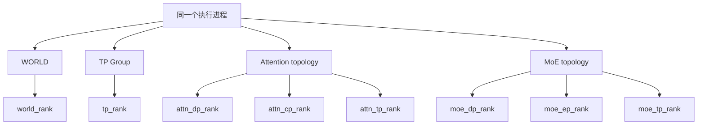
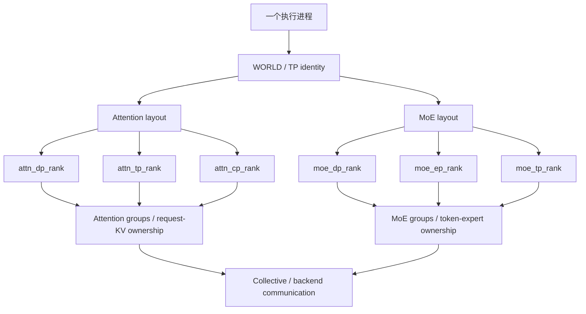

# SGLang Rank 与 Group：读懂 TP、DP Attention 和 EP 坐标

一个 SGLang 进程可以同时有 `tp_rank`、`attn_tp_rank`、`attn_dp_rank` 和 `moe_ep_rank`。这些编号描述它在不同并行布局中的位置：Attention 关心请求分组与 head 分片，MoE 关心专家归属，两者使用同一批进程，却未必使用同一套通信组。

例如日志里的 `rank=2`，可能是全局编号，也可能只是某个 TP 子组内排第三的进程。若先把编号当成设备 ID，后面的 Group 成员和通信范围都会看错。下面从全局编号、组内编号和逻辑 DP 编号分起，再用 `TP16 / DP8` 展开 Attention 与 MoE 坐标。设备 Worker 数量的例子按 PP1、一进程一卡的普通启动布局理解，弹性分支单独说明。

<details markdown="1">
<summary>版本与源码入口</summary>

源码固定到：

```text
sgl-project/sglang
commit: 176dbcb85d3b7737564e4911947035cc0af65f0a
核对日期：2026-09-21
```

主要源码入口包括：

- [`runtime_context.py`](https://github.com/sgl-project/sglang/blob/176dbcb85d3b7737564e4911947035cc0af65f0a/python/sglang/srt/runtime_context.py)
- [`distributed/parallel_state.py`](https://github.com/sgl-project/sglang/blob/176dbcb85d3b7737564e4911947035cc0af65f0a/python/sglang/srt/distributed/parallel_state.py)
- [`managers/data_parallel_controller.py`](https://github.com/sgl-project/sglang/blob/176dbcb85d3b7737564e4911947035cc0af65f0a/python/sglang/srt/managers/data_parallel_controller.py)
- [`layers/dp_attention.py`](https://github.com/sgl-project/sglang/blob/176dbcb85d3b7737564e4911947035cc0af65f0a/python/sglang/srt/layers/dp_attention.py)
- [`entrypoints/engine.py`](https://github.com/sgl-project/sglang/blob/176dbcb85d3b7737564e4911947035cc0af65f0a/python/sglang/srt/entrypoints/engine.py)
- [`managers/scheduler.py`](https://github.com/sgl-project/sglang/blob/176dbcb85d3b7737564e4911947035cc0af65f0a/python/sglang/srt/managers/scheduler.py)

SGLang 的并行实现仍在快速演进，因此下面讲的是这个固定 commit 的实现语义，而不是把某个类名或参数组合当成永久 API。

</details>

## 一、同一个进程的多套编号

先不要管 TP、DP、EP，只看四个执行进程：

```text
Process A
Process B
Process C
Process D
```

假设它们共同组成一个 WORLD：

```text
WORLD Group

┌────────┬────────┬────────┬────────┐
│ Rank 0 │ Rank 1 │ Rank 2 │ Rank 3 │
└────────┴────────┴────────┴────────┘
```

此时：`world_size = 4`

而每个进程都有一个 WORLD Rank：

```text
A → world_rank = 0
B → world_rank = 1
C → world_rank = 2
D → world_rank = 3
```

这里的 Rank 描述的是**进程在一个通信集合中的位置**。它不等价于 NPU ID、GPU ID、PCIe 序号，也不等价于操作系统 PID。

例如一组假设编号可以是：

```text
PID         = 40580
device_id   = 3
world_rank  = 6
```

PID 用于操作系统识别进程，device_id 选择机器内的设备，world_rank 则在分布式作业中标识参与者。数值相同或不同，都不能互相替代。

把例子扩大到八个进程，再将它们的 WORLD Rank 分成两个 Group：

```text
WORLD
0 1 2 3 4 5 6 7

Group A = [0, 1, 2, 3]
Group B = [4, 5, 6, 7]
```

对于 WORLD Rank 6 来说，它在整个 WORLD 中当然还是 6，但在 Group B 中的位置是 2：

```text
Group B

WORLD rank:  4   5   6   7
local rank:  0   1   2   3
                     ↑
```

```text
world_rank   = 6
rank_in_group = 2
```

SGLang 当前的 `get_tensor_model_parallel_rank()` 就是返回当前进程在 TP Group 中的 `rank_in_group`；`get_moe_expert_parallel_rank()` 同样返回它在 MoE EP Group 中的 `rank_in_group`。对应 getter 可以直接在 [`parallel_state.py`](https://github.com/sgl-project/sglang/blob/176dbcb85d3b7737564e4911947035cc0af65f0a/python/sglang/srt/distributed/parallel_state.py#L3088-L3168) 中看到。

因此源码里单独出现下面这个赋值时，还无法确定它代表哪一个进程：

```python
rank = 2
```

读取这个编号时，要同时找到它所属的 Group：

> **这是哪个 Group / 哪套并行坐标系里的 Rank 2？**

例如 Group B 的组内 Rank2 对应全局 Rank6；如果把它当成全局 Rank2，就会在日志对齐时找错参与者。看到 Group 的有序成员列表后，才能完成这一步转换。

对于 DeepSeek-V4，一批相同的物理 Rank 在不同计算阶段还会被重新解释：



后面读 Attention 和 MoE 时，就分别沿图中相应分支展开。进程没有换，变化的是当前计算怎样划分数据、怎样组织通信。

## 二、Native DP 与 DP Attention 的区别

TP Rank 相对直观：你属于哪个 TP Group，在里面排第几。

`dp_rank` 随 Native DP 与 DPA 模式改变含义。

当前 SGLang 同一个 `--dp-size` 参数可以出现在两种很不一样的运行方式里：

1. **Native DP**：复制完整模型并把不同请求路由到不同 replica；
2. **DP Attention / DPA**：在一个 TP model-parallel world 内，让 Attention 按 DP shard 处理不同请求 / KV，再在后续 MoE 阶段重新组织数据。

这两种模式都使用 `dp_size`，但启动的进程拓扑不同。要解释日志中的 `dp_rank`，先看 `enable_dp_attention` 是否开启，再追这个值是在启动时赋予，还是从 TP 坐标派生。

### Native DP：`dp_rank` 是第几个完整 replica

当前 `DataParallelController` 在未启用 DP Attention 时走 `launch_dp_schedulers()`：

```python
for dp_rank in range(get_parallel().dp_size):
    ...
    launch_tensor_parallel_group(..., dp_rank)
```

对应源码在 [`data_parallel_controller.py`](https://github.com/sgl-project/sglang/blob/176dbcb85d3b7737564e4911947035cc0af65f0a/python/sglang/srt/managers/data_parallel_controller.py#L366-L428)。

假设：

```text
tp_size = 4
dp_size = 2
enable_dp_attention = False
PP = 1
```

那么直觉上就是两套完整的 4-way TP replica：

```text
Native DP replica 0
TP ranks: 0 1 2 3

Native DP replica 1
TP ranks: 0 1 2 3
```

这里两个副本中的 TP Rank 都从 0 数到 3，TP Rank0 因而可能在日志里出现两次。要区分它们，还需要 `dp_rank=0/1`，说明当前 Scheduler / Worker 属于哪个完整副本。

当前 `runtime_context.py` 对 `dp_rank` 的说明也特意强调：它是 DataParallelController 在 spawn 时赋予的 replica identity，并**不是某个统一 DP process group 的 `rank_in_group`**。源码可见 [`runtime_context.py`](https://github.com/sgl-project/sglang/blob/176dbcb85d3b7737564e4911947035cc0af65f0a/python/sglang/srt/runtime_context.py#L197-L211)。

### DPA：`dp_rank` 会由 `tp_rank` 派生

启用 `--enable-dp-attention` 后，`DataParallelController` 不再按 `dp_size` 启动多套完整 TP replica，而是走 `launch_dp_attention_schedulers()`。这个路径只调用一次 `launch_tensor_parallel_group(...)`，随后在 TP Rank 循环内部，根据 `tp_rank` 计算当前进程属于哪个 Attention DP shard。源码见 [`data_parallel_controller.py`](https://github.com/sgl-project/sglang/blob/176dbcb85d3b7737564e4911947035cc0af65f0a/python/sglang/srt/managers/data_parallel_controller.py#L548-L600) 与 [`data_parallel_controller.py`](https://github.com/sgl-project/sglang/blob/176dbcb85d3b7737564e4911947035cc0af65f0a/python/sglang/srt/managers/data_parallel_controller.py#L641-L672)。

关键代码是：

```python
_, _, dp_rank, _ = compute_dp_attention_world_info(
    enable_dp_attention,
    tp_rank,
    tp_size,
    dp_size,
    attn_cp_size,
)
```

所以在 DPA 普通启动路径里，传进 Scheduler 的 `dp_rank` 本身就是从 `tp_rank` 的 Attention 拓扑位置派生出来的。

Scheduler 初始化时又会单独计算并保存：

```python
attn_dp_rank
```

见 [`scheduler.py`](https://github.com/sgl-project/sglang/blob/176dbcb85d3b7737564e4911947035cc0af65f0a/python/sglang/srt/managers/scheduler.py#L519-L548)。

在普通、非 elastic 的 DPA 启动时，`dp_rank` 与 `attn_dp_rank` 往往数值相同，因为它们来自同一套 `tp_rank → Attention DP` 映射；但两者最好仍分开理解：

- `dp_rank` 是 Scheduler / controller 层拿来标识和路由当前 DP worker slot 的身份；
- `attn_dp_rank` 是当前进程在 Attention 拓扑中的逻辑 DP 坐标。

当前 `runtime_context.py` 对这一区别有直接说明：`attn_dp_rank` 是从 `tp_rank` 的 Attention topology 计算得到，并可能在 elastic scale-up 中移动；它没有被建模成普通 group getter。见 [`runtime_context.py`](https://github.com/sgl-project/sglang/blob/176dbcb85d3b7737564e4911947035cc0af65f0a/python/sglang/srt/runtime_context.py#L184-L205)。

因此，看到下面三个名字时，不能默认它们都来自同一种组内编号规则：

```text
tp_rank
dp_rank
ep_rank
```

更准确的做法是先确认当前模式：

| 名称 | 当前 SGLang 中更准确的理解 |
| --- | --- |
| `tp_rank` | 当前 TP Group 中的位置 |
| `dp_rank` | Controller / spawn 层的 DP worker / replica identity；DPA 路径下由 Attention shard 映射得到 |
| `attn_dp_rank` | Attention 拓扑中的 DP 维坐标 |
| `moe_dp_rank` | MoE 拓扑中的 DP 维坐标 / 对应 MoE DP Group 的位置语义 |
| `moe_ep_rank` | MoE EP Group 中的位置 |

例如 Controller 用 DP 身份决定把请求发给哪个 Worker，Attention 逻辑坐标则参与计算请求与 KV 的布局；即使两者在普通 DPA 启动中数值相同，作用也不同。涉及弹性扩展时，更要以当前布局和实际 Group 为准。

## 三、展开 TP16 / DP8 的坐标

把这些编号放进一组具体配置，区别就更清楚了：

```text
tp_size = 16
dp_size = 8
enable_dp_attention = True
attn_cp_size = 1
PP = 1
```

在 Native DP 中，TP16、DP8 会让人联想到 `16 × 8 = 128` 个设备 Worker。这里开启了 DPA：DP8 用来划分同一组 TP Rank 的 Attention 请求，不能再把设备数乘八。先把 Attention 宽度算出来，就能看清区别。

当前 SGLang 对 Attention 宽度的派生逻辑是：

```python
attn_dp_size = dp_size if enable_dp_attention else 1
attn_tp_size = tp_size // attn_dp_size // attn_cp_size
```

见 [`runtime_context.py`](https://github.com/sgl-project/sglang/blob/176dbcb85d3b7737564e4911947035cc0af65f0a/python/sglang/srt/runtime_context.py#L249-L281)。

代入：

```text
attn_dp_size = 8
attn_tp_size = 16 / 8 / 1 = 2
```

也就是说，原本这一组 16 个 TP Rank，被 Attention 重新解释成：

```text
8 个 Attention-DP shard
×
每个 shard 2 个 Attention-TP rank
```

可以直接画成：

```text
                         attn_tp_rank

                         0      1
                       ┌──────┬──────┐
attn_dp_rank = 0       │ TP0  │ TP1  │
attn_dp_rank = 1       │ TP2  │ TP3  │
attn_dp_rank = 2       │ TP4  │ TP5  │
attn_dp_rank = 3       │ TP6  │ TP7  │
attn_dp_rank = 4       │ TP8  │ TP9  │
attn_dp_rank = 5       │ TP10 │ TP11 │
attn_dp_rank = 6       │ TP12 │ TP13 │
attn_dp_rank = 7       │ TP14 │ TP15 │
                       └──────┴──────┘
```

对应关系：

| `tp_rank` | `attn_dp_rank` | `attn_tp_rank` |
| ---: | ---: | ---: |
| 0 | 0 | 0 |
| 1 | 0 | 1 |
| 2 | 1 | 0 |
| 3 | 1 | 1 |
| 4 | 2 | 0 |
| 5 | 2 | 1 |
| 6 | 3 | 0 |
| 7 | 3 | 1 |
| 8 | 4 | 0 |
| 9 | 4 | 1 |
| 10 | 5 | 0 |
| 11 | 5 | 1 |
| 12 | 6 | 0 |
| 13 | 6 | 1 |
| 14 | 7 | 0 |
| 15 | 7 | 1 |

当前源码的坐标展开公式是：

```text
tp_rank
=
(attn_dp_rank × attn_cp_size + attn_cp_rank)
× attn_tp_size
+
attn_tp_rank
```

并且 `attn_tp_rank` 是最快变化的维度。具体实现在 [`derive_attention_ranks()`](https://github.com/sgl-project/sglang/blob/176dbcb85d3b7737564e4911947035cc0af65f0a/python/sglang/srt/runtime_context.py#L262-L281)。

在 `attn_cp_size=1` 时，它简化成：

```text
tp_rank
=
attn_dp_rank × attn_tp_size
+
attn_tp_rank
```

所以 `tp_rank=10`：

```text
attn_dp_rank = 5
attn_tp_rank = 0
```

例如 TP10 和 TP11 的 Attention-DP 坐标都是 5，在该请求分组内分别是 Attention-TP Rank0 和 Rank1。它们共同处理相应请求；TP12、TP13 则进入下一组。这里仍然只有原来的 16 个 model-parallel Rank。

### 相同 TP / DP 数字对应的两种设备规模

如果我们保持：

```text
tp_size = 16
dp_size = 8
PP = 1
```

但关闭：`enable_dp_attention = False`

那么 `DataParallelController.launch_dp_schedulers()` 会真的循环八次 `dp_rank`，每个 DP replica 都启动一套完整 16-way TP Group。此时设备 worker 数量才是：`8 replicas × 16 TP workers = 128 device workers`

因此比较两份都写着 `TP16 / DP8` 的配置时，必须把 DPA 开关一起列出来。PP=1 下，它会改变这些数字对应的启动拓扑：

| 配置 | 拓扑含义（PP=1） | device worker 直觉 |
| --- | --- | ---: |
| `TP16 + DP8`，DPA 关闭 | 8 套完整的 16-way TP replica | 128 |
| `TP16 + DP8 + --enable-dp-attention` | 1 个 16-way TP world，被 Attention 解释为 `DP8 × ATTN_TP2` | 16 |

后续 Attention 与 MoE 通信都沿这套坐标展开。

## 四、MoE 怎样划分专家与张量分片

Attention 的坐标系解决的是：不同请求 / KV 如何分到 Attention DP shard，以及一个 shard 内还剩多少 Attention TP。

进入 DeepSeek-V4 的 MoE 后，要按 Router 选中的 Expert 找到权重所在 Rank，再决定 Token 送到哪里、专家结果从哪里返回。因此同一批 TP Rank 还要展开另一套 MoE 坐标。Attention 的 DP 编号不能直接拿来当作 MoE 的 DP 或 EP 编号。

launcher 源码直接写出了 hierarchy：

```text
Attention:
Global(TP) → DP → ATTN_CP → ATTN_TP

MoE:
Global(TP) → MOE_DP → EP → MOE_TP
```

见 [`engine.py`](https://github.com/sgl-project/sglang/blob/176dbcb85d3b7737564e4911947035cc0af65f0a/python/sglang/srt/entrypoints/engine.py#L1906-L1928) 和 [`data_parallel_controller.py`](https://github.com/sgl-project/sglang/blob/176dbcb85d3b7737564e4911947035cc0af65f0a/python/sglang/srt/managers/data_parallel_controller.py#L682-L704)。

这里按以下顺序展开坐标：`MOE_DP → EP → MOE_TP`

这里“`MOE_TP` 变化最快”指递增 `tp_rank` 时，先改变 `moe_tp_rank`；这一维数完后，再增加 `moe_ep_rank`，最后才增加 `moe_dp_rank`。下面的公式与表格都按这个顺序展开。

当前宽度关系为：

```text
moe_tp_size
=
tp_size / moe_dp_size / moe_ep_size
```

因此在一个 TP Group 内，可以把一维 `tp_rank` 展开成三维坐标：`(moe_dp_rank, moe_ep_rank, moe_tp_rank)`

在常规布局下可写成：

```text
moe_tp_rank
=
tp_rank % moe_tp_size
```

```text
moe_ep_rank
=
(tp_rank // moe_tp_size) % moe_ep_size
```

```text
moe_dp_rank
=
tp_rank // (moe_ep_size × moe_tp_size)
```

反过来：

```text
tp_rank
=
(moe_dp_rank × moe_ep_size + moe_ep_rank)
× moe_tp_size
+
moe_tp_rank
```

`runtime_context.py` 中 `derive_spawn_ranks()` 给出的 `moe_dp_rank` / `moe_ep_rank` 推导与这个展开完全一致，见 [`runtime_context.py`](https://github.com/sgl-project/sglang/blob/176dbcb85d3b7737564e4911947035cc0af65f0a/python/sglang/srt/runtime_context.py#L299-L330)。

### 用 8 个 Rank 看最清楚

先用一个只说明坐标关系的例子。参数组合在目标 backend 上是否可运行，仍要检查相应限制：

```text
tp_size     = 8
moe_dp_size = 2
ep_size     = 4
```

那么：

```text
moe_tp_size
= 8 / 2 / 4
= 1
```

此时可以画成：

```text
                           moe_ep_rank

                         0    1    2    3
                      ┌────┬────┬────┬────┐
moe_dp_rank = 0       │ 0  │ 1  │ 2  │ 3  │
                      ├────┼────┼────┼────┤
moe_dp_rank = 1       │ 4  │ 5  │ 6  │ 7  │
                      └────┴────┴────┴────┘
```

因为 `moe_tp_size=1`，第三维暂时看不出来。

这时 EP Groups 是：

```text
MOE_EP Group 0 = [0, 1, 2, 3]
MOE_EP Group 1 = [4, 5, 6, 7]
```

而 MoE DP Groups 则固定 EP 坐标、跨 DP 维连接：

```text
MOE_DP Group 0 = [0, 4]
MOE_DP Group 1 = [1, 5]
MOE_DP Group 2 = [2, 6]
MOE_DP Group 3 = [3, 7]
```

所以 `tp_rank=6` 对应：

```text
moe_dp_rank = 1
moe_ep_rank = 2
moe_tp_rank = 0
```

也就是：

```text
一维坐标：6

三维坐标：
(dp=1, ep=2, tp=0)
```

如果想让 `moe_tp_rank` 也出现，可以把例子换成：

```text
tp_size     = 16
moe_dp_size = 2
ep_size     = 4
```

那么：`moe_tp_size = 2`

开头几个 Rank 就变成：

| `tp_rank` | `moe_dp_rank` | `moe_ep_rank` | `moe_tp_rank` |
| ---: | ---: | ---: | ---: |
| 0 | 0 | 0 | 0 |
| 1 | 0 | 0 | 1 |
| 2 | 0 | 1 | 0 |
| 3 | 0 | 1 | 1 |
| 4 | 0 | 2 | 0 |
| 5 | 0 | 2 | 1 |
| 6 | 0 | 3 | 0 |
| 7 | 0 | 3 | 1 |
| 8 | 1 | 0 | 0 |
| 9 | 1 | 0 | 1 |
| 10 | 1 | 1 | 0 |
| 11 | 1 | 1 | 1 |

这时 TP0、TP1 属于同一个 MoE-DP/EP 坐标，分别持有 MoE-TP 分片 0、1；到 TP2 才进入下一个 EP 坐标。再看 TP10，它在这组 MoE 参数下是 `(moe_dp=1, moe_ep=1, moe_tp=0)`；若沿用前面 Attention 的 DP8、CP1，则 Attention 坐标仍是 `(attn_dp=5, attn_tp=0)`。同一进程的两个 DP 数字不同，是因为两套布局在按不同职责分工。

### 用 Group 成员核对坐标展开顺序

`parallel_state.py` 的真实 Group 构造也和上面的三维展开一致：

- `_MOE_TP`：同一个 `(moe_dp, moe_ep)` 下的连续 `moe_tp_size` 个 Rank；
- `_MOE_EP`：固定 `(moe_dp, moe_tp)`，沿 EP 维按 `moe_tp_size` 步长取 Rank；
- `_MOE_DP`：固定 `(moe_ep, moe_tp)`，沿 DP 维跨越 `moe_tp_size × moe_ep_size`。

对应实现位于 [`parallel_state.py`](https://github.com/sgl-project/sglang/blob/176dbcb85d3b7737564e4911947035cc0af65f0a/python/sglang/srt/distributed/parallel_state.py#L2809-L2895)。

当 `attn_cp_size > moe_dp_size` 时，还有一条 alias 分支：`_MOE_DP` 直接复用 `_ATTN_CP`，借助 CP partners 共享进入 MoE 所需的 Token。查到这一条件时，应沿复用后的 Group 成员继续追踪。

查找实际成员时，沿以下构造过程展开：

> 先看 `tp_size / moe_dp_size / ep_size` 如何派生 `moe_tp_size`，再看当前配置最终创建了哪些 Group，而不是只凭参数名字想象拓扑。

## 五、EP 与 TP 宽度相同，Group 仍可能不同

坐标算对之后，还要区分通信组本身的身份。同一批进程可以被放进两个独立创建的通信组，即使成员顺序完全相同，调用时也不能把这两个 Group 自动当成一个对象。

假设：

```text
tp_size = 8
ep_size = 8
moe_dp_size = 1
```

那么：`moe_tp_size = 1`

从成员列表上看，TP Group 和 MoE EP Group 都可能包含：`[0, 1, 2, 3, 4, 5, 6, 7]`

从这份列表只能确认参与者相同，不能直接推出 `_MOE_EP == _TP`。固定版本在 NPU 路径上会单独创建 MoE EP Group。

`parallel_state.py` 的逻辑是：

```python
if moe_ep_size == tensor_model_parallel_size and not _is_npu:
    _MOE_EP = _TP
else:
    _MOE_EP = init_model_parallel_group(...)
```

源码见 [`parallel_state.py`](https://github.com/sgl-project/sglang/blob/176dbcb85d3b7737564e4911947035cc0af65f0a/python/sglang/srt/distributed/parallel_state.py#L2837-L2865)。

代码旁边注明了这个要求：`NPU requires a standalone group for MOE expert parallelism`

所以在 Ascend 910C / NPU 路径里，即使：

```text
TP members     = [0,1,2,3,4,5,6,7]
MOE_EP members = [0,1,2,3,4,5,6,7]
```

仍然应该理解成：

```text
TP Group
≠
MOE EP Group
```

成员列表相同，但 Group Handle 与通信上下文是独立的。排查时可以分别记录 TP 和 MOE_EP 的成员与 Handle，避免把两个调用点误配为同一个组内的通信。

实际排查时，下面几项要分别从两套 Group 的调用中确认：

```text
这次 collective 使用哪个通信上下文
谁和谁在同一个 communicator 里
这套通信资源为哪种并行语义服务
```

`_MOE_EP` 保存 MoE EP process group；DeepEP / FuseEP 在这套拓扑上组织各自的 dispatch / combine 数据路径。定位通信时，Group 成员与 backend 执行入口需要一起看。

## 六、沿源码确认 Rank 的含义

沿着前面的启动与坐标映射，再回看 Scheduler 保存的 `ParallelState`：这些字段让执行代码能查到当前进程在各阶段的身份。

当前结构中同时保存：

```text
tp_rank / tp_size
pp_rank / pp_size

dp_rank / dp_size

attn_tp_rank / attn_tp_size
attn_cp_rank / attn_cp_size
attn_dp_rank / attn_dp_size

moe_ep_rank / moe_ep_size
moe_dp_rank / moe_dp_size
```

Scheduler 构造这些字段的位置可以看 [`scheduler.py`](https://github.com/sgl-project/sglang/blob/176dbcb85d3b7737564e4911947035cc0af65f0a/python/sglang/srt/managers/scheduler.py#L519-L548)。

这些字段分别记录同一个进程在各套并行坐标中的身份。可以用下图对照：



具体排查时，可以把进程身份、逻辑坐标和实际 Group 放在同一行记录。`tp_rank` 通常是 TP Group 内编号；`attn_dp_rank` 表达 Attention 拓扑坐标；`dp_rank` 则要结合 Native DP 或 DPA 模式解释。通信参与者最终由调用使用的 Group 决定。

回到 `TP16 / DP8`：开启 DPA 且 CP=1 时，同一个 16-rank TP world 在 Attention 视角下分成 `8 × 1 × 2`；Native DP 则是 8 个完整 replica，每个 replica 做 16-way TP，PP=1 时共有 128 个 device worker。进入 MoE 后，再按 `moe_dp_size`、`ep_size` 与派生的 `moe_tp_size` 查找 Group 成员。配置可用性还取决于所选 backend 的宽度约束。
