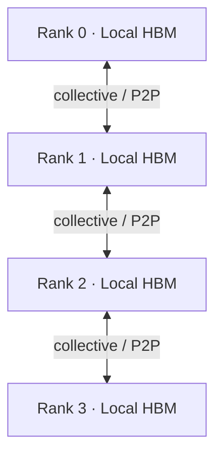
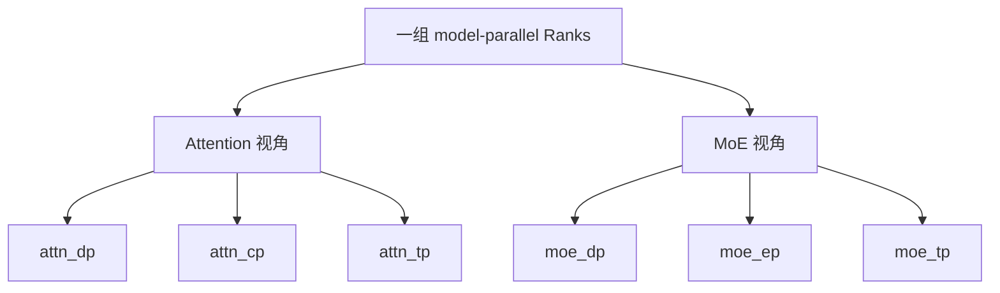
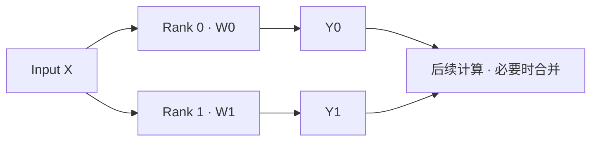
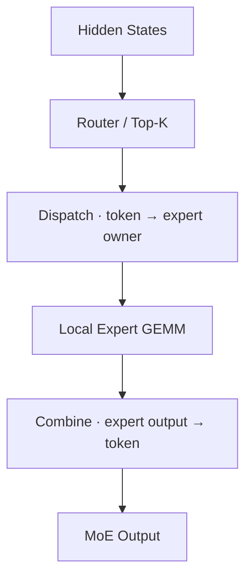
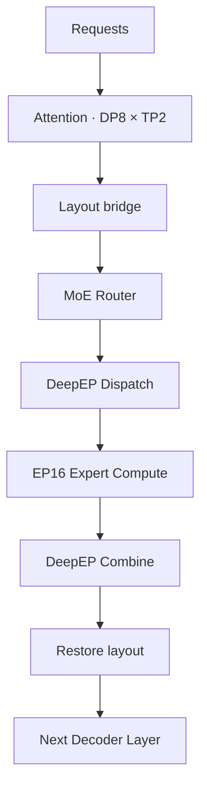

# 模型怎样跨多卡运行：从显存容量到 TP、DP Attention 与 EP

大模型部署通常先碰到容量问题：权重、KV Cache 和执行中的临时 Tensor，能不能同时放进设备内存？即使权重已经分到多卡，还要安排各张卡计算哪一部分，以及何时交换结果。

MoE 很容易造成容量上的误解。一个 Token 只激活少量专家，不代表服务只需保存这些专家；后续请求还可能选到其他权重。下面先算常驻容量，再看 TP 分矩阵、普通 DP 分请求、EP 分专家，最后把它们放回同一层的执行过程。

并行语义固定参考 `sgl-project/sglang @ 176dbcb85d3b7737564e4911947035cc0af65f0a`，核对日期为 2026-09-21。DeepSeek-V4 规模和 Ascend 支持情况同时参考 SGLang 官方文档。本文讨论推理部署，不涉及训练中的梯度同步与 Optimizer State。

## 一、显存需要容纳哪些内容

SGLang DeepSeek-V4 cookbook 给出的 `DeepSeek-V4-Flash-0731` 规模约为 304B Total Parameters、13B Active Parameters。

`304B` 表示整套模型的总参数；`13B` 表示 MoE 路由后，一个 Token 一次前向大约激活的参数规模。当前 Token 未使用的专家，可能会被后续 Token 选中，因此仍需保存在服务可访问的位置。

所以，13B 可以帮助理解单 Token 的激活计算量，不能替代常驻权重的容量。权重卸载、按需装载会引入另一套安排，下面先按所有相关权重常驻设备 HBM 的部署计算。

仅按总参数量和位宽估算权重，不另加量化 Scale、对齐、Runtime Buffer。Embedding 等权重已经包含在总参数中，也不重复累加：

| 权重精度 | 理想化每参数字节数 | 304B 参数的权重下界 |
| --- | ---: | ---: |
| BF16 | 2 Byte | 约 608 GB |
| W8 / INT8 | 1 Byte | 约 304 GB |
| 4 bit | 0.5 Byte | 约 152 GB |

GB 在表中采用十进制，即 `1 GB = 10^9 Byte`，对照工具的 GiB 前需换算。这还是理想位宽下的下界：Checkpoint 与运行 HBM 另有量化 Scale、未量化部分、布局和对齐。ModelSlim W8/W4 缩小的是对应权重，KV Cache、工作区及整个 Runtime 不会自动同比缩小。

设备数量也要明确。SGLang Ascend 文档使用 `A3 Series` 命名，并按每张卡 2 个 die、每 die 64 GB device memory 描述资源。本文对外统一称 Ascend 910C，引用资源时保留 `A3 Series` 以便核对；`tp_size` 按参与计算的逻辑 device / die 数理解，物理卡数另按双 die 换算。

一张双 die 卡的两个 64 GB 合计为 128 GB，但仍是两个设备各自的本地 HBM，并非统一地址空间。合计容量也小于 304B W8 权重约 304 GB 的理论下界。

权重以外，实际运行还需要 KV Cache、activations/hidden states、Attention/MoE workspace、通信 buffer 和 Graph 静态 buffer，并为分配器的空闲保留块与碎片留出余量。

allocator 的 `reserved` 包含它管理的活跃块。计算额外空间时，应取尚未使用的保留部分和碎片，避免再次累加已经算过的权重、KV 等分配。

DeepSeek-V4 缓存还区分 SWA 与压缩历史，不能直接套普通 MHA 公式。并发和上下文长度会继续影响状态大小，所以即使权重能放下，也得为缓存与执行工作区留余量。

按这些权重常驻 HBM 的条件，多卡首先解决容量，之后才有余地比较性能。

多张 NPU 不会自动组成统一 HBM。每个 Rank 保存自己的本地权重、Tensor 和缓存，需要跨设备使用的数据仍得通过 collective 或点对点通信交换。



因此，多卡部署还需说明谁保存数据、谁执行计算、何时交换结果。TP、DP、EP 分别从张量、请求、专家三个角度安排工作。

## 二、TP、DP 与 EP 分别切什么

先看分配对象：TP 切 Tensor 的计算及权重，普通 DP 把请求分给模型副本，EP 则分配专家权重。

| 并行方式 | 主要切分对象 | 最先解决的问题 | 一个 Token 的直觉 |
| --- | --- | --- | --- |
| **TP** | Tensor / Linear 权重维度 | Dense / 共享权重太大，单设备放不下或算不动 | 同一个 Token 由多个 Rank 协作计算 |
| **DP** | Request / Batch | 请求多，需要更高吞吐 | 不同 Replica 处理不同请求 |
| **EP** | MoE Expert ownership | Expert 权重太多，不能全部复制 | Token 被 Router 发给持有目标 Expert 的 Rank |

在 DeepSeek-V4 这样的 MoE 中，Dense / 共享部分可以走 TP 分片，专家权重可以由 EP 分散。两者都可能减少单 Rank 权重占用，但切分维度不同。

这些安排也可以组合。同一 Decoder Layer 在 Attention 阶段按一套布局处理请求，进入 MoE 时又按专家布局解释同一批 Rank。

固定版本中，启用 DP Attention 后满足 `tp_size = attn_dp_size × attn_cp_size × attn_tp_size`；进入 MoE，同一个外层 TP world 又可分解为 `tp_size = moe_dp_size × moe_ep_size × moe_tp_size`。可在 [`runtime_context.py`](https://github.com/sgl-project/sglang/blob/176dbcb85d3b7737564e4911947035cc0af65f0a/python/sglang/srt/runtime_context.py#L249-L377) 核对派生逻辑。



这两组乘积描述的是同一批 model-parallel Rank。Attention 按请求与特征组织，MoE 按专家归属组织，因此阶段切换还要把输出转成下一阶段能够消费的布局。

## 三、TP：拆分矩阵计算，再合并结果

先从 Transformer 常见的 Linear / GEMM 看 TP，用矩阵乘表示为 `Y = XW`。

若 W 的输出维很大，可以沿这个维度做 Column Parallel，拆成 `W = [W0 | W1]`。两个 Rank 各存自己的 shard，分别计算 `Y0 = XW0`、`Y1 = XW1`。



这样每个 Rank 无需保存这块矩阵的完整副本，计算也由多个设备分担。假设矩阵能够均匀做 8-way TP，每个 Rank 对它只保存约 `1/8` 的 shard。

这个 `1/8` 描述的是刚才那块可均匀分片的矩阵，还不能推到整模型 HBM。

有些权重会分片，有些会复制，MoE 的专家又可能按 EP 分布。单 Rank 最终占用仍取决于模型结构、TP/EP 布局、量化方式和实现。

分片还会带来交换和归并。例如 Row Parallel Linear 的不同 Rank 可以先产生 partial output，再用 reduction 得到后续需要的结果。AllReduce、AllGather、ReduceScatter 的选择取决于布局：后续需要 replicated Tensor 时恢复完整结果，能继续消费 shard 时就保留分片。

增加 TP Rank 能分摊可分片权重与计算，但需要同步、合并的结果也得跨设备移动。评估更多设备的收益时，这部分通信不能漏算。

TP 太小，容量可能不够；TP 太大，又可能把计算拆得过碎，让 small GEMM、通信和同步消耗更多时间。实际宽度需要结合这两边选择。

## 四、普通 DP 与 DP Attention 怎样分配请求

一份模型能运行后，还需处理同时到达的多条请求。普通 DP 从完整模型副本的层面分工。

它复制模型，让不同 Replica 处理不同 Request / Batch。

例如一份模型需要 8 个 device worker、`TP=8`，普通 DP=2 就对应两组独立 TP8 副本。每组内部都有自己的 TP shards，各自服务不同请求。

第二组副本仍要容纳另一份可运行模型，无法给第一份额外扩展存储。因而普通 DP 增加并发服务容量，但不会继续缩小单份模型。

SGLang 中还需留意 `--dp-size` 是否用于 DP Attention（DPA）。官方将 DPA 定义为只在 Attention 部分应用数据并行。DeepSeek 这类 MLA 模型可以让不同 Attention-DP shard 各自处理请求、维护 KV Cache，再把数据桥接到 FFN / MoE 的并行布局。

同样写 `TP16 / DP8`，开启 DPA 与否会产生下面的区别：

| 配置 | 含义（忽略 PP 等其他维度） | device worker 直觉 |
| --- | --- | ---: |
| `TP16 + DP8`，普通 Native DP | 8 套完整的 16-way TP Replica | 约 128 |
| `TP16 + DP8 + DPA` | 1 个 16-way model-parallel world，Attention 内重解释为 DP8 × TP2 | 16 |

固定源码按以下逻辑派生宽度：

```python
attn_dp_size = dp_size if enable_dp_attention else 1
attn_tp_size = tp_size // attn_dp_size // attn_cp_size
```

当 `tp_size=16`、`dp_size=8`、`enable_dp_attention=True`、`attn_cp_size=1` 时：

- `attn_dp_size = 8`
- `attn_tp_size = 16 / 8 / 1 = 2`

这里总共仍有 16 个 model-parallel Rank。Attention 把它们分成 8 个请求组，每组有 2 个 Attention-TP Rank：

| attn_dp_rank | attn_tp_rank=0 | attn_tp_rank=1 |
| ---: | --- | --- |
| 0 | Rank0 | Rank1 |
| 1 | Rank2 | Rank3 |
| 2 | Rank4 | Rank5 |
| 3 | Rank6 | Rank7 |
| 4 | Rank8 | Rank9 |
| 5 | Rank10 | Rank11 |
| 6 | Rank12 | Rank13 |
| 7 | Rank14 | Rank15 |

Attention 的 8 个请求组都在这 16 个 Rank 之内。

官方文档也明确区分这两种模式：普通 DP 是完整模型 Replica；DPA 的不同 shard 独立处理 Attention batch 与 KV，在 MoE 场景中又常与 EP 组合。固定文档见 [`dp_dpa_smg_guide.mdx`](https://github.com/sgl-project/sglang/blob/176dbcb85d3b7737564e4911947035cc0af65f0a/docs/docs/advanced_features/dp_dpa_smg_guide.mdx)。

读配置时应先确认是哪种 DP，再计算 Replica 数与组内 TP 宽度，否则只凭 `TP16 / DP8` 很容易推错设备数量。

## 五、EP：让 Token 找到对应专家

再把分配对象换成专家，看 MoE 怎样使用这些 Rank。

Dense FFN 中，各 Token 经过同一套 MLP；MoE 先由 Router 选择少量 Expert。因此模型可以拥有 304B Total 参数，每个 Token 却只激活约 13B。

EP 将专家权重分散到不同 Rank：例如 Rank 0 持有一组，Rank 1 持有另一组，其余 Rank 继续持有其他专家。

实际布局还可能包含 shared experts、副本和 EPLB 重排，不保证每卡正好连续存放固定数量的 Expert。需要先确定各 Rank 当前持有哪些专家权重。


假设 Token A 在 Rank 0，Router 选中 Rank 2 上的 Expert 37，那么 Hidden State 要先送到 Rank 2。专家计算完成后，输出还要回到后续计算所需的位置。

使用 DeepEP 这类 A2A backend 时，典型路径如下：



当多个 Rank 的 Token 同时访问远端专家，Dispatch / Combine 就形成 All-to-All 类型的交换。固定 SGLang EP 文档将 DeepEP 描述为用于 MoE token shuffling 的高效 A2A backend。

EP 说明专家归属，实际交换仍取决于 backend。固定版本的 `none` backend 可使用 AllReduce / AllGather 路径，DeepEP、Ascend FuseEP 等 A2A backend 又各有适用条件，看到 EP 参数后还要继续核对运行分支。

该版本文档要求 DeepEP 等 A2A backend 满足 `ep_size = tp_size`。因此，概念配置 `TP16 + DPA8 + EP16` 若取 `moe_dp_size=1`，同一批 Rank 可在两阶段呈现如下布局：

| 阶段 | 同一组 16 Rank 的逻辑布局 |
| --- | --- |
| Attention | `8 Attention-DP × 2 Attention-TP` |
| MoE | `1 MoE-DP × 16 EP × 1 MoE-TP` |

同一批设备有时协作计算一个 Token，有时各自处理请求，有时接收发给本地 Expert 的 Token。差别来自当前子模块对 Rank 的组织方式。

## 六、从权重分布回到一次 Forward

现在用一组 16 Rank 的概念配置串起一次 Forward：

```text
tp_size = 16
dp_size = 8
enable_dp_attention = True
attn_cp_size = 1
ep_size = 16
moe_a2a_backend = deepep
```

它用于说明数据流，并非完整启动命令，也不代表已在任意硬件验证。暂时忽略 PP、PD Disaggregation 和投机解码，只跟踪一个 Decoder Layer；部署时仍需确认模型、精度和 backend 支持。

Attention 阶段按 `8 DP × 2 Attention-TP` 组织。不同 Attention-DP shard 处理各自请求与本地 KV，同组两个 Attention-TP Rank 协作完成需要分片的计算。

进入 MoE 后，Router 选择目标专家，DeepEP 把 Hidden State dispatch 到相应 owner，并将专家输出 combine 回来。下一层开始前，再恢复 Attention 能消费的布局。



从容量看，TP、EP 分摊了不同权重；从执行看，Attention 的 DP/TP 和 MoE 的专家归属之间需要交换布局。增加设备是否值得，要把容量、计算收益以及这部分通信成本一起评估。

### 继续阅读

进一步读 SGLang 源码时，可以先确定 Rank 坐标，再看 collective 怎样搬张量，最后跟踪 Attention 到 MoE 的完整布局转换：

1. [SGLang Rank 与 Group：读懂 TP、DP Attention 和 EP 坐标](sglang-rank-group-deepseek-v4.md)
2. [SGLang 里的 AllReduce、AllGather、ReduceScatter、All-to-All 到底在搬什么？](sglang-collectives-deepseek-v4.md)
3. [DeepSeek-V4 分布式 Forward：Attention 与 MoE 怎样交换布局](../sglang/deepseek-v4-distributed-parallel-source-analysis.md)

### 主要资料

- [SGLang DeepSeek-V4 Cookbook](https://github.com/sgl-project/sglang/blob/main/docs/cookbook/autoregressive/DeepSeek/DeepSeek-V4.mdx)
- [SGLang DP / DPA Guide](https://github.com/sgl-project/sglang/blob/176dbcb85d3b7737564e4911947035cc0af65f0a/docs/docs/advanced_features/dp_dpa_smg_guide.mdx)
- [SGLang Expert Parallelism](https://github.com/sgl-project/sglang/blob/176dbcb85d3b7737564e4911947035cc0af65f0a/docs/docs/advanced_features/expert_parallelism.mdx)
- [SGLang `runtime_context.py`](https://github.com/sgl-project/sglang/blob/176dbcb85d3b7737564e4911947035cc0af65f0a/python/sglang/srt/runtime_context.py)
- [SGLang Ascend Model Support](https://github.com/sgl-project/sglang/blob/main/docs/docs/hardware-platforms/ascend-npus/reference/support_models.mdx)
- [SGLang Ascend Deployment Tutorial：64 GB / die 与双 die 卡的资源口径](https://github.com/sgl-project/sglang/blob/main/docs/docs/hardware-platforms/ascend-npus/model-deployment/tutorials/qwen3_5_397b.mdx)
