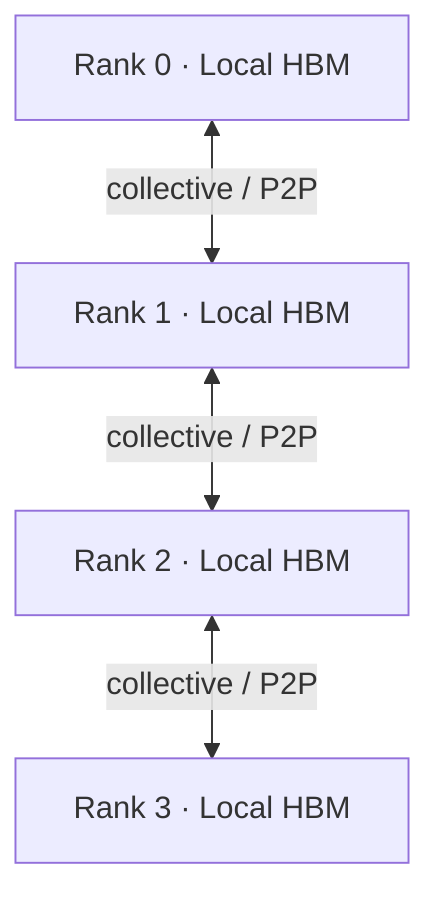
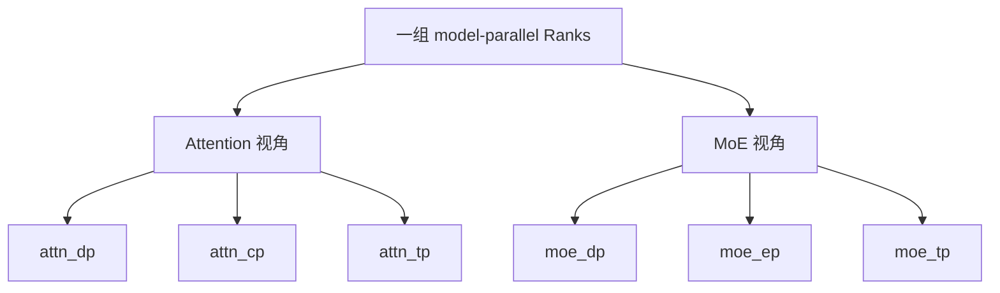
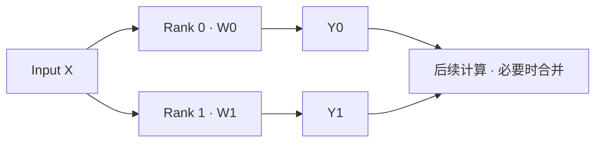
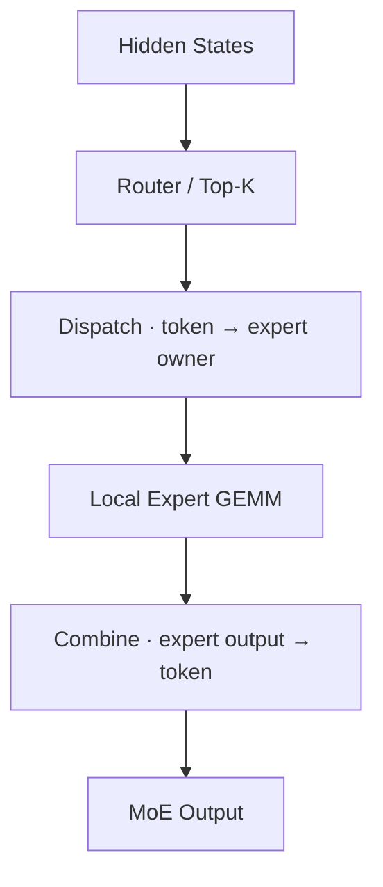
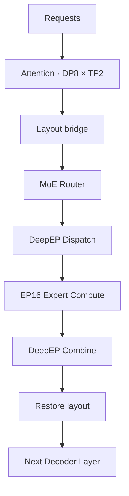

# 模型怎样跨多卡运行：从显存容量到 TP、DP Attention 与 EP

DeepSeek-V4-Flash 每 Token 约激活 13B 参数，常驻权重却要按约 304B 总参数安排。当前没用到的专家，下一条请求仍可能选中。容量放得下之后，才轮到多张卡怎样共同计算。

TP 分矩阵，普通 DP 分请求，EP 分专家。同一批 Rank 还可以在 Attention、MoE 阶段使用不同布局。下面先估算 HBM 需要容纳什么，再把这些分工接成一层 Forward。

并行语义固定参考 `sgl-project/sglang @ 176dbcb85d3b7737564e4911947035cc0af65f0a`，核对日期为 2026-09-21。模型规模、Ascend 支持参考 SGLang 官方文档。本文只讨论推理部署。

## 一、显存需要容纳哪些内容

SGLang cookbook 给出的 `DeepSeek-V4-Flash-0731` 约有 304B Total Parameters、13B Active Parameters。

304B 数整套模型，13B 数一个 Token 前向激活的参数。未被本次路由选中的专家，也要留在服务可访问的位置。

以下按相关权重常驻设备 HBM 计算。权重卸载、按需装载则需要另外安排读取和执行。

先只用总参数量、位宽估算，不额外累加已包含在总参数中的 Embedding，也暂不计 Scale、对齐、Runtime Buffer：

| 权重精度 | 理想化每参数字节数 | 304B 参数的权重下界 |
| --- | ---: | ---: |
| BF16 | 2 Byte | 约 608 GB |
| W8 / INT8 | 1 Byte | 约 304 GB |
| 4 bit | 0.5 Byte | 约 152 GB |

表中 GB 为十进制，`1 GB = 10^9 Byte`，与工具的 GiB 比较前要换算。这是理想位宽下的下界，实际还有量化 Scale、未量化部分、布局、对齐。ModelSlim W8/W4 缩小对应权重，KV、workspace、Runtime 占用仍需分别计算。

SGLang Ascend 文档用 `A3 Series`，按每卡 2 个 die、每 die 64 GB device memory 描述资源。本文统一称 Ascend 910C，同时保留文档名称便于核对。`tp_size` 数参与计算的逻辑 device / die，物理卡数再按双 die 换算。

双 die 卡合计 128 GB，分别属于两个设备的本地 HBM。即使只比较总量，也小于约 304 GB 的 304B W8 理论权重。

实际还要放下 KV、activations/hidden states、Attention/MoE workspace、通信 buffer、Graph 静态 buffer，并为分配器空闲保留块、碎片留余量。

allocator 的 `reserved` 已包含活跃分配。估算额外空间只加未使用的保留部分、碎片，才不会把权重、KV 再算一遍。

V4 状态还分 SWA、压缩历史，容量随并发、上下文改变，不能直接套普通 MHA 公式。权重放下，只完成了部署的一部分。

在权重常驻 HBM 的条件下，多卡先解决这笔容量需求。

每个 Rank 仍持有自己的本地权重、Tensor、缓存，跨设备使用的数据要通过 collective、点对点通信交换。



所以多卡分工需要同时回答数据在哪里、谁执行、何时交换。

## 二、TP、DP 与 EP 分别切什么

TP 切 Tensor 的权重与计算，普通 DP 将请求交给模型副本，EP 则分配专家权重。

| 并行方式 | 主要切分对象 | 最先解决的问题 | 一个 Token 的直觉 |
| --- | --- | --- | --- |
| **TP** | Tensor / Linear 权重维度 | Dense / 共享权重太大，单设备放不下或算不动 | 同一个 Token 由多个 Rank 协作计算 |
| **DP** | Request / Batch | 请求多，需要更高吞吐 | 不同 Replica 处理不同请求 |
| **EP** | MoE Expert ownership | Expert 权重太多，不能全部复制 | Token 被 Router 发给持有目标 Expert 的 Rank |

MoE 的 Dense / 共享部分可以用 TP 分片，专家可以按 EP 分散，两者沿不同维度减少单 Rank 权重。

组合之后，同一 Decoder Layer 的 Attention 按请求、特征布局，MoE 再按专家归属解释这些 Rank。

固定实现开启 DPA 时有 `tp_size = attn_dp_size × attn_cp_size × attn_tp_size`；MoE 则有 `tp_size = moe_dp_size × moe_ep_size × moe_tp_size`。派生逻辑见 [`runtime_context.py`](https://github.com/sgl-project/sglang/blob/176dbcb85d3b7737564e4911947035cc0af65f0a/python/sglang/srt/runtime_context.py#L249-L377)。



两个乘积描述同一批 model-parallel Rank。阶段切换时，数据也要转换成下一模块能消费的布局。

## 三、TP：拆分矩阵计算，再合并结果

以 Linear / GEMM 的 `Y = XW` 看 TP。

沿 W 输出维做 Column Parallel，拆为 `W = [W0 | W1]`。两个 Rank 各存 shard，分别算 `Y0 = XW0`、`Y1 = XW1`。



若这块矩阵能均匀分为 8-way TP，各 Rank 就只保存约 `1/8` 权重，并分担对应计算。

这个比例只适用于这块可分片矩阵。

模型里还可能有复制权重、EP 专家，最终单 Rank HBM 仍取决于结构、TP/EP、量化与实现。

分片结果还要按需要交换。例如 Row Parallel 先产生 partial output，再归约。后续需要完整 replicated Tensor，就恢复结果；能继续消费 shard，则可保留分片。AllReduce、AllGather、ReduceScatter 对应这些不同布局需求。

TP 分摊权重、计算，也引入跨设备结果交换。

宽度太小，容量不够；过大又可能让 GEMM 过碎，通信、同步占比上升。合适宽度需要权衡这两类成本。

## 四、普通 DP 与 DP Attention 怎样分配请求

一份模型已经可运行，普通 DP 再复制服务能力。

每个 Replica 处理不同 Request / Batch。

假设一份模型要 8 个 device worker，`TP=8`，普通 DP=2 就是两组独立 TP8 副本，各有完整一套 TP shards。

第二组继续容纳另一份模型，扩大并发服务能力，并不会给第一组扩展存储。

SGLang 的 `--dp-size` 还可能用于 DP Attention。官方 DPA 只在 Attention 部分做数据并行：各 shard 处理自己的请求、KV，再将数据接到 FFN / MoE 布局。

同样写 `TP16 / DP8`，是否开启 DPA 会改变设备、请求的组织：

| 配置 | 含义（忽略 PP 等其他维度） | device worker 直觉 |
| --- | --- | ---: |
| `TP16 + DP8`，普通 Native DP | 8 套完整的 16-way TP Replica | 约 128 |
| `TP16 + DP8 + DPA` | 1 个 16-way model-parallel world，Attention 内重解释为 DP8 × TP2 | 16 |

固定代码派生为：

```python
attn_dp_size = dp_size if enable_dp_attention else 1
attn_tp_size = tp_size // attn_dp_size // attn_cp_size
```

`tp_size=16`、`dp_size=8`、`enable_dp_attention=True`、`attn_cp_size=1` 时：

`attn_dp_size = 8`，`attn_tp_size = 16 / 8 / 1 = 2`。

总计仍为 16 个 model-parallel Rank，Attention 形成 8 个请求组，每组 2 个 Attention-TP Rank：

| attn_dp_rank | attn_tp_rank=0 | attn_tp_rank=1 |
| ---: | --- | --- |
| 0 | Rank0 | Rank1 |
| 1 | Rank2 | Rank3 |
| 2 | Rank4 | Rank5 |
| 3 | Rank6 | Rank7 |
| 4 | Rank8 | Rank9 |
| 5 | Rank10 | Rank11 |
| 6 | Rank12 | Rank13 |
| 7 | Rank14 | Rank15 |

这 8 组都在原来的 16 Rank 内。

固定官方 [`dp_dpa_smg_guide.mdx`](https://github.com/sgl-project/sglang/blob/176dbcb85d3b7737564e4911947035cc0af65f0a/docs/docs/advanced_features/dp_dpa_smg_guide.mdx) 区分了普通 DP 完整副本与 DPA：后者独立处理 Attention batch、KV，在 MoE 中又常与 EP 组合。

读配置先确定 DP 的用法，再数 Replica、组内 TP，设备数量才不会算错。

## 五、EP：让 Token 找到对应专家

到了 MoE，分配对象变成专家。

Dense FFN 让 Token 经过同一套 MLP；MoE Router 为每 Token 选少量专家，因而可以有 304B 总参数、约 13B 激活参数。

EP 将专家权重分给各 Rank，例如 Rank 0 持有一组，Rank 1 持有另一组。

实际还可能有 shared experts、副本、EPLB 重排，当前专家归属要按映射确定，未必连续、均匀地放在每卡。

Token A 在 Rank 0，Router 选中了 Rank 2 的 Expert 37，就需要将 Hidden State 送去计算，再把贡献送回后续需要的位置。

DeepEP 等 A2A backend 的典型执行为：



多 Rank 同时访问远端专家，Dispatch / Combine 形成 All-to-All 类交换。固定 EP 文档将 DeepEP 定义为 MoE token shuffling 的高效 A2A backend。

EP 规定专家归属，backend 决定具体交换。固定 `none` backend 可以走 AllReduce / AllGather，DeepEP、Ascend FuseEP 等 A2A backend 则各有准入条件。

该版本文档要求 DeepEP 等 A2A backend 满足 `ep_size = tp_size`。概念配置 `TP16 + DPA8 + EP16`、`moe_dp_size=1`，因此可以形成：

| 阶段 | 同一组 16 Rank 的逻辑布局 |
| --- | --- |
| Attention | `8 Attention-DP × 2 Attention-TP` |
| MoE | `1 MoE-DP × 16 EP × 1 MoE-TP` |

设备相同，组织方式随模块改变：有时共同计算一条请求，有时各自处理请求，有时接收路由到本地专家的行。

## 六、从权重分布回到一次 Forward

用 16 Rank 概念配置串起一层：

```text
tp_size = 16
dp_size = 8
enable_dp_attention = True
attn_cp_size = 1
ep_size = 16
moe_a2a_backend = deepep
```

这里只示意数据流，不是完整启动命令。忽略 PP、PD、投机解码，部署时还需满足模型、精度、backend 条件。

Attention 以 `8 DP × 2 Attention-TP` 运行。各 Attention-DP 处理自己的请求、KV，组内两个 Rank 协作完成分片计算。

进入 MoE，Router 选专家，DeepEP dispatch 到 owner，combine 回专家输出，再为下一层恢复 Attention 布局。



TP、EP 分摊了不同权重，Attention 与专家布局之间也增加交换。容量够不够、计算省多少、通信花多久，共同决定增加设备后的收益。

### 继续阅读

后续可以先读 Rank 坐标，再看 collective 搬运，最后接上完整阶段转换：

1. [SGLang Rank 与 Group：读懂 TP、DP Attention 和 EP 坐标](sglang-rank-group-deepseek-v4.md)
2. [SGLang 里的 AllReduce、AllGather、ReduceScatter、All-to-All 到底在搬什么？](sglang-collectives-deepseek-v4.md)
3. [DeepSeek-V4 分布式 Forward：Attention 与 MoE 怎样交换布局](../sglang/deepseek-v4-distributed-parallel-source-analysis.md)

### 主要资料

- [SGLang DeepSeek-V4 Cookbook](https://github.com/sgl-project/sglang/blob/main/docs/cookbook/autoregressive/DeepSeek/DeepSeek-V4.mdx)
- [SGLang DP / DPA Guide](https://github.com/sgl-project/sglang/blob/176dbcb85d3b7737564e4911947035cc0af65f0a/docs/docs/advanced_features/dp_dpa_smg_guide.mdx)
- [SGLang Expert Parallelism](https://github.com/sgl-project/sglang/blob/176dbcb85d3b7737564e4911947035cc0af65f0a/docs/docs/advanced_features/expert_parallelism.mdx)
- [SGLang `runtime_context.py`](https://github.com/sgl-project/sglang/blob/176dbcb85d3b7737564e4911947035cc0af65f0a/python/sglang/srt/runtime_context.py)
- [SGLang Ascend Model Support](https://github.com/sgl-project/sglang/blob/main/docs/docs/hardware-platforms/ascend-npus/reference/support_models.mdx)
- [SGLang Ascend Deployment Tutorial：64 GB / die 与双 die 卡的资源口径](https://github.com/sgl-project/sglang/blob/main/docs/docs/hardware-platforms/ascend-npus/model-deployment/tutorials/qwen3_5_397b.mdx)
