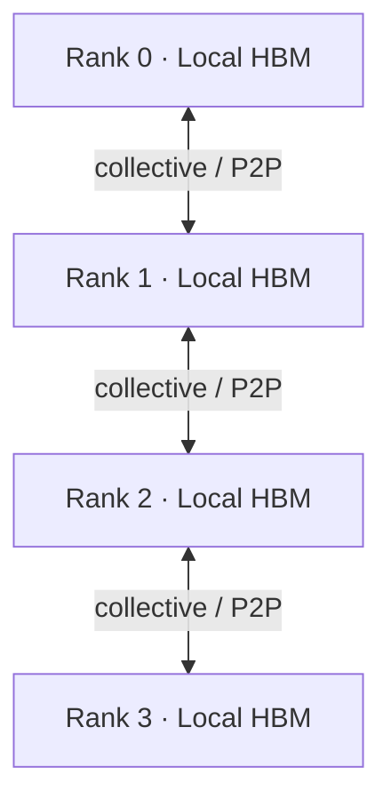
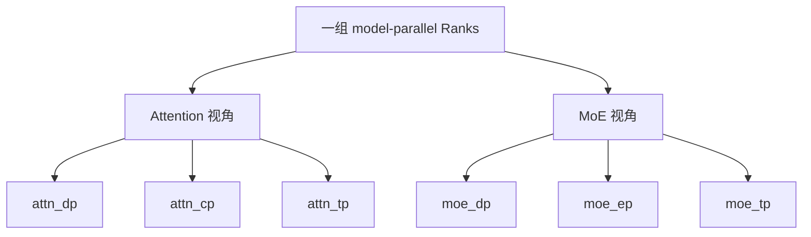
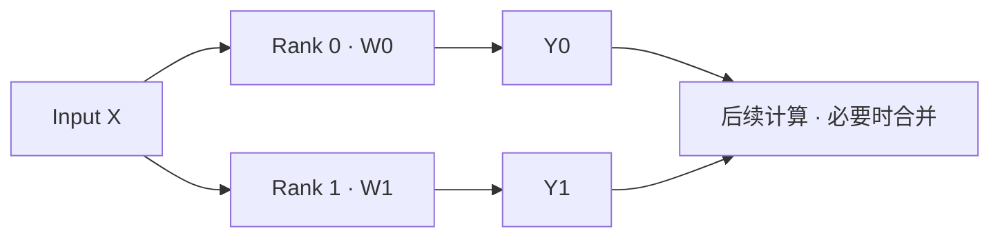
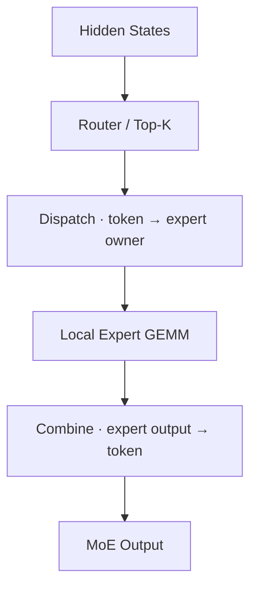
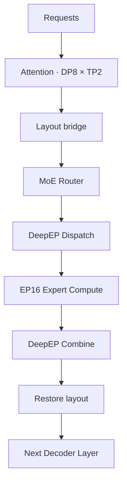

# 模型怎样跨多卡运行：从显存容量到 TP、DP Attention 与 EP

部署大模型时，第一道约束通常是容量：权重、KV Cache 和执行中的临时 Tensor 能否同时放进设备内存。把权重分到多张卡后，还要决定一次计算怎样分工，以及分片结果在哪里合并。

例如 MoE 每个 Token 只激活一小部分专家，看起来计算量比总参数规模小很多，却仍要存放后续请求可能选到的专家权重。先把容量这笔账算清，再看 TP 怎样切矩阵、普通 DP 怎样分请求、EP 怎样放专家，最后就能理解同一批设备为什么会在 Attention 和 MoE 阶段采用不同布局。

本文的并行语义参考 `sgl-project/sglang @ 176dbcb85d3b7737564e4911947035cc0af65f0a`，核对日期为 2026-09-21；DeepSeek-V4 参数规模与 Ascend 支持情况同时参考当前 SGLang 官方文档。本文只讨论推理，不讨论训练里的梯度同步与 Optimizer State。

## 一、显存需要容纳哪些内容

SGLang 当前 DeepSeek-V4 cookbook 给出的 `DeepSeek-V4-Flash-0731` 规模约为 **304B Total Parameters / 13B Active Parameters**。

这两个数字必须先分清。`304B` 是整套模型的总参数量；`13B` 是 MoE 路由之后，一个 Token 在一次前向中大约激活的参数规模。每个 Token 只使用部分 Expert，后续 Token 却可能选择其他 Expert，因此服务仍要能访问整套可路由专家的权重。

13B 主要帮助理解一次 Token 前向的激活计算规模，不能拿它代替整套常驻权重的容量。除非另行设计权重卸载或按需装载，这些可能被路由到的专家都要在服务可访问的位置保存；下面按权重常驻设备 HBM 的部署讨论。

先按总参数量估算权重本身，暂不另加量化 Scale、对齐和 Runtime Buffer 等开销。Embedding 等模型权重已包含在总参数口径内，不应作为额外参数再算一次：

| 权重精度 | 理想化每参数字节数 | 304B 参数的权重下界 |
| --- | ---: | ---: |
| BF16 | 2 Byte | 约 608 GB |
| W8 / INT8 | 1 Byte | 约 304 GB |
| 4 bit | 0.5 Byte | 约 152 GB |

表中 GB 按十进制计算，即 `1 GB = 10^9 Byte`；与工具显示的 GiB 对比前要先统一单位。这只是按理想位宽估算的权重下界。真实 Checkpoint 和服务 HBM 还包含量化 Scale、未量化部分、布局与对齐等数据；ModelSlim W8/W4 降低的是对应权重的占用，不能把 KV Cache、临时工作区和整个 Runtime 都按同样比例缩小。

这里还要统一一个 Ascend 计数口径。SGLang Ascend 文档当前仍使用 `A3 Series` 的产品命名，并按**每张卡 2 个 die、每个 die 64 GB device memory**描述资源；本文沿用本系列统一的对外称呼 **Ascend 910C**，在引用官方资源口径时保留 `A3 Series` 便于对照。本文按参与计算的逻辑 device / die 数量解释 `tp_size`，物理卡数另按双 die 口径换算。

即便把一张双 die 卡上的两颗 64 GB device memory 合计为 128 GB 容量，这 128 GB 也不是一块统一地址空间，而是两个设备各自的本地 HBM；无论如何，它仍远小于 304B W8 权重约 304 GB 的理论下界。

更重要的是，推理运行时还要给下面这些对象留空间：

```text
HBM
├── Model Weights
├── KV Cache
├── Activations / Hidden States
├── Attention / MoE Workspace
├── Communication Buffers
├── Graph / Static Buffers
└── 分配器空闲保留块与碎片
```

allocator 的 `reserved` 已包含它管理的活跃块。核算额外占用时，取尚未使用的保留空间及碎片，避免与权重、KV 等活跃分配重复计数。

DeepSeek-V4 的缓存还要区分 SWA 与压缩历史，不能直接套用普通 MHA 的容量公式。权重放下之后，并发请求数和上下文长度仍会改变缓存需求；容量规划必须为这些状态与执行工作区留出空间。

在这种常驻本地 HBM 的部署条件下，多卡先满足模型的容量要求，再讨论性能取舍。

但多张 NPU 也不会自动拼成一块更大的统一 HBM。每个 Rank 仍然有自己的本地权重、Tensor 和缓存，跨设备数据必须显式通过 collective 或点对点通信移动。



多卡部署接下来要确定数据由谁保存、谁计算，以及何时交换。TP、DP、EP 分别从张量、请求和专家三个角度安排这些工作。

## 二、TP、DP 与 EP 分别切什么

三种并行的区别，可以先从被分配的对象看。TP 分的是一个 Tensor 的计算与权重，普通 DP 分的是请求，EP 分的是专家权重；它们解决的容量或吞吐问题并不相同。

| 并行方式 | 主要切分对象 | 最先解决的问题 | 一个 Token 的直觉 |
| --- | --- | --- | --- |
| **TP** | Tensor / Linear 权重维度 | Dense / 共享权重太大，单设备放不下或算不动 | 同一个 Token 由多个 Rank 协作计算 |
| **DP** | Request / Batch | 请求多，需要更高吞吐 | 不同 Replica 处理不同请求 |
| **EP** | MoE Expert ownership | Expert 权重太多，不能全部复制 | Token 被 Router 发给持有目标 Expert 的 Rank |

对 DeepSeek-V4 这样的 MoE，Dense / 共享部分可以由 TP 分片，数量巨大的 Expert 权重还可以由 EP 分散。TP 和 EP 都可能降低单 Rank 需要持有的权重，只是它们切的是不同维度。

这也是后面理解 SGLang 的关键。TP、DP、EP 不是三个互斥开关。同一个 DeepSeek-V4 Decoder Layer 完全可能在 Attention 阶段采用一套布局，在 MoE 阶段重新解释同一批 Rank。

当前 SGLang 的并行宽度正是这样组织的。开启 DP Attention 时，Attention 侧满足 `tp_size = attn_dp_size × attn_cp_size × attn_tp_size`；进入 MoE 后，同一个外层 TP world 又可以被解释为 `tp_size = moe_dp_size × moe_ep_size × moe_tp_size`。对应派生逻辑在 [`runtime_context.py`](https://github.com/sgl-project/sglang/blob/176dbcb85d3b7737564e4911947035cc0af65f0a/python/sglang/srt/runtime_context.py#L249-L377)。



这两套乘积分解都在描述同一批 model-parallel Rank。Attention 按请求与特征分片组织计算，MoE 再按专家归属组织数据；阶段切换时，就需要把上一阶段的输出转成下一阶段能消费的布局。

## 三、TP：拆分矩阵计算，再合并结果

Transformer 中大量计算最终都会落到 Linear / GEMM。用最简单的矩阵乘法表示就是 `Y = XW`。

假设 `W` 的输出维很大，可以做 Column Parallel，把它沿输出维切成 `W = [W0 | W1]`。两个 Rank 分别保存自己的 shard，得到 `Y0 = XW0` 和 `Y1 = XW1`。



这带来两个直接收益。第一，参与 TP 分片的权重不再要求每个 Rank 保存完整副本；如果一个矩阵能够均匀做 8-way TP，那么每个 Rank 对这块矩阵只承担大约 `1/8` 的 shard。第二，同一个 Forward 的计算也分散到了多个设备上。

这个 `1/8` 只适用于刚才那块能均匀切分的矩阵，不能直接推成“整模型 HBM 也降到八分之一”。

真实模型里有些权重会 TP-shard，有些权重可能复制；到了 MoE，又可能由 EP 决定 Expert ownership。最终每个 Rank 的模型内存取决于模型结构、TP/EP 布局、量化方式和具体实现。

TP 还有一个代价：切开以后经常要重新交换或归并数据。比如 Row Parallel Linear 中，不同 Rank 可能分别产生 partial output，随后需要 reduction 才能得到后续层需要的结果。根据具体布局，常见 collective 包括 AllReduce、AllGather 和 ReduceScatter；后续计算需要 replicated Tensor 时，就恢复完整结果；能够消费 sharded Tensor 时，继续保留分片。

增加 TP Rank，可以让可分片权重分别放到更多设备的本地 HBM，并分担计算。但设备之间不会自动共享结果，分片越多，越需要检查合并结果的通信和同步是否抵消了计算收益。

这也解释了为什么 `tp_size` 不是越大越好。TP 太小，模型可能放不下；TP 太大，又可能让通信、small GEMM 和同步成本开始吞噬收益。

## 四、普通 DP 与 DP Attention 怎样分配请求

TP 解决了“同一份模型怎么拆”。当模型已经能运行，服务系统还要面对另一个问题：同时来了很多请求怎么办？

最经典的 Data Parallelism 很直接：**复制模型，让不同 Replica 处理不同 Request / Batch。**

假设一份模型本身需要 8 个 device worker 做 `TP=8`，那么经典 DP=2 更接近两套独立的 TP8 模型副本。每个 Replica 内部仍然有自己的 TP shard 集合，只是两套 Replica 处理不同请求。

两套副本都必须各自容纳一份可运行的模型。因此单份模型若必须 TP8 才能装下，DP=2 仍要两组 TP8 权重分片，而不能把第二组设备当作第一份模型额外的存储空间。普通 DP 主要增加并发服务容量，不会继续缩小单份模型。

到了 DeepSeek 场景，SGLang 的 `--dp-size` 还可能出现在另一种完全不同的模式：**DP Attention（DPA）**。官方文档把 DPA 描述为只对 Attention 部分应用数据并行。对于 DeepSeek 这类 MLA 模型，它可以让不同 Attention-DP shard 处理不同请求，并维护各自的 KV Cache；进入后续 FFN / MoE 时，再把数据布局桥接到另一套并行拓扑。

所以同样看到 `TP16 / DP8`，必须先判断 DPA 是否开启：

| 配置 | 含义（忽略 PP 等其他维度） | device worker 直觉 |
| --- | --- | ---: |
| `TP16 + DP8`，普通 Native DP | 8 套完整的 16-way TP Replica | 约 128 |
| `TP16 + DP8 + DPA` | 1 个 16-way model-parallel world，Attention 内重解释为 DP8 × TP2 | 16 |

当前固定版本的派生逻辑非常直接：

```python
attn_dp_size = dp_size if enable_dp_attention else 1
attn_tp_size = tp_size // attn_dp_size // attn_cp_size
```

如果 `tp_size=16`、`dp_size=8`、`enable_dp_attention=True`、`attn_cp_size=1`，那么：

- `attn_dp_size = 8`
- `attn_tp_size = 16 / 8 / 1 = 2`

也就是说，这里首先还是 **16 个 model-parallel Rank**，只是在 Attention 阶段被解释成 8 个 Attention-DP shard，每个 shard 内再有 2 个 Attention-TP Rank：

```text
                    attn_tp_rank
                    0       1
                 ┌───────┬───────┐
attn_dp_rank 0   │  R0   │  R1   │
attn_dp_rank 1   │  R2   │  R3   │
attn_dp_rank 2   │  R4   │  R5   │
attn_dp_rank 3   │  R6   │  R7   │
attn_dp_rank 4   │  R8   │  R9   │
attn_dp_rank 5   │ R10   │ R11   │
attn_dp_rank 6   │ R12   │ R13   │
attn_dp_rank 7   │ R14   │ R15   │
                 └───────┴───────┘
```

仍是这 16 个 Rank 协作，Attention 在其中划分了 8 个请求组。

SGLang 官方 DPA 文档也明确区分了普通 DP 和 DPA：普通 DP 是完整模型 Replica；DPA 则让 Attention 的不同 DP shard 独立处理 batch 与 KV，并在 MoE 场景下经常与 EP 组合。对应文档见 [`dp_dpa_smg_guide.mdx`](https://github.com/sgl-project/sglang/blob/176dbcb85d3b7737564e4911947035cc0af65f0a/docs/docs/advanced_features/dp_dpa_smg_guide.mdx)。

解释 `dp_size` 时，先确定是普通 DP 还是 DP Attention，再展开 Replica 与组内 TP 宽度。`TP16 / DP8` 在这两种模式下对应不同拓扑。

## 五、EP：让 Token 找到对应专家

接下来把分配对象从请求换成专家，看 MoE 怎样使用这批设备。

Dense FFN 可以粗略理解为每个 Token 都经过同一套 MLP；MoE 则先经过 Router，为 Token 选择少量 Expert。这解释了为什么 `304B Total / 13B Active` 可以同时成立：模型拥有大量 Expert，但每个 Token 只命中其中一小部分。

既然不同 Token 只会访问少量 Expert，一个自然的工程选择就是：**将 Expert 权重分散到不同 Rank。** 概念上，Rank 0 可以拥有一组 Expert，Rank 1 拥有另一组，后续 Rank 继续持有剩余 Expert。这就是 Expert Parallelism。

真实系统并不保证“一张卡正好连续放 N 个 Expert”。还可能涉及 shared experts、expert replication、EPLB 重排等机制。但 EP 的核心语义不变：

> **不同 Rank 拥有不同的 Expert 权重集合。**

这样一来，新的问题立刻出现。假设 Token A 当前在 Rank 0，Router 却选择了由 Rank 2 持有的 Expert 37，那么 Hidden State 必须先被送到 Rank 2；Expert 计算完成后，结果还要回到后续计算所需的逻辑位置。

使用 DeepEP 这类 A2A backend 时，典型数据流是：



当很多 Rank 上的 Token 同时命中很多远端 Expert，Dispatch / Combine 自然会形成 All-to-All 类型的数据交换。SGLang 当前 EP 文档也把 DeepEP 定义为用于 MoE token shuffling 的高效 A2A backend。

这里要分清专家布局与通信实现。EP 决定哪些 Rank 持有哪些专家；All-to-All 是某些 backend 用来完成 Token Dispatch / Combine 的交换方式。SGLang 固定版本的 `none` backend 还可以走基于 AllReduce / AllGather 的路径，DeepEP、Ascend FuseEP 等 A2A backend 则有各自的适用条件。看到 EP 参数后，仍要继续核对实际 backend。

对于当前固定版本，SGLang 文档还明确指出：DeepEP 等 A2A backend 目前要求 `ep_size = tp_size`。因此在一个典型的 `TP16 + DPA8 + EP16` 概念配置里，如果 `moe_dp_size=1`，同一批 16 个 Rank 可以出现两种视角：

| 阶段 | 同一组 16 Rank 的逻辑布局 |
| --- | --- |
| Attention | `8 Attention-DP × 2 Attention-TP` |
| MoE | `1 MoE-DP × 16 EP × 1 MoE-TP` |

同一批 Rank 在 Attention、Dense 和 MoE 子模块中采用不同的布局：有时协作计算同一 Token，有时处理各自的请求，有时接收发给本地 Expert 的 Token。

## 六、从权重分布回到一次 Forward

现在可以回到开头的问题。假设有一组 16 个 Rank，概念配置是：

```text
tp_size = 16
dp_size = 8
enable_dp_attention = True
attn_cp_size = 1
ep_size = 16
moe_a2a_backend = deepep
```

这是一组用于说明数据流的概念配置，不是完整启动命令，也不表示已在任意硬件上验证通过。先不考虑 PP、PD Disaggregation 和投机解码，只看一个 Decoder Layer，实际部署仍需核对模型、精度与 backend 的支持条件。

Attention 阶段，16 个 Rank 被解释成 `8 DP × 2 Attention-TP`。不同 Attention-DP shard 可以处理不同请求与本地 KV；每个 shard 内部，两个 Attention-TP Rank 共同完成需要分片的 Attention 计算。

Attention 结束以后，数据要进入 MoE。此时同一批 Rank 的意义发生变化：Expert 权重按 EP 分布，Router 为每个 Token 选出目标 Expert，DeepEP 负责把 Token Hidden State dispatch 到对应 Expert owner，再把 Expert 输出 combine 回来。随后下一层又要恢复到 Attention 所需要的数据布局。



这套配置中，同一批设备先按 Attention 的 DP/TP 组织处理请求，再按 MoE 的 Expert 归属交换 Token。TP 分摊张量与权重，DP 分配请求，EP 分配专家；通信把一个阶段的输出变成下一个阶段需要的布局。评估是否值得增加设备时，应同时计算容量收益和这部分交换成本。

### 继续阅读

这篇只负责回答“为什么需要多卡，以及 TP / DP / EP 分别在解决什么”。继续进入 SGLang 源码时，推荐按下面的顺序阅读：

1. [SGLang Rank 与 Group：读懂 TP、DP Attention 和 EP 坐标](sglang-rank-group-deepseek-v4.md)
2. [SGLang 里的 AllReduce、AllGather、ReduceScatter、All-to-All 到底在搬什么？](sglang-collectives-deepseek-v4.md)
3. [DeepSeek-V4 分布式 Forward：Attention 与 MoE 怎样交换布局](../sglang/deepseek-v4-distributed-parallel-source-analysis.md)

### 主要资料

- [SGLang DeepSeek-V4 Cookbook](https://github.com/sgl-project/sglang/blob/main/docs/cookbook/autoregressive/DeepSeek/DeepSeek-V4.mdx)
- [SGLang DP / DPA Guide](https://github.com/sgl-project/sglang/blob/176dbcb85d3b7737564e4911947035cc0af65f0a/docs/docs/advanced_features/dp_dpa_smg_guide.mdx)
- [SGLang Expert Parallelism](https://github.com/sgl-project/sglang/blob/176dbcb85d3b7737564e4911947035cc0af65f0a/docs/docs/advanced_features/expert_parallelism.mdx)
- [SGLang `runtime_context.py`](https://github.com/sgl-project/sglang/blob/176dbcb85d3b7737564e4911947035cc0af65f0a/python/sglang/srt/runtime_context.py)
- [SGLang Ascend Model Support](https://github.com/sgl-project/sglang/blob/main/docs/docs/hardware-platforms/ascend-npus/reference/support_models.mdx)
- [SGLang Ascend Deployment Tutorial：64 GB / die 与双 die 卡的资源口径](https://github.com/sgl-project/sglang/blob/main/docs/docs/hardware-platforms/ascend-npus/model-deployment/tutorials/qwen3_5_397b.mdx)
