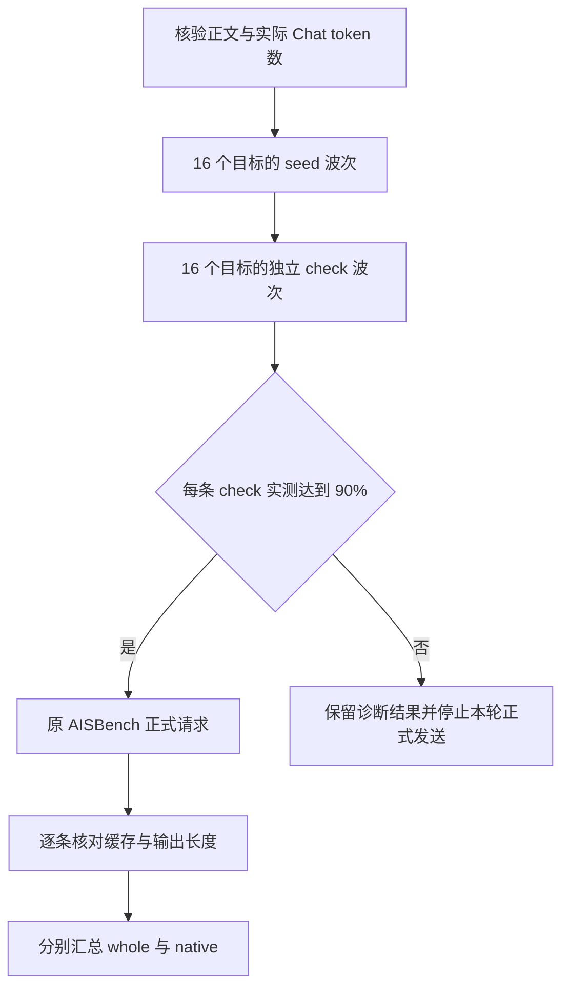

# 128K 输入、90% 前缀缓存：怎样把压测场景真正跑准

8 条请求全成功，长度也对，这次 128K 压测的场景却没过：第一条只命中约 87.50%，其余约 89.06%，都不到约定的九成。

约束是正文 128K、输出 1K，而且每请求实际前缀复用至少 90%。公共资料足够长、请求发生过命中，都不能代替这项逐条比例。

调整公共区、seed，补独立 check 并覆盖多 DP 后，才得到逐条`118784 / 131076 = 90.6222%`。之后 N160、N640 继续验收，让布局、并发在相同缓存条件下比较。

复用2026年10月21日DeepSeek-V4-Flash、Ascend 910C PD记录，P8+D8共16物理卡，当时冻结适配、W8A8和高AL复制展示集。原值见[数值摘录](../../assets/128k-prefix-cache-benchmark-calibration/evidence.json)；[零缓存 Prefill 合批](decode-fast-throughput-limited-by-prefill.md)先前讲零缓存合批，本篇先把高缓存场景跑准。

## 一、90% 的分母，从 131072 变成了 131076

正文精确 131072，Chat 实际 131076，输出固定 1024。

生成按正文长度，缓存按 Chat 输入作分母，完成量按输出核。额外 4 Token 来自消息结构、编码，生成器绑定 DSV4 聊天编码器和真实 tokenizer，再由正式 usage 确认。

首轮 8 条都有过命中，若数“命中过的请求”就是 100%。这与每条输入复用几成不同，报告按 Token 数写分子、分母。

初版公共区用`floor(131072 × 0.9 / 128) × 128`，得 117888，128 为本轮 KV 页大小。除实际 Chat 输入：

```text
117888 / 131076 = 89.93866%
```

公共区即使全命中，预测也没过 90%。本轮要求每条至少九成，就需按实际分母判定。

采用整数判据：

```python
# 场景验收规则；prompt_tokens、cached_tokens来自实际回包。
meets_target = cached_tokens * 10 >= prompt_tokens * 9
```

131076 输入至少要 117969 实际缓存 Token。页大小帮助构造公共区，最后仍使用服务计数。

## 二、公共前缀要共享，后缀又得真的不同

复制任务用来取得较长接受长度。数据难度、实际长度、缓存、接受统计各自记录。

正文前放完全相同资料，后放请求标识、任务：

```text
公共资料区：相同内容、相同字节顺序
──────────────────────────
请求 A：独立 nonce A + 后缀内容与复制任务 A
请求 B：独立 nonce B + 后缀内容与复制任务 B
请求 C：独立 nonce C + 后缀内容与复制任务 C
```

nonce 放在公共区之后。开头就不同，会破坏前缀；整条重复，又可能连后缀命中。

拼接后重新核长度，单独编码的公共区、后缀未必可直接相加。生成器逐条核完整正文，再算 Chat Token IDs 公共前缀，seed、check、正式数据都参与。

第二版公共正文 118912，Chat 序列按 128 页对齐，预测复用同为 118912、约 90.7199%，给实际匹配留一点余量。

沿用适配 JSONL，`question`为正文、`answer`为参考。采样单设`temperature=0`、`ignore_eos=True`、输出上限 1024。逐行长度、哈希、配置保存后，N/C 变更继续复用。

这只是 CPU 准备完成，实际命中要等服务执行。

## 三、首轮没有达标，下一轮改了哪里

首轮一条独立 seed 后，8 条诊断，C1/r1。输入均 131076、输出 1024，缓存为：

| 记录 | token 数 | 占实际 Chat 输入的比例 |
| --- | ---: | ---: |
| 初版页对齐预测 | 117888 | 89.9387% |
| 首轮第 1 条实测 | 114688 | 87.4973% |
| 首轮后 7 条逐条实测 | 116736 | 89.0598% |
| 调整后页对齐预测 | 118912 | 90.7199% |
| 调整后 8 条逐条实测 | 118784 | 90.6222% |

collector 仍按理论`117888 ± 128`断言，偏差超限后报收集错误。原请求、计数还在，重读即可区分：生成成功，缓存条件没过。

第二版同时改公共区、seed。公共区 118912，seed 只取公共前缀，正文 118912、Chat 118916，只输出 1 Token，把正式独立后缀留给后面的请求。

seed 之后发完整 128K 独立 cache-check，仅输出 1 Token，后缀不同于正式集。实际命中 118784 通过，再发 8 条各 1024 输出的诊断。

check、8 条诊断均 90.6222%，少于预测一页。结果归整套准备，公共区、seed 的单项作用没有隔离。

该 seed 自身已命中 116736，并非全冷，耗约 0.989 秒；check 约 3.193 秒，均归准备成本。

## 四、一个目标命中了，还要接住多 DP 的正式流量

C1 指定 P0/D0，只证明这个目标。多 DP 正式流量还需其他目标就绪。

软件 P/D DP16，按 16 目标各发 seed，再各发 check。每波最多并行 16 条，每目标 1 条、输出 1 Token，共 32 条准备，另于正式统计。

check 全部通过整数判据，才发不指定 DP 的原 AISBench 负载。任一失败就在正式请求数 0 时停，避免追加预热反复寻找达标状态。



16 数软件 DP 目标，吞吐仍除 P8+D8 物理 16 卡。usage 没给实际执行 DP 号，因此只确认指定目标与命中，未重建正式路由均衡。

首轮全目标测试 N160/C64/r6，160 全成功、各 1024，缓存 160/160，min/mean/max 均 90.6222%。它增加覆盖，但缺 native，whole 不能代替稳态窗口。

## 五、正式压测里，缓存计数也要跟着每条请求走

check 说明开测前状态。运行中仍会换目标、淘汰、额外复用，所以正式每条都保留 usage。

这版兼容回包提供：

```text
usage.prompt_tokens
usage.completion_tokens
usage.prompt_tokens_details.cached_tokens
```

流式扩展先调父类解析，再保存字段，沿用原传输、计时；后处理读原 details。cached token 缺失就记未观测，不填 0、不用公共区预测替代。

逐条核 131076 输入、1024 实际输出、整数缓存条件。`ignore_eos=True`只规定生成意图，真实 completion 仍要验。

先看通过、缺失、最小值，再看加权比。两条等长输入若命中 100%、80%，均值 90%，后一条仍失败。C90 最终 640/640 通过，缺失 0、低于 90% 为 0，min/mean/max 均为 90.6222%。

名义新位置为`131076 - 118784 = 12292`，还受 chunk、页对齐影响；D 继续读长历史，整个上下文并未变成 12292。

因此 128K 高缓存、16K 零缓存各自保存数据、布局、结果，新增行数接近也不是同一工作。

## 六、热缓存成绩之外，还花了多少准备时间

校准后才做布局、并发，P布局见[另一篇](ascend-910c-prefill-scenario-static-eplb.md)。C128/C90用同实体N640、服务、布局、r6，输入131076、输出1024、逐条90.6222%，全成功。

| 指标 | C128 whole | C90 whole | C90 native |
| --- | ---: | ---: | ---: |
| 纳入请求数 | 640 | 640 | 549 |
| 区间时长（s） | 170.4029 | 179.5766 | 143.4935 |
| 平均系统并发 | 112.3225 | 82.8179 | 87.4978 |
| TTFT 平均 / P90（s） | 18.1407 / 20.3236 | 12.6819 / 14.3259 | 12.2502 / 13.9273 |
| TPOT 平均 / P90（ms） | 11.5 / 12.6 | 10.3 / 10.9 | 10.4 / 11.0 |
| E2E 平均（s） | 29.9064 | 23.2377 | 22.8695 |
| 输出总吞吐（token/s） | 3845.9447 | 3649.4736 | 3917.7796 |
| 输出 / PD16 物理卡（token/s） | 240.3715 | 228.0921 | 244.8612 |

C90 等待少、whole 约−5.11%。native 原 selector 取 549 条、143.4935 秒，满足 128 条/60 秒。C128 的 native 后处理失败，表里只留已有 whole。

C90 whole AL=`655360 / 113463 = 5.7760`，不移给native。proposal严格接受率、Draft/Verify wall仍缺，计数见[结果摘录](../../assets/128k-prefix-cache-benchmark-calibration/evidence.json)。

C90 各阶段耗时为：

| 阶段 | 请求数与输出 | 墙时 |
| --- | --- | ---: |
| 多目标 seed 与独立 check | 16 + 16 条，各输出 1 token | 两波合计 47.9102 秒 |
| 正式 AISBench | 640 条，各输出 1024 token | 179.5766 秒 |
| 控制器全程 | 包含准备、正式测量与收尾 | 309.1594 秒 |

seed 请求延迟之和 666.8566 秒，check 98.7363 秒，两波并行墙时却共 47.9102 秒。控制器已包含准备、正式，不与分项再次求和。

本轮热服务复用，新增启动、MF、路由验证为 0，32 条缓存准备仍计成本。本文没有为写作新发请求。

whole 输入吞吐 467146.8782 token/s 包含全部名义输入，描述承载量；命中部分不能全算新增计算。

## 七、下一轮怎样保持还是同一个场景

本轮后缀唯一，不保证跨轮唯一。重用旧集可能命中上轮后缀，将 90.6% 悄悄变成接近 100%。

每轮先固定想保留的缓存状态。清理放 seed 之前；新命名空间仍放公共区后，记录版本；用旧集则继续读逐条计数，排除额外命中。

首轮 114688、116736 与后来的 118784 一起保存，说明预测、实际的偏差，换编码、路由时可据此追查。

同类报告把正文/Chat、cached 范围、seed/check 数量与墙时、实际输出、统计窗口并列，才能重建场景从准备到验收的过程。

后续布局、并发比较使用的基准为：正文 131072、输入 131076、逐条命中 118784、输出 1024，N640 全部满足。
