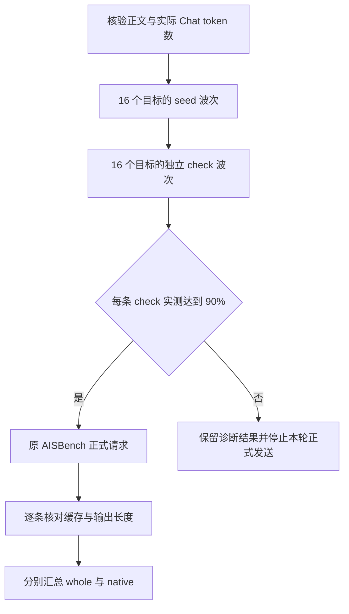

# 128K 输入、90% 前缀缓存：怎样把压测场景真正跑准

第一轮 8 条请求均成功，输入输出长度也正确，但还没有达到约定的缓存条件。

目标是 128K 正文、1K 输出，且每条请求实际前缀命中至少 90%。首轮第一条约为 87.50%，后七条约为 89.06%。公共前缀虽已很长，仍需用服务返回计数核对，不能由文本相似程度判断实际复用。

我们随后调整公共区与 seed，增加独立缓存检查，并覆盖多 DP 目标，才得到每条 `118784 / 131076 = 90.6222%`。扩大到 160 条、640 条后继续逐条验收，在缓存条件固定下来后再比较并发和吞吐。

本文复用 2026 年 10 月 21 日的 DeepSeek-V4-Flash、Ascend 910C PD 实验。P、D 各 8 张物理卡，共 16 张，使用当时冻结的本地 SGLang 适配、W8A8 权重和有利于高 AL 的原文复制展示负载。失败诊断、调整和正式结果见[数值摘录](../../assets/128k-prefix-cache-benchmark-calibration/evidence.json)。与上一篇[零缓存 Prefill 合批](decode-fast-throughput-limited-by-prefill.md)不同，这里先处理缓存场景如何验收。

## 一、90% 的分母，从 131072 变成了 131076

本次 128K 正文精确为 131072 token，聊天编码后实际输入为 131076，输出固定 1024 token。

数据生成使用正文长度，输入核对和缓存分母使用 Chat 长度，输出长度则用于验收完成量。多出的 4 个 token 来自本次消息结构与编码。生成器调用绑定的 DSV4 聊天编码器和真实 tokenizer，并由正式回包再次确认。

这里的 90% 指每条请求内部命中的 Token 比例。首轮 8 条请求都出现过命中，按“发生过命中的请求数”统计是 100%，但每条实际复用的输入仍不足九成。报告必须写清分子与分母，不能把这两种命中率混用。

初版按 `floor(131072 × 0.9 / 128) × 128` 构造公共前缀，得到 117888 token，其中 128 为本轮 KV 页大小。除以实际 Chat 输入后为：

```text
117888 / 131076 = 89.93866%
```

即使初版预测的公共区全命中，也尚未达到 90%。如果只要求约九成，这个误差可以讨论；本次约定是每条至少 90%，就必须按实际分母验收。

逐请求检查使用整数判据：

```python
# 场景验收规则；prompt_tokens、cached_tokens来自实际回包。
meets_target = cached_tokens * 10 >= prompt_tokens * 9
```

131076-token 输入至少需要 117969 个实际缓存 token。页大小和公共区长度用于构造数据，最终是否满足要求，仍按回包计数判断。

## 二、公共前缀要共享，后缀又得真的不同

任务采用原文复制，以观察较长的投机接受长度。它的预测难度与普通问答不同，属于有利展示负载，不能将输入输出、缓存和接受统计混为一项。

正文前部放完全一致的公共资料，后部再放请求标识和任务，结构如下：

```text
公共资料区：相同内容、相同字节顺序
──────────────────────────
请求 A：独立 nonce A + 后缀内容与复制任务 A
请求 B：独立 nonce B + 后缀内容与复制任务 B
请求 C：独立 nonce C + 后缀内容与复制任务 C
```

nonce 必须位于公共区之后。若开头就不同，即使后续资料一致，也失去相同前缀；若整条请求重复，又可能命中后缀，使约九成复用变成接近全量复用。

长度在拼接后核验。公共区、后缀单独编码的 token 数之和，未必等于整段文本重编码的结果。生成器逐条检查完整正文，再对聊天 token ID 序列计算公共前缀；seed、check 和正式数据都需要参与。

第二版将公共正文加到 118912 token，完整 Chat 序列经 128-token 页对齐后的预测复用长度同为 118912，预测命中约 90.7199%。这个余量用于容纳实际匹配与预测的差别。

数据沿用当前适配的 JSONL，`question` 保存正文、`answer` 保存参考答案。采样单独配置 `temperature=0`、`ignore_eos=True`、最大输出 1024。逐行长度、哈希与配置一并保存，后续改变 N 或并发时，才能确认数据未变。

到这里仅完成 CPU 数据准备。公共区长度和完整输入长度可以准确核对，服务实际命中仍未发生，必须等请求执行后读取。

## 三、首轮没有达标，下一轮改了哪里

首轮先发一条独立 seed，再发 8 条诊断，C1、1 req/s。每条实际 Chat 输入为 131076、输出 1024，但命中低于预测：

| 记录 | token 数 | 占实际 Chat 输入的比例 |
| --- | ---: | ---: |
| 初版页对齐预测 | 117888 | 89.9387% |
| 首轮第 1 条实测 | 114688 | 87.4973% |
| 首轮后 7 条逐条实测 | 116736 | 89.0598% |
| 调整后页对齐预测 | 118912 | 90.7199% |
| 调整后 8 条逐条实测 | 118784 | 90.6222% |

collector 当时还将理论 `117888 ± 128` 作为断言，实际偏差超出范围，最终报收集错误。原请求与计数并未丢失，整理后可以确认模型完成生成，只是缓存场景未达要求。

第二版同时调整公共区和 seed。公共区增至 118912，seed 缩为公共前缀本身，正文 118912、Chat 输入 118916，只输出 1 token。正式任务的独立后缀留给后续请求，不再进入 seed。

seed 后再发一条完整 128K cache-check，只输出 1 token，并使用不同于正式数据的后缀。确认实际命中 118784、满足要求后，再发 8 条正式诊断，各输出 1024。

这一版 check 与 8 条诊断均为 90.6222%，比预测少一页。记录采用实际值，没有将预测当成命中。由于公共区和 seed 同时改变，结果只能说明整套准备达标，无法拆出单项贡献。

调整后的 seed 自身已命中 116736 token，因此不是全冷请求。它约耗时 0.989 秒，独立 check 约 3.193 秒，两项均计入准备记录，用于说明正式测试之前的服务状态。

## 四、一个目标命中了，还要接住多 DP 的正式流量

C1 诊断指定 P0/D0，只检查了这个目标。正式高并发经过多 DP 调度，还需为其他目标准备缓存。

当时软件配置为 P/D DP16。扩展时按 16 个目标分别发 seed，再按同一组目标发独立 check。两波各最多并行 16 条，同一波每个目标只有一条请求，均输出 1 token。共 32 条准备请求，不并入正式负载。

所有 check 通过整数判据，才运行不固定 DP 的原 AISBench 负载；任一失败，就在正式请求数仍为零时停止。这条流程没有通过反复追加预热寻找达标状态，避免准备成本和缓存状态难以追溯。



软件有 16 个 DP 目标，吞吐仍按 P8+D8 的 16 张物理卡归一化。usage 当时未提供实际执行 DP 编号，因此只保存指定目标与命中结果，未据此计算正式流量的 DP 均衡分布。

全目标准备后的首轮为 N160/C64、6 req/s，160 条均成功、各输出 1024。缓存覆盖 160/160，最小、平均、最大均为 90.6222%，比单目标 N8 提供了更多场景覆盖。该轮未取得 native 区间，whole 时长也未替代稳态验证。

## 五、正式压测里，缓存计数也要跟着每条请求走

cache-check 只确认正式开始前的状态。运行中还可能出现目标变化、淘汰或额外复用，因此每条正式结果仍须保留 usage。

这版 OpenAI 兼容回包提供以下字段：

```text
usage.prompt_tokens
usage.completion_tokens
usage.prompt_tokens_details.cached_tokens
```

流式扩展先调用原父类解析，再把这些字段保存到附加结果，传输与计时点沿用原实现。后处理读取原 details；如果缺少 cached token，就标为未观测，不填零，也不以预测的公共区长度代替。

每条同时核对实际输入 131076、实际输出 1024，以及整数缓存判据。`ignore_eos=True` 和输出上限只表示请求意图，仍需检查 completion，避免输出缩短被误当作缓存收益。

先统计通过数、缺失数与最小值，再看加权比例。例如等长请求分别命中 100%、80%，平均虽为 90%，后一条仍不合格。最终 C90 覆盖 640/640，未观测 0 条、低于 90% 的 0 条，最小、平均、最大均为 90.6222%。

名义未命中位置为 `131076 - 118784 = 12292`。P 不必重算全部前缀，但实际计算形状还受分块和页对齐影响。D 后续输出仍在长历史上进行，请求上下文没有随未命中长度缩为 12292。

因此，这组缓存任务与 16K 零缓存任务分别保存数据、布局和结果。新增位置数量接近，不足以让它们成为同一负载。

## 六、热缓存成绩之外，还花了多少准备时间

场景校准后继续做了静态布局和并发对照，P 端布局准备见[另一篇](ascend-910c-prefill-scenario-static-eplb.md)。下面 C128/C90 使用同一份 640 条实体数据、相同服务与布局、6 req/s。每条实际输入 131076、输出 1024，命中均为 90.6222%，640 成功、0 失败。

| 指标 | C128 whole | C90 whole | C90 native |
| --- | ---: | ---: | ---: |
| 纳入请求数 | 640 | 640 | 549 |
| 区间时长（s） | 170.4029 | 179.5766 | 143.4935 |
| 平均系统并发 | 112.3225 | 82.8179 | 87.4978 |
| TTFT 平均 / P90（s） | 18.1407 / 20.3236 | 12.6819 / 14.3259 | 12.2502 / 13.9273 |
| TPOT 平均 / P90（ms） | 11.5 / 12.6 | 10.3 / 10.9 | 10.4 / 11.0 |
| E2E 平均（s） | 29.9064 | 23.2377 | 22.8695 |
| 输出总吞吐（token/s） | 3845.9447 | 3649.4736 | 3917.7796 |
| 输出 / PD16 物理卡（token/s） | 240.3715 | 228.0921 | 244.8612 |

C90 等待较短，whole 吞吐则比 C128 低约 5.11%。其 native 使用原 selector，549 条、143.4935 秒，满足项目预定至少 128 条和 60 秒的要求。C128 的 native 后处理当时失败，所以保留已有 whole，没有补造稳态列。

C90 whole 的 AL 为 `655360 / 113463 = 5.7760`，按整轮输出除以 verify 调用计算，没有复制到 native。实际 proposal 严格接受率及 draft/verify wall time 仍未观测，原始计数见[结果摘录](../../assets/128k-prefix-cache-benchmark-calibration/evidence.json)。

这轮 C90 的准备与正式时间分别为：

| 阶段 | 请求数与输出 | 墙时 |
| --- | --- | ---: |
| 多目标 seed 与独立 check | 16 + 16 条，各输出 1 token | 两波合计 47.9102 秒 |
| 正式 AISBench | 640 条，各输出 1024 token | 179.5766 秒 |
| 控制器全程 | 包含准备、正式测量与收尾 | 309.1594 秒 |

seed 逐请求延迟之和约 666.8566 秒，check 约 98.7363 秒；由于各波并行，两波实际墙时共 47.9102 秒。准备成本单列，才能说明热缓存成绩怎样取得。控制器时间已包含准备和正式测量，不再与分项相加。

本轮复用热服务，新增模型启动、MF 和路由验证均为零，但仍执行了 32 条缓存准备请求，成本单独保留。写本文只使用已有记录，未新增请求。

输入吞吐也包含命中部分。C90 whole 原 AISBench 约为 467146.8782 输入 token/s，按请求名义总输入计数，可描述承载的长输入量，却不能直接当作新增计算速率。

## 七、下一轮怎样保持还是同一个场景

正式后缀在本轮内唯一，仍不能防止跨轮命中。重复同一数据时，上一轮后缀可能保留，实际复用从 90.6% 升至接近 100%，测试条件就改变了。

每轮应先决定保留什么缓存状态。需要清理就放在 seed 之前，seed 后清理会使准备失效。使用新命名空间时，唯一内容仍放公共区之后，并记录新数据版本；使用旧数据时，继续按正式逐条计数检查额外命中。

首轮不达标结果也有保留价值。114688、116736 和调整后的 118784 展示了理论前缀与实际复用的差别，后续换编码或调度时可以据此排查，而无须重新猜测。

核对同类报告时，可以从正文与 Chat 长度、cached token 范围、seed/check 的数量与耗时、实际输出和统计窗口开始。每项都能对应到构造、准备或正式验收中的具体步骤。

本轮最后确认的是：正文 131072、实际输入 131076、每条命中 118784、输出 1024，640 条正式请求全部满足缓存条件。后续的布局和并发比较使用这组已核验条件作为基准。
