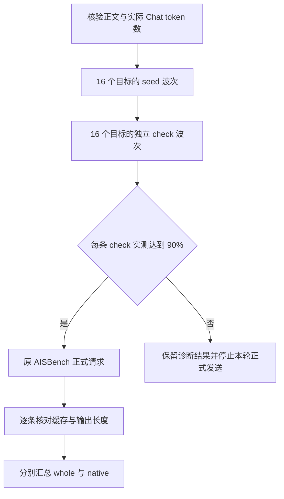

# 128K 输入、90% 前缀缓存：怎样把压测场景真正跑准

第一轮 8 条请求全部成功，输入和输出长度也正确，我们却还没有跑出要求的场景。

目标是 128K 正文、1K 输出，每条请求实际前缀缓存命中至少 90%。首轮实测，第一条只有 87.50%，后七条约 89.06%。数据已经放进了很长的公共前缀，服务也能正常生成，但“看起来九成相同”和“实际复用了九成 token”之间，还有一段工作要做。

后来调整公共区与 seed，加入独立缓存检查，再覆盖多 DP 目标，才得到每条 `118784 / 131076 = 90.6222%` 的结果。之后扩大到 160 条和 640 条，仍逐条检查同一个条件，才开始讨论并发与吞吐。

这篇记录的是 2026 年 10 月 21 日 DeepSeek-V4-Flash / Ascend 910C 的真实 PD 实验。P、D 各 8 张物理卡，共 16 张，使用当时冻结的本地 SGLang 适配、W8A8 权重和高 AL 原文复制展示负载。[首轮失败、调整后诊断和正式结果的数值摘录](../../assets/128k-prefix-cache-benchmark-calibration/evidence.json)随文保留。前一篇讲[零缓存下的 Prefill 合批](decode-fast-throughput-limited-by-prefill.md)，这里先把缓存场景本身跑准。

## 一、90% 的分母，从 131072 变成了 131076

这次的 128K 指 131072 个正文 token。正文进入服务之前，还要经过聊天编码，实际 Chat 输入为 131076 token。正式输出则固定为 1024 token。

三个数字分别记录：正文长度用于生成数据，实际 Chat 长度用于核对请求和计算缓存比例，输出长度用于检查模型有没有完成约定工作。这里多出的 4 个 token 来自这次的编码与消息结构；生成器直接调用绑定的 DSV4 聊天编码器和真实 tokenizer，正式回包再核对一次。

这里说的 90%，是每条请求内部的 token 命中比例。若只看“有没有发生过缓存命中”，首轮 8 条全部有，按请求数算是 100%；但它们复用的 token 都没有达到各自输入的九成。这两个百分比说的是不同的事。

最初，公共正文前缀按 `floor(131072 × 0.9 / 128) × 128` 构造，得到 117888 token。128 是这轮使用的 KV 页大小。这个值与实际 Chat 输入相比，只有：

```text
117888 / 131076 = 89.93866%
```

所以，哪怕预测的公共区全部命中，依然差一点才到 90%。平时说“约九成”可以接受这个误差，本次约定却是每条至少 90%，验收就要按后者执行。

我们后来用整数判据检查每一条请求：

```python
# 场景验收规则；prompt_tokens、cached_tokens来自实际回包。
meets_target = cached_tokens * 10 >= prompt_tokens * 9
```

对于 131076-token 输入，至少需要 117969 个实际缓存 token。页大小和公共前缀长度仍用于构造数据，最终是否达标，则由实际回包决定。

## 二、公共前缀要共享，后缀又得真的不同

为了观察较长的投机接受长度，我们使用原文复制类任务。这是有利负载展示集，任务的预测难度和普通问答不同；输入输出长度、缓存与接受统计分别记录。

正文分成两段：前面是完全一致的公共资料区，后面放请求标识和具体任务。结构可以简化成：

```text
公共资料区：相同内容、相同字节顺序
──────────────────────────
请求 A：独立 nonce A + 后缀内容与复制任务 A
请求 B：独立 nonce B + 后缀内容与复制任务 B
请求 C：独立 nonce C + 后缀内容与复制任务 C
```

nonce 放在公共区之后。若把唯一标识放到开头，请求很早就开始不同，后面的长资料即使一样，也失去了相同前缀的位置关系。反过来，若整条请求都重复，后续又可能连后缀一起命中，场景就从约九成复用变成了接近全量复用。

长度也在拼接后检查。单独编码公共区，再单独编码后缀，两段 token 数相加，未必就是完整文本重新编码后的结果。生成器为每条完整正文核长，再对完整聊天 token ID 序列求公共前缀长度；seed、check 和正式数据都参与相关核对。

第二版把公共正文区指定为 118912 token。实际 Chat 序列的公共部分，经 128-token 页对齐后的预测复用长度也是 118912，对实际输入的预测比例约为 90.7199%。这给实际匹配留出了一点余量。

数据格式沿用当前 AISBench 适配的 JSONL：`question` 保存完整正文，`answer` 保存对应参考答案；采样配置单独记录 `temperature=0`、`ignore_eos=True` 和最大输出 1024。数据文件、逐行长度与哈希、采样配置分别保存，后面改变 N 或并发时就有明确的对照对象。

这些是 CPU 数据准备。生成器知道公共区有多长、每条正文有多少 token，缓存此时还只是预测值。只有模型请求执行后，才知道本轮服务真正复用了多少。

## 三、首轮没有达标，下一轮改了哪里

首轮采用一条独立 seed，随后发送 8 条正式诊断请求，C1、1 req/s。每条实际 Chat 输入都是 131076，输出都是 1024，但缓存计数低于预测：

| 记录 | token 数 | 占实际 Chat 输入的比例 |
| --- | ---: | ---: |
| 初版页对齐预测 | 117888 | 89.9387% |
| 首轮第 1 条实测 | 114688 | 87.4973% |
| 首轮后 7 条逐条实测 | 116736 | 89.0598% |
| 调整后页对齐预测 | 118912 | 90.7199% |
| 调整后 8 条逐条实测 | 118784 | 90.6222% |

首轮还暴露了一个采集问题：collector 把理论预测的 `117888 ± 128` 当成断言，实际计数偏得更多，最终状态报了收集错误。原始请求与计数都还在。把它们整理出来，才能看清这是一次未满足缓存要求的诊断，而不是模型生成失败。

下一版做了两项调整。公共区加长到 118912；seed 则缩短为公共前缀本身，正文 118912、实际 Chat 输入 118916，只生成 1 个 token。正式请求的独立后缀留给后续请求，不再塞进 seed。

然后，单独发一条完整 128K 的 cache-check，同样只输出 1 个 token。它与正式数据有不同的后缀，用来检查预热后实际能匹配多少。回包确认命中 118784、达到要求，才发后面的正式 8 条，每条仍输出 1024。

这一轮 check 和 8 条诊断都达到 90.6222%，比数据预测少一页。我们据此保留了实际计数，没有再把预测长度改名成命中长度。公共区加长与 seed 缩短在同一版里发生，这组诊断回答的是整套缓存准备是否达标。

seed 也有自己的缓存状态。调整后的那条 seed 实际已经命中 116736 token，并非一次全冷请求。它耗时约 0.989 秒，独立 check 耗时约 3.193 秒，两项都留在准备记录里。这样读报告时，才知道正式热缓存成绩之前，服务已经处在什么状态。

## 四、一个目标命中了，还要接住多 DP 的正式流量

C1 诊断时，请求指定了 P0/D0 目标。正式高并发会经过多 DP 调度，一条预热成功，覆盖不了后续的所有目标。

这一轮软件配置为 P/D DP16。扩展阶段按 16 个目标分别准备 seed，再按相同目标做独立 check。具体执行成两波：第一波最多并行 16 条 seed，第二波最多并行 16 条 check，每个目标在同一波只有一条请求。每条都只输出 1 个 token，32 条准备请求与正式数据分开。

所有 check 都满足整数判据后，才启动不固定 DP 的原 AISBench 负载。若某条 check 失败，本轮在正式请求数为零时停止。反复追加预热直到结果变好，会把准备成本与缓存状态越改越复杂，我们在这条路径里没有这样做。



软件目标编号和物理卡数分别记录。这里有 16 个 DP 目标，吞吐折算仍按 P8+D8 的 16 张物理卡。回包 usage 当时没有返回实际执行 DP 编号，因此报告保存指定目标与命中结果，没有据此绘制正式请求的 DP 均衡分布。

第一轮全目标预热后的负载是 N160/C64、6 req/s。160 条全部成功、输出均为 1024，缓存覆盖 160/160，最小值、均值和最大值都为 90.6222%。到这里，我们才拿到比单目标 N8 更完整的缓存场景结果。那轮尚未取得 native 区间，whole 的时长也没有拿来替代稳态验证。

## 五、正式压测里，缓存计数也要跟着每条请求走

缓存检查通过，只说明发正式请求之前的准备状态。正式测量还可能遇到路由差异、缓存淘汰或额外复用，所以每条结果继续记录实际 usage。

在这次服务的 OpenAI 兼容回包里，我们读取的是：

```text
usage.prompt_tokens
usage.completion_tokens
usage.prompt_tokens_details.cached_tokens
```

AISBench 的流式扩展先执行原父类解析，再把这些数值保存到结果的附加字段。原传输和计时点保留，后处理从原有逐请求结果读计数。cached token 字段缺失时标为未观测，不补成零，也不拿理论公共区填进去。

验收时同时检查三件事：实际输入为 131076、实际输出为 1024、整数缓存判据通过。`ignore_eos=True` 和输出配置只是请求意图，最后还是核对实际 completion 数。这也让缓存带来的收益与缩短输出分开。

统计时先看逐条通过数、缺失数和最小值，再看加权比例。两条等长请求若分别命中 100% 和 80%，平均值刚好是 90%，后一条却没达到本次要求。最终 C90 的正式结果是覆盖 640/640、未观测 0 条、低于 90% 的 0 条，最小、均值、最大比例均为 90.6222%。

实际未命中的名义部分为 `131076 - 118784 = 12292` token。它解释了为什么“128K 输入”不意味着 P 本轮重新处理全部 128K 前缀；实际批次形状还要经过分块与页对齐。D 后续生成仍面对这条长上下文请求，缓存复用也没有把它的上下文长度改成 12292。

因此，90% 场景和此前 16K 零缓存场景各自保存数据、布局与成绩。输入长度相近的未命中部分，并不会让两者自动变成同一个负载。

## 六、热缓存成绩之外，还花了多少准备时间

完成缓存场景校准后，我们继续做了专属静态布局和并发实验，P 端布局的采集与拟合在[另一篇文章](ascend-910c-prefill-scenario-static-eplb.md)里展开。下面这组是后期同一份物理 640 数据、同一组服务与布局、同为 6 req/s 的 C128/C90 对照。正式 640 条每条实际输入 131076、输出 1024，缓存均为 90.6222%，640 成功、0 失败。

| 指标 | C128 whole | C90 whole | C90 native |
| --- | ---: | ---: | ---: |
| 纳入请求数 | 640 | 640 | 549 |
| 区间时长（s） | 170.4029 | 179.5766 | 143.4935 |
| 平均系统并发 | 112.3225 | 82.8179 | 87.4978 |
| TTFT 平均 / P90（s） | 18.1407 / 20.3236 | 12.6819 / 14.3259 | 12.2502 / 13.9273 |
| TPOT 平均 / P90（ms） | 11.5 / 12.6 | 10.3 / 10.9 | 10.4 / 11.0 |
| E2E 平均（s） | 29.9064 | 23.2377 | 22.8695 |
| 输出总吞吐（token/s） | 3845.9447 | 3649.4736 | 3917.7796 |
| 输出 / PD16 物理卡（token/s） | 240.3715 | 228.0921 | 244.8612 |

C90 的等待时间更低，whole 吞吐则比 C128 低约 5.11%。native 来自原 AISBench selector，持续 143.4935 秒、纳入 549 条，达到本项目约定的至少 128 条与 60 秒门槛。C128 当时的 native 后处理失败，表中保留它已有的 whole 成绩。

C90 whole 的 AL 为 `655360 / 113463 = 5.7760`，是整轮输出数除以 verify 调用数；没有将它复制到 native 区间。实际 proposal 严格接受率、draft/verify 阶段 wall time 仍是未观测项，具体计数保留在[结果摘录](../../assets/128k-prefix-cache-benchmark-calibration/evidence.json)里。

同一轮 C90，还有一张准备时间账：

| 阶段 | 请求数与输出 | 墙时 |
| --- | --- | ---: |
| 多目标 seed 与独立 check | 16 + 16 条，各输出 1 token | 两波合计 47.9102 秒 |
| 正式 AISBench | 640 条，各输出 1024 token | 179.5766 秒 |
| 控制器全程 | 包含准备、正式测量与收尾 | 309.1594 秒 |

seed 的逐请求延迟相加约为 666.8566 秒，check 相加约为 98.7363 秒，但它们是并行执行的，实际两波墙时为 47.9102 秒。正式窗口之外的成本单列，读者既能看到热缓存下的性能，也能知道取得这种状态之前做了什么。控制器时间包含前两项，各行没有再相加。

这轮复用了热服务，新增模型启动、MF 和路由验证均为零。缓存准备仍然有 32 条真实模型请求，单独记账；生成这篇文章则只处理已有记录。

输入吞吐也有类似口径。C90 whole 原 AISBench 报告约 467146.8782 输入 token/s，它按请求的名义输入 token 总数统计，其中包含缓存命中的部分。拿这个值描述服务接收的长输入量很直观，解释实际计算时则要把缓存复用一起带上。

## 七、下一轮怎样保持还是同一个场景

共享前缀保持一致，正式后缀在本轮内各自唯一，还只解决了第一次发送的问题。重复跑同一份数据时，上一轮的后缀也可能留在缓存里；若实际命中从 90.6% 变成接近 100%，得到的是另一种复用程度。

因此，每轮开始先确定要保留什么状态。需要清缓存时，把清理放在 seed 之前；seed 之后再清，前面的准备就白做了。若采用新命名空间，就把唯一内容放在公共区之后，同时重新保存数据版本。复用旧数据时，仍由正式逐条计数检查有没有额外命中。

首轮没有达到要求的记录也留着。114688、116736 和后来的 118784，让我们看清理论前缀与实际复用之间的差别；若只保留最后一张达标截图，下一次换编码或路由时，又要重新猜这几个数从哪里来。

再看一份标着“128K、90%”的报告，我会先找这几项：正文与实际 Chat 长度，逐请求 cached token 的范围，独立 seed/check 的数量和耗时，实际输出长度，以及正式请求用了什么统计窗口。它们对应了这次从构造数据到校准场景的每一步。

最后跑准的这轮，可以具体写成：正文 131072，实际输入 131076，每条命中 118784，实际输出 1024，正式 640 条全部满足缓存条件。后面再调并发、比较布局，才是在一个已知的场景上继续。
