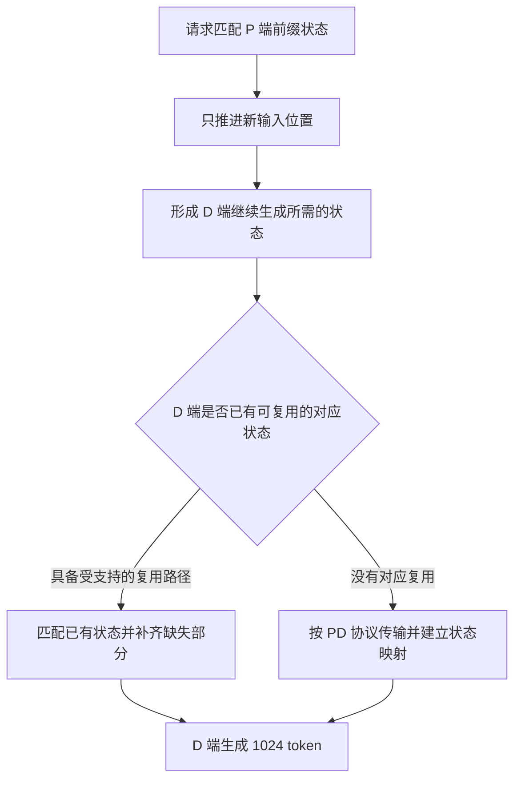

# 128K 已经命中 90% 前缀缓存，为什么推理仍然不轻松？

一条实际输入 131076 token 的请求，已有 118784 token 命中缓存，只剩 12292 个新位置需要处理。从新输入数量看，它甚至短于一条普通 16K 请求。

但计算新位置时，仍要使用前面的历史状态；输出也接在这段长历史之后。前缀缓存避免了重复生成已有模型状态，却没有消除后续步骤对它们的依赖，因此不能按一条独立 12K 请求估算全部工作。

我们在 DeepSeek-V4-Flash、Ascend 910C 的真实 PD 测试中逐条核验了 90.6222% 复用。640 条请求全部成功，每条输出 1024 token，C90 的 whole 平均 TTFT 仍为 12.6819 秒、TPOT 为 10.3 毫秒、E2E 为 23.2377 秒。缓存条件已满足，等待仍然存在；至于时间主要花在计算、传输还是队列，仅靠这张表无法区分。

[上一篇](128k-prefix-cache-benchmark-calibration.md)记录了怎样将 90% 缓存场景校准。这里继续追踪命中后剩余的工作。实验数值沿用冻结的本地适配，机制另核对公开 sgl-project/sglang @ 5c69e32abe013fa1b913022682a3104c79105f37；公开源码可以解释执行关系，不能反推出历史实验的阶段耗时。来源见[数值与摘录](../../assets/128k-prefix-cache-remaining-costs/evidence.json)。

## 一、先分清三个长度：复用前缀、新输入和逻辑上下文

本次 128K 正文为 131072 token，聊天编码后实际输入为 131076。缓存比例以实际输入为分母，正文长度另行记录。回包提供 `cached_tokens=118784`，计算如下：

```text
实际输入 L = 131076
复用前缀 P = 118784
新输入   U = L - P = 12292
token 命中比例 = P / L = 90.6222%
```

复用前缀状态后，请求可以从匹配位置继续，无须重新执行旧位置的模型计算。但后缀提出了不同内容，新 Query、隐藏状态、专家路由和输出仍要计算。缓存中没有预先保存所有可能后缀的答案。

从 Java 后端的经验理解，可以把它看作复用已算好的中间结果：后续步骤免去重算，但仍引用该结果。这个类比只解释依赖关系，模型的实际执行仍是多层张量计算。


图中长条只按输入位置比例绘制，不代表耗时。P 本次新增位置为 12292，后缀末尾的逻辑位置却接近 131076。开启分块 Prefill 后，这些新位置还可能进入多个 batch，形状受页对齐、调度预算和合批影响。

公开 NPU DSV4 后端分别传递这两类长度：普通 Extend 的 Query 累积长度由 `extend_seq_lens_cpu` 构造，Attention 另接收有效 KV 长度和页表。Query 行数决定本轮处理多少新位置，KV 元数据决定可访问的历史范围，见[长度构造](https://github.com/sgl-project/sglang/blob/5c69e32abe013fa1b913022682a3104c79105f37/python/sglang/srt/hardware_backend/npu/attention/ascend_dsv4_backend.py#L1849-L1873)与[调用参数](https://github.com/sgl-project/sglang/blob/5c69e32abe013fa1b913022682a3104c79105f37/python/sglang/srt/hardware_backend/npu/attention/ascend_dsv4_backend.py#L2160-L2188)。

所以，这次需要处理约 12K 新 token，同时拥有约 128K 逻辑上下文。估算计算、内存或吞吐时，两个长度都需要保留。

## 二、新 token 需要读取旧状态，命中比例不能直接换成计算比例

先看一个普通稠密因果 Attention 的教学模型，再对照 DeepSeek-V4 的实际路径。

假设总输入 100 个位置，前 90 个命中，后 10 个待计算。旧位置的 Query 可以跳过，但第 91 个新 Query 仍要访问可见历史，第 92 个也一样，直到第 100 个。

只计算逻辑 Query–Key 配对，剩余项包含新 Query 对旧位置的关系，以及新后缀内部的因果关系：

```text
后缀需要的配对：10 × 90 + (1 + 2 + ... + 10) = 955
全冷 100 个位置：1 + 2 + ... + 100 = 5050
剩余配对比例：955 / 5050 ≈ 18.91%
```

这组例子中，90% token 命中并未将 Attention 配对量降为原来的 10%。旧 K/V 无须重建，但新 Query 读取、使用它们的工作仍然存在。

以 P 表示前缀、U 表示后缀，配对数为 `U×P + U×(U+1)/2`。这个式子只描述依赖规模，尚未包含投影、MoE、通信或真实 Kernel 行为。FlashAttention 类实现也不必将完整分数矩阵写回显存，所以配对数不能直接换算 HBM 字节或墙钟耗时。

DeepSeek-V4 对历史的组织和访问又与这个教学模型不同。即使代入实际长度算出稠密配对比例，也不能作为本次计算占比或加速倍数。接下来应按层看保留了哪些状态，以及新 Query 怎样读取。

## 三、DeepSeek-V4 的长历史，经过了窗口、压缩和检索

该 NPU 实现按每层的 `compress_ratio` 选择历史访问路径，没有在所有层对全部原始 128K KV 做稠密扫描：

| 层的配置 | 近期状态 | 更远历史的访问方式 |
| --- | --- | --- |
| ratio 0 | SWA 滑动窗口 | 无该层的压缩历史路径 |
| ratio 4 | SWA 滑动窗口 | C4 压缩历史，主 Attention 使用 Indexer 选出的 TopK 位置 |
| ratio 128 | SWA 滑动窗口 | C128 压缩历史，沿有效压缩历史访问，不走 C4 TopK 选择 |

表中是不同层的配置，并非每层同时运行三套完整 Attention。`_forward_compressed()` 从池中读取 SWA 与对应压缩 buffer，传递窗口、有效长度和页表；C4 设置 `cmp_sparse_indices`，C128 则设为 `None`，见[对应源码](https://github.com/sgl-project/sglang/blob/5c69e32abe013fa1b913022682a3104c79105f37/python/sglang/srt/hardware_backend/npu/attention/ascend_dsv4_backend.py#L2118-L2188)。

上下文增加对各路径的影响不同。SWA 受窗口限制，原始长度从 16K 增至 128K 不会直接让同一 Query 读取八倍窗口。C128 会面对更多压缩条目，但流量不能按原始 token 数直接计算。C4 主 Attention 可读取选中的历史位置，产生或复用这些选择的 Indexer 工作则需另算。

TopK 限制主 Attention 读取范围，仍不能说明所有历史工作都与长度无关。例如 [IndexCache freq2](deepseek-v4-indexcache-freq2-cross-layer-topk-reuse.md)只复用部分跨层选择，新 token 的 Attention、压缩状态更新和 MoE 仍需执行。

前缀复用还要求状态正确接续。除压缩 KV，Compressor、Indexer 也具有自身状态和寻址，仅保存一块类似 K/V 的张量并不充分。NPU Pool 分别提供 SWA、压缩 KV 及相关状态接口，取 buffer 时等待相应层传输完成，可对照[Pool 访问接口](https://github.com/sgl-project/sglang/blob/5c69e32abe013fa1b913022682a3104c79105f37/python/sglang/srt/hardware_backend/npu/dsv4/dsv4_memory_pool.py#L468-L544)。

缓存容量也不能套用权重量化位宽。实验权重为 W8A8，记录中的 KV dtype 却是 bfloat16。需要分别核算窗口、压缩池、Indexer、状态和页表的 dtype 与布局，不能统一按 INT8 K/V 估算。压缩率 128 同样不表示整套服务仅占普通实现的 1/128 内存。

## 四、P 端省掉重算，D 端仍要拿到可继续生成的状态

PD 部署还需要确认前缀状态驻留在哪一端，以及下一步在哪里执行。

P 端命中前缀，表示它能从匹配位置继续 Prefill。D 端属于另一个服务，要生成后续输出，仍需获得可访问的请求历史。P 已有状态，不代表 D 也已经持有。

本轮快照记录 P 为 `disable_radix_cache=false`、D 为 `true`。因此两端没有相同的本地前缀复用条件，无法由 P 命中推导省去九成 PD 传输。usage 统计的是命中 token，也未测量传输字节。



图示列出了两种有条件的部署可能。实际走哪条路径，需要结合缓存配置和状态确认；一项 usage 命中比例无法确定，本轮尤其要保留 D 端 radix 关闭的条件。

公开 DSV4 NPU Pool 的主 PD buffer 含 C4 KV、Indexer K 和 scale，SWA、压缩状态、C128 另有注册接口。[注册代码](https://github.com/sgl-project/sglang/blob/5c69e32abe013fa1b913022682a3104c79105f37/python/sglang/srt/hardware_backend/npu/dsv4/dsv4_memory_pool.py#L387-L466)反映了不同对象的布局，不能用原始 token 数乘统一 KV 大小代替。

发送端也分别处理普通 KV 页、SWA 窗口与请求级状态。`_send_kv_chunk()` 从尾部窗口选择 SWA payload，C128 状态则按逻辑输入长度建立对应，见[分块与状态索引](https://github.com/sgl-project/sglang/blob/5c69e32abe013fa1b913022682a3104c79105f37/python/sglang/srt/disaggregation/prefill.py#L1302-L1382)。因此既不能从九成命中推出只传一成，也不能从 D 未命中推出传输完整原始 128K 普通 KV。

这轮未保存完整逐组件字节量与关键路径耗时，只能确认状态交接仍需执行，无法将 12.68 秒 TTFT 直接归于网络。解释首字等待还要核对队列、P 执行、目标资源准备和传输完成，以及它们之间的依赖与重叠。

## 五、后面的 1K 输出，仍要在长上下文上生成

Prefill 后，D 端还需生成 1024 token。每个新位置都接在 128K 输入之后，历史访问由窗口、压缩和检索机制决定。前缀命中并未预先完成这些输出的 Query、采样和状态更新。

本轮使用 DSpark Compact，草稿长度 5、验证宽度 6，并启用自动 SPS。每轮验证可提交多个输出，减少推进轮数，但仍有 Draft、Verify、接受和状态提交成本。整轮 AL 约 5.7760，等于输出 token 总数除以 verify 调用数，只描述提交进度，没有给出一轮耗时。

例如两个请求都平均每轮提交近 6 个 token，其中一个若有更高的历史访问、批次执行或通信成本，TPOT 仍会更高。长上下文还受缓存驻留、batch、Graph 档位和带宽利用影响，无法仅按长度判断八倍或十分之一这样的倍率。

提高并发时，也不能将状态需求简化为 `C×12292`。本地缓存支持共享时，公共前缀可能共用物理页，但独立后缀和输出继续增长；跨 DP、跨服务副本又有不同归属。DeepSeek-V4 的窗口池、压缩池各有容量约束，应核对实际占用、排队和退让后再加 C。

缓存复用已计算的输入位置，投机减少输出提交所需轮数，两者作用于不同重复工作。它们可以同时受益，但是否提高端到端速度，仍需测量实际时间。

## 六、回到实测：怎样判断还剩哪一段值得优化

下面两列使用同一轮 C90 负载：DeepSeek-V4-Flash、Ascend 910C，P8+D8 共 16 张物理卡；正文 131072、实际输入 131076、输出 1024，逐条命中 118784。负载为有利于高 AL 的复制展示集，不能推广为普通问答。配置并发上限 90、目标发送速率 6 req/s，640 成功、0 失败。

| 指标 | whole | AISBench native |
| --- | ---: | ---: |
| 纳入请求数 | 640 | 549 |
| 统计时长（s） | 179.5766 | 143.4935 |
| 实际平均系统并发 | 82.8179 | 87.4978 |
| 实际请求吞吐（req/s） | 3.5639 | 3.8260 |
| TTFT 平均 / P90（ms） | 12681.9 / 14325.9 | 12250.2 / 13927.3 |
| TPOT 平均 / P90（ms） | 10.3 / 10.9 | 10.4 / 11.0 |
| ITL 平均 / P90（ms） | 58.2 / 76.4 | 58.6 / 76.7 |
| E2E 平均（s） | 23.2377 | 22.8695 |
| 输出总吞吐（token/s） | 3649.4736 | 3917.7796 |
| 输出 / PD16 物理卡（token/s） | 228.0921 | 244.8612 |
| 输出 / D8 物理卡（token/s） | 456.1842 | 489.7225 |
| 输出 AL | 5.7760 | NOT_OBSERVED |
| 接受 draft / 实际 verified 槽位 | 543675 / 563907，96.4122% | NOT_OBSERVED |
| 实际生成 proposal 的严格接受率 | NOT_OBSERVED | NOT_OBSERVED |

native 按原 AISBench selector 选入 549 条、覆盖 143.49 秒，满足此前约定的样本与时长门槛。whole 接受计数没有挪用到 native，verified 槽位比例也未当作实际 proposal 严格接受率。ITL 沿用工具原定义；一次流式事件可能带多个 token，不能代替 TPOT 或单轮 Verify 成本。

结果表明，缓存按要求命中后，首字等待与持续生成仍有开销。但没有同配置的全冷 128K 基线，无法计算九成缓存究竟加速多少。16K 零缓存的新增输入、历史、布局和运行状态也不同，两组结果相除不能隔离上下文长度的影响。

输入吞吐要看实际计入什么。whole 原 AISBench 为 467146.8782 token/s，包含完整输入及命中前缀。若按同一窗口只折算名义未命中位置，约为 43807.94 token/s；它描述新输入位置的处理速率，仍不代表实际 FLOP/s、KV 读取流量或 NPU 利用率。

继续诊断时，TTFT 长就查队列、P 执行与状态交接边界；生成慢就查 Draft/Verify 关键路径、历史访问和 batch，而不能只看 AL。并发增长却吞吐不增时，结合两端活跃请求、排队和状态池占用确认积压位置，再决定调整 C、合批或资源。这些阶段可能重叠，累计时间不能简单相加。

本轮在正式窗口外另发 16 条 seed、16 条 cache-check，两波共用 47.9102 秒，是热缓存结果的准备成本。因为复用热服务，新增模型启动、MF 和路由准备均为零。控制器总用时 309.1594 秒，已包含正式窗口及准备收尾，不能再将分项加到总时间。

118784 个前缀位置的重算已经省去。接下来要定位的，是 12292 个新位置和 1024 个输出实际经过的计算、状态访问和交接路径。核对这些工作，才能解释一项高缓存命中成绩中仍然存在的等待。
