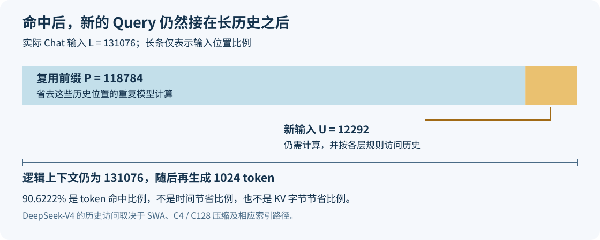
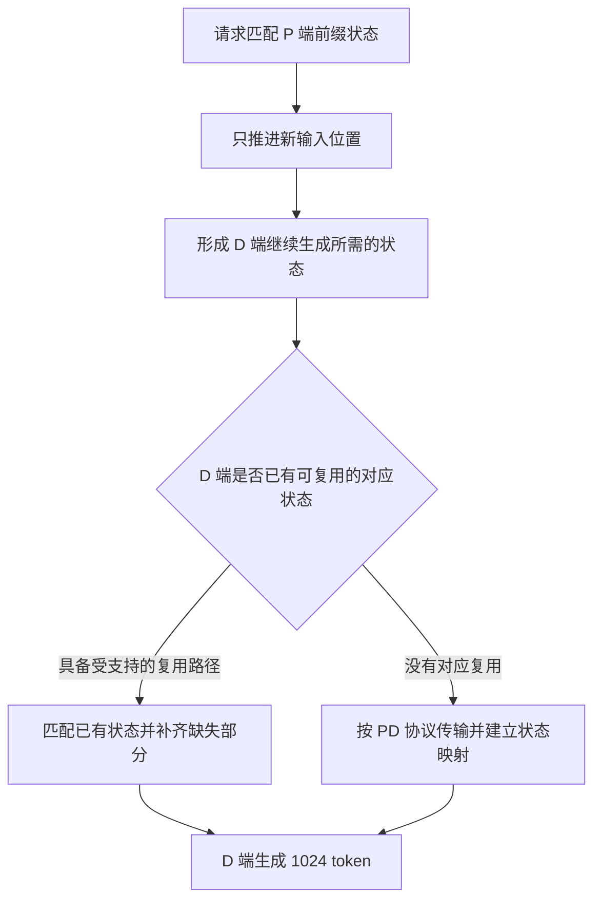

# 128K 已经命中 90% 前缀缓存，为什么推理仍然不轻松？

一条请求有 131076 个输入 token，其中 118784 个已经命中缓存。剩下 12292 个，看起来比一条普通的 16K 请求还短。

但这条请求并没有变成一条 12K 请求。它只是不用重新生成一大段前缀的模型状态，后面的输入和输出仍然接在那段历史之后。缓存省掉了前面的重复工作，历史本身还在。

在 DeepSeek-V4-Flash / Ascend 910C 的一次真实 PD 实验中，我们逐条确认了 90.6222% 的输入 token 复用，最终 640 条全部成功、每条实际输出 1024。C90 的 whole 平均 TTFT 仍有 12.6819 秒，TPOT 为 10.3 毫秒，E2E 为 23.2377 秒。这些数字首先说明：缓存要求确实满足，用户仍然需要等待。仅凭这张表，还无法断定等待主要发生在计算、传输还是队列。

上一篇[缓存场景校准](128k-prefix-cache-benchmark-calibration.md)解释怎样把“90%”测准。这篇沿着缓存命中后的请求，解释还剩哪些工作。实验数值来自当时冻结的本地适配；机制分析另外核对公开源码 sgl-project/sglang @ 5c69e32abe013fa1b913022682a3104c79105f37。公开版本用来说明执行关系，不据此反推历史实验的分阶段耗时。[数值与来源摘录](../../assets/128k-prefix-cache-remaining-costs/evidence.json)随文保存。

## 一、先分清三个长度：复用前缀、新输入和逻辑上下文

这里的 128K 正文是 131072 token，经过本次聊天编码后，实际输入为 131076。正文长度与缓存比例的分母分别记录。实际回包中的 `cached_tokens=118784`，因此：

```text
实际输入 L = 131076
复用前缀 P = 118784
新输入   U = L - P = 12292
token 命中比例 = P / L = 90.6222%
```

前缀缓存保存的是可复用的模型状态。后一个请求沿用相同前缀时，可以从匹配位置继续计算，省掉为这些历史位置重新执行模型、重新构造状态的工作。它并没有保存“这个前缀后面所有问题的答案”：请求后缀不同，新的 Query、隐藏状态、专家路由和最终输出仍要重新计算。

对 Java 后端开发者，可以借一个有限的类比：已经缓存了前面计算好的中间结果，后面的步骤可以直接引用它；引用不会让这份中间结果从依赖关系中消失。这个类比只说明复用关系，实际执行仍是多层张量计算。



图中的长条按输入位置比例绘制，不能当作时间比例。P 本次需要推进的新输入位置只有 12292 个，后缀末尾所在的逻辑位置仍接近 131076。若启用分块 Prefill，这些新位置还会拆进多个 batch，实际形状受页对齐、调度预算与合批限制影响。

公开 NPU DSV4 后端把这两个长度明确分开：普通 Extend 的 Query 累积长度由 `extend_seq_lens_cpu` 生成，Attention 调用另外接收有效 KV 长度与页表。新 Query 有多少行，与它允许访问多长的历史，是两套元数据。[Query 长度构造](https://github.com/sgl-project/sglang/blob/5c69e32abe013fa1b913022682a3104c79105f37/python/sglang/srt/hardware_backend/npu/attention/ascend_dsv4_backend.py#L1849-L1873)、[Attention 参数](https://github.com/sgl-project/sglang/blob/5c69e32abe013fa1b913022682a3104c79105f37/python/sglang/srt/hardware_backend/npu/attention/ascend_dsv4_backend.py#L2160-L2188)都能看到这种分工。

所以，“本轮处理约 12K 新 token”和“请求拥有约 128K 上下文”可以同时成立。混淆它们，后续关于计算量、内存和吞吐的判断都会偏掉。

## 二、新 token 需要读取旧状态，命中比例不能直接换成计算比例

先用一个小的、普通稠密因果 Attention 例子建立直觉，再回到 DeepSeek-V4。

假设输入只有 100 个位置，前 90 个位置命中缓存，后 10 个位置需要计算。旧位置的 Query 不必重新执行，但第 91 个位置的 Query 仍要关注它之前的可见历史，第 92 个位置也一样，直到第 100 个位置。

如果只数逻辑上的 Query–Key 配对，后缀还有两部分：10 个新 Query 与 90 个旧位置的关系，以及新后缀内部的因果关系。

```text
后缀需要的配对：10 × 90 + (1 + 2 + ... + 10) = 955
全冷 100 个位置：1 + 2 + ... + 100 = 5050
剩余配对比例：955 / 5050 ≈ 18.91%
```

这个教学例子里，90% 的 token 命中，没有把 Attention 的逻辑配对压到 10%。因为新 Query 与旧历史的关系还需要计算。旧 K/V 已经存在，省的是重建它们，读取并使用它们仍有代价。

一般写成前缀 P、后缀 U，配对数就是 `U×P + U×(U+1)/2`。这里只是在解释依赖规模：它没有计入投影、MoE、通信，也没有描述 Kernel 的真实执行和 HBM 流量。即使是稠密 Attention，FlashAttention 类实现也不需要把完整分数矩阵写回显存，不能把配对数直接换成字节数或墙时。

DeepSeek-V4 又进一步改变了历史的组织和访问方式。把上式套到本次长度，可以算出一个稠密教学模型的剩余配对比例；它不能代表本次 DeepSeek-V4 的计算占比，更不能拿来预测提速倍数。真正需要检查的是：每类层保留什么状态，新 Query 怎样访问它们。

## 三、DeepSeek-V4 的长历史，经过了窗口、压缩和检索

DeepSeek-V4 在这条 NPU 实现里，不是每一层都让每个 Query 扫描全部原始 128K KV。源码按层的 `compress_ratio` 组织不同路径：

| 层的配置 | 近期状态 | 更远历史的访问方式 |
| --- | --- | --- |
| ratio 0 | SWA 滑动窗口 | 无该层的压缩历史路径 |
| ratio 4 | SWA 滑动窗口 | C4 压缩历史，主 Attention 使用 Indexer 选出的 TopK 位置 |
| ratio 128 | SWA 滑动窗口 | C128 压缩历史，沿有效压缩历史访问，不走 C4 TopK 选择 |

三行表示不同层的选择，不能理解成每一层都同时执行三套完整 Attention。NPU 后端的 `_forward_compressed()` 从池中取得 SWA 和对应压缩 buffer，给算子传入窗口、有效长度和页表；C4 分支设置 `cmp_sparse_indices`，C128 分支则置为 `None`。[对应源码](https://github.com/sgl-project/sglang/blob/5c69e32abe013fa1b913022682a3104c79105f37/python/sglang/srt/hardware_backend/npu/attention/ascend_dsv4_backend.py#L2118-L2188)直接展示了这个区别。

这让“上下文变长”的影响分成几种情况。SWA 主要受窗口限制，不会因为原始上下文从 16K 变成 128K，就让同一个 Query 读取八倍窗口。C128 面对的是压缩后的有效历史，原始长度增加会带来更多压缩条目，但不能按原始 token 数直接估算流量。C4 主 Attention 可以只读取选中的历史位置，另一方面，生成或复用这些选择所需的 Indexer 工作也要单独考虑。

因此，TopK 限制了主 Attention 的读取范围，不等于整个历史相关工作都与上下文长度无关。我们用过的 [IndexCache freq2](deepseek-v4-indexcache-freq2-cross-layer-topk-reuse.md)复用部分跨层选择结果，也没有取消新 token 的全部 Attention、压缩状态更新或 MoE。

历史复用还依赖状态能被正确接续。除了 Attention 使用的压缩 KV，Compressor 与 Indexer 有各自的状态和寻址关系。只保留“看起来像 K/V 的那块张量”，不能保证后续计算得到同样结果。当前 NPU Pool 分别提供 SWA、压缩 KV 与相关状态的访问接口，取 buffer 时还会等待对应层的传输就绪。[Pool 访问接口](https://github.com/sgl-project/sglang/blob/5c69e32abe013fa1b913022682a3104c79105f37/python/sglang/srt/hardware_backend/npu/dsv4/dsv4_memory_pool.py#L468-L544)说明了这些对象并非一个连续的通用 KV 数组。

这里也需要区分权重量化和缓存占用。实验使用 W8A8 权重，运行记录里的 KV dtype 是 bfloat16；不能据此把全部历史状态按一个 INT8 K/V 公式核算。实际容量要分别看窗口、压缩池、Indexer、状态、页表及其 dtype 和布局。压缩率 128 更不意味着整套服务只使用普通实现的 1/128 内存。

## 四、P 端省掉重算，D 端仍要拿到可继续生成的状态

PD 分离把另一个问题带了进来：缓存在哪里，下一阶段在哪里执行？

P 端拥有可复用的前缀状态，说明它可以从匹配位置继续 Prefill。D 端在另一个服务里生成，仍然需要能够访问这条请求的历史状态。P 已经算过，与 D 已经持有，是不同条件。

本轮运行快照里，P 的 `disable_radix_cache=false`，D 则为 `true`。因此，这个实验不能按“P/D 都有相同的本地前缀命中，可以直接省掉九成传输”来解释。回包中的 token 命中计数，也不是传输字节统计。



这是条件示意图，描述两种部署可能。不能从一条 usage 的命中比例判断箭头走向；本轮 D 端 radix 关闭，保留这个区别尤其必要。

在公开 DSV4 NPU Pool 中，主 PD buffer 包含 C4 KV、Indexer K 和 scale；SWA、压缩状态及 C128 则有相应的独立注册接口。[buffer 注册](https://github.com/sgl-project/sglang/blob/5c69e32abe013fa1b913022682a3104c79105f37/python/sglang/srt/hardware_backend/npu/dsv4/dsv4_memory_pool.py#L387-L466)说明传输对象具有各自布局，不能拿原始 token 数乘一个统一 KV 大小。

发送端还区分普通 KV 页范围、SWA 窗口和请求级状态。例如 `_send_kv_chunk()` 的 SWA payload 从尾部窗口选取位置，C128 请求状态使用逻辑输入长度确定对应关系。[分块与状态索引](https://github.com/sgl-project/sglang/blob/5c69e32abe013fa1b913022682a3104c79105f37/python/sglang/srt/disaggregation/prefill.py#L1302-L1382)保留了这些区别。因此，既不能说九成命中就只传一成，也不能说 D 没有 radix 命中就必须传完整原始 128K 的普通 KV。

这轮没有完整的逐组件传输字节和关键路径耗时。可以确认的是状态交接仍然存在；不能据此把 12.68 秒 TTFT 归因于网络。实际解释首字等待，还要区分排队、P 执行、目标资源准备与传输完成之间的依赖和重叠。

## 五、后面的 1K 输出，仍要在长上下文上生成

完成 Prefill 后，D 端继续输出 1024 token。每一步的新位置仍然跟在 128K 输入之后，允许访问的历史由前面介绍的窗口、压缩和检索机制决定。前缀命中没有替这些未来的输出完成 Query、采样或状态更新。

本轮启用了 DSpark Compact，草稿长度为 5、验证宽度为 6，并使用自动 SPS。它试图用一轮验证提交多个输出 token，减少逐 token 推进的轮数；每轮仍有 Draft、Verify、接受决策与状态提交等成本。整轮 AL 约 5.7760，是输出 token 总数除以 verify 调用数。它没有说明这一轮有多贵。

例如，两个请求都平均一轮提交接近 6 个 token，若一个请求的历史访问、批次形状或通信等待更贵，最终 TPOT 仍然不同。长上下文的 Kernel 行为也可能受到缓存驻留、batch、Graph 档位和带宽利用影响，不能根据长度单独给出八倍或十分之一这样的倍数。

并发增加后，状态占用也不能简单按“每条只剩 12K”估算。公共前缀可能在支持共享的本地缓存中共用物理页，各请求的独立后缀与输出则继续增长；跨 DP、跨服务的副本又有不同归属。DeepSeek-V4 的窗口池和压缩池还各有容量约束。增加 C 之前，需要看实际池占用、排队和退让情况，而不能用 `C×12292` 代替整套状态需求。

缓存和投机在优化不同的重复工作：缓存让已经计算过的输入位置可以复用；投机试图减少提交输出所需的推进轮数。两者可以同时有效，但高命中与高 AL 加在一起，仍然不能替代端到端测量。

## 六、回到实测：怎样判断还剩哪一段值得优化

下面两列来自同一份 C90 正式负载：DeepSeek-V4-Flash、Ascend 910C、P8+D8 共 16 张物理卡，正文 131072、实际输入 131076、实际输出 1024，逐条命中 118784。数据是有利于较高 AL 的复制展示集，不能推广为普通问答表现。配置并发上限 90，发送速率 6 req/s，640 成功、0 失败。

| 指标 | whole | AISBench native |
| --- | ---: | ---: |
| 纳入请求数 | 640 | 549 |
| 统计时长（s） | 179.5766 | 143.4935 |
| 实际平均系统并发 | 82.8179 | 87.4978 |
| 实际请求吞吐（req/s） | 3.5639 | 3.8260 |
| TTFT 平均 / P90（ms） | 12681.9 / 14325.9 | 12250.2 / 13927.3 |
| TPOT 平均 / P90（ms） | 10.3 / 10.9 | 10.4 / 11.0 |
| ITL 平均 / P90（ms） | 58.2 / 76.4 | 58.6 / 76.7 |
| E2E 平均（s） | 23.2377 | 22.8695 |
| 输出总吞吐（token/s） | 3649.4736 | 3917.7796 |
| 输出 / PD16 物理卡（token/s） | 228.0921 | 244.8612 |
| 输出 / D8 物理卡（token/s） | 456.1842 | 489.7225 |
| 输出 AL | 5.7760 | NOT_OBSERVED |
| 接受 draft / 实际 verified 槽位 | 543675 / 563907，96.4122% | NOT_OBSERVED |
| 实际生成 proposal 的严格接受率 | NOT_OBSERVED | NOT_OBSERVED |

native 使用原 AISBench selector，549 条、143.49 秒，满足本项目事先约定的样本与时长门槛。whole 的接受统计没有搬到 native；verified 槽位比例也没有冒充实际生成 proposal 的严格接受率。ITL 保留工具原定义，投机流式返回中的一次事件可能包含多个 token，不能拿它替代 TPOT 或单轮 Verify 成本。

这组结果说明，在准确满足缓存条件的场景里，仍然有明显的首字等待和持续生成开销。它没有提供同配置下的全冷 128K 对照，所以无法从中算出“90% 缓存加速了多少倍”，也不能与 16K 零缓存成绩相除后归因于上下文长度。后者的新输入量、历史长度、布局和运行状态都不同。

读输入吞吐时同样要保留分母。whole 的原 AISBench 输入吞吐为 467146.8782 token/s，按完整输入 token 计数，其中包含命中部分。若只把名义未命中位置按同一窗口折算，得到约 43807.94 token/s；这个派生值描述新输入位置的处理速率，仍不是实际 FLOP/s、KV 读取量或 NPU 利用率。

诊断可以沿着缺失的证据逐步收窄。TTFT 较长时，先找队列、P 执行和状态交接的时间边界，不从 TTFT 总数猜网络瓶颈。生成较慢时，再看 Draft/Verify 的真实关键路径、历史访问和批次形状；仅有 AL 不够。并发增加却吞吐不再增长时，结合两端排队、活跃请求与状态池占用，判断请求积在哪里，再决定改 C、合批还是资源配置。阶段可能重叠，不能把各自累计时间机械相加。

正式窗口之外，本轮还单独做了 16 条 seed 和 16 条 cache-check，两波墙时合计 47.9102 秒。它们为热缓存成绩建立前提，不能算成免费；同时，这轮复用热服务，新增模型启动、MF 和路由准备均为零。完整控制器用时 309.1594 秒，包含正式窗口及准备收尾，不与分项再相加。

面对下一份“128K、90% 命中”的报告，我会先找复用了多少输入位置，再找新 Query 如何访问历史、状态在哪里驻留和交接，最后才解释吞吐。118784 个位置的重算已经省下了；要继续提速，需要定位剩下 12292 个新位置和 1024 个输出经过的实际路径。
