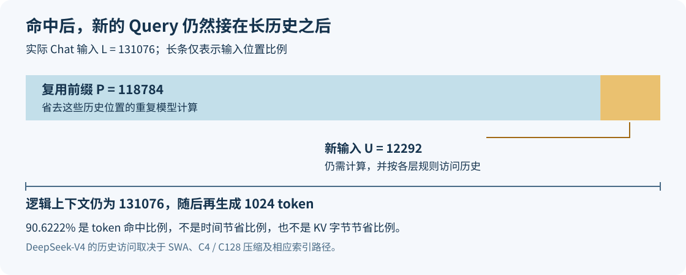
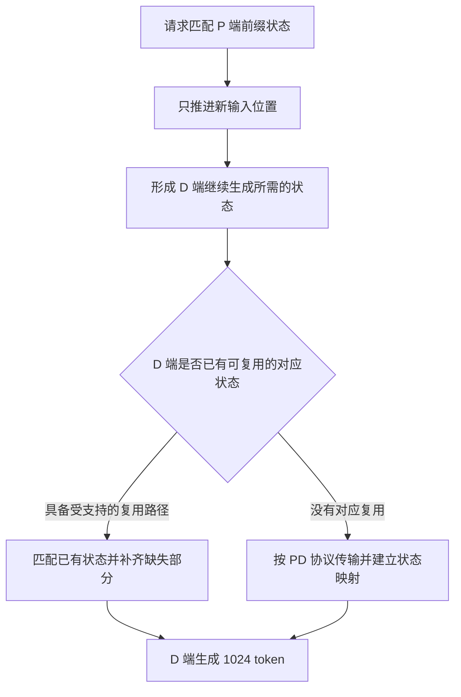

# 128K 已经命中 90% 前缀缓存，为什么推理仍然不轻松？

131076 个输入位置，118784 已缓存，新增只剩 12292，比普通 16K 还短。它仍不是一条独立 12K 请求：新 Query 和后续输出接在原 128K 历史后。

前缀缓存少做旧位置的模型计算，后面仍需读取、使用已存状态。节省了重算，依赖还在。

Flash/Ascend 910C 真实 PD 中，N640 全成功、各 1024 输出、逐条命中 90.6222%。C90 whole TTFT 仍 12.6819 秒、TPOT 10.3ms、E2E 23.2377 秒。表里能看见等待，尚不能将它分给计算、交接或排队。

[上一篇](128k-prefix-cache-benchmark-calibration.md)讲缓存校准，本篇接着看剩余工作。实测用冻结本地适配，机制另看公开sgl-project/sglang @ 5c69e32abe013fa1b913022682a3104c79105f37，不能从公开代码反推历史阶段时间，见[数值与摘录](../../assets/128k-prefix-cache-remaining-costs/evidence.json)。

## 一、先分清三个长度：复用前缀、新输入和逻辑上下文

正文 131072，Chat 131076，输出 1024。usage 给`cached_tokens=118784`，比例以实际输入作分母：

```text
实际输入 L = 131076
复用前缀 P = 118784
新输入   U = L - P = 12292
token 命中比例 = P / L = 90.6222%
```

命中状态让请求从匹配位置继续，后缀的新 Query、hidden、路由、输出还要执行，缓存里没有所有未来后缀的答案。

从 Java 后端理解，可以类比复用已算好的中间结果：后续不用重算，却还要引用它。模型实际通过多层 Tensor 完成这些依赖。



图长条按位置画，不按耗时。P 新增 12292，后缀末尾位置接近 131076，chunk、页对齐、调度、合批还会改变它们进入哪些 batch。

NPU DSV4用`extend_seq_lens_cpu`构造新Query累积长度，另传有效KV长度、页表。前者数本轮行，后者给历史范围，见[长度构造](https://github.com/sgl-project/sglang/blob/5c69e32abe013fa1b913022682a3104c79105f37/python/sglang/srt/hardware_backend/npu/attention/ascend_dsv4_backend.py#L1849-L1873)、[调用参数](https://github.com/sgl-project/sglang/blob/5c69e32abe013fa1b913022682a3104c79105f37/python/sglang/srt/hardware_backend/npu/attention/ascend_dsv4_backend.py#L2160-L2188)。

约 12K 新输入、约 128K 逻辑上下文，两种长度同时决定工作。

## 二、新 token 需要读取旧状态，命中比例不能直接换成计算比例

先用普通稠密因果 Attention 说明依赖，再看 V4。

总长 100，前 90 命中，后 10 待算。第 91 个 Query 仍读取合法历史，之后依次到 100。

新 Query 对旧位置、对后缀自身的因果配对为：

```text
后缀需要的配对：10 × 90 + (1 + 2 + ... + 10) = 955
全冷 100 个位置：1 + 2 + ... + 100 = 5050
剩余配对比例：955 / 5050 ≈ 18.91%
```

90% 命中没有把这些配对缩到原 10%。旧 K/V 省重建，新 Query 仍用它们。

前缀 P、后缀 U，配对`U×P + U×(U+1)/2`只描述依赖，未含投影、MoE、通信、Kernel。FlashAttention 也不一定写出完整分数矩阵，因此不能据配对数直接算 HBM、墙时。

V4 历史组织不同，实际长度代入这套稠密模型，也不能得到本次计算占比、加速倍数。

## 三、DeepSeek-V4 的长历史，经过了窗口、压缩和检索

NPU 按各层 compress_ratio 走不同路径：

| 层的配置 | 近期状态 | 更远历史的访问方式 |
| --- | --- | --- |
| ratio 0 | SWA 滑动窗口 | 无该层的压缩历史路径 |
| ratio 4 | SWA 滑动窗口 | C4 压缩历史，主 Attention 使用 Indexer 选出的 TopK 位置 |
| ratio 128 | SWA 滑动窗口 | C128 压缩历史，沿有效压缩历史访问，不走 C4 TopK 选择 |

不同层配置列在表中，并非每层跑三套。`_forward_compressed()`取SWA、对应压缩buffer、窗口、长度、页表；C4用`cmp_sparse_indices`，C128设None，见[对应源码](https://github.com/sgl-project/sglang/blob/5c69e32abe013fa1b913022682a3104c79105f37/python/sglang/srt/hardware_backend/npu/attention/ascend_dsv4_backend.py#L2118-L2188)。

SWA 受窗口约束；C128 长上下文有更多压缩条目；C4 主 Attention 读取选中位置，产生或复用选择的 Indexer 另外计。它们的增长都不等同原始 Token 数。

[IndexCache freq2](deepseek-v4-indexcache-freq2-cross-layer-topk-reuse.md)只少做部分跨层选择，新Attention、压缩状态、MoE仍运行，TopK有上限不等于所有历史工作恒定。

前缀还要接续Compressor、Indexer状态与寻址。NPU Pool分别提供SWA、压缩KV、状态，取buffer时等相应层传输，见[Pool 访问接口](https://github.com/sgl-project/sglang/blob/5c69e32abe013fa1b913022682a3104c79105f37/python/sglang/srt/hardware_backend/npu/dsv4/dsv4_memory_pool.py#L468-L544)。

本轮 W8A8 是权重，KV 记录为 bfloat16，窗口、压缩池、Indexer、状态、页表各查 dtype、布局。压缩 128 也不表示服务总内存变成 1/128。

## 四、P 端省掉重算，D 端仍要拿到可继续生成的状态

PD 还要看状态在哪一端驻留。

P 命中表示 P 能从匹配位置续算；D 是另一个服务，生成前也要有可访问历史。

快照 P 的`disable_radix_cache=false`，D 为 true，两端本地复用条件不同。P 命中九成，未说明 PD 少传九成，usage 也没有给传输字节。



图列了两种有条件的可能，实际需对照缓存、状态，尤其保留本轮 D radix 关的条件。

公开NPU主PD buffer含C4 KV、Indexer K/scale，SWA、压缩状态、C128另注册，见[注册代码](https://github.com/sgl-project/sglang/blob/5c69e32abe013fa1b913022682a3104c79105f37/python/sglang/srt/hardware_backend/npu/dsv4/dsv4_memory_pool.py#L387-L466)。布局各不相同，不能把原始Token乘统一KV字节。

发送也区分普通页、SWA、请求状态。`_send_kv_chunk()`选尾窗SWA，C128按逻辑长度建对应，见[分块与状态索引](https://github.com/sgl-project/sglang/blob/5c69e32abe013fa1b913022682a3104c79105f37/python/sglang/srt/disaggregation/prefill.py#L1302-L1382)。既不能推出只传一成，也不能推出完整原始128K普通KV。

本轮缺逐组件字节、关键路径时间，无法把 TTFT 12.68 秒归网络。排队、P 执行、D 资源准备、传输完成的依赖与重叠仍要拆。

## 五、后面的 1K 输出，仍要在长上下文上生成

D 继续生成 1024 位置，各接在 128K 后，由窗口、压缩、检索决定历史访问。它们的 Query、采样、状态没有被输入缓存预先完成。

本轮 DSpark Compact、草稿 5/Verify 6、自动 SPS，一轮可提交多枚，也要付 Draft、Verify、接受、提交。whole AL 5.7760 只数输出/Verify，没有给周期时间。

同样每轮约 6 枚，历史访问、batch、通信贵的一组，TPOT 仍可更高。缓存驻留、Graph、带宽效率让倍率无法只从长度推出。

状态需求也不是`C×12292`。本地可共享前缀页，独立后缀、输出却继续长，跨 DP、服务还有副本归属。加 C 之前看窗口池、压缩池占用、排队、退让。

缓存少重算输入，投机少推进轮次，作用于不同重复工作，收益最后用时间比较。

## 六、回到实测：怎样判断还剩哪一段值得优化

同轮 C90 如下：Flash/Ascend 910C、PD16 物理卡，正文 131072、Chat 131076、输出 1024、逐条缓存 118784，复制集、N640/C90/r6，全成功。

| 指标 | whole | AISBench native |
| --- | ---: | ---: |
| 纳入请求数 | 640 | 549 |
| 统计时长（s） | 179.5766 | 143.4935 |
| 实际平均系统并发 | 82.8179 | 87.4978 |
| 实际请求吞吐（req/s） | 3.5639 | 3.8260 |
| TTFT 平均 / P90（ms） | 12681.9 / 14325.9 | 12250.2 / 13927.3 |
| TPOT 平均 / P90（ms） | 10.3 / 10.9 | 10.4 / 11.0 |
| ITL 平均 / P90（ms） | 58.2 / 76.4 | 58.6 / 76.7 |
| E2E 平均（s） | 23.2377 | 22.8695 |
| 输出总吞吐（token/s） | 3649.4736 | 3917.7796 |
| 输出 / PD16 物理卡（token/s） | 228.0921 | 244.8612 |
| 输出 / D8 物理卡（token/s） | 456.1842 | 489.7225 |
| 输出 AL | 5.7760 | NOT_OBSERVED |
| 接受 draft / 实际 verified 槽位 | 543675 / 563907，96.4122% | NOT_OBSERVED |
| 实际生成 proposal 的严格接受率 | NOT_OBSERVED | NOT_OBSERVED |

native 原 selector 取 549 条、143.49 秒。接受数只在 whole，verified 槽比未当 proposal 严格接受率。ITL 沿工具，多 Token 事件不能代替 TPOT、单轮 Verify 成本。

本轮没有同配置全冷 128K，无法计算缓存加速比。16K 零缓存的历史、布局、状态也不同，相除不能隔离长度影响。

whole 名义输入 467146.8782 token/s 含完整前缀，只按同窗未命中折算约 43807.94 token/s。后者仍不是 FLOP/s、KV 流量、设备利用率。

继续定位：TTFT 查队列、P 执行、交接；生成查 Draft/Verify 关键路径、历史、batch；加 C 无吞吐，就看两端在途、队列、状态池找积压。可重叠阶段的累计值也不能直接相加。

正式外 16seed、16check，两波墙时 47.9102 秒；复用热服务，新增启动、MF、路由 0。控制器 309.1594 秒已含准备、正式、收尾。

缓存已经省去了 118784 个旧位置的重算。接下来要追 12292 新位置、1024 输出实际经过的状态读取、计算、交接，才能解释剩余等待。
