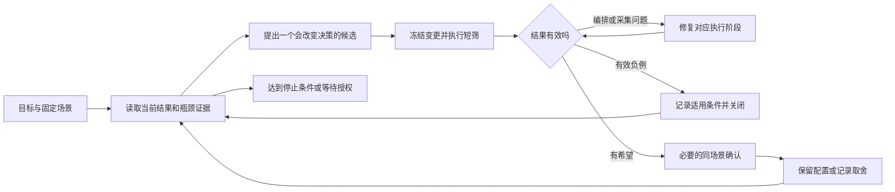

# 把性能目标交给 AI 之后：大模型推理的全自动调优闭环

“在平均 TPOT 小于 20ms 的条件下，把输出吞吐尽量提高，争取超过 230 tok/s/卡。”

代理接到目标后，首先得确定比较条件：“每卡”是否包含 P 和 D 的全部物理卡，输入长度和缓存命中如何定义，吞吐采用 whole 还是 native。改变这些条件也能让数字变大，但那未必是相同工作变快了。

这次调 DeepSeek-V4-Flash、Ascend 910C，我把改配置、生成数据、压测、分析和部分工具适配交给编码代理连续执行。最终在真实 P8+D8、16 张物理卡上，两种有利于获得较长接受长度的复制任务都取得了 native 超过 230 tok/s/PD16 卡、平均 TPOT 小于 20ms 的结果。中间也有长准备、重复核验和采集错误，具体见[流程复盘](inference-tuning-workflow-postmortem.md)。

这里主要讲代理怎样选择下一轮，沿实际候选解释判断与取舍。执行和数据恢复另见[配套文章](ai-driven-inference-autotuning-execution-and-evidence.md)，下面的流程建议也都从这些已发生问题出发。

## 一、把一句目标变成可比较的实验问题

吞吐目标还受 TPOT、成功数、完整输出和设备数量限制。本轮要求真实 PD，并分别固定零缓存与 90% 前缀缓存场景，不能在调参时悄悄改变工作量。

本轮先检查候选是否满足质量、成功请求数与时延条件，再比较合格候选的输出吞吐。其中平均 TPOT 必须严格小于 20ms；TTFT 均值和 P90 继续报告，7 秒只是参考，不用于淘汰候选。这些取舍由用户确定，代理据此执行，不能自行改 SLO。

实验先使用 16K 正文、1K 输出、零缓存，后来改为 128K/1K、实际命中约 90.6%。后者原始输入是前者的八倍，P 端需要新计算的部分却受缓存影响，不能按八倍工作量理解。因此旧布局只作为起点，新场景的专家分布和性能需要另测。

复制任务用于观察较长接受长度，实际输出固定为 1024 Token；后文的高 AL 就来自这类展示集。普通问答或代码的预测难度不同，不能沿用这里的吞吐容量。

每个候选需说明场景、单项变化及结果将决定什么。比如：

> 保持 16K 复制数据、零缓存、640 请求、C128、6 req/s 和当前服务源码不变，只把 P 侧单次 Prefill 接纳请求上限从 1 改到 2，判断尾块能否与下一请求合批，并据此决定是否保留该配置。

这样便能按同条件比较，而不只留下“试 Pcap2”的名称。旧配置和证明引用原文件，无须每次复制完整历史。

## 二、让代理先解释现象，再选择参数

连续调优容易变成默认动作：吞吐低就加 C、接受短就加草稿、利用率低就加请求。参数虽改得快，若没有解释当前现象，仍可能绕过真正限制产出的环节。

PD 中由 P 准备输入，D 接着生成。如果 P 无法持续交付，D 即使单条序列生成很快，也不会凭空增加工作量。反过来，P 没有排队也可能是客户端节奏或调度所限，不能据此认定 D 已有足够大的 batch。

客户端并发 C、到达速率 r、实际平均在途数和完成 QPS 要分别读取。C90 只是上限，不保证始终有 90 条请求；6 req/s 是目标提交节奏，也未必等于完成速度。队列和统计区间能帮助解释这些量为何不同。

已有采样显示 P 持续排队，D 的等待队列为零，因此优先检查 P 的交付与组批。这个线索比直接提高 D 并发更具体，但还没有分清 P 内部的计算、通信和调度成本；D 等待队列为零也不等于 D 没有运行请求。

下一轮应能区分解释。怀疑客户端供给不足，可在服务不变时改 C 或 r，观察在途、完成与排队；供给充分却只增长等待时，就转查 batch、token 预算及执行路径。

已有统计无法区分阶段时，再带问题采短 trace。旧材料先复用，服务器侧分析后回传必要结论，可减少传输和等待。

## 三、一个有效候选怎样从机制走到实测

P 合批上限是本轮有代表性的候选。

这份 16K 数据经过 Chat 包装后实际为 16388 Token，有效 chunk 为 8192，因而被拆成两块 8192 和尾部 4 Token。如果单批只允许接纳一条请求，尾块可能单独执行；允许再接纳下一条，才有机会用掉剩余 Token 预算。

C128 限制客户端同时在途的请求，P cap1→2 调整一次 Prefill 接纳的请求上限，两者并不等价。提高 cap 也没有把 worker 的 Token 预算翻倍；仅凭 running 数低，仍不能断定设备有足够资源接纳更多工作。

先用真实接纳方法处理同一组 320 条输入，批次数从 960 降为 645，Token 总数保持不变，确认了尾块合批在这条路径上可以发生。实际运行的通信、专家分布与等待仍可能变化，因此这个检查之后还要单独测性能。

短测筛选呈正向后，再用 640 条实体请求确认。对照固定同一份 16K 高 AL 数据、C128、r6、静态布局和 Compact，只改 P cap：

| 输出吞吐，tok/s/PD16 卡 | cap1 | cap2 |
| --- | ---: | ---: |
| AISBench native | 179.0441 | 236.8268 |
| whole | 166.2402 | 216.5483 |

native 约提高 32.27%，whole 约提高 30.26%。cap2 的 native 窗口纳入 493 条请求，时长约 133.23 秒，平均 TPOT 为 9.4ms；whole 的 640 条请求全部成功，各输出 1024 Token。这些结果支持在当前配置组合中保留 cap2。

更早的普通负载中，P cap2 曾经负向。这次重试是因为复制任务、布局和父配置都已变化，而且找到了具体的尾块合批机会。失败记录需要保留这些条件，才有依据判断一个旧方向何时值得重试。

本文各组原值见[数值摘录](../../assets/ai-driven-inference-autotuning/decision-evidence.csv)。

## 四、下一轮该按什么顺序排

候选保留时，同时保存数据版本、布局、有效参数和源码身份。之后回到该状态应能直接定位，而非翻日志重新猜测。

排候选时，可比较可能收益、失败后能排除的解释，以及准备恢复成本。无需编造精确概率，先将缺少价值的方向后移，就能减少并发调查。

纯 C/r 热测较便宜，适合已有供给疑点时先做。静态布局需采集、拟合和加载，应有专家倾斜影响设备时间的依据。占比很小的 copy 则需要更强理由才值得冷启动。

短测用于尽早停止明确的负例，有希望的候选再延长确认。请求数少、窗口短时，填充与收尾更容易影响结果。本次要求 native 至少包含 128 条请求、持续 60 秒，这只是最低验收条件，仍不能替代长期容量评估。

一轮 N320 的 native 超过 239 tok/s/PD16 卡，但只有约 50.67 秒，没有达到窗口要求，因此继续做 N640。后者以 236.8268 tok/s/PD16 卡确认了较长窗口下的表现。两轮 N 不同，分别留档，不据此计算配置的涨跌幅。

依赖也决定顺序。研究 AL≈5.5 先具备相应 draft/verify 宽度，研究 90% 缓存先逐条验证实际命中。独立 CPU 准备可提前，报告和重复审查则不能阻挡已就绪模型实验。

## 五、自动调优需要能够拒绝一个漂亮结果

结果出来后，还需决定保留或恢复，数字大并不自动通过验收。

先确认正式请求是否执行。发出之前失败，记录为编排故障；推理成功、统计失败，则修原数据的处理。若把工具错误填成低吞吐，搜索过程就会错误淘汰潜在有效的配置。

再核对工作量：输出是否实际 1024、零缓存有无意外复用、高缓存是否逐条达标。聚合 Gauge 无法排除部分请求未满足条件。

质量也需独立检查。IndexCache 已有性能但未做全面任务评估，Compact 修了已复现位置错误，也未代替业务精度。这些缺口决定后续部署还要补什么。

再按同口径比较。128K 逐条命中 90.6222% 的同实体 N640，C128/C90 whole 分别 240.3715、228.0921 tok/s/PD16 卡；C90 等待更低，却减少约 5.11% 整轮吞吐。

C90 的 native 为 244.8612 tok/s/PD16 卡、平均 TPOT 为 10.4ms。它不能与 C128 的 whole 比较，再宣称降并发提高了容量；C128 缺少有效 native 结果，这一列就保留为空。

C128 与 C90 对应不同容量和首字取舍。将两种结果完整保留，用户换目标后便可选择，无须因报告省略某列重跑。

## 六、把判断接到一个能持续运行的闭环上

据此，工具可以逐步收敛为以下流程：

故障后从哪里恢复，取决于原请求到了哪一步。尚未发出，就修入口后再发；已经结束，就接着处理原数据。如果所有错误都从部署起点重跑，只会反复增加机器成本。

模型适合解释证据、提候选，程序负责固定的参数核对、锁、启动、超时、阶段及结束记录。无需每轮生成控制器，也不靠自然语言摘要判断是否已结束。

用户暂停、资源截止或原请求状态未知时，停止新负载。单次 C90 完成仍维持单次授权，写文章和看截图也不改变机器安排。入口保留最新指令与短状态，避免从旧聊天猜测。

业务场景、质量容忍与性能取舍仍由人选择。代理可承担执行和调查，却必须按这些条件解释一次测量。

评价自动调优还要看取得有效决策所花时间、重复负例、实验是否改变选择，以及健康状态能否保留。本轮产出了结果，也暴露编排与观测问题；接下来应先复用同一参数和采集入口，再考虑更复杂搜索。
