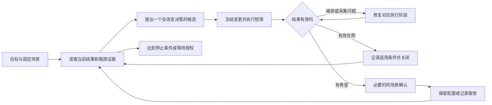

# 把性能目标交给 AI 之后：大模型推理的全自动调优闭环

“在平均 TPOT 小于 20ms 的条件下，把输出吞吐尽量提高，争取超过 230 tok/s/卡。”

代理拿到这句话，先要把“每卡”的分母、输入与缓存、whole / native 窗口说清楚。P、D 一共多少物理卡，哪些 Token 真要重算，都会改变这个目标的含义。

这次调 DeepSeek-V4-Flash、Ascend 910C，我让编码代理连续改配置、准备数据、压测、分析，也适配了一部分工具。真实 P8+D8、16 张物理卡，两种容易取得长接受长度的复制任务都达到 native 超过 230 tok/s/PD16 卡、平均 TPOT 小于 20ms。过程中也付出了长准备、重复核验、采集错误的成本，见[流程复盘](inference-tuning-workflow-postmortem.md)。

这里沿几轮实际候选，讨论代理怎样决定下一步。执行、数据恢复放在[配套文章](ai-driven-inference-autotuning-execution-and-evidence.md)，避免把选择参数和修工具混成一件事。

## 一、把一句目标变成可比较的实验问题

目标中的吞吐，还要同时满足质量、成功数、完整输出、设备数量。本轮固定真实 PD，零缓存和 90% 前缀缓存分别测量。

合格候选再按输出吞吐比较：平均 TPOT 严格小于 20ms，TTFT 均值、P90 继续报告，7 秒只作参考。这些由用户确定，代理按约定筛选。

最初为 16K 正文、1K 输出、零缓存，后来换成 128K/1K、实际命中约 90.6%。名义输入增至八倍，P 新算量却由缓存改变，旧布局只能作为起点，专家分布、性能重新验证。

复制任务用于观察长接受长度，输出固定 1024 Token。高 AL 来自这组展示数据；普通问答、代码难度不同，容量需要用自己的负载测。

候选可以先写成一个明确的实验问题：

> 保持 16K 复制数据、零缓存、640 请求、C128、6 req/s 和当前服务源码不变，只把 P 侧单次 Prefill 接纳请求上限从 1 改到 2，判断尾块能否与下一请求合批，并据此决定是否保留该配置。

这样结果能回答是否保留 cap2。父配置和原有证明直接引用文件，候选记录只补本次变化。

## 二、让代理先解释现象，再选择参数

吞吐低就加 C，接受短就加草稿，利用率低就加请求，这些动作很容易自动化。难的是判断本轮究竟卡在哪里，下一次变化能区分什么。

PD 中 P 准备输入，D 继续生成。P 交付不足，D 单条序列再快也缺少工作。P 不排队也未必是供给充分，还可能受客户端节奏、调度限制。

因此 C、到达速率 r、平均在途、完成 QPS 各自读取。C90 只是上限，6 req/s 只是提交节奏，实际请求数还受排队、完成速度和统计窗口影响。

本轮已有采样是 P 持续排队、D 等待队列为零，于是先查 P 交付与组批。D 等待为零仍可能有运行请求，P 内部计算、通信、调度也尚未拆开。

如果怀疑供给不足，可保持服务不变，只改 C 或 r，看在途、完成、队列。供给已足而等待增加，再查 batch、Token 预算、执行路径。这样的候选才有可区分的结果。

已有统计不足时，再围绕问题采短 trace。原材料先复用，服务器上分析后回传必要结论，减少搬运与等待。

## 三、一个有效候选怎样从机制走到实测

P 的合批上限，是这轮从机制走到收益的一个例子。

16K 数据加 Chat 包装后为 16388 Token，有效 chunk=8192，拆成 8192、8192、尾部 4。单批只能接一条请求，尾块可能单独执行；多接下一条，才可能用剩余预算合批。

C128 限客户端在途，P cap1→2 限单次 Prefill 接纳请求，分别作用于不同环节。cap 也没把 worker Token 预算翻倍，能否接更多工作仍要看实际预算。

先用真实接纳方法处理相同 320 条输入，batch 从 960 到 645，Token 总数不变，证明尾块合批确实可发生。通信、专家分布、等待的实际成本，还需上设备比较。

短测正向后，再用 640 条实体请求确认。固定同一份 16K 高 AL 数据、C128、r6、静态布局、Compact，只改 P cap：

| 输出吞吐，tok/s/PD16 卡 | cap1 | cap2 |
| --- | ---: | ---: |
| AISBench native | 179.0441 | 236.8268 |
| whole | 166.2402 | 216.5483 |

native 提高约 32.27%，whole 约 30.26%。cap2 native 包含 493 条、约 133.23 秒，平均 TPOT 9.4ms；whole 的 640 条全成功、各 1024 Token，因此在当前组合保留 cap2。

更早的普通负载里，cap2 曾负向。这次数据、布局、父配置都变了，也找到了尾块合批机会，才有重试理由。负例和它的条件一起保留，旧方向就不必永远淘汰，也不会无条件重跑。

原始数值见[数值摘录](../../assets/ai-driven-inference-autotuning/decision-evidence.csv)。

## 四、下一轮该按什么顺序排

保留候选时，把数据版本、布局、有效参数、源码身份一起保存，后续能直接回到这个状态。

下一轮可以按可能收益、失败能排除什么、准备恢复成本排序。不必给它们编出精确概率。

C/r 热测便宜，有供给疑点时先做；静态布局要采集、拟合、加载，先要有专家倾斜影响耗时的证据。只占很小比例的 copy，则未必值得冷启动。

短测尽早挡住明确负例，有希望再延长。本轮 native 最低要求 128 条、60 秒，填充、收尾的影响仍要检查，长期容量另行评估。

N320 曾测到 native 超过 239 tok/s/PD16 卡，但仅约 50.67 秒，未达时长。继续 N640 后，以 236.8268 tok/s/PD16 卡确认。N 不同，两个结果各自归档，不算成配置退化。

候选也按依赖推进：AL≈5.5 需要相应 draft/verify 宽度，90% 缓存需要逐条验证命中。CPU 准备可以提前，报告、重复审查则不该挡住已就绪实验。

## 五、自动调优需要能够拒绝一个漂亮结果

测完先判断结果是否有效，再决定保留、恢复。

请求还没发出就失败，是编排故障；推理成功、统计失败，就接着处理原数据。把工具失败填成低吞吐，会让搜索淘汰其实没有测过的候选。

有效工作量需要逐条对齐：输出 1024 是否完整，零缓存是否额外复用，高缓存是否每条达标。聚合 Gauge 无法代替这些检查。

质量还有独立缺口：IndexCache 已有性能结果，全面任务评估未做；Compact 修过已复现位置错误，也仍需业务精度验证。

同实体 N640、逐条命中 90.6222% 的 128K 结果中，C128/C90 whole 为 240.3715、228.0921 tok/s/PD16 卡。C90 等待较低，整轮吞吐少约 5.11%。

C90 native 为 244.8612 tok/s/PD16 卡、TPOT 10.4ms，C128 没有有效 native。表中这一格留空，两种窗口就不会被拼成“降 C 提升容量”的结论。

两组完整保留，用户以后换吞吐、首字目标时，可以直接作取舍。

## 六、把判断接到一个能持续运行的闭环上

选择、执行、验收可以逐步接成：

恢复从原请求停在哪一步开始：尚未发出就修入口，已经结束就处理原数据。前面的热服务和成功请求还能用，没必要每次回部署起点。

模型解释材料、提候选，程序负责固定参数校验、锁、启动、超时、阶段和结束记录。控制器复用稳定入口，结束状态由实际产物确定。

暂停、资源截止或原请求状态未知，就停止新负载。一次 C90 只授权一次，看截图、写文章也不改变设备安排。入口保存最新指令、短状态，接续时不从旧聊天推测。

业务场景、质量容忍、性能取舍由人选择，代理按这些条件执行和解释结果。

自动调优的成本，还包括多久取得有效决定、负例是否重复、健康状态能否保留。这轮拿到了结果，也暴露了编排、观测的开销；下一步先收敛已有参数和采集入口。
