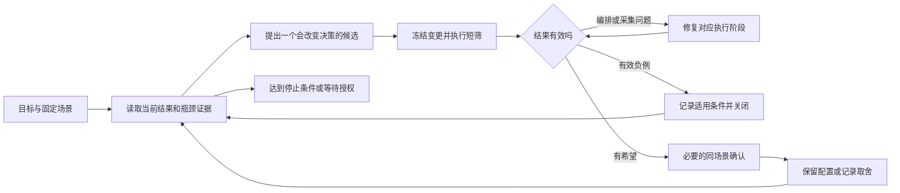

# 把性能目标交给 AI 之后：大模型推理的全自动调优闭环

“在平均 TPOT 小于 20ms 的条件下，把输出吞吐尽量提高，争取超过 230 tok/s/卡。”

代理收到这个目标，首先要搞清楚我们在比较什么。卡是只算 Decode，还是把 Prefill 和 Decode 一起算？输入是 16K 还是 128K，缓存命中多少？吞吐看整轮，还是工具选出的稳态区间？这几处一变，数字就可能变大，机器却未必做得更快。

这次 DeepSeek-V4-Flash / Ascend 910C 实验，把配置调整、数据生成、压测、分析和部分代码适配交给 AI 编码代理连续执行。最终，在真实 P8+D8、共 16 张物理卡上，两类有利复制负载都取得了超过 230 tok/s/PD16 卡、平均 TPOT 小于 20ms 的 native 结果。但中间也出现了长时间准备、重复核验和采集失败。过程中的问题已在[流程复盘](inference-tuning-workflow-postmortem.md)展开。

这一篇聊聊下一轮实验怎么选。我们实际做过哪些判断，哪些地方后来想明白了，会沿着例子展开；最后再把它们整理成一个可继续改进的闭环。执行和采集中的具体问题，放在[另一篇文章](ai-driven-inference-autotuning-execution-and-evidence.md)。

## 一、把一句目标变成可比较的实验问题

“最大化吞吐”通常带有约束。我们希望 TPOT 不超过上限，请求不能失败，输出长度不能缩短，设备数不能悄悄减少。对这次实验，还要求真实 PD 部署，并分别固定零缓存和 90% 前缀缓存两个场景。

可以把目标写成：在一个固定场景内，从满足质量、请求成功和时延条件的候选中，寻找输出吞吐最高的配置。平均 TPOT 严格小于 20ms 是本次的准入条件；TTFT 仍报告均值与 P90，但当时没有把 7 秒参考值作为淘汰条件。这是用户选择的取舍，不能在执行途中被代理改成另一套 SLO。

参数之前，还有场景。我们先做 16K 正文、1K 输出、零缓存，后来转到 128K 正文、1K 输出、实际前缀命中约 90.6%。后者虽然输入长了八倍，大部分前缀却已经在缓存里，P 侧面对的实际工作发生了变化。旧布局可以先用来跑通，新场景的专家分布和性能则重新测。

为了观察较长的接受长度，我们还专门构造了原文复制等容易预测的任务，固定实际输出 1024 token。后文的高 AL 成绩就来自这套展示集。换成普通问答或代码业务，预测难度会变，容量也要跟着重新测。

所以，一张实验卡片至少需要表达清楚三件事：当前优化哪个场景，唯一改变什么，结果会影响哪个选择。例如：

> 保持 16K 复制数据、零缓存、640 请求、C128、6 req/s 和当前服务源码不变，只把 P 侧单次 Prefill 接纳请求上限从 1 改到 2，判断尾块能否与下一请求合批，并据此决定是否保留该配置。

这比“试一下 Pcap2”多写了几句，后面比较时却省事很多：哪项动了、其余项是什么，一眼就能看清。历史配置和证明文件留个引用就够了。

## 二、让代理先解释现象，再选择参数

连续调优最容易退化为参数枚举：吞吐不够就加并发，接受长度不够就加草稿，设备利用率不满就开更多请求。这样的动作很快，却可能始终碰不到真正限制系统的资源。

真实 PD 系统中，P 负责 Prefill，D 负责后续 Decode。它们通过请求和状态交接连接起来。即使 D 生成一段输出很快，如果 P 无法持续交付新请求，D 侧也不会凭空增加有效工作。反过来，P 侧没有排队，也不代表 Decode 的批次已经足够大，还可能受客户端到达速率或调度策略影响。

因此，并发上限 C、配置到达速率 r、实际平均系统并发、实测 QPS，是四个不同的观察量。C90 说明客户端最多允许多少请求在途，不保证系统每时每刻都有 90 条；6 req/s 是发送侧配置，也不是最终完成速率。代理需要用实际队列和时间区间解释它们的关系。

采样里有一个值得追的现象：P 持续排队，D 等待队列为零。继续看 Prefill 的供给和批次组织，比盲目增加 D 的并发更有依据。至于 P 内部时间花在计算、通信还是调度，队列数据还回答不了，需要下一步观察。

更合适的下一步，是选择一个能区分解释的实验。如果怀疑客户端供给不足，可以在服务不变时调整 C 或 r，观察实际并发、完成速率和排队是否增加。如果供给已经充足，继续加 r 只增加等待，就应转向批次、token 预算或设备执行路径。

profile 可以留到这个时候再采。已有统计先用起来，实在分不清时间花在哪个阶段，再采一小段，带着问题看时间线。trace 留在服务器分析，回传少量结论，也省得把等待花在传文件上。

## 三、一个有效候选怎样从机制走到实测

P 侧合批上限的实验，是这轮最能说明问题的例子。

当时的 16K 场景，实际 Chat 输入为 16388 token，当前工作路径的有效 chunk 为 8192。沿请求拆开，就是两个 8192-token 块，最后剩下一个很短的 4-token 尾块。如果单次 Prefill 最多接纳一条请求，尾块就可能占据一次效率很低的批次；允许再接纳下一条请求，才有机会共同利用 token 预算。

这里有两个容易混淆的“并发”。AISBench 的 C128 是系统在途请求上限；P 侧 cap1→2 是 Prefill 批次接纳请求数的变化。后者没有把每个 worker 的 token 预算一并翻倍，也不能用 running 未达到请求槽上限来证明仍有容量。

先调用真实调度方法做了一次 CPU 检查：同一组 320 条输入，批次数从 960 降到 645，token 总量守恒。尾块合批确实发生了。接下来才是性能问题：batch 变大之后，通信、专家分布和等待也会变化，最后能省多少时间，要交给 NPU 实测。

短筛表现出希望后，才做物理 640 请求确认。下面对照保持同一 16K 高 AL 复制数据、C128、6 req/s、静态布局与 Compact 组合，仅改变 P 侧 cap：

| 输出吞吐，tok/s/PD16 卡 | cap1 | cap2 |
| --- | ---: | ---: |
| AISBench native | 179.0441 | 236.8268 |
| whole | 166.2402 | 216.5483 |

native 提高约 32.27%，whole 提高约 30.26%。cap2 确认轮的 native 区间纳入 493 条请求、持续约 133.23 秒，平均 TPOT 为 9.4ms；640 条请求全部成功，实际输出均为 1024 token。这是当时组合和负载下的明确正向证据，值得保留。

更早的普通负载中，Pcap2 测过负向。后来仍然值得重试，是因为复制负载、布局和父配置都变了，而且这次已经看到了尾块合批的具体机会。失败记录里留下这些条件，代理下次才知道该继续关闭，还是重新考虑。

这组对照和后文用到的数据，放在[数值摘录](../../assets/ai-driven-inference-autotuning/decision-evidence.csv)中。

## 四、下一轮该按什么顺序排

候选有了收益，先把这一站保存下来：数据版本、布局、有效参数和源码身份都留好，后续从这里继续。否则用户说“回到刚才最好的配置”，代理却还得翻日志猜是哪一套。

接下来需要比较候选的价值。对于昂贵实验，可以粗略考虑：成功后有多大收益，失败后能排除什么解释，需要多少准备和恢复成本。这里不必假装能准确给每项填写概率；把明显不值得的方向排后，就已经比同时开十个调查有效。

热服务上的纯 C/r 调整，通常比需要重启、预热和拓扑验证的服务变更便宜。若已有迹象表明供给不足，它就值得先做。静态专家布局需要采集、拟合与加载，但如果设备时间主要受专家不均衡影响，才可能值得支付这些成本。一个局部 copy 只占很小时间比例的假设，则不应仅因“改起来有意思”而排到前面。

短筛先关掉清楚的负例，有希望的再做确认。请求少，试错便宜，结果也更容易受启动和收尾影响。这次把 native 至少 128 条、60 秒作为最低门槛，更长时间的容量要另看。

某次 320 请求短筛的 native 超过 239 tok/s/PD16 卡，区间却只有约 50.67 秒。当时最有用的决定是再做一次 640 确认。后来的 236.8268 才回答了较长窗口能否保持这个水平；前后 N 不同，就各自保留结果，不再计算一个涨跌百分比。

候选之间存在依赖时，要按依赖顺序执行。要测 AL≈5.5，首先需要具备相应的草稿和验证宽度；要比较 90% 前缀缓存场景，首先需要逐条证明实际命中。独立的 CPU 数据准备可以提前做，但不能用旁支写报告或重复审查阻挡一个已经就绪的模型实验。

## 五、自动调优需要能够拒绝一个漂亮结果

一轮跑完，数字出来了，还要回答一个问题：接下来保留它，还是回到上一套？

第一步看正式请求发出了没有。入口在发请求前失败，记到编排故障；推理成功、统计子进程失败，就修原数据处理。若把这两类错误都填成一个很低的吞吐，搜索会避开原本可能有效的配置，开始围着工具故障打转。

然后核对这轮有没有按约定执行：每条是否真的输出了 1024 token，零缓存场景有没有意外复用前缀，90% 缓存场景是不是每条都达到要求。整体 Gauge 看起来不错，仍可能藏着少数没命中的请求。

性能表外还有输出质量。IndexCache 跨层复用测到了提速，全面任务精度评估却还没完成；Compact 的跨请求位置映射修好了已复现的问题，业务质量也仍需单独测。走到这里，性能实验与上线之间还有一段路，后续评测要补在这个位置。

最后才比较收益，而且只比较相同口径。128K、逐条实际缓存约 90.6222% 的同一物理 640 数据，在 C128 与 C90 的 whole 输出吞吐分别为 240.3715 和 228.0921 tok/s/PD16 卡。C90 的 TTFT、TPOT 和 E2E 更低，却付出了约 5.11% 的整轮吞吐损失。

C90 同轮的 native 为 244.8612，平均 TPOT 为 10.4ms。若把它与 C128 whole 摆在一起，会得出“降低并发还提高了吞吐”的相反印象，原因只是统计窗口变了。C128 当时没有取得有效 native，这一列就留空。

所以，“最优”往往得多问一句：更在意整轮吞吐，还是首 token 等待？C128 和 C90 各有适合的目标。把这组取舍留下来，用户改变目标时就能直接选，而不用重新跑一遍。

## 六、把判断接到一个能持续运行的闭环上

把这些经验接起来，现有工具可以朝下面这个闭环收敛：

图里的故障分支接回哪一步，要看原请求的状态。尚未发出，就修好入口再发；已经结束，就接原数据采集。每次都从最前面重来，闭环就成了一个昂贵的重试器。

规划层适合由模型解释证据、提出候选；执行层应尽量由确定的程序完成参数检查、锁、进程启动、超时、阶段记录和结束确认。模型不必每轮重新写一遍控制器，也不应只凭自然语言消息判断一轮是否结束。

循环也要知道什么时候停。用户暂停、资源到期、原负载结束状态未知，都会停止发新任务。用户只要求补一轮 C90，就补完这一轮；写文章、看截图期间，机器维持原安排。当前指令和短状态文件放在入口，比从几天聊天里猜授权更清楚。

人仍然负责选择业务场景、可接受的质量风险和性能取舍。代理可以承担大量重复工作，也能发现人没有优先考虑的候选；但这不意味着把一次测量的解释权交给最大的数字。

要评价这套全自动调优，除了最终吞吐，还应看从一个问题到有效决策用了多久，多少实验真的改变了选择，负例是否被重复，健康状态是否被保留。这次已经证明局部自动化能持续产出结果，也暴露了编排成本和观测缺口。下一步应先让同一个参数入口、同一条采集链稳定复用，再谈更复杂的搜索策略。
