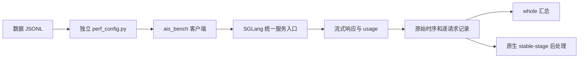

# 用 AISBench 压测 SGLang：从第一条请求到一份可信报告

服务起好了，接口也能正常回答问题，下一步往往就是压测。但第一次得到一张性能表，并不意味着已经知道这张表测了什么。

在 DeepSeek-V4-Flash / Ascend 910C 的 PD 调优里，我们用 AISBench 跑过短请求诊断、16K 零缓存、高 AL 复制负载和 128K 前缀缓存场景。也踩过一些很具体的坑：封装脚本生成的配置与想象不同，扩展类在当前进程能用，换到实际 worker 却找不到；模型请求已经完成，native 后处理又因导入路径失败。

这篇先走通一条最小路径：连接已运行的 SGLang，明确输入与输出，发送一条请求，再扩大负载，最后保留足够的原始材料解释报告。配置扩展和统计公式的细节，留在这条路径需要它们的位置展开。

随文提供[完整示例目录](../../examples/aisbench-sglang/README.md)，包含配置、4 条 JSONL、运行脚本和配置检查脚本。源码基准固定为 AISBench/benchmark [`e00d1f7`](https://github.com/AISBench/benchmark/tree/e00d1f758310c45580576af291a3126919776c89)，它也是我们历史客户端审计记录中的提交；当时另有请求超时改为 300 秒的本地修改，后续计数 observer 也单独绑定过源码。这里给的是该版本接口上的最小示例，不把历史整套环境都称为原版默认配置。

## 一、先分清是谁在发请求

我们当时经常执行的是 `aisbench_test.py`。它读取同目录的 `config.py`，生成数据和临时模型配置，把 JSONL 连接到指定位置，再启动真正的 `ais_bench` 命令。

两者的职责不同。`aisbench_test.py` 是那次环境里的封装，`config.py` 也是封装自己的设置；AISBench 本身支持独立的模型、数据集和汇总配置，也支持把它们放在同一个 Python 文件里运行。[官方自定义配置说明](https://ais-bench-benchmark-rf.readthedocs.io/en/v3.1-20260903-master/advanced_tutorials/run_custom_config.html)列出了这两种入口。

本篇示例直接提供 `perf_config.py`，用位置参数交给 `ais_bench`。这样每轮配置跟着实验目录保存，也避开了共享安装目录里临时配置和软链接相互覆盖的问题。



PD 分离时，客户端连统一入口，由服务侧把请求交给 P、D。分别对 P 或 D 的内部端口发请求，测到的接口和完整服务路径可能不同。服务启动与路由已经准备好，是本篇的前提；示例脚本不会重启服务或修改缓存状态。

客户端也单独管理。可以复用已有匹配环境；需要新装时，在 Linux Bash 创建虚拟环境，再检出固定提交：

```bash
mkdir -p "$HOME/aisbench-sglang-lab"
cd "$HOME/aisbench-sglang-lab"
python3.11 -m venv .venv
source .venv/bin/activate
git clone https://github.com/AISBench/benchmark.git aisbench
git -C aisbench checkout e00d1f758310c45580576af291a3126919776c89
python -m pip install -e ./aisbench
git clone https://github.com/AkiYangDev/llm-inference-notes.git notes
cd notes/examples/aisbench-sglang
```

该提交的安装依赖包含 torch 等库，但这条路径是通过 HTTP 调用已经加载模型的服务。客户端环境与模型服务器的运行环境分别记录，不需要为了换压测配置去升级活动服务的依赖。

## 二、先用一条请求确认接口与模型名

配置之前先确定三个对象：统一入口地址、服务接受的模型 id，以及客户端用于计数的 tokenizer 目录。

`model` 与 `path` 容易填混。前者进入请求里的模型字段，应与服务回包中的 id 对应；后者在本例中指向客户端可读的 tokenizer 目录。二者可能碰巧都写成权重路径，但它们承担的职责不同。

以下用本机端口举例。地址、模型别名和目录都要按自己的服务修改：

```bash
export HOST_IP=127.0.0.1
export HOST_PORT=30000
export SERVED_MODEL=deepseek-v4-flash
export TOKENIZER_PATH=/models/DeepSeek-V4-Flash
export API_KEY=""
export AIS_DATASET="$PWD/data.jsonl"

curl --fail --silent --show-error \
  -H "Authorization: Bearer ${API_KEY}" \
  "http://${HOST_IP}:${HOST_PORT}/v1/models"
```

把 `SERVED_MODEL` 改成这个回包中的 id，然后检查 `/v1/chat/completions`。下面 JSON 中的模型别名也要一起替换：

```bash
curl --fail --no-buffer \
  "http://${HOST_IP}:${HOST_PORT}/v1/chat/completions" \
  -H 'Content-Type: application/json' \
  -H "Authorization: Bearer ${API_KEY}" \
  --data-binary '{"model":"deepseek-v4-flash","messages":[{"role":"user","content":"用一句话解释KV Cache。"}],"stream":true,"stream_options":{"include_usage":true},"temperature":0,"max_tokens":32}'
```

这里看的是接口能否接通、流式事件能否返回，以及 usage 是否携带实际输入输出计数。curl 本身也是一次真实模型请求，会改变服务热状态；它放在正式测量之前，单独算准备工作。

示例只填 `host_ip` 和 `host_port`，让适配类拼接 `v1/chat/completions`。不要把带协议、端口和完整端点的字符串全部塞进 `host_ip`；需要反向代理前缀或 HTTPS 时，再按当前适配器的 base URL 规则配置，并从实际请求日志核对最终 URL。

AISBench 示例使用 `VLLMCustomAPIChat(stream=True)`。名字带 VLLM，但本次接的是 SGLang 的兼容聊天接口。旧脚本用过 `VLLMCustomAPIChatStream`，固定源码中它已转向前一种写法并打印弃用提示；照抄不同版本的类名，容易把兼容问题留到实际运行时才发现。

## 三、把一条 JSONL 怎样变成请求写清楚

示例数据只有 4 条，每行有 `question` 和 `answer`。例如：

```json
{"question":"请求编号A001。请用三句话解释大模型推理中的Prefill阶段。","answer":""}
```

配置中的 `reader_cfg` 读取 `question`，零样本 retriever 不添加示例，prompt template 为 `{question}`，最后交给聊天 API 模型。空 `answer` 只为保持这个性能示例的数据结构；本例没有用它评估回答准确率。

完整配置用 `CustomDataset` 直接读取 JSONL 文件。我们历史封装借用了 `GSM8KDataset`，该 loader 会读取目录中的 `train.jsonl` 和 `test.jsonl`，因此脚本还维护了相应目录与软链接。“文件都叫 JSONL”并不能保证两个 loader 的路径约定相同。新示例直接指向独立文件，省掉这一层隐含约定。

正文长度则是另一件事。4 条小数据用于接通流程，没有声称固定 token 长度。正式做 16K 或 128K 时，要使用实际 tokenizer 核验完整正文，再核对聊天编码后的输入。我们那次 16K 正文为 16384 token，实际 Chat 为 16388；多出的 4 个 token 属于当时的编码与消息结构，换模型时要重新确认。

输出也分配置与实测。示例 `max_out_len=32`，正式实验后来固定为 1024；`temperature=0`、`ignore_eos=True` 用于对应的固定输出性能场景。实际是否完成这些 token，要看回包和结果里的 completion 数。只写输出上限，然后把提前结束的回答与完整长输出混在一起，吞吐和 TPOT 就失去了原来的比较条件。

缓存要求与数据长度分别保存。请求编号放在后面，仍可能共享前面一段 token；重复使用同一份数据，还可能命中上一轮留下的后缀。零缓存要核对实际命中，90% 缓存也要核对实际计数，具体构造在[128K 缓存场景校准](128k-prefix-cache-benchmark-calibration.md)中展开。

## 四、先跑 1 条，再跑 4 条

[`perf_config.py`](../../examples/aisbench-sglang/perf_config.py)从环境读取地址、tokenizer、数据文件和负载参数。模型、数据集和推理组件使用完整点分类型名，方便保存配置后由新进程重新导入。

它显式采用非 lazy 配置模式，让环境读取在解析时完成。随文检查脚本实际执行 MMEngine 的 Config 读取、dump 和新进程 reload，检查数据结构，但不构造 AISBench 模型、加载 tokenizer 或访问服务。实际 worker 的导入和 HTTP 兼容性，由接下来的一条小测覆盖：

```bash
python validate_config.py
NUM_REQUESTS=1 CONCURRENCY=1 REQUEST_RATE=1 bash run.sh
NUM_REQUESTS=4 CONCURRENCY=2 REQUEST_RATE=1 bash run.sh
```

[`run.sh`](../../examples/aisbench-sglang/run.sh)最终调用的是：

```text
ais_bench perf_config.py --mode perf --summarizer default_perf
          --num-prompts N --num-warmups 0 --work-dir 本轮独立目录 --debug
```

上面是入口结构，完整可执行版本在脚本里。shell 使用 `set -euo pipefail`，让 AISBench 的非零退出穿过 `tee` 传回调用者；否则最后一个日志命令成功，可能掩盖前面压测失败。

这一版 `--num-warmups` 默认值为 1，示例显式设成 0，使额外模型请求数量清楚。模型初始化、正式缓存 seed 和短准备测试仍按各自场景执行，并单独记账。关闭工具自动 warmup，不等于服务已经准备好。

一条请求先看失败数、输入输出计数和流式回包；4 条再看数据是否按预期读入、结果文件是否完整。它们都不是容量或稳态测量。尤其不要因样例生成的表格有 TPOT 和吞吐，就把那几个短请求当成服务能力。

## 五、请求数、并发和速率要一起看

这几个字段在本例中的位置如下：

| 变量 | 实际作用 |
| --- | --- |
| `--num-prompts` | 本轮选取的请求数，不负责生成实体数据 |
| `batch_size` | 此 API 推理路径的配置并发上限 C |
| `request_rate` | 客户端到达节奏；示例从 1 req/s 开始，0 表示不按该速率限流 |
| `max_out_len` | 请求输出上限，仍需核对实际输出 |
| `retry` | 该固定实现按 `range(self.retry)` 尝试发送，本例设 1，只尝试一次 |

N640、C90、6 req/s 分别约束总量、在途容量和供给节奏。C90 不表示始终有 90 条在服务中，6 req/s 也不表示最后每秒完成 6 条。请求等待并发额度、服务排队和有限负载的起落，都会体现在实际发送时间与完成统计中。

`retry` 尤其值得看一眼实际实现。该版本的 [`BaseAPIModel.generate()`](https://github.com/AISBench/benchmark/blob/e00d1f758310c45580576af291a3126919776c89/ais_bench/benchmark/models/api_models/base_api.py#L450) 使用 `for _ in range(self.retry)`，因此 1 表示总共尝试一次；若照“追加重试次数”的直觉填成 0，连发送循环都不会进入。示例先保留失败，后续需要重试时，再把尝试次数和实际发送情况一起记录。

短测通过后，换成已经核验的实体文件再扩大，例如 README 中的 N640 命令要求那份文件至少有 640 条记录。正式实验记录模型与服务源码、物理设备数、输入输出、数据 SHA、缓存、采样、N/C/r 和统计窗口。调整并发时，其他条件才能找到明确的对照对象。

这也解释了为什么提高 r 未必提高吞吐。我们在旧场景里提高到达速率后，吞吐曾几乎不变；之后在高 AL 场景里，P 端合批又带来明显变化。要结合当前队列和接纳机制判断，不能把一次速率平台推广到所有数据。[Decode 很快而吞吐受限的那次实验](decode-fast-throughput-limited-by-prefill.md)保留了具体过程。

## 六、从 whole 走到稳态，保留同一轮原始数据

控制台结束时，先找到实际打印的结果目录。示例的外层 `OUT` 下还有 AISBench 生成的内层时间戳；`performances/<model_abbr>/` 中保存汇总 JSON、分布 CSV、逐请求 details JSONL，以及后处理使用的数据库数据。配置、日志、details 和关联数据库一起保留，不能只复制最后一张表。

`default_perf` 汇总的 `total`，我们在文章中称为 whole。原生 `stable_stage` 则按该版本自己的并发事件规则选取请求。在[固定源码](https://github.com/AISBench/benchmark/blob/e00d1f758310c45580576af291a3126919776c89/ais_bench/benchmark/calculators/stable_perf_metric_calculator.py#L64)里，它以第二次达到配置最大并发为起点，找到后面的相应终点，再纳入开始时间位于该区间的请求。它不是手工删掉最慢的几条。

小负载可能根本找不到这个阶段。即使找到了，也继续看纳入请求数与时长。我们项目当时约定至少 128 条、60 秒才足够做稳态确认，这是实验约定，不能当作 AISBench 的通用定义。

固定版本提供 `perf_viz`，[工作流](https://github.com/AISBench/benchmark/blob/e00d1f758310c45580576af291a3126919776c89/ais_bench/benchmark/cli/workers.py)只有后处理，不包含推理。按[示例 README](../../examples/aisbench-sglang/README.md)指定原 work-dir 和准确时间戳，先备份 whole 的 performances，再用 `--mode perf_viz --reuse 时间戳 --summarizer stable_stage` 重算。新的结果可能写到原来的汇总路径，所以两份表要分开保留。

下面是一轮此前封存的真实结果：DeepSeek-V4-Flash / Ascend 910C，P8+D8，共 16 张物理卡；128K 正文、实际输入 131076、输出 1024，高 AL 复制展示负载，逐请求缓存 90.6222%，N640/C90/r6。

| 指标 | whole | 原生稳态 native |
| --- | ---: | ---: |
| 纳入请求数 | 640 | 549 |
| 区间时长（s） | 179.5766 | 143.4935 |
| 平均系统并发 | 82.8179 | 87.4978 |
| TTFT 平均（ms） | 12681.9 | 12250.2 |
| TPOT 平均（ms） | 10.3 | 10.4 |
| E2E 平均（s） | 23.2377 | 22.8695 |
| 输出总吞吐（token/s） | 3649.4736 | 3917.7796 |
| 输出 / PD16 物理卡（token/s） | 228.0921 | 244.8612 |

两列来自同一轮模型请求，区别是统计窗口。native 数值更高，不表示后处理让模型变快了。whole 640 条全部成功、0 失败，接受长度和缓存的原始计数及报告摘要保留在[随文证据](../../assets/aisbench-sglang-first-request-to-report/evidence.json)中。

主表之外，CSV 里的 Min、Max、Median、P75、P90、P99 和样本数继续保存。TTFT 是客户端观测的首输出等待，E2E 是端到端耗时；TPOT 与 ITL 也不能混写，尤其投机解码可能一次返回多个 token。输出总吞吐属于系统统计，逐请求 token 速度分布则属于另一类指标。

每卡数值也要写分母。这轮除以 P+D 的 16 张物理卡；如果只除以 D8，数字会翻倍，但机器整体没有改变。至于请求 QPS、输入加输出吞吐和 nominal 输入 token 中的缓存部分，也应分别命名。

## 七、报告出错，先判断推理执行到哪一步

我们确实遇到过：正式推理已完成，后处理新进程却找不到 `ais_prefix_cache`。结果文件还在，服务也可能仍健康，这时应修复原后处理环境，按原记录重算。缺模块不需要靠重新发送几百条长请求来解决。

若请求本身失败，则检查对应错误、状态码、实际 URL、模型 id 和服务日志。若连正式请求都未发出，就归为配置或编排失败。把这几个阶段分清，才能决定是改配置、补导入路径、重算报告，还是处理服务故障。

投机接受明细和逐请求缓存统计属于下一层扩展。服务返回字段、客户端保留字段、结果写盘与后处理读取要接起来，缺少分母时写未观测；AL 不能直接换算成实测严格接受率。原 AISBench 计时与流式解析也应保留，不为多拿几个字段重新实现一套传输。

随文示例本次完成了 JSONL 检查、固定源码与 CLI 核对、真实 MMEngine 配置序列化和新进程读取；没有连接当前服务重跑上述小测或正式压测。实测表来自已有封存结果。

下一次打开报告，我会先把它对应到具体配置、数据文件和原始时间线：到底发了多少条，完成了多少工作，缓存是什么状态，表里又纳入了哪段请求。把这几项接上，后面的性能判断才有可继续追查的起点。
