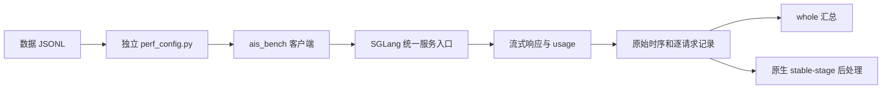

# 用 AISBench 压测 SGLang：从第一条请求到一份可信报告

SGLang 接口能正常回答后，就可以开始检查压测流程。第一张性能表通常会给出不少数字，但仍需确认实际发送了什么请求、运行了哪些配置，以及每列采用哪段统计时间。

在 DeepSeek-V4-Flash、Ascend 910C 的 PD 调优中，我们用 AISBench 做过短请求诊断、16K 零缓存、高 AL 复制任务和 128K 前缀缓存测试。实际失败往往发生在配置与进程衔接处：封装生成的配置并非预期值，扩展类在当前进程可用、worker 却无法导入，或请求完成后 native 汇总因模块路径失败。

下面从一条请求开始：连接已有服务，核对输入输出，再扩大负载并保存原始结果。配置扩展和统计公式随具体步骤解释，先保证能追溯每轮究竟执行了什么。

[完整示例目录](../../examples/aisbench-sglang/README.md)包含配置、4 条 JSONL、运行及配置检查脚本。接口按 AISBench/benchmark [`e00d1f7`](https://github.com/AISBench/benchmark/tree/e00d1f758310c45580576af291a3126919776c89) 编写，与历史客户端审计基准相同。但历史现场另有 300 秒超时的本地修改，计数 observer 也单独绑定过源码，因此不能把那套环境称为原版默认。

## 一、先分清是谁在发请求

当时常用的入口是 `aisbench_test.py`：它读取同目录 `config.py`，生成数据和临时模型配置，将 JSONL 连接到约定位置，最后启动真正的 `ais_bench`。

这两个文件属于现场封装。AISBench 自身可以使用独立模型、数据集和汇总配置，也能将三者放在一个 Python 文件中运行，入口见[官方自定义配置说明](https://ais-bench-benchmark-rf.readthedocs.io/en/v3.1-20260903-master/advanced_tutorials/run_custom_config.html)。排查参数时，需要先知道改的是封装设置还是工具配置。

本例直接通过位置参数传入 `perf_config.py`。每轮配置保存在各自实验目录，减少共享安装目录中的临时配置和软链接互相覆盖。



PD 客户端连接统一入口，由服务侧分发到 P、D。直接访问内部端口，可能绕开完整路径。本例以服务与路由已就绪为前提，脚本不会重启服务或修改缓存。

客户端可以复用现有兼容环境。需要新建时，在 Linux Bash 中创建虚拟环境并检出固定提交：

```bash
mkdir -p "$HOME/aisbench-sglang-lab"
cd "$HOME/aisbench-sglang-lab"
python3.11 -m venv .venv
source .venv/bin/activate
git clone https://github.com/AISBench/benchmark.git aisbench
git -C aisbench checkout e00d1f758310c45580576af291a3126919776c89
python -m pip install -e ./aisbench
git clone https://github.com/AkiYangDev/llm-inference-notes.git notes
cd notes/examples/aisbench-sglang
```

这个提交依赖 torch 等库，但示例客户端只通过 HTTP 调用已加载模型的服务。两侧运行环境应分别记录，无须为调整压测配置升级活动服务的依赖。

## 二、先用一条请求确认接口与模型名

配置前先确定统一入口、服务接受的模型 id，以及客户端能读取的 tokenizer 目录。

`model` 写入请求模型字段，应匹配服务返回的 id；`path` 在此处用于客户端 tokenizer。两者有时恰好都是权重路径，却不能按同一用途填写。

下面使用本机端口示意，地址、模型别名和目录按实际服务替换：

```bash
export HOST_IP=127.0.0.1
export HOST_PORT=30000
export SERVED_MODEL=deepseek-v4-flash
export TOKENIZER_PATH=/models/DeepSeek-V4-Flash
export API_KEY=""
export AIS_DATASET="$PWD/data.jsonl"

curl --fail --silent --show-error \
  -H "Authorization: Bearer ${API_KEY}" \
  "http://${HOST_IP}:${HOST_PORT}/v1/models"
```

将 `SERVED_MODEL` 设为上面返回的 id，再检查 `/v1/chat/completions`。命令 JSON 中的模型别名也需对应修改：

```bash
curl --fail --no-buffer \
  "http://${HOST_IP}:${HOST_PORT}/v1/chat/completions" \
  -H 'Content-Type: application/json' \
  -H "Authorization: Bearer ${API_KEY}" \
  --data-binary '{"model":"deepseek-v4-flash","messages":[{"role":"user","content":"用一句话解释KV Cache。"}],"stream":true,"stream_options":{"include_usage":true},"temperature":0,"max_tokens":32}'
```

这次 curl 用于检查接口连通、流式事件和 usage 中的实际输入输出计数。它仍会执行真实模型请求、改变服务热状态，应单独计入正式测量前的准备成本。

示例填写 `host_ip`、`host_port`，由适配类拼接 `v1/chat/completions`。`host_ip` 不接收一整串带协议和端点的 URL。使用 HTTPS 或反向代理前缀时，需按该版适配器的 base URL 规则配置，并核对日志中实际发出的 URL。

这里选用 `VLLMCustomAPIChat(stream=True)` 调用 SGLang 兼容聊天接口。类名中的 VLLM 不限制服务器必须使用 vLLM。旧 `VLLMCustomAPIChatStream` 在固定源码中已转向新写法并提示弃用，配置时应核对所用版本。

## 三、把一条 JSONL 怎样变成请求写清楚

示例共 4 条数据，每行含 `question`、`answer`，例如：

```json
{"question":"请求编号A001。请用三句话解释大模型推理中的Prefill阶段。","answer":""}
```

`reader_cfg` 读取 `question`，零样本 retriever 不添加示例，prompt template 使用 `{question}`，再交给聊天模型。空 `answer` 只用于保持数据结构，本例不据此评估准确率。

配置由 `CustomDataset` 直接读取 JSONL。历史封装借用 `GSM8KDataset`，后者要求目录内存在 `train.jsonl`、`test.jsonl`，所以还要维护目录和软链接。即使文件格式相同，loader 的路径约定也可能不同；独立文件可以避免这层依赖。

4 条小样本仅用于接通流程，没有固定 token 长度。正式测试 16K 或 128K 时，先用实际 tokenizer 核验正文，再核对聊天编码后的完整输入。那次 16K 正文为 16384 token，Chat 输入为 16388，多出的 4 个 token 来自当时消息结构与编码，换模型后不能直接套用。

输出也要区分上限与完成量。示例设 `max_out_len=32`，正式测试后来固定为 1024；`temperature=0`、`ignore_eos=True` 用于相应固定输出场景。仍需检查实际 completion，避免将提前结束的请求与完整长输出混算，改变吞吐和 TPOT 的比较条件。

缓存条件要独立核验。即使请求末尾编号不同，前部 token 仍可能共享；重复数据还可能命中前轮后缀。零缓存和 90% 缓存都应按实际计数验收，方法见[128K 缓存场景校准](128k-prefix-cache-benchmark-calibration.md)。

## 四、先跑 1 条，再跑 4 条

[`perf_config.py`](../../examples/aisbench-sglang/perf_config.py)从环境变量读取地址、tokenizer、数据和负载设置。模型、数据集及推理组件使用完整点分类型名，使保存后的配置能由新进程导入。

配置显式关闭 lazy 模式，在解析时完成环境读取。检查脚本执行真实 MMEngine Config 读取、dump 和新进程 reload，只核对结构，不构造模型、加载 tokenizer 或访问服务。worker 导入与 HTTP 兼容性需通过随后的一条小测检查：

```bash
python validate_config.py
NUM_REQUESTS=1 CONCURRENCY=1 REQUEST_RATE=1 bash run.sh
NUM_REQUESTS=4 CONCURRENCY=2 REQUEST_RATE=1 bash run.sh
```

[`run.sh`](../../examples/aisbench-sglang/run.sh)最终通过以下结构调用工具：

```text
ais_bench perf_config.py --mode perf --summarizer default_perf
          --num-prompts N --num-warmups 0 --work-dir 本轮独立目录 --debug
```

完整命令保存在脚本中。`set -euo pipefail` 保证 AISBench 的非零退出经过 `tee` 后仍能返回调用者，避免日志命令成功掩盖压测失败。

该版 `--num-warmups` 默认 1，本例显式设为 0，便于确认实际发出多少请求。模型初始化、缓存 seed 和短测仍需按场景准备并单独记录，关闭工具自动 warmup 不代表服务已预热。

先用一条请求检查失败数、计数和回包，再用 4 条检查数据读取与结果完整性。这些短请求只验证流程，表里即使出现 TPOT、吞吐，也不能据此评价容量或稳态能力。

## 五、请求数、并发和速率要一起看

本例的负载设置分别作用于以下位置：

| 变量 | 实际作用 |
| --- | --- |
| `--num-prompts` | 本轮选取的请求数，不负责生成实体数据 |
| `batch_size` | 此 API 推理路径的配置并发上限 C |
| `request_rate` | 客户端到达节奏；示例从 1 req/s 开始，0 表示不按该速率限流 |
| `max_out_len` | 请求输出上限，仍需核对实际输出 |
| `retry` | 该固定实现按 `range(self.retry)` 尝试发送，本例设 1，只尝试一次 |

N640 决定总请求量，C90 决定在途上限，6 req/s 设置到达节奏。实际在服务中的请求不一定持续为 90，完成速率也不一定达到每秒 6 条。等待并发额度、服务排队及爬升收尾都会影响发送和完成时间。

`retry` 的含义应按代码判断。固定 [`BaseAPIModel.generate()`](https://github.com/AISBench/benchmark/blob/e00d1f758310c45580576af291a3126919776c89/ais_bench/benchmark/models/api_models/base_api.py#L450) 用 `for _ in range(self.retry)`，所以 1 表示总共尝试一次，0 则不进入发送循环。本例先保留失败；需要重试时，另行记录尝试次数和实际发送量。

扩大测试前，换入已经核验的实体数据。例如 README 的 N640 命令要求文件至少有 640 条。每轮同时保存模型与源码、物理设备数、实际输入输出、数据 SHA、缓存、采样、N/C/r 和统计窗口，后续调整并发才有可比基线。

提高 r 也未必提高完成吞吐。旧场景增加到达速率后，吞吐曾几乎不变；另一组高 AL 场景通过 P 端合批改善了吞吐，详见[那次实验](decode-fast-throughput-limited-by-prefill.md)。需结合当前队列和接纳机制判断，速率平台不能跨数据推广。

## 六、从 whole 走到稳态，保留同一轮原始数据

结束后按控制台打印找到实际结果目录。外层 `OUT` 内还有 AISBench 生成的时间戳目录，`performances/<model_abbr>/` 保存汇总 JSON、分布 CSV、逐请求 details JSONL 和后处理数据库。配置、日志、details 与数据库均应保存，截图不足以支撑重算。

文章将 `default_perf` 的 `total` 称为 whole。`stable_stage` 则按并发事件选样：固定[源码](https://github.com/AISBench/benchmark/blob/e00d1f758310c45580576af291a3126919776c89/ais_bench/benchmark/calculators/stable_perf_metric_calculator.py#L64)从第二次达到最大并发的时刻开始，确定后续终点，再选开始时间位于区间内的请求。这个过程没有按快慢删请求。

小负载可能无法形成稳定段。即使选择成功，也要核对入选数和持续时间。我们当时约定至少 128 条、60 秒才做稳态确认，这是项目实验要求，并非 AISBench 对所有场景的定义。

固定版本的 `perf_viz` [工作流](https://github.com/AISBench/benchmark/blob/e00d1f758310c45580576af291a3126919776c89/ais_bench/benchmark/cli/workers.py)只执行后处理。按[示例 README](../../examples/aisbench-sglang/README.md)填写原 work-dir 与准确时间戳，先备份 whole performances，再用 `--mode perf_viz --reuse 时间戳 --summarizer stable_stage` 重算。因为新汇总可能写回相同路径，两种表应分别保存。

下面复用一轮封存结果：DeepSeek-V4-Flash、Ascend 910C，P8+D8 共 16 张物理卡，128K 正文、实际输入 131076、输出 1024，高 AL 复制展示负载，逐请求缓存 90.6222%，N640/C90/r6。

| 指标 | whole | 原生稳态 native |
| --- | ---: | ---: |
| 纳入请求数 | 640 | 549 |
| 区间时长（s） | 179.5766 | 143.4935 |
| 平均系统并发 | 82.8179 | 87.4978 |
| TTFT 平均（ms） | 12681.9 | 12250.2 |
| TPOT 平均（ms） | 10.3 | 10.4 |
| E2E 平均（s） | 23.2377 | 22.8695 |
| 输出总吞吐（token/s） | 3649.4736 | 3917.7796 |
| 输出 / PD16 物理卡（token/s） | 228.0921 | 244.8612 |

两列来自同一轮推理，只是统计窗口不同。native 较高并不代表后处理加速了模型。whole 中 640 条全部成功、0 失败，接受长度、缓存原始计数和报告摘要见[随文证据](../../assets/aisbench-sglang-first-request-to-report/evidence.json)。

同时保留 CSV 中的 Min、Max、Median、P75、P90、P99 和样本数。TTFT 为客户端等待首输出的时间，E2E 为端到端耗时；TPOT 与 ITL 也各有分母，投机一次返回多个 token 时尤其不能混用。系统总吞吐与逐请求速率分布同样需要分开解释。

本轮每卡指标以 P+D 共 16 张物理卡归一化。若只除 D8，数值会翻倍，系统本身却未变化。请求 QPS、输入加输出吞吐，以及 nominal 输入中的缓存量，也应保留各自名称与口径。

## 七、报告出错，先判断推理执行到哪一步

曾有一次正式推理已经结束，后处理进程却无法导入 `ais_prefix_cache`。原始结果仍在，服务也可能健康，应修复导入环境并重算原记录，无须为这个缺模块问题再发几百条长请求。

若请求确实失败，再查错误、状态码、实际 URL、模型 id 和服务日志；正式请求尚未发出时，则属于配置或编排失败。确认执行阶段后，才能选择修改配置、补模块、重算报告或修复服务。

投机明细和逐请求缓存可在基本流程通过后接入。需要核对服务生成、客户端保留、写盘与后处理，缺分母就标未观测，不能把 AL 换算为实测严格接受率。原 AISBench 流式解析和计时应继续沿用，减少额外字段引入的行为变化。

本次示例已检查 JSONL、固定源码与 CLI，并执行真实 MMEngine 配置序列化及新进程读取。没有连接当前服务重发小测或正式压测，表中性能来自已有封存结果。

一份可追溯报告，需要对应到具体配置、数据和原始时间线：发了多少条、实际完成多少输入输出、缓存是否符合要求、最终纳入哪段请求。核对这些条件之后，性能差别才有明确的比较对象。
