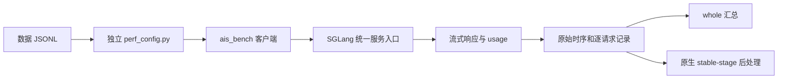

# 用 AISBench 压测 SGLang：从第一条请求到一份可信报告

接口能回答，离一份可比较的性能报告还差几步：客户端实际发了什么、服务跑的哪套配置、最后选了哪些请求。先用一条请求走通，再扩大，出了问题也容易查回原数据。

Flash/Ascend 910C PD 调优里，我们用 AISBench 测过短诊断、16K 零缓存、高 AL 复制、128K 缓存。常见故障在进程交接：封装生成参数不符、父进程有类但 worker 导入失败、推理结束后 native 缺模块。

下面从已有服务开始，依次核接口、JSONL、配置、负载、结果目录，再用同轮原数据算 whole、native。

[完整示例目录](../../examples/aisbench-sglang/README.md)有配置、4条JSONL、运行与检查脚本，绑定AISBench/benchmark [`e00d1f7`](https://github.com/AISBench/benchmark/tree/e00d1f758310c45580576af291a3126919776c89)，与历史审计基准一致。现场还改过300秒超时、计数observer另绑源码，所以历史环境并非原版默认。

## 一、先分清是谁在发请求

现场常用`aisbench_test.py`读取同目录`config.py`，生成数据、临时模型配置、JSONL 连接，最后启动`ais_bench`。

它是现场封装。工具本身可独立配置模型、数据、汇总，也可合在一个Python文件，见[官方自定义配置说明](https://ais-bench-benchmark-rf.readthedocs.io/en/v3.1-20260903-master/advanced_tutorials/run_custom_config.html)。排参数先确定是哪一层。

本例直接将`perf_config.py`作为位置参数，每轮放独立实验目录，避免共享临时文件、软链接相互覆盖。



PD 客户端访问统一入口，由服务分 P、D，直接打内部端口可能绕过交接。本例假定服务、路由就绪，脚本不重启、不改缓存。

客户端复用兼容环境即可。新建 Linux Bash 环境并检出固定提交：

```bash
mkdir -p "$HOME/aisbench-sglang-lab"
cd "$HOME/aisbench-sglang-lab"
python3.11 -m venv .venv
source .venv/bin/activate
git clone https://github.com/AISBench/benchmark.git aisbench
git -C aisbench checkout e00d1f758310c45580576af291a3126919776c89
python -m pip install -e ./aisbench
git clone https://github.com/AkiYangDev/llm-inference-notes.git notes
cd notes/examples/aisbench-sglang
```

该提交依赖 torch，客户端示例只通过 HTTP 调用已有模型。客户端依赖、服务环境分别记录。

## 二、先用一条请求确认接口与模型名

先确认入口、服务 model id、客户端可读 tokenizer 目录。

`model`进入请求字段，匹配服务 id；`path`提供客户端 tokenizer。即使两者都写权重路径，用途也不同。

本机端口示意，按服务替换：

```bash
export HOST_IP=127.0.0.1
export HOST_PORT=30000
export SERVED_MODEL=deepseek-v4-flash
export TOKENIZER_PATH=/models/DeepSeek-V4-Flash
export API_KEY=""
export AIS_DATASET="$PWD/data.jsonl"

curl --fail --silent --show-error \
  -H "Authorization: Bearer ${API_KEY}" \
  "http://${HOST_IP}:${HOST_PORT}/v1/models"
```

将`SERVED_MODEL`设为返回 id，继续查聊天接口，JSON 中的别名也一并匹配：

```bash
curl --fail --no-buffer \
  "http://${HOST_IP}:${HOST_PORT}/v1/chat/completions" \
  -H 'Content-Type: application/json' \
  -H "Authorization: Bearer ${API_KEY}" \
  --data-binary '{"model":"deepseek-v4-flash","messages":[{"role":"user","content":"用一句话解释KV Cache。"}],"stream":true,"stream_options":{"include_usage":true},"temperature":0,"max_tokens":32}'
```

curl 核流式事件、usage 计数，也会真实执行、改变热状态，单独归准备成本。

适配器用`host_ip`、`host_port`拼`v1/chat/completions`，host_ip 不填完整 URL。HTTPS、代理前缀按该版 base URL 规则配置，再看实际请求日志。

`VLLMCustomAPIChat(stream=True)`也能请求 SGLang 兼容接口，类名不限制服务框架。旧`VLLMCustomAPIChatStream`在此版本已提示弃用。

## 三、把一条 JSONL 怎样变成请求写清楚

4 条 JSONL 各含 question、answer：

```json
{"question":"请求编号A001。请用三句话解释大模型推理中的Prefill阶段。","answer":""}
```

`reader_cfg`读 question，零样本 retriever 不加示例，模板`{question}`交聊天模型。空 answer 只满足结构，不用于精度评分。

本例 CustomDataset 直接读文件；历史封装用 GSM8KDataset，要求 train.jsonl、test.jsonl 和目录/软链接约定。同为 JSONL，loader 路径要求仍可能不同。

4 条仅接流程，没有固定 Token 长。长输入先用实际 tokenizer 核正文，再看 Chat 完整长度。本次 16K 为 16384→16388，额外 4 来自当时编码，不能移给别的模型。

示例输出上限 32，正式后来 1024，配合`temperature=0`、`ignore_eos=True`。实际 completion 计数仍需核验，提前结束会改变工作量、TPOT。

末尾编号不同，前面仍可能共享；旧后缀还可能跨轮命中。cache0、90%都按实际计数验，见[128K 缓存场景校准](128k-prefix-cache-benchmark-calibration.md)。

## 四、先跑 1 条，再跑 4 条

[`perf_config.py`](../../examples/aisbench-sglang/perf_config.py)读地址、tokenizer、数据、负载环境变量，用完整点分类型名，让保存配置可被新进程导入。

关闭 lazy，解析时读环境。检查走真实 MMEngine Config、dump、新进程 reload，只查结构，不加载 tokenizer、不构造模型、不访问服务，随后一条请求再核 worker、HTTP：

```bash
python validate_config.py
NUM_REQUESTS=1 CONCURRENCY=1 REQUEST_RATE=1 bash run.sh
NUM_REQUESTS=4 CONCURRENCY=2 REQUEST_RATE=1 bash run.sh
```

[`run.sh`](../../examples/aisbench-sglang/run.sh)实际调用为：

```text
ais_bench perf_config.py --mode perf --summarizer default_perf
          --num-prompts N --num-warmups 0 --work-dir 本轮独立目录 --debug
```

脚本中`set -euo pipefail`让 AISBench 非零退出穿过 tee，传回调用端。

该版自动 warmup 默认 1，本例显式 0，便于核总发送量。初始化、seed、短测按场景另记，关自动 warmup 并不代表服务已热。

一条先看失败、计数、回包，再四条核数据、落盘。短表中的吞吐、TPOT 只验证流程。

## 五、请求数、并发和速率要一起看

负载参数分别控制：

| 变量 | 实际作用 |
| --- | --- |
| `--num-prompts` | 本轮选取的请求数，不负责生成实体数据 |
| `batch_size` | 此 API 推理路径的配置并发上限 C |
| `request_rate` | 客户端到达节奏；示例从 1 req/s 开始，0 表示不按该速率限流 |
| `max_out_len` | 请求输出上限，仍需核对实际输出 |
| `retry` | 该固定实现按 `range(self.retry)` 尝试发送，本例设 1，只尝试一次 |

N640 为总量、C90 为在途上限、r6 为到达节奏。等待额度、服务排队、升载收尾让实际并发、完成 QPS 偏离配置。

[`BaseAPIModel.generate()`](https://github.com/AISBench/benchmark/blob/e00d1f758310c45580576af291a3126919776c89/ais_bench/benchmark/models/api_models/base_api.py#L450)使用`for _ in range(self.retry)`，因此 retry=1 总共一次，retry=0 不发送。先保留失败，需要重试就另记实际尝试、发送数。

扩大前换已核数据，README 的 N640 要求至少 640 实体行。配置同时留模型、两端源码、物理卡、长度、数据 SHA、缓存、采样、N/C/r、窗口。

提高r未必提高完成量，旧场景曾遇平台；另一高AL场景改善P合批才提速，见[那次实验](decode-fast-throughput-limited-by-prefill.md)。队列、接纳与负载一起解释结果。

## 六、从 whole 走到稳态，保留同一轮原始数据

结果目录从实际日志找，OUT下还有工具时间戳，`performances/<model_abbr>/`放JSON、分布CSV、details JSONL、后处理数据库。配置、日志、数据库一起留档，才能重算。

本文将default_perf的total称whole。stable_stage按并发事件选样，[源码](https://github.com/AISBench/benchmark/blob/e00d1f758310c45580576af291a3126919776c89/ais_bench/benchmark/calculators/stable_perf_metric_calculator.py#L64)从第二次达到最大并发开始，再确定终点，选开始时间在区间内的请求，没有按快慢删数据。

小负载可能没有稳定段，选出来还需看样本、时长。128 条/60 秒是本项目约定，不是工具对所有工作点的定义。

[工作流](https://github.com/AISBench/benchmark/blob/e00d1f758310c45580576af291a3126919776c89/ais_bench/benchmark/cli/workers.py)仅后处理。按[示例 README](../../examples/aisbench-sglang/README.md)填原work-dir、时间戳，备份whole，再用`--mode perf_viz --reuse 时间戳 --summarizer stable_stage`重算，防新结果覆盖原路径。

以下复用封存 Flash/Ascend 910C、PD16 卡、128K 正文/Chat 131076、1024 输出、复制集、逐条 90.6222%、N640/C90/r6：

| 指标 | whole | 原生稳态 native |
| --- | ---: | ---: |
| 纳入请求数 | 640 | 549 |
| 区间时长（s） | 179.5766 | 143.4935 |
| 平均系统并发 | 82.8179 | 87.4978 |
| TTFT 平均（ms） | 12681.9 | 12250.2 |
| TPOT 平均（ms） | 10.3 | 10.4 |
| E2E 平均（s） | 23.2377 | 22.8695 |
| 输出总吞吐（token/s） | 3649.4736 | 3917.7796 |
| 输出 / PD16 物理卡（token/s） | 228.0921 | 244.8612 |

两列来自同一轮，native较高只因窗口不同。whole640成功、0失败，接受、缓存计数见[随文证据](../../assets/aisbench-sglang-first-request-to-report/evidence.json)。

Min、Max、Median、P75、P90、P99、样本一起保留。TTFT、E2E、TPOT、ITL 各有起止、分母；多 Token 流式事件下尤其要区分。系统总吞吐和每请求速率也分开读。

每卡除 P+D 物理 16。改除 D8，数字翻倍，服务没变。QPS、输入加输出吞吐、名义输入中的缓存，继续按各自名字报告。

## 七、报告出错，先判断推理执行到哪一步

曾有推理已结束、native 却无法导入`ais_prefix_cache`。原 details 还在，就先确认服务、原请求，修导入后重算。

实际请求失败再查状态码、URL、model id、服务日志；未发请求则修配置。执行到哪一步，决定补模块、算报告还是修服务。

基础流程通了再加投机、缓存字段，逐层核服务生成、客户端保留、写盘、后处理，计数缺失记未观测。流式解析、计时继续沿原实现。

本例已核 JSONL、固定源码、CLI，并走过真实 MMEngine 序列化、新进程读取，没有连接当前服务重发请求。表里为既有封存性能。

最终报告对应到具体配置、数据、原时间线：实际发多少、完成多少、缓存满足什么、哪些请求入选。这样一张性能表才有明确比较对象。
