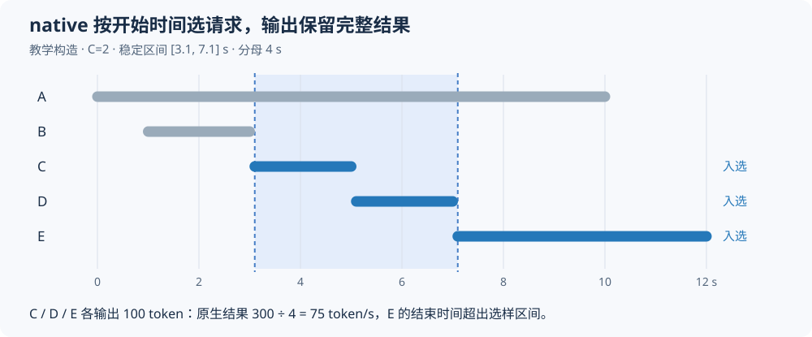

# AISBench 的 whole、native、TPOT 和 ITL，到底在量什么？

一轮压测里，TPOT 从 8.8 ms 涨到 9.4 ms，每卡输出吞吐却从 179.04 涨到 236.83 token/s。另一轮报告更容易让人疑惑：平均 TPOT 只有 10.4 ms，平均 ITL 却有 58.6 ms。

两组都是真实的 DeepSeek-V4-Flash、Ascend 910C PD 测试。第一组用 16K 输入、零缓存，比较 Prefill 合批；第二组用 128K 输入、约 90% 前缀命中。这里借它们解释指标，各自的负载仍需分开看。

这些数字没有互相否定。TPOT、ITL、系统吞吐各自取了不同的时间点、样本和分母，下面从一条请求的时间线开始算。

源码固定在 AISBench [e00d1f7](https://github.com/AISBench/benchmark/tree/e00d1f758310c45580576af291a3126919776c89)。实验记录把原生 `StablePerfMetricCalculator` 的结果叫 native，源码阶段名是 `stable`；whole 对应默认计算器的 `total`。这两种统计没有切换服务端推理模式。原始数值和完整统计行在[脱敏证据](../../assets/aisbench-whole-native-tpot-itl/evidence.json)中。

## 一、先沿一条请求走完时间线

一条流式请求在客户端留下这样的时间线：

~~~text
t0              t1          t2          t3        …        tm
准备发送 POST    首个记点事件  后续事件    后续事件             最后记点事件
|---------------|-----------|-----------|-------------------|
     TTFT                 首个事件之后的流式阶段
|---------------------------------------------------------|
                         E2E
~~~

这版代码在 HTTP POST 发起前记录 `t0`，随后每个通过过滤的 SSE 数据事件都先记时间，再交给响应解析函数。空行、注释和 `[DONE]` 不增加记点。因此 `tm` 对应最后一个记点事件，不是连接关闭或脚本退出的时刻，也不是某个服务端算子完成的时刻。实现见 [stream_infer](https://github.com/AISBench/benchmark/blob/e00d1f758310c45580576af291a3126919776c89/ais_bench/benchmark/models/api_models/base_api.py)。

从这个位置看，请求会经历网络、服务排队、Prefill、PD 交接和 Decode，任何一段都可能增加客户端延迟。发送前等待客户端并发槽位的时间，则未自动包含在 `t0 → tm` 中。

TTFT 大，首先说明首个记点事件来得晚。要继续判断晚在队列、Prefill 还是 PD 交接，需要把服务侧记录接上这条时间线。

首个记点甚至未必有正文：角色或 reasoning 事件也可能被计时，尾部 usage、metadata-only 事件则可能推后 `tm`。实际回包决定这些点落在哪里，[流式计数与计时](sglang-stream-acceptance-cache-timing.md)讨论了怎样保存计数并保留原计时。

## 二、TPOT 摊的是 token，ITL 数的是事件间隔

实际输出为 `L` 个 token 时，汇总器这样计算：

| 指标 | 单请求计算方式 | 读数含义 |
| --- | --- | --- |
| E2E / E2EL | `tm − t0` | 从发送前记点到最后记点事件 |
| TTFT | `t1 − t0` | 到首个记点事件的等待 |
| TPOT | `(tm − t1) / (L − 1)`，L > 1 | 把首事件后的时间摊到其余输出 token |
| ITL | `t2−t1, t3−t2, …, tm−t(m−1)` | 相邻已记点流式事件的间隔 |

对应实现是 [DefaultPerfSummarizer._calc_perf_data](https://github.com/AISBench/benchmark/blob/e00d1f758310c45580576af291a3126919776c89/ais_bench/benchmark/summarizers/default_perf.py)。输出长度优先取可用的服务返回值，缺失时相关分支才用 tokenizer 补算；配置中的最大输出长度不能直接拿来充当实际 `L`。

设一条教学请求在 0 ms 发出，100、160、220 ms 收到三个记点事件，最终输出 13 token：

~~~text
E2E  = 220 ms
TTFT = 100 ms
TPOT = (220 − 100) / (13 − 1) = 10 ms
ITL  = [60 ms, 60 ms]
~~~

客户端每隔 60 ms 收到更新，token 却能平均摊到 10 ms，因为一个事件可以带多个 token。投机解码接受候选后，还会经过文本解码和输出缓冲，事件到达与模型逐 token 计算并不是同一条时间线。

128K 实测的 native 结果也有这个差别：

| 指标 | Average | P90 |
| --- | ---: | ---: |
| TPOT | 10.4 ms | 11.0 ms |
| ITL | 58.6 ms | 76.7 ms |
| E2E | 22.8695 s | 24.5766 s |

ITL 表示两次客户端更新之间的等待，TPOT 则把首事件后的时间摊到输出 token 上。单事件 token 数、事件聚合、尾部 metadata 和样本权重都会影响二者的比值，所以不能拿这个比值直接算 AL 或接受率。

删掉无正文事件会改变 ITL 的样本数；删掉尾部事件还会移动 `tm`，连 E2E、TPOT 一起改变。若想看“相邻正文更新间隔”，可以另算并单独命名，原 AISBench 指标仍需保留。

## 三、Average 和 P90 的样本也不一样

TTFT、TPOT、E2E 先在每条成功请求上各算一个值，再对请求求分布。TPOT P90 因而是单请求平均 TPOT 的第 90 百分位。

ITL 的做法不同：先把各请求的间隔数组拼在一起，再求 Average、P90。事件多的请求自然贡献更多样本。[BasePerfMetricCalculator](https://github.com/AISBench/benchmark/blob/e00d1f758310c45580576af291a3126919776c89/ais_bench/benchmark/calculators/base_perf_metric_calculator.py)中的 `np.concatenate` 和 `np.percentile` 对应这一步。

例如请求 A 贡献两个间隔 `[50, 50]` ms，请求 B 贡献一个 `[1]` ms，合并均值为：

~~~text
(50 + 50 + 1) / 3 = 33.67 ms
~~~

若先各算请求均值，再让两条请求等权平均，结果就是 `(50 + 1) / 2 = 25.5 ms`。两个算法的权重不同，数值自然不同。

还有一个表头容易读错：这版 ITL 行的 `N` 写的是具有非零 Decode 间隔的请求数。N=549 并不表示只有 549 个间隔参与 P90，间隔总数要另外统计。

默认表提供 Average、Min、Max、Median、P75、P90、P99，没有 P95。补算 P95 需要原样本，只凭 P90、P99 恢复不了。P90 也不是达标率；“TPOT < 20 ms 的请求占多少”要逐条判断，并写出请求分母。

同样不能把不同指标的分位数拼起来：`P90(E2E)` 不等于 `P90(TTFT) + 1023 × P90(TPOT)`。三个第 90 百分位未必落在同一条请求上。

## 四、whole 看完整一轮，native 怎样选出稳定段

whole 用有效时间明细中最早的开始、最晚的结束划定边界。本文轮次全部成功，对应第一条正式请求发送前的记点，到最后一条正式请求的最后记点事件。

native 先选样。固定版本的 [StablePerfMetricCalculator](https://github.com/AISBench/benchmark/blob/e00d1f758310c45580576af291a3126919776c89/ais_bench/benchmark/calculators/stable_perf_metric_calculator.py) 把所有开始、结束时刻排成事件序列，沿序列累加客户端在途数：

1. 请求开始使在途数达到配置上限 C，记一次“到达 C”。
2. 第二次通过请求开始到达 C 的时刻，作为稳定段起点。
3. 最后一个处理后在途数等于 C 的事件时刻，作为终点。
4. 开始时间落在这个闭区间内的请求，进入 native 样本。

“第二次到达 C”是再次达到在途上限，既不是第二条请求，也不是第二轮预热。两个边界之间可以有并发波动；没有第二次到达 C 时，选择器会报找不到稳定阶段。

选完之后，吞吐的分母取稳定区间时长，分子和延迟却取入选请求的完整结果。它并没有逐 token 裁掉区间外的输出。

图中设 C=2。第一次达到 C 是 1 s，第二次是 3.1 s，最后一次是 7.1 s，于是选中 `[3.1, 7.1]` 这 4 s，以及 C、D、E 三条请求。即使 E 到 12 s 才结束，三条各输出 100 token 时，仍用完整 300 token 除以 4 s，得到 75 token/s。E 在区间结束后输出的 token 也算进了分子。

因此 native 衡量的是稳定段选出的请求，而非严格落在任意连续 4 秒内的设备产出。区间越短，边界请求的影响越明显。当时实验要求长窗口确认至少选入 128 条、持续至少 60 秒，这是我们的实验约定，AISBench 没有规定这组通用门槛。

whole 保留爬升和收尾，native 帮助观察高负载区间；入选数、持续时间和并发曲线要与二者一起看。若确实要量固定墙钟窗口内的产出，需要输出事件或逐 token 时间记录，重新定义统计。

## 五、配置 C、系统并发和 QPS，怎样放在一张表里

C=90 限制的是客户端在途请求上限。服务内部 running、waiting 和 Decode batch 各有自己的变化过程，不能把它们直接写成 90。

默认计算器这样给出 `Concurrency`：

~~~text
平均客户端在途数 = 入选请求 E2E 之和 / 统计时长
~~~

对于覆盖完整请求的 whole，每条请求的在途时长相当于一块面积，总面积除以总时长就是平均在途数。服务端排队也占这块面积，所以它与 P、D 内部的 batch size 不是同一个量。

native 仍将入选请求的完整 E2E 求和，除以稳定区间时长，再按 C 封顶。上一节的例子算出 `8.7/4=2.175`，最终显示为 2。报告里 Concurrency=C 可能只是触发了封顶，不能据此证明整段一直满并发。

实际 C90 那轮使用 W8A8、P8+D8 共 16 张物理卡，做高 AL 复制任务。正文 131072 token，Chat 后实际输入 131076，每条输出 1024，逐条缓存命中 `118784/131076=90.6222%`，目标频率 6 req/s：

| 区间 | 发送 / 纳入请求 | C | AIS Concurrency | 时长(s) | QPS | E2E均值(s) | 总输出吞吐(token/s) | 每PD16卡(token/s) |
| --- | ---: | ---: | ---: | ---: | ---: | ---: | ---: | ---: |
| whole | 640 / 640 | 90 | 82.8179 | 179.5766 | 3.5639 | 23.2377 | 3649.4736 | 228.0921 |
| native | 640 / 549 | 90 | 87.4978 | 143.4935 | 3.8260 | 22.8695 | 3917.7796 | 244.8612 |

whole 一行满足 `3.5639 × 23.2377 ≈ 82.8179`，对应完成速率、平均 E2E 与平均在途数的求和关系。表中值已经舍入，重算会留下一点误差。

其中 6 req/s 是发起侧的目标，3.5639 req/s 才是整轮成功数除以时长。并发上限、请求驻留、爬升和收尾都能拉低后者，单凭这个差值还找不到具体服务瓶颈。

整轮 640 条中，native 选入 549 条。whole AL=5.7760 来自整轮输出和 verify 计数；native 没有独立的接受计数分母，仍记未观测。这轮也没采到实际 proposal 对应的严格接受率，以及 draft/verify 阶段耗时，AL 无法替代它们。

## 六、两个“输出 token/s”，为何能差近百倍

统计表中 `OutputTokenThroughput` 的分布先逐请求计算：

~~~text
单请求速率 = 该请求输出 token 数 / 该请求 E2E
~~~

summary 中的 `Output Token Throughput` 则汇总入选请求：

~~~text
系统输出吞吐 = 所有入选请求的输出 token 总数 / 统计时长
~~~

前面 whole 的逐请求速率 Average 为 44.361 token/s，系统输出吞吐则为 3649.4736 token/s。多个请求同时在运行，所以整套系统的完成速率可以远高于单条请求的平均速率。

单请求速率用 L 除以完整 E2E，包含 TTFT；TPOT 去掉首事件等待，再按 L−1 分摊，因而也不能简单取 `1000/TPOT`。先对每条请求的速率求平均，还不同于平均输出长度除以平均 E2E。

再看开头那组 16K 对照。两边均为 N640/C128/6 req/s，实际输入 16388、输出 1024、cache=0，静态布局、Compact6、自动 SPS 相同，只把 P 端 Prefill 合批槽位从 1 改成 2。

| 原生稳定段指标 | Pcap1 | Pcap2 |
| --- | ---: | ---: |
| TPOT平均(ms) | 8.8 | 9.4 |
| 输出吞吐(token/s/PD16卡) | 179.0441 | 236.8268 |

Prefill 更快地向下游供给请求后，系统吞吐提高约 32.27%，单请求 TPOT 则略升。[《Decode 已经很快了，吞吐为什么上不去？》](decode-fast-throughput-limited-by-prefill.md)进一步解释了这段流水线。这个选择要看吞吐和延迟能否共同满足目标，最低 TPOT 本身不够决定配置。

每卡吞吐还取决于除数。本次除以 P8+D8 共 16 张物理卡；只除 D 端 8 卡时应标明 D8 归一化。后者数值翻倍，整套系统产出没有变化。

输入加输出吞吐中的输入包括命中前缀，表示请求承载的逻辑 token。它不能代表新增 Prefill 计算量，更不能换个单位就当成访存或通信带宽。

## 七、拿到报告后，我会按这个顺序读

面对一份报告，我先找实际负载和分母：模型、设备、输入输出、缓存、投机采样设置，发了多少、成功多少，whole 和 native 各选了谁、除以多长时间。短测可筛选配置，持续吞吐还得由足够长的窗口确认。

再把延迟放回请求时间线。TPOT 低、ITL 高，就查事件携带多少输出、是否缓冲、尾部还有哪些事件；TTFT 涨而 TPOT 平稳，就接着查首事件前的队列、Prefill、PD 交接。客户端指标提供方向，服务记录负责定位。

比较两轮吞吐时，我会把 whole、native 同时留下，对齐负载、时间分母和设备归一化。失败也保留原错误和数量；某条失败请求没有有效时间点时，成功分布恢复不了它等了多久。

[离线算例](../../examples/aisbench-metrics/README.md)只用 Python 标准库，就能重算 TPOT/ITL、两种权重平均和 native 边界，不需要启动模型。报告里出现看似矛盾的数字时，先按原算法算一遍，往往比立刻改配置更容易找到原因。
