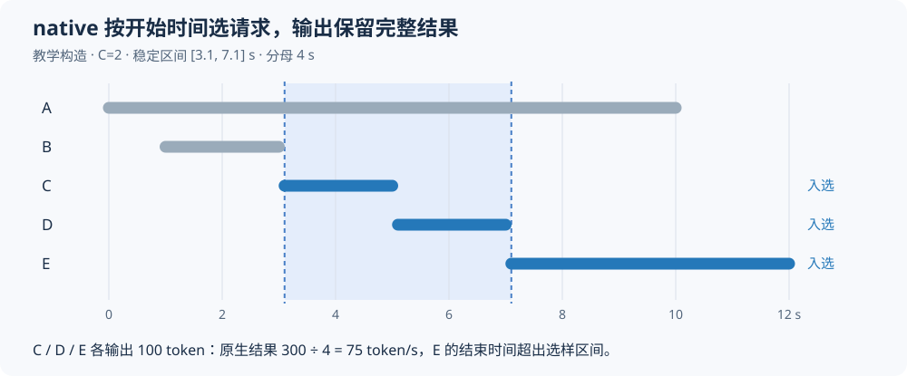

# AISBench 的 whole、native、TPOT 和 ITL，到底在量什么？

我们曾在两轮报告中遇到容易误读的数字。一组 TPOT 从 8.8 ms 升到 9.4 ms，输出吞吐却从 179.04 提高到 236.83 token/s/卡；另一轮平均 TPOT 为 10.4 ms，平均 ITL 达到 58.6 ms。

两组均来自 DeepSeek-V4-Flash、Ascend 910C 的真实 PD 测试。前者使用 16K 输入、零缓存，比较 Prefill 合批；后者使用 128K 输入、约 90% 前缀命中。它们用于解释不同指标，负载本身不能直接比较。

这些结果可以同时成立，因为时间和吞吐指标各有观察位置、样本与分母。先明确每个数字怎样计算，才能判断它反映的是请求等待、流式输出还是整套系统的完成速度。

下文按 AISBench 固定提交 [e00d1f7](https://github.com/AISBench/benchmark/tree/e00d1f758310c45580576af291a3126919776c89) 解释。native 是实验记录对原生 `StablePerfMetricCalculator` 结果的称呼，源码阶段名为 `stable`；whole 对应默认计算器的 `total`。它们没有切换服务端推理模式，只改变客户端的统计范围。真实数值与完整统计行见[脱敏证据](../../assets/aisbench-whole-native-tpot-itl/evidence.json)。

## 一、先沿一条请求走完时间线

客户端记录一条流式请求的时间线如下：

~~~text
t0              t1          t2          t3        …        tm
准备发送 POST    首个记点事件  后续事件    后续事件             最后记点事件
|---------------|-----------|-----------|-------------------|
     TTFT                 首个事件之后的流式阶段
|---------------------------------------------------------|
                         E2E
~~~

该版本在 HTTP POST 发起前记录 `t0`，随后每解析到一个通过过滤的 SSE 数据事件，先记时间，再调用响应解析函数。空行、注释和 `[DONE]` 不生成后续记点。因此 `tm` 是最后记点事件到达的时间，不能当作连接关闭、脚本退出或服务端算子完成时间。入口见 [stream_infer](https://github.com/AISBench/benchmark/blob/e00d1f758310c45580576af291a3126919776c89/ais_bench/benchmark/models/api_models/base_api.py)。

从这个位置计时，网络、服务排队、Prefill、PD 交接和 Decode 都可能影响客户端延迟。进入发送流程之前，在客户端等待并发槽位的时间，则未自动计入请求的 `t0 → tm`。

因此，TTFT 大只说明首个记点事件来得晚。要区分排队、Prefill 或 PD 交接，还需对应服务侧记录，单项客户端延迟无法拆出各阶段。

首个记点也未必带正文 token。服务返回的角色、reasoning 等数据事件同样可能被计时；尾部 usage 或 metadata-only 事件还可能推迟结束点。具体应按实际回包核对，保留这些字段且不改变原计时的方法见[流式计数与计时](sglang-stream-acceptance-cache-timing.md)。

## 二、TPOT 摊的是 token，ITL 数的是事件间隔

假设请求实际输出 `L` 个 token，汇总器按下面方式计算：

| 指标 | 单请求计算方式 | 读数含义 |
| --- | --- | --- |
| E2E / E2EL | `tm − t0` | 从发送前记点到最后记点事件 |
| TTFT | `t1 − t0` | 到首个记点事件的等待 |
| TPOT | `(tm − t1) / (L − 1)`，L > 1 | 把首事件后的时间摊到其余输出 token |
| ITL | `t2−t1, t3−t2, …, tm−t(m−1)` | 相邻已记点流式事件的间隔 |

公式对应 [DefaultPerfSummarizer._calc_perf_data](https://github.com/AISBench/benchmark/blob/e00d1f758310c45580576af291a3126919776c89/ais_bench/benchmark/summarizers/default_perf.py)。输出 token 数优先取可用的服务返回值，缺失时相关分支用 tokenizer 补算。因此实际 `L` 需要读取结果，不能直接采用配置中的最大输出长度。

用一个教学例子计算：请求在 0 ms 发出，100、160、220 ms 分别收到三个记点事件，实际输出 13 token。

~~~text
E2E  = 220 ms
TTFT = 100 ms
TPOT = (220 − 100) / (13 − 1) = 10 ms
ITL  = [60 ms, 60 ms]
~~~

一个事件可以携带多个 token。投机解码接受候选后，还可能经过文本解码与输出缓冲才发送事件。于是 token 平均摊到 10 ms，同时客户端每隔 60 ms 才收到一次更新，两项计算并不冲突。

实际 128K 测试的 native 结果也呈现了这种差别：

| 指标 | Average | P90 |
| --- | ---: | ---: |
| TPOT | 10.4 ms | 11.0 ms |
| ITL | 58.6 ms | 76.7 ms |
| E2E | 22.8695 s | 24.5766 s |

ITL 描述两次客户端更新之间的等待，TPOT 将首事件后的时间分摊到输出 token。两者的比值可能受到单事件 token 数影响，也混有事件聚合、尾部 metadata 和样本权重，不能直接反推 AL 或接受率。

若为了缩短 ITL 删除无正文事件，间隔样本数就变了；删除末尾事件还可能改变 `tm`，进而改变 E2E 和 TPOT。确实需要“相邻正文更新间隔”时，应单独命名计算，并保留 AISBench 原指标。

## 三、Average 和 P90 的样本也不一样

TTFT、TPOT、E2E 都先为每条成功请求得到一个值，再对这些值求分布。因此 TPOT P90 是单请求平均 TPOT 的第 90 百分位。

ITL 则先合并每条请求的间隔数组，再计算 Average 和 P90。事件多的请求会贡献更多样本，源码中的 [BasePerfMetricCalculator](https://github.com/AISBench/benchmark/blob/e00d1f758310c45580576af291a3126919776c89/ais_bench/benchmark/calculators/base_perf_metric_calculator.py) 通过 `np.concatenate` 和 `np.percentile` 完成这项统计。

例如，请求 A 有 `[50, 50]` ms 两个间隔，请求 B 只有 `[1]` ms 一个间隔，合并后的 ITL 均值为：

~~~text
(50 + 50 + 1) / 3 = 33.67 ms
~~~

先分别算请求均值、再对两条请求等权平均，则得到 `(50 + 1) / 2 = 25.5 ms`。两种统计赋予请求的权重不同，报告中应说明实际采用哪种。

该版本 ITL 行的 `N` 填写具有非零 Decode 间隔的请求数，未填写拼接后的间隔总量。因此 N=549 不表示只用了 549 个间隔算 P90；核对事件分布时，还需单独统计间隔数。

默认统计项包含 Average、Min、Max、Median、P75、P90、P99。原表没有 P95，只能从原样本补算，P90 与 P99 无法恢复它。P90 也不表示达标率；若要统计“TPOT < 20 ms 的请求比例”，需要按条件逐条计数，并给出请求分母。

不同指标的分位数也不能相加。`P90(E2E)` 不等于 `P90(TTFT) + 1023 × P90(TPOT)`，因为三个分布的第 90 百分位可能来自不同请求。

## 四、whole 看完整一轮，native 怎样选出稳定段

whole 取有效时间明细中最早开始、最晚结束作为边界。本文这些轮次全部成功，所以它覆盖第一条正式请求发送前记点，到最后一条正式请求的最后记点事件。

native 会先选稳定段。固定 [StablePerfMetricCalculator](https://github.com/AISBench/benchmark/blob/e00d1f758310c45580576af291a3126919776c89/ais_bench/benchmark/calculators/stable_perf_metric_calculator.py) 将所有开始、结束时间排成事件序列，累计客户端在途数：

1. 请求开始使在途数达到配置上限 C，记一次“到达 C”。
2. 第二次通过请求开始到达 C 的时刻，作为稳定段起点。
3. 最后一个处理后在途数等于 C 的事件时刻，作为终点。
4. 开始时间落在这个闭区间内的请求，进入 native 样本。

第二次到达 C 指在途数再次达到上限，不是第二条请求或第二轮预热。起止之间即使出现并发波动，也仍可能被选中；若没有第二次到达 C，选择器则会报找不到稳定阶段。

选样以后，计算还存在一处边界差别：分母使用稳定区间时长，输出 token 和延迟使用入选请求的完整结果。算法没有根据逐 token 发送时间裁掉区间外输出。

图中为 C=2 的教学例子。第一次达到 C 在 1 s，第二次在 3.1 s，最后一次在 7.1 s。因此选择 `[3.1, 7.1]`、共 4 s 区间，纳入 C、D、E 三条请求。E 虽到 12 s 才结束，若三条各输出 100 token，算法仍计入完整 300 token，除以 4 s 得到 75 token/s，其中包含 E 在区间结束后的输出。

所以该版本 native 使用稳定段选样，并非严格计算任意连续 4 秒内设备实际产出的 token。区间短时，边界请求影响更大。我们将至少 128 条入选请求、区间至少 60 秒作为当时长窗口确认的最低要求；这是实验约定，不是 AISBench 规定的通用阈值。

whole 保留爬升与收尾，native 用于观察高负载区间，两者应连同并发曲线、入选数和持续时间一起报告。如果需要严格墙钟窗口内的产出，还需输出事件或逐 token 的时间记录，再单独统计，不能直接重命名 native。

## 五、配置 C、系统并发和 QPS，怎样放在一张表里

配置 C=90 限制客户端最多允许多少在途请求。服务端实际运行数、Decode batch 都需要另外观察，不一定持续等于 90。

默认计算器使用下面的 `Concurrency` 公式：

~~~text
平均客户端在途数 = 入选请求 E2E 之和 / 统计时长
~~~

对覆盖完整请求的 whole，可以将每条请求的在途时间看作面积，再除以总时长。服务端排队时间也计入客户端在途，不能直接对应 P、D 内部的 running、waiting 或 batch size。

native 仍用入选请求完整 E2E 求和、除以稳定区间时长，最后再按 C 封顶。上节例子算得 `8.7/4=2.175`，显示值会限制为 2。因此 Concurrency=C 可能来自封顶，无法单靠这格判断区间一直满并发。

实际 C90 测试使用 W8A8，P8+D8 共 16 张物理卡，负载为高 AL 复制任务。正文 131072 token，实际 Chat 输入 131076，每条输出 1024；逐条缓存命中为 `118784/131076=90.6222%`，目标请求频率 6 req/s。结果如下：

| 区间 | 发送 / 纳入请求 | C | AIS Concurrency | 时长(s) | QPS | E2E均值(s) | 总输出吞吐(token/s) | 每PD16卡(token/s) |
| --- | ---: | ---: | ---: | ---: | ---: | ---: | ---: | ---: |
| whole | 640 / 640 | 90 | 82.8179 | 179.5766 | 3.5639 | 23.2377 | 3649.4736 | 228.0921 |
| native | 640 / 549 | 90 | 87.4978 | 143.4935 | 3.8260 | 22.8695 | 3917.7796 | 244.8612 |

whole 中 `3.5639 × 23.2377 ≈ 82.8179`，与平均在途数对应。这是同一组请求的求和关系，使用表中舍入值重算会有误差。

6 req/s 是发起侧配置目标，3.5639 req/s 则来自整轮成功数除以时长。并发上限、请求驻留、爬升和收尾都会影响后者。QPS 低于目标频率时，还不能直接定位到某个服务阶段。

整轮发送 640 条，native 选入 549 条。whole AL=5.7760 来自整轮输出与 verify 计数；native 缺少独立接受计数分母，仍标为未观测。这份结果也没有采到实际生成 proposal 的严格接受率及 draft/verify 阶段耗时，不能由 AL 补算。

## 六、两个“输出 token/s”，为何能差近百倍

统计表 `OutputTokenThroughput` 的分布，先逐请求计算：

~~~text
单请求速率 = 该请求输出 token 数 / 该请求 E2E
~~~

summary 的 `Output Token Throughput` 则使用所有入选请求：

~~~text
系统输出吞吐 = 所有入选请求的输出 token 总数 / 统计时长
~~~

前面 whole 的单请求速率 Average 为 44.361 token/s，系统输出吞吐为 3649.4736 token/s。两者相差很大，是因为系统同时处理许多请求。

单请求速率包括 TTFT，用完整 E2E 作分母、输出长度 L 作分子；TPOT 则去掉首事件等待、按 L−1 分摊，因此速率也不等于 `1000/TPOT`。逐请求速率求平均，还不同于平均输出长度除以平均 E2E。

开头的 16K 对照只将 P 端 Prefill 合批槽位从 1 调到 2。两臂均为 N640/C128/6 req/s，实际输入 16388、输出 1024、cache=0，静态布局、Compact6、自动 SPS 等配置保持一致。

| 原生稳定段指标 | Pcap1 | Pcap2 |
| --- | ---: | ---: |
| TPOT平均(ms) | 8.8 | 9.4 |
| 输出吞吐(token/s/PD16卡) | 179.0441 | 236.8268 |

Prefill 合批改善了流水线供给，系统吞吐提高约 32.27%，而单请求 TPOT 略升。机制见[《Decode 已经很快了，吞吐为什么上不去？》](decode-fast-throughput-limited-by-prefill.md)。因此选择配置时，需要同时比较请求延迟与系统吞吐，不能只找最低 TPOT。

每卡吞吐的除数也要写清。本次用系统吞吐除以 P8+D8 共 16 张物理卡；若只除以 D 端 8 卡，应标为 D8 归一化值。数值会翻倍，但系统总输出不变。

输入加输出吞吐也受缓存口径影响。此处输入数包含命中前缀，描述请求承载的逻辑 token，未代表新增 Prefill 计算量，更不能当作设备访存或通信带宽。

## 七、拿到报告后，我会按这个顺序读

读报告时，我先确认模型、设备、实际输入输出、缓存和投机采样配置，再核对发送数、成功数，以及 whole、native 各自纳入的请求和时间分母。短测用于筛选，持续吞吐结论需要足够长的统计窗口。

随后沿请求时间线理解 TTFT、TPOT、ITL 与 E2E。TPOT 低、ITL 高时，可以检查事件携带的输出量、缓冲和尾部事件；TTFT 增长、TPOT 平稳时，再查首事件前的排队、Prefill 与 PD 交接。分位数描述尾部，具体瓶颈仍需执行记录。

比较吞吐则保持同负载、同分母和同设备归一化口径，并同时报告 whole、native。有失败时保留失败数与原错误；若失败请求没有有效时间点，成功请求分布也无法恢复它的等待时间。

附带的[离线算例](../../examples/aisbench-metrics/README.md)仅依赖 Python 标准库，可以重算 TPOT/ITL、请求等权与事件等权平均，以及 native 选样边界，无须启动模型服务。拿到具体报告后，可先用这些关系核对数字，再判断是否需要查队列、改统计或调整配置。
