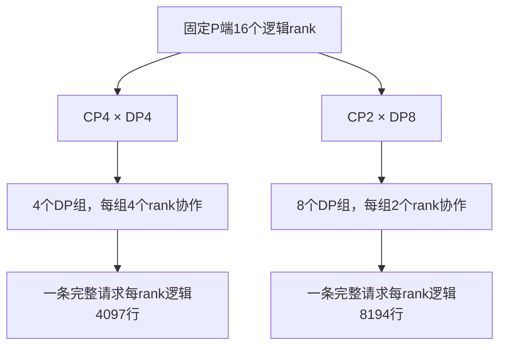

# CP2 替代 CP4：通信组变小了，为什么整体吞吐没有提高？

在一次 DeepSeek-V4-Flash / Ascend 910C 调优中，我们把 P 端从 CP4/DP4 改成 CP2/DP8。相同 N480、C88、4 req/s，正文16K、输出1K、零前缀命中，AISBench native 单卡输出吞吐从 181.2029 降到 179.5582 tok/s，变化约 **−0.91%**；whole 从 164.6732 降到 161.9804，约 **−1.64%**。

有意思的是，native mean TPOT 同时从 19.3ms 降到 17.2ms。若只看 Token 生成间隔，候选似乎更好；但 TTFT 升高，E2E 没有缩短，系统最终也没有更快完成这批请求。

这组负例最值得学习的地方，是 CP 调整会连带改变什么。“降低 CP 可以降低并行通信”只能作为待验证的动机，不能当成已实现的收益：本次 CP 组变小，DP 组数增加，单 rank 输入行数约翻倍，normal 通信还从一轮变成两轮。下面沿实际配置与源码，把这些变化和测量结果连起来。

本文复用2026年10月20日保存的运行快照、同负载报告及源码，软件版本记录为 `0.0.0.dev18433+gce0a8fea5.d20261013`，另有当时冻结的适配文件。它不是后来高 AL 复制负载的测试，也不能据此给所有 CP2/CP4 场景排名。完整配置、文件 SHA 与原值在[配套证据](../../assets/ascend-910c-cp2-vs-cp4/evidence.json)中。

## 1. 少一些人一起处理一条请求，多一些组同时处理不同请求

Context Parallelism 把一条请求的上下文计算分给多个 rank。CP4 表示一个 CP 组内有4个 rank 协作；CP2 则是2个。若固定这层 Attention 并行域的总 rank 数，缩小 CP 组，就可能划出更多处理不同请求的 DP Attention 组。

本次 P 的 TP16 逻辑域保持不变，实际配置从 CP4×DP4 变成 CP2×DP8。双方都开启 DP Attention 和 Prefill CP，使用 zigzag 策略；Pcap 均为1。资源仍是 P8+D8 共16张物理卡，软件的 rank/group 数不能直接换成物理卡数。

按该版本的 Attention 划分，组内 Attention TP 宽度在两边都是 `16/(DP×CP)=1`。启动命令里的 TP16 不是说每条请求的 Attention 都由16个 rank 一起做；Attention 的请求与上下文分组，和后面的 EP 专家分发，需要分别看。

这使 CP2/DP8 成为一个有理由尝试的候选：更多 DP 组提供更多独立请求的处理机会，较小 CP 组也改变了组内交互范围。但它没有让每条请求少做输入计算。对完整16388-token请求而言，每个参与 rank 分担的逻辑输入从4097行增至8194行。

如果各 DP 组都有可处理请求，一次全局推进也可能处理更多请求、更多总输入。不能拿 CP4 时的一轮耗时不变，再乘上翻倍的 DP 组数来预测两倍服务率。反过来，行数翻倍也不意味着所有算子时长恰好翻倍：矩阵形状、路由分布、并行效率与重叠都会变化，最终仍要测量。

## 2. 先把接纳预算、逻辑行数和补齐行数分开

本次“16K”正文实际为16384 Token，聊天编码后是16388。Scheduler 按 page128 计费，完整输入的接纳预算是16512；但模型真正要处理的输入仍是16388。这两个数不能互相替代。

开启 DP Attention 时，全局 CLI 的 chunk 会除以 DP 数。原 CP4/DP4 使用全局131072、有效32768；候选 CP2/DP8 使用全局132096、有效16512，恰好可以接纳完整请求。如果只改 DP8、仍保留全局131072，有效预算会变成16384，留下4-token尾块，已经不是希望验证的“完整请求进入 CP2”形状。

完整请求进入 zigzag CP 后，再根据 CP 切分和策略对齐生成每 rank 的实际形状。固定源码的 [`get_cp_padding_align_size`](https://github.com/Ascend/sglang/blob/ce0a8fea5f4245839d174b2b8c55692be1810a7f/python/sglang/srt/layers/cp/padding.py) 对 zigzag 返回 `2×CP`，补齐逻辑取各 rank 最大逻辑行数向上对齐：

| 层次 | CP4/DP4 | CP2/DP8 |
| --- | ---: | ---: |
| 实际完整输入 | 16388 | 16388 |
| page128 接纳计费 | 16512 | 16512 |
| 有效 chunk 预算 | 32768 | 16512 |
| 每 rank 逻辑行数 | 4097 | 8194 |
| zigzag 对齐粒度 | 8 | 4 |
| 源码推导的补齐行数 | 4104 | 8196 |

这里需要更正此前 chunk 分析中的一个细节：历史候选算术把 CP2 也按8行对齐，写成8200；复核已绑定源码并执行原 padding 方法后，CP2 按4行对齐应为8196。旧记录中的8200属于分析算术，不是设备实测形状。此次同时修正前文；原始历史文件保留，避免把纠错混成重新实验。

这个修正不改变通信容量判断：**不补齐的8194行也已经超过8192**。它改变的是第二轮具体余量，不能继续把旧记录的“第二轮8行”当作精确事实。实际性能结果来自已经完成的压测，不靠这项算术重新生成。

## 3. CP 组变小，MoE 的 EP16 并没有一起缩小

一次前向经过不止一个通信域。Attention 侧有 CP 的上下文与元数据协作，MoE 则通过 EP 域完成专家分发和结果合并。本次运行快照里，P 的 `ep_size=16`、`moe_dp_size=1` 和 DeepEP normal 模式在两边相同。

因此，从 CP4 改成 CP2，并不意味着所有 All-to-All 都从4卡变成2卡。冻结源码中的调用链经过 `cp_shard_model_inputs`，将局部 hidden 输入模型；在对应 CP+DeepEP 分支中，MoE 继续消费局部行，后续 `get_dispatch_layout` 才检查分发容量。CP 切分改变了进入这条链路的行数，没有把 EP 域自动缩成 CP 域。

当时 native normal 实现每轮最多8192行。CP4 的完整请求补齐后4104行，一轮可以容纳；CP2 的逻辑8194行已经越界，所以候选配置需要 normal round2。不能把每轮环境变量直接写成8200来规避，冻结实现本身就检查每轮上限。

第二轮很短，也仍然有分轮状态、写入、通知、等待和结果读取。多轮还影响相应元数据与缓冲区布局。这里支持的是“执行路径增加了这些步骤”，没有独立计时就不能给它们分配具体毫秒，也不能直接宣布它们解释了全部−0.91%。

另外，8196是输入端形状，不是某个专家实际接收到的 Token 数。每 Token 选择多个专家，接收端分布还依赖路由与布局；临时 Tensor 和 workspace 的峰值也不能仅按几行尾数估算。原候选经过了对应的容量检查与真实运行，但这不等于已测得所有中间张量的峰值。

所以，本次比较应当完整命名为 **CP4/DP4/chunk32768/round1 与 CP2/DP8/chunk16512/round2 的联合配置对照**。负载对齐，不代表只动了一个孤立开关。

## 4. TPOT 改善，为什么系统吞吐没有跟着提高

双方使用相同 DeepSeek-V4-Flash W8A8 权重、P/D源码与专家布局，D 保持 DSPARK 草稿3/验证宽度4、原 Graph 档位 `[1,2,4,8,12,16]`，两端 IndexCache freq2。正式发送各480条、C88、到达速率4 req/s，实际输入16388、每条输出1024，实际前缀命中率0%，均为480成功、0失败。

原 AISBench native 区间的对照如下，单卡吞吐按全部 PD16 物理卡归一：

| 指标 | CP4/DP4 | CP2/DP8 |
| --- | ---: | ---: |
| 发送 / native 纳入请求数 | 480 / 386 | 480 / 392 |
| native 时长（s） | 136.3333 | 139.7207 |
| 平均系统并发 | 85.7474 | 85.4174 |
| TTFT 平均 / P90（ms） | 10570.0 / 12418.9 | 12827.6 / 14621.4 |
| TPOT 平均 / P90（ms） | 19.3 / 22.4 | 17.2 / 19.5 |
| ITL 平均 / P90（ms） | 62.4 / 73.4 | 56.9 / 69.6 |
| E2E 平均（s） | 30.2856 | 30.4454 |
| 系统输出吞吐（tok/s） | 2899.2466 | 2872.9308 |
| PD16 单卡输出（tok/s） | 181.2029 | 179.5582 |
| 完成速率（req/s） | 2.8313 | 2.8056 |
| AL / 严格接受率 | native未采 / 未采 | native未采 / 未采 |

CP2 的生成阶段间隔更小，首 Token 却晚了约2.26秒。原 E2E 均值略升，完成速率略降，因此固定输出长度下的系统吞吐也略降。ITL 保留原流式事件口径，投机输出可能一个事件携带多个 Token，不能用 ITL 替代 TPOT 或 Draft/Verify 阶段成本。

完整 whole 窗口的方向一致：

| 指标 | CP4/DP4 | CP2/DP8 |
| --- | ---: | ---: |
| 纳入请求 / 时长（s） | 480 / 186.5513 | 480 / 189.6525 |
| TTFT 平均（ms） | 10491.5 | 13146.7 |
| TPOT 平均（ms） | 18.9 | 17.0 |
| E2E 平均（s） | 29.8756 | 30.5568 |
| PD16 单卡输出（tok/s） | 164.6732 | 161.9804 |
| whole AL 计数代理 | 3.1549 | 3.2119 |
| 严格 Draft 接受率 | NOT_OBSERVED | NOT_OBSERVED |

whole AL 代理来自 `491520/155798` 和 `491520/153029`。这些是窗口级计数，没有严格 proposal 分母，也没有对应 native 选择集的计数；不能用 `(AL−1)/gamma` 换算成严格接受率，更不能凭它略升就说模型质量更好。

两端 D 启动配置相同，也不意味着 D 每轮面对的请求组合相同。P 的交付节奏、在途分布和采样窗口都可能改变生成阶段观测。现有结果证明的是端到端指标发生了这些变化，没有证明“CP2 直接把 D 算子加速了”。

## 5. P forward 指标接近翻倍，也不能直接写成计算翻倍

原阶段计数里，P 的 initial queue 均值从5.6275s降到3.5247s；`prefill_forward` 从2.6856s升到5.4187s，KV transfer阶段从1.3485s升到2.6861s。它看起来与单 rank 行数增大很吻合，但仍需检查这些计时究竟从哪里开始、到哪里结束。

冻结的 `req_time_stats.py` 使用 host `perf_counter`，从记录 forward entry 到处理 Prefill 结果统计这段时间。入口早于实际 NPU kernel，overlap 调度又会在处理前一批结果前，先准备或发出后一批。因此它是**请求在该阶段的驻留区间**，不是一个不可重叠的设备服务时间。

一个简单的构造例子就能看出差别：请求A的区间为 `[1,3]` 秒，B为 `[2,4]` 秒，两段合计4秒，但它们覆盖的 wall 只有3秒。不能拿 `请求数×平均forward/DP组数` 计算设备利用率，更不能随意把均值再除以2来修正。

CP 还会改变指标副本数。本次保存的 P 观测数量从1924变为962，分别除以 CP4 和 CP2 都是481，而正式请求数为480。这说明计数窗口存在副本与边界差异；多出的一次没有请求身份级归因，不能默认命名为某个健康探针。

这些信息支持进一步检查 P 的接纳到交付路径，也提醒我们不能把5.4187s都算成 NPU 计算，或把 transfer 增长直接解释为网络变慢。若要拆出 CP collective、MoE 分轮、KV传输各自的暴露成本，需要对应批次的设备区间和依赖，而本次没有这样的完整隔离测量。

## 6. 小幅负向结果，足够停止候选，不足以判定 CP2 普遍更差

native 下降0.91%、whole下降1.64%，幅度并不大。双方 native 选择集不同，且各只有一次同负载运行；没有重复测量与置信区间，就不该把它宣传成稳定、普适的性能回归。更合适的工程判断是：**本轮没有观察到支持继续投入长测的吞吐收益。**

这与实验失败不同。候选完成了正式请求、输出长度与缓存检查，原 owner 已退出，结果有效。没有收益可以关闭方向，不必为了让结论“更显著”继续重跑，也不应把之后的恢复或配置切换混入正式测量窗口。

成本并不小：候选加载与两轮 MF 合计约663.81s，128条 typed route 验证约349.47s，配套阶段合计约1022.68s；正式负载约189.65s，含编排和采集的生命周期约1329.43s。嵌套的 MF 时间已包含在前项，不能再次相加。已有热 CP4 基准直接复用，没有为凑齐对照额外跑一次。

输出检查也保留了边界：失败数为0并不等于精度评测通过。候选原记录中有少量替换字符信号及一次约11.804s的 SSE 间隔，完整精度状态仍为未评估。本文保留原统计，没有因这些信号删除请求，也没有将其单独归因于 CP2。

## 7. 下一次选 CP，看的是哪种成本占主导

CP 更大，单请求有更多 rank 协作，每 rank 的局部输入通常更小，但上下文协作与数据组织的成本可能增加。CP 更小，可以增加独立请求组的机会，每 rank 也承担更多输入。哪一边更好，取决于序列长度、缓存状态、接纳形状、内存和通信临界点。

这次最明确的临界点是8192行：从4097逻辑行到8194逻辑行，并非只改了一个连续的小参数，而是跨入 normal 多轮路径。因而后续排查应围绕“哪些等待暴露出来、每批实际处理多少请求、P多久交付一批”，而不是仅按 CP 组数评价通信开销。

换到更长序列或不同 Prefix Cache 命中时，应先重新计算未命中输入及 CP 分片；换成不同 EP 后端，也要重新核对容量和通信域。[chunk选择文章](deepseek-v4-prefill-chunk-size-selection.md)讨论了同一套预算如何影响尾块；[时间线空隙文章](npu-timeline-gaps-and-recoverable-speedup.md)则说明为何局部等待还不能直接换成整机收益。

对这一轮，最终保留的结论很具体：CP2/DP8 运行成功，生成间隔改善，但首 Token 等待增长，整批完成速率未提高。它没有支持替换 CP4 的吞吐目标；也没有否定在其他形状、其他内存约束或其他通信后端下使用 CP2。应当保留的是这组完整配置与证据，而不是一个脱离场景的“CP越小越好”或“CP越大越好”。

## 配套材料

- [四个原统计区间 CSV](../../assets/ascend-910c-cp2-vs-cp4/matched-results.csv)、[全部原 AIS 统计行 JSON](../../assets/ascend-910c-cp2-vs-cp4/evidence.json)：包含时延分布、卡数口径、AL代理、阶段指标及成本说明。
- [固定版本的 CP padding 源码](https://github.com/Ascend/sglang/blob/ce0a8fea5f4245839d174b2b8c55692be1810a7f/python/sglang/srt/layers/cp/padding.py)：zigzag 的 `2×CP` 对齐规则。
- [CP与TP/DP/EP的关系](../distributed/why-large-models-need-multi-card-tp-dp-ep.md)、[DeepSeek-V4分布式Forward](../sglang/deepseek-v4-distributed-parallel-source-analysis.md)：理解不同通信域和数据布局。
- [负例与停止条件](ascend-910c-inference-tuning-negative-results-and-stop-rules.md)：把本次结果放回整个调优过程。

[返回性能分析](README.md)
