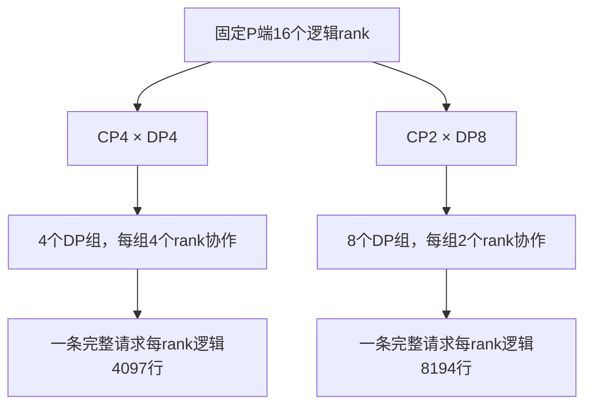

# CP2 替代 CP4：通信组变小了，为什么整体吞吐没有提高？

一次 DeepSeek-V4-Flash、Ascend 910C 调优将 P 端从 CP4/DP4 改为 CP2/DP8。在相同 N480、C88、4 req/s、正文 16K、输出 1K、零前缀命中的条件下，AISBench native 每卡输出吞吐从 181.2029 降至 179.5582 tok/s，约下降 0.91%；whole 从 164.6732 降至 161.9804，约下降 1.64%。

生成阶段的 native mean TPOT 却从 19.3ms 降到了 17.2ms。候选在这项指标上更好，但 TTFT 增长、E2E 未缩短，最终完成请求的速度没有提高。

要解释结果，需要看 CP 改动同时带来的其他变化。CP 组缩小后，DP 组数增加，每 rank 输入约翻倍，normal 通信也由一轮变为两轮。减少 CP 通信是提出候选的理由，实际收益仍取决于这些执行变化。

本文使用 2026 年 10 月 20 日的原运行快照、报告和源码。软件记录为 `0.0.0.dev18433+gce0a8fea5.d20261013`，并绑定当时的适配文件。它与后来的高 AL 复制负载不同，结果仅适用于这组场景；完整配置、SHA 与原值见[配套证据](../../assets/ascend-910c-cp2-vs-cp4/evidence.json)。

## 1. 少一些人一起处理一条请求，多一些组同时处理不同请求

Context Parallelism 将同一请求的上下文计算分给多个 rank。CP4 由组内 4 个 rank 协作，CP2 则由 2 个。Attention 并行域总 rank 数固定时，缩小 CP 可以划出更多 DP Attention 组，分别处理不同请求。

本次 P 的 TP16 逻辑域不变，由 CP4×DP4 重组为 CP2×DP8。两组都启用 DP Attention、Prefill CP 和 zigzag，Pcap 均为 1。设备仍为 P8+D8 共 16 张物理卡，逻辑 rank/group 数需与卡数分别记录。

该版两组的 Attention TP 宽度均为 `16/(DP×CP)=1`。所以命令中的 TP16 不能直接解释为每条请求的 Attention 由 16 个 rank 一起计算；请求与上下文如何切分，还需与 MoE 的 EP 分发区分。

更多 DP 组提供了并行处理独立请求的机会，较小 CP 也缩小了组内交互范围，因此 CP2/DP8 值得作为候选。但完整请求仍有 16388 token，每 rank 分担的逻辑输入由 4097 行增至 8194 行，并未减少输入计算。

各 DP 组都有请求时，一次全局推进可能处理更多总输入，不能假定单轮耗时保持不变，再按 DP 组数翻倍推导服务率。每 rank 行数增加也不意味着算子时间恰好翻倍，形状、路由和重叠效率仍需实测。

## 2. 先把接纳预算、逻辑行数和补齐行数分开

这组负载正文为 16384 token，聊天编码后为 16388。Scheduler 按 page128 向上计费，完整输入消耗 16512 接纳预算，模型实际输入仍是 16388。容量预算与执行行数不能互换。

启用 DP Attention 后，全局 chunk 会除以 DP 数。原 CP4/DP4 的全局 131072 对应有效 32768；CP2/DP8 改用全局 132096，对应有效 16512，可接纳完整请求。若只改 DP8 而保留 131072，有效预算为 16384，就会留下 4-token 尾块，偏离完整请求进入 CP2 的候选目标。

进入 zigzag CP 后，还要按分片与补齐规则生成实际形状。固定 [`get_cp_padding_align_size`](https://github.com/Ascend/sglang/blob/ce0a8fea5f4245839d174b2b8c55692be1810a7f/python/sglang/srt/layers/cp/padding.py) 对 zigzag 返回 `2×CP`，各 rank 最大逻辑行数再向上对齐：

| 层次 | CP4/DP4 | CP2/DP8 |
| --- | ---: | ---: |
| 实际完整输入 | 16388 | 16388 |
| page128 接纳计费 | 16512 | 16512 |
| 有效 chunk 预算 | 32768 | 16512 |
| 每 rank 逻辑行数 | 4097 | 8194 |
| zigzag 对齐粒度 | 8 | 4 |
| 源码推导的补齐行数 | 4104 | 8196 |

这里也修正了此前 chunk 分析的算术：旧记录将 CP2 按 8 行对齐，写成 8200。复核固定源码并执行原 padding 方法后，CP2 应按 4 行对齐，得到 8196。8200 并非设备实测，前文已同步更正，历史文件则保留原记录。

修正不会改变容量判断，因为未补齐的 8194 行已超过 8192；变化只在第二轮的余量，旧“第二轮 8 行”不能继续引用为精确值。性能表仍来自原压测，没有因算术纠错重跑。

## 3. CP 组变小，MoE 的 EP16 并没有一起缩小

前向会经过不同通信域。Attention 在 CP 域协作上下文和元数据，MoE 在 EP 域分发专家并合并结果。本次 P 的 `ep_size=16`、`moe_dp_size=1` 和 DeepEP normal 在两组中一致。

因此 CP4→CP2 不会让全部 All-to-All 的参与者都从 4 个 Rank 缩到 2 个。冻结调用链通过 `cp_shard_model_inputs` 传入局部 hidden，CP+DeepEP 分支的 MoE 继续处理局部行，再由 `get_dispatch_layout` 检查容量。变化发生在输入行数，EP 通信域没有自动缩小。

当时 native normal 每轮最多 8192 行。CP4 补齐后 4104 行，一轮可容纳；CP2 逻辑行数已达 8194，必须启用 normal round2。每轮容量受冻结实现检查，不能仅将环境变量写成 8200 来绕过。

第二轮即使很短，也仍有分轮状态、写入、通知、等待和读取，相关元数据及缓冲布局也会变化。源码能确认增加了这些步骤，但没有独立计时，无法给出具体毫秒，更无法将全部 −0.91% 归给它们。

8196 只是输入形状，专家实际接收量还受每 token 多专家选择、路由和布局影响。临时张量与 workspace 峰值也不能由尾部行数直接估算。候选通过容量检查并完成实际运行，并不表示全部中间张量峰值都已采集。

因此，报告中应保留完整对照：CP4/DP4/chunk32768/round1 与 CP2/DP8/chunk16512/round2。两组负载对齐，但修改的是联合配置。

## 4. TPOT 改善，为什么系统吞吐没有跟着提高

两组使用相同 DeepSeek-V4-Flash W8A8、P/D 源码和专家布局。D 保留 DSPARK 草稿 3、验证宽度 4、Graph 档位 `[1,2,4,8,12,16]`，两端均为 IndexCache freq2。正式各发 480 条，C88、4 req/s，实际输入 16388、输出 1024，前缀命中 0%，均为 480 成功、0 失败。

原 AISBench native 指标如下，每卡吞吐以 PD16 全部物理卡归一化：

| 指标 | CP4/DP4 | CP2/DP8 |
| --- | ---: | ---: |
| 发送 / native 纳入请求数 | 480 / 386 | 480 / 392 |
| native 时长（s） | 136.3333 | 139.7207 |
| 平均系统并发 | 85.7474 | 85.4174 |
| TTFT 平均 / P90（ms） | 10570.0 / 12418.9 | 12827.6 / 14621.4 |
| TPOT 平均 / P90（ms） | 19.3 / 22.4 | 17.2 / 19.5 |
| ITL 平均 / P90（ms） | 62.4 / 73.4 | 56.9 / 69.6 |
| E2E 平均（s） | 30.2856 | 30.4454 |
| 系统输出吞吐（tok/s） | 2899.2466 | 2872.9308 |
| PD16 单卡输出（tok/s） | 181.2029 | 179.5582 |
| 完成速率（req/s） | 2.8313 | 2.8056 |
| AL / 严格接受率 | native未采 / 未采 | native未采 / 未采 |

CP2 生成阶段间隔较短，却晚约 2.26 秒才得到首 token。E2E 均值略增、完成速率略降，对固定输出长度而言，系统吞吐随之下降。ITL 仍按流式事件统计，投机事件可能含多个 token，不能代替 TPOT 或 Draft/Verify 设备耗时。

whole 区间也给出相同方向：

| 指标 | CP4/DP4 | CP2/DP8 |
| --- | ---: | ---: |
| 纳入请求 / 时长（s） | 480 / 186.5513 | 480 / 189.6525 |
| TTFT 平均（ms） | 10491.5 | 13146.7 |
| TPOT 平均（ms） | 18.9 | 17.0 |
| E2E 平均（s） | 29.8756 | 30.5568 |
| PD16 单卡输出（tok/s） | 164.6732 | 161.9804 |
| whole AL 计数代理 | 3.1549 | 3.2119 |
| 严格 Draft 接受率 | NOT_OBSERVED | NOT_OBSERVED |

whole AL 代理使用 `491520/155798`、`491520/153029`。这些计数没有严格 proposal 分母，也未按 native 选择集独立统计；既不能用 `(AL−1)/gamma` 补出严格接受率，也不能将 AL 略增解释为质量改善。

D 启动配置相同，实际每轮处理的请求组合仍可能不同。P 交付节奏、在途分布和统计选样都会影响生成指标。因此当前证据说明端到端结果发生了这些变化，尚未隔离 CP2 对 D 算子的直接作用。

## 5. P forward 指标接近翻倍，也不能直接写成计算翻倍

阶段记录中，P initial queue 均值由 5.6275s 降至 3.5247s，`prefill_forward` 由 2.6856s 升至 5.4187s，KV transfer 由 1.3485s 升至 2.6861s。它们与行数变化相容，但仍需先核对计时边界。

冻结 `req_time_stats.py` 用 host `perf_counter`，覆盖 forward entry 到处理 Prefill 结果。起点早于实际 NPU kernel，overlap 调度也可能在处理前批结果前先提交后批。因此该值描述请求驻留时间，无法直接作为不重叠的设备服务时间。

例如教学时间线中，A 为 `[1,3]` 秒、B 为 `[2,4]` 秒，两段相加 4 秒，实际只覆盖 3 秒墙时。`请求数×平均forward/DP组数` 不能据此表示设备利用率，也没有理由再除以 2 修正。

CP 还改变观测副本数：P 记录由 1924 变为 962，分别除以 CP4、CP2 都得到 481，正式请求却为 480。记录包含副本及窗口边界差别，多出的一次未绑定请求身份，不能自行归为健康探针。

这些数据值得沿 P 接纳到交付继续查，却不足以将 5.4187s 全归 NPU 计算，或把 transfer 增长定为网络变慢。本次缺少逐批设备区间与依赖，尚未分离 CP collective、MoE 分轮、KV 传输各自暴露的成本。

## 6. 小幅负向结果，足够停止候选，不足以判定 CP2 普遍更差

native −0.91%、whole −1.64% 都是小幅变化，两组 native 样本不同，也各只有一次运行。没有重复和置信区间，不能将它描述为稳定的普适回归。本轮可作出的决策是：没有观察到值得继续投入长测的吞吐收益。

候选已完成正式请求、输出和缓存验收，原 owner 已退出，属于有效的负向结果。无需为放大差异重复运行，后续恢复与配置切换也应排除在正式窗口之外。

候选加载及两轮 MF 约 663.81s，128 条 typed route 验证约 349.47s，配套合计约 1022.68s；正式负载约 189.65s，含编排采集的全程约 1329.43s。MF 已嵌在前项中，不能重复相加。对照直接复用热 CP4 基准，没有额外重跑。

输出还存在未完成的精度核查。虽然失败数为 0，原记录仍有少量替换字符信号及一次约 11.804s 的 SSE 间隔，完整精度状态为未评估。统计保留这些请求，也没有将异常信号单独归因于 CP2。

## 7. 下一次选 CP，看的是哪种成本占主导

CP 增大通常减小每 rank 局部输入，同时增加上下文协作与组织成本；CP 减小可以增加独立请求组，每 rank 则需处理更多输入。取舍应结合长度、缓存、接纳形状、内存和通信容量。

本次具体跨过了 8192 行边界：4097 行变为 8194 行后进入 normal 多轮路径。因此接下来更值得查每批实际请求数、暴露等待与 P 交付间隔，而非只根据 CP 组大小估算通信收益。

换长序列或 Prefix Cache 条件后，先重算未命中输入及 CP 分片；换 EP 后端后，再查容量和通信域。预算与尾块关系见[chunk 选择](deepseek-v4-prefill-chunk-size-selection.md)，局部等待如何关联整机收益见[时间线分析](npu-timeline-gaps-and-recoverable-speedup.md)。

这轮最终没有用 CP2/DP8 替代 CP4：候选运行成功，生成间隔改善，但首 token 等待增长、整批完成速率未提高。这个决定只适用于当前吞吐目标；其他形状、容量约束或后端仍可重新评估 CP2，比较时应带上完整配置。

## 配套材料

- [四个原统计区间 CSV](../../assets/ascend-910c-cp2-vs-cp4/matched-results.csv)、[全部原 AIS 统计行 JSON](../../assets/ascend-910c-cp2-vs-cp4/evidence.json)：包含时延分布、卡数口径、AL代理、阶段指标及成本说明。
- [固定版本的 CP padding 源码](https://github.com/Ascend/sglang/blob/ce0a8fea5f4245839d174b2b8c55692be1810a7f/python/sglang/srt/layers/cp/padding.py)：zigzag 的 `2×CP` 对齐规则。
- [CP与TP/DP/EP的关系](../distributed/why-large-models-need-multi-card-tp-dp-ep.md)、[DeepSeek-V4分布式Forward](../sglang/deepseek-v4-distributed-parallel-source-analysis.md)：理解不同通信域和数据布局。
- [负例与停止条件](ascend-910c-inference-tuning-negative-results-and-stop-rules.md)：把本次结果放回整个调优过程。

[返回性能分析](README.md)
