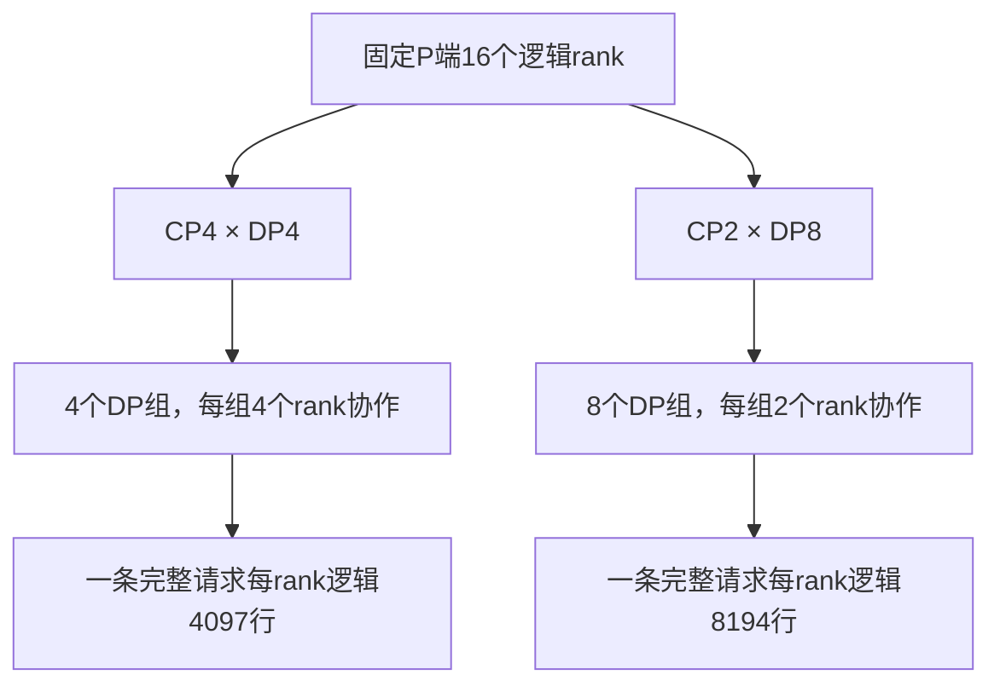

# CP2 替代 CP4：通信组变小了，为什么整体吞吐没有提高？

P 从 CP4/DP4 换到 CP2/DP8，native 平均 TPOT 19.3→17.2ms，整套 PD 吞吐却 181.2029→179.5582 tok/s/卡，约−0.91%；whole 164.6732→161.9804，约−1.64%。

这次 Flash/Ascend 910C 固定 N480、C88、r4、16K 正文、1K 输出、零缓存。生成间隔改善，TTFT 却涨、E2E 没缩短，完成请求没有更快。

CP 组变小，DP 组变多，每 Rank 输入也约翻倍，normal 通信跨进两轮。候选原本想省 CP 交互，实际要合计这些变化。

记录为2026年10月20日，`0.0.0.dev18433+gce0a8fea5.d20261013`及绑定适配文件，使用普通原负载，区别于后来高AL复制集，配置、SHA、数值见[配套证据](../../assets/ascend-910c-cp2-vs-cp4/evidence.json)。

## 1. 少一些人一起处理一条请求，多一些组同时处理不同请求

CP 将同请求上下文分给组内 Rank。CP4 由 4 个协作，CP2 由 2 个；Attention 并行域总数固定，同一批 Rank 可组成更多 DPA 组。

P 逻辑 TP16 保持不变，CP4×DP4 改 CP2×DP8，DPA、Prefill CP、zigzag 开启，Pcap1。硬件仍 P8+D8 物理 16 卡。

两组 Attention TP 均`16/(DP×CP)=1`。总体 TP16 没有让每请求同时由 16 Rank 算 Attention，请求、上下文切分和 MoE EP 各有组织。

更多 DP 提供并行服务请求的机会，小 CP 减少组内范围。完整输入仍 16388，每 Rank 逻辑行 4097→8194，计算没有少掉。

各 DP 都有工作，一轮全局推进可能包含更多总输入。DP 翻倍、单 Rank 行翻倍，都不能直接推服务率或单轮耗时倍率。

## 2. 先把接纳预算、逻辑行数和补齐行数分开

正文 16384、Chat 16388，page128 计费为 16512，模型输入仍 16388。接纳预算与执行行数分别计。

DPA 把全局 chunk 除 DP。CP4/DP4 的 131072→32768，CP2/DP8 改 132096→16512，完整接纳。若保留 131072，DP8 有效 16384，会留 4 Token 尾块。

[`get_cp_padding_align_size`](https://github.com/Ascend/sglang/blob/ce0a8fea5f4245839d174b2b8c55692be1810a7f/python/sglang/srt/layers/cp/padding.py)对zigzag返回`2×CP`，局部逻辑行再向上对齐：

| 层次 | CP4/DP4 | CP2/DP8 |
| --- | ---: | ---: |
| 实际完整输入 | 16388 | 16388 |
| page128 接纳计费 | 16512 | 16512 |
| 有效 chunk 预算 | 32768 | 16512 |
| 每 rank 逻辑行数 | 4097 | 8194 |
| zigzag 对齐粒度 | 8 | 4 |
| 源码推导的补齐行数 | 4104 | 8196 |

旧文把 CP2 按 8 行对齐成 8200；复核固定源码、执行原方法后，应按 4 行得 8196。8200 并非实测，前文更正，历史记录保留。

8194 未填充就已超 8192，因此仍两轮。不能再引旧“第二轮 8 行”为精确值，性能表也没有因纠算重跑。

## 3. CP 组变小，MoE 的 EP16 并没有一起缩小

Attention 在 CP 域协作上下文、metadata，MoE 在 EP 域分专家、合结果。P 的`ep_size=16`、`moe_dp_size=1`、DeepEP normal 没变。

CP4→2 没有把全部 A2A 成员也从 4 变 2。`cp_shard_model_inputs`给局部 hidden，CP+DeepEP MoE 继续处理局部行，再由`get_dispatch_layout`核容量，EP 域保留。

native normal 上限 8192。CP4 补齐到 4104 行 可一轮，CP2 逻辑 8194 就需 round2；冻结实现检查容量，改环境为 8200 不能绕过。

尾轮再短，也要状态、写入、通知、等待、读取，metadata、buffer 随之改变。源码确认多了这些步骤，尚无隔离计时分出具体毫秒。

8196 数输入行，专家接收还取决于多专家路由、布局。临时 Tensor、workspace 峰值并未完整采到，合法完成不等于量过全部中间状态。

完整比较因此为 CP4/DP4/chunk 32768/round1 与 CP2/DP8/chunk 16512/round2。

## 4. TPOT 改善，为什么系统吞吐没有跟着提高

两组 Flash W8A8、P/D 代码、布局相同，D 草稿 3/Verify 4、Graph`[1,2,4,8,12,16]`，双方 IndexCache freq2。每组 N480/C88/r4、输入 16388、输出 1024、cache 0%，全成功。

native 原指标按 PD16 归一：

| 指标 | CP4/DP4 | CP2/DP8 |
| --- | ---: | ---: |
| 发送 / native 纳入请求数 | 480 / 386 | 480 / 392 |
| native 时长（s） | 136.3333 | 139.7207 |
| 平均系统并发 | 85.7474 | 85.4174 |
| TTFT 平均 / P90（ms） | 10570.0 / 12418.9 | 12827.6 / 14621.4 |
| TPOT 平均 / P90（ms） | 19.3 / 22.4 | 17.2 / 19.5 |
| ITL 平均 / P90（ms） | 62.4 / 73.4 | 56.9 / 69.6 |
| E2E 平均（s） | 30.2856 | 30.4454 |
| 系统输出吞吐（tok/s） | 2899.2466 | 2872.9308 |
| PD16 单卡输出（tok/s） | 181.2029 | 179.5582 |
| 完成速率（req/s） | 2.8313 | 2.8056 |
| AL / 严格接受率 | native未采 / 未采 | native未采 / 未采 |

CP2 晚约 2.26 秒收到首 Token，E2E 略涨、完成速率略降。投机流式事件可能含多 Token，ITL 仍按事件统计，不能代替 TPOT、设备 Draft/Verify。

whole 同样负向：

| 指标 | CP4/DP4 | CP2/DP8 |
| --- | ---: | ---: |
| 纳入请求 / 时长（s） | 480 / 186.5513 | 480 / 189.6525 |
| TTFT 平均（ms） | 10491.5 | 13146.7 |
| TPOT 平均（ms） | 18.9 | 17.0 |
| E2E 平均（s） | 29.8756 | 30.5568 |
| PD16 单卡输出（tok/s） | 164.6732 | 161.9804 |
| whole AL 计数代理 | 3.1549 | 3.2119 |
| 严格 Draft 接受率 | NOT_OBSERVED | NOT_OBSERVED |

whole AL 代理为`491520/155798`、`491520/153029`，缺 proposal 严格分母、native 独立接受计数。`(AL−1)/gamma`不能补缺，也不能从 AL 判断质量。

D 配置不变，运行中请求组合仍会随 P 交付、在途、选样改变，尚未隔离 CP2 对 D 某算子的影响。

## 5. P forward 指标接近翻倍，也不能直接写成计算翻倍

P initial queue 均值 5.6275→3.5247s，`prefill_forward`2.6856→5.4187s，KV transfer 1.3485→2.6861s。先要确定这些时间从哪里开始、到哪里结束。

`req_time_stats.py`用 Host `perf_counter`，从 forward 入口到 Prefill 结果处理。起点早于 NPU kernel，Overlap 还可先提交后批、再处理前批，所以它表示请求驻留。

教学例 A `[1,3]`秒、B `[2,4]`秒，相加 4 秒、覆盖 3 秒。`请求数×平均forward/DP组数`不能变成设备利用率，再除 2 也没有根据。

CP 还复制记录：P 有 1924、962 条，除 CP4、CP2 都得 481，正式却 480。多出一次没绑定身份，不能擅自当健康探针。

这些指标适合继续查 P 接纳、交付，但 5.4187s 并非纯 NPU 计算，transfer 增加也未定位网络。缺逐批设备区间、依赖，CP、MoE 分轮、KV 的暴露成本仍未拆开。

## 6. 小幅负向结果，足够停止候选，不足以判定 CP2 普遍更差

两组只各一轮、native 样本不同，−0.91%、−1.64% 尚非稳定普适回归。本轮没有看到值得继续长测的吞吐收益，便先停止。

正式请求、输出、缓存验收完成，owner 已退出，属于有效负向。恢复、切配置在正式窗口之外。

加载及两轮 MF 约 663.81s，128 条 typed route 验证约 349.47s，配套 1022.68s；正式 189.65s，含编排采集全程 1329.43s。MF 嵌在前项，对照复用热 CP4，没有另跑基准。

精度仍未评估。虽然失败 0，原回答有少量替换字符、一次 11.804s SSE 间隔，均保留，也没单独归因 CP2。

## 7. 下一次选 CP，看的是哪种成本占主导

CP 增大，局部输入减少、上下文协作更多；CP 减小，独立请求组增加、局部输入变大。长度、缓存、内存、接纳、通信容量共同决定取舍。

这次具体是 4097→8194，跨 8192 进入 normal 多轮。后续查实际 batch、暴露等待、P 交付间隔，比只按 CP 组大小估通信更有用。

新长度、Prefix Cache先重算未命中和分片，新EP backend再核域、容量。参见[chunk 选择](deepseek-v4-prefill-chunk-size-selection.md)、[时间线分析](npu-timeline-gaps-and-recoverable-speedup.md)。

当前吞吐目标下未用 CP2 替代 CP4。候选合法、生成间隔改善，首 Token 等待却使整批完成变慢；其他形状、容量约束、后端变化后再带完整条件重评。

## 配套材料

- [四个原统计区间 CSV](../../assets/ascend-910c-cp2-vs-cp4/matched-results.csv)、[全部原 AIS 统计行 JSON](../../assets/ascend-910c-cp2-vs-cp4/evidence.json)：包含时延分布、卡数口径、AL代理、阶段指标及成本说明。
- [固定版本的 CP padding 源码](https://github.com/Ascend/sglang/blob/ce0a8fea5f4245839d174b2b8c55692be1810a7f/python/sglang/srt/layers/cp/padding.py)：zigzag 的 `2×CP` 对齐规则。
- [CP与TP/DP/EP的关系](../distributed/why-large-models-need-multi-card-tp-dp-ep.md)、[DeepSeek-V4分布式Forward](../sglang/deepseek-v4-distributed-parallel-source-analysis.md)：理解不同通信域和数据布局。
- [负例与停止条件](ascend-910c-inference-tuning-negative-results-and-stop-rules.md)：把本次结果放回整个调优过程。

[返回性能分析](README.md)
