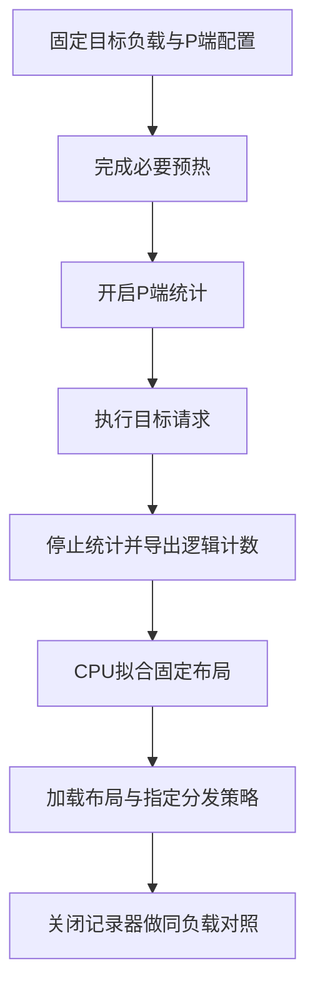

# Ascend 910C上的P端场景静态EPLB：从路由计数、专家布局到实测收益

一次 DeepSeek-V4-Flash PD 调优中，D 端平均 TPOT 已降到几毫秒，高 AL 复制任务每轮约输出 5.5 Token，系统吞吐却仍未达到目标。采样显示 P 持续排队、D 的等待队列较少，我们因此转查 P 端 MoE：现有专家放置是否适合这组输入？

在随后相同 16K 零缓存、N320/C128/r6 测试中，P 端候选使 whole 输出由 139.17 增至 158.90 token/s/卡，约提高 14.18%。但它同时改变了布局与副本分发，将 dynamic 改为 static，因此只能报告组合收益。

本文按采集、拟合和测量解释这项方案，包括 256 个逻辑专家为何对应 272 个物理槽，以及离线分数怎样使用。材料来自 2026 年 10 月 18—21 日固定运行快照，未混入后续在线动态 EPLB，也不将当时补丁当作当前上游默认。

## 一、先把静态布局、副本分发和在线重排分开

EPLB 通常展开为 Expert Parallelism Load Balancing，含义是专家并行负载均衡。本文的静态方案需要分别看放置、分发和在线更新。

放置描述每个逻辑专家有几份副本、位于哪里。分发在 Router 选中专家后决定使用哪份副本。在线重排则根据持续计数，更新布局并迁移权重。这几项可以独立配置。

本轮先离线采集，再用 CPU 拟合并加载固定文件，在线 EPLB 始终关闭。两组 `enable_eplb` 都为 false；分发选项 `ep_dispatch_algorithm` 从 dynamic 改为 static。这里的 dynamic 描述如何选择副本，不表示服务正在更新布局或迁移权重。

`init_expert_location` 选择初始布局，`ep_num_redundant_experts` 设定冗余槽数，`ep_dispatch_algorithm` 控制副本分发，在线重排另有开关。核对实验时，以最终命令和运行记录为准。

服务为真实 PD 分离，P、D 各 8 张 Ascend 910C，共 16 张物理卡。P 的 EP16 指逻辑 rank，不代表其独占 16 张卡。所有每卡指标均用系统输出除以全部 P+D 的 16 张卡。

P 有 256 个逻辑专家，加上 16 个冗余槽，共 272 个物理槽。分给 16 个 EP Rank 后，每 Rank 持有 17 槽。新旧方案都有这 16 个冗余槽，候选是在已有预算内调整副本位置，再切换分发策略，没有增加冗余容量。

P 排队支持检查供给路径，却尚不能将瓶颈唯一归于专家倾斜。分块、KV 交接、Attention 与调度预算也可能限制供给，候选最终仍需同负载验证。

## 二、布局改变的是执行位置，不是Router想选哪个专家

在一层 MoE 中，Router 先产生逻辑专家 ID，布局再将它关联到物理副本，分发策略从中选择执行位置。`physical_to_logical_map` 则反向记录每个槽位对应的逻辑专家。

布局文件有 43 行，每行 272 个 0～255 整数。行对应层、列对应物理槽，重复逻辑 ID 表示副本，没有新增模型逻辑专家。

每行按连续 17 槽分给各 EP rank，首段对应 rank0、次段 rank1，依此类推。这样可以从文件直接核对每 rank 容量。

用一个教学模型看副本分配：四位逻辑专家的工作量为 80、60、10、10，两个 rank 各容纳三槽，多出的两个槽可放副本。

若把副本给冷专家，估计负载如下：

```text
rank0：[E0, E2, E3] → 80 + 5 + 5 = 90
rank1：[E1, E2, E3] → 60 + 5 + 5 = 70
```

改为复制热点，并假设各副本均分流量：

```text
rank0：[E0, E1, E2] → 40 + 30 + 10 = 80
rank1：[E0, E1, E3] → 40 + 30 + 10 = 80
```

总工作量仍是 160，调整的是最忙 rank 的估计负担。80、90 都是教学计数，未表示实测路由或毫秒。

这个推导有两个前提：副本保存了正确权重与量化状态，实际流量又能近似均分。只改映射，不能保证副本内容正确；实际分发若不均匀，单副本负载为 40 的估计也就不能代表真实执行。

固定布局可以不改变 Router 的逻辑选择，但输出正确仍须验证。本轮没有完整业务精度或逐 token 等价验收，性能不能替代质量证据。

## 三、采集P端分布，必须让计数对应目标场景

P 处理输入，D 处理持续生成的草稿与验证，两者可能有不同专家热点。因此相同模型也需分别采集，不能直接把 D 布局当成 P 的最优布局。

16K 候选先在 P 采集高 AL 复制任务，N160/C128/r6，再扩大请求做性能检查。正文 16384 token、Chat 输入 16388、输出 1024、缓存 0，实际 chunk8192、noCP/DP16 和通信配置一并冻结。

记录只在目标负载上开启，正式性能轮关闭。流程为：



导出 `logical_count` 的 `[512, 43, 256]` 分别为记录槽、层和逻辑专家。计数表示专家分配，一个 token 选择多专家可产生多次贡献，不能直接按请求解释。

512 是环形记录容量，不是请求数，也不保证完整时序。16K 数据中留下 34 个非零槽，不能把它们称作 34 个独立请求或时间段。导出前已经跨 Rank 归约，拟合时也无需再乘 16。

原 dump 曾因 HCCL 分配失败。后续保留映射，将计数复制到 CPU，再复用同成员 Gloo 整数 SUM，由 rank0 保存，才取得可用文件。这只修复离线采集，未直接加速 token 生成；失败文件也未用于拟合。

128K、90% warm 场景则先完成各 DP seed 和独立 cache-check，再开启目标统计，避免将冷前缀准备混入 warm 分布。正式逐条命中为 118784/131076，即 90.6222%，验收使用实际计数。

## 四、怎样在16个冗余槽里生成候选布局

当次使用独立 CPU 拟合脚本，未直接套上游在线 planner。它逐层读取逻辑负载，先分配副本，再放置物理位置。

首先让每个逻辑专家至少有一份。以 w_e 表示计数、c_e 表示副本数，按 `w_e / c_e` 估计单副本负担，逐个将额外 16 槽分给当前最忙专家，且副本数不超过可放置 rank 数。

随后按估计负担降序放置副本，优先选择当前负载最低的 Rank，同时保证每 Rank 17 槽、同一专家的副本不重复放在同 Rank。遇到局部容量冲突，就尝试交换已有放置，而不是丢弃专家。这些是当次离线脚本的约束，并非所有 EPLB 实现都采用的规则。

最后在固定容量下做有限次成对交换，继续降低峰值，并以负载平方和帮助选取。输出逐层验证 256 专家全部覆盖、272 值合法，以及各 rank 内无重复逻辑 ID。

这是受容量与覆盖约束的离线放置。文件通过格式检查后，部署仍要核对权重加载、布局和实际分发模式是否一致。

34 个非零槽被分成两份，各 17 槽：一份用于拟合，另一份计算估计负载。脚本虽然把它们命名为 train、holdout，但环形槽不保证时序或独立性，因此这里只是对保留槽做内部检查，不能按独立测试集理解。

分数假设副本理想均分，将各 rank 负担相加，再算最大值/均值。越接近 1，只说明这个估计模型中的放置越均匀。

16K 的 43 层分数中位数从约 1.6132 降至 1.0068，第 4 层从 1.9175 降至 1.0056。这可以筛选明显不合理的放置，不能按同一比例推导实际 rank 时间下降。

逻辑计数没有完整的来源 rank—目标专家联合分布和微批时序，实际副本分发也未必均匀。算子 shape、通信与重叠成本不随计数线性变化，因此理想分数只能用于筛选，设备表现需另测。

## 五、14.18%的收益究竟证明了什么

性能基线没有使用开着 observer 的统计轮。正式两组都关闭记录器，使用相同复制数据、N320/C128/r6、1024 输出与零缓存。

P 均为 noCP/DP16、chunk8192、请求上限 1、16 冗余槽；D 静态布局、Compact、草稿 5/验证 6 和双方 IndexCache freq2 保持匹配。变化项目为：

| P端项目 | 基线 | 候选 |
| --- | --- | --- |
| 专家布局 | 原布局 | 当前复制场景拟合布局 |
| 副本分发策略 | dynamic | static |
| 在线动态EPLB | 关闭 | 关闭 |
| 每层物理槽 / 冗余槽 | 272 / 16 | 272 / 16 |

因此 14.18% 属于场景布局与 static 分发的联合收益。没有同布局分别使用两种分发的完整对照，无法拆分贡献，也未证明 static 普遍更优。

whole 按全部 P8+D8、16 张物理卡归一化，两轮均为 320 成功、0 失败：

表中 AL 使用 whole 输出/verify；实际 proposal 严格接受率均未完整观测，保留缺失。

| 指标 | 基线 | 候选 |
| --- | ---: | ---: |
| 正式窗口(s) | 147.16 | 128.89 |
| 输出吞吐(token/s/卡) | 139.17 | 158.90 |
| TTFT均值(s) | 35.49 | 30.35 |
| TPOT均值(ms) | 9.2 | 8.7 |
| E2E均值(s) | 44.89 | 39.26 |
| whole AL | 5.5192 | 5.7645 |

whole 吞吐提高 14.18%，TTFT 与 E2E 也缩短，因此本轮保留了候选。AL 同时发生变化，说明观测到的生成过程也随执行条件改变；系统结果不能简化为只减少了 P 的某个算子成本，更不能从 AL 判断输出质量。

原报告的 native 从 159.35 升到 188.75，约提高 18.45%。但候选只选入 175 条请求，窗口为 59.34 秒，未达到项目的 60 秒要求，因此没有据此认定充分稳态收益。

候选扩大为 640 条后，native 有 496 条、177.30 秒，吞吐 179.04 token/s/卡，whole 为 166.24。它验证了更长窗口运行，却缺相同 640 条旧方案，不能与 320 条结果相除确认布局收益。

再后来仅将 P 请求上限从 1 改为 2，同 640 条负载获得 native236.83、whole216.55。这部分应归给合批上限，不能再次记作静态布局收益，阶段百分比也不能直接累加，详见[整体复盘](ascend-910c-inference-tuning-effective-optimizations-and-costs.md)。

## 六、128K的均衡分数更好，为什么端到端只提高0.81%

换到 128K 高缓存后，重新采集并拟合 P、D。P 为 272 槽、冗余 16，D 为 256 槽、冗余 0；P 的 26 个非零槽分为 13、13，仍是环形保留槽的内部划分。

离线 P 第 4 层由约 2.4649 降至 1.0176，43 层中位数由约 1.3868 降至 1.0134。但相同 N160/C64/r6、逐条 cache90.6222% 的 whole 仅从 147.91 增到 149.11 token/s/卡，约 0.81%，该轮没有 native。

128K 这轮同时改了 P、D 两端布局，基线已经采用 static 分发。所以 0.81% 只是两端组合的观测，不能单独归给 P，也不能用来证明 P 布局本身无效。

离线计数更均匀，要先落实为实际 Rank 执行时间缩短；缩短的部分还需影响关键路径，才可能提高 PD 完成速率。如果倾斜被分发、通信或其他阶段覆盖，或者主要等待来自调度、KV 交接、长历史 Attention，分数改善就不会等比例变成吞吐收益。

本轮未逐项证明这些关系，不能指定某段为唯一原因。已确认的是部署和拟合完成，而大幅性能收益仍需独立证据。

0.81% 也只是没有重复置信范围的单次差异。保留健康状态用于后续实验是合理选择，继续采集或冷启动则需新失衡证据和部署价值，不能仅由更低拟合分数驱动。

## 七、怎样把场景静态布局做成可复用的工程能力

复用布局时应连同场景保存：模型量化、P/D 角色、实际长度、缓存、chunk、并行几何、冗余预算、分发以及 N/C/r 与窗口。数据、缓存或角色改变后，先判断已有统计是否仍能代表目标负载。

部署分别核对文件覆盖、实际加载身份、冗余与分发模式，完成必要预热和路由，再在统计关闭时测量失败与输出。权重、量化状态及业务质量仍需相应正确性证据，HTTP 成功不足以替代。

统计、CPU 拟合、服务切换、预热和路由也占用时间，需与正式吞吐窗口分开记录。布局改变需要的准备不能省略记账；计数和拟合已完成后，纯热 C 变更也不应重新采集。

当前可保留的结果是：特定 16K 高 AL 零缓存下，既有冗余预算中的场景布局加 static 分发，在同 N320 whole 配对中提高约 14.18%。长窗口确认了候选运行，尚缺 N640 旧方案对照；128K 只得到两端布局的小幅观测。

若继续优化，优先补实际副本流量、最慢 rank 时间、P 交付节奏，以及同布局下两种分发的对照。它们能判断离线估计在哪些执行条件下成立，也比单独再拟合一张更低分布局更有助于选下一轮。

---

**数据与实现范围**：[实验对照](../../assets/ascend-910c-prefill-static-eplb/measurements.csv)保留whole/native、N/C/r及缺失标记；[离线拟合数值](../../assets/ascend-910c-prefill-static-eplb/offline-fit-summary.json)保留两种场景的槽数、分割语义、逐层理想估计和拟合脚本指纹。教学布局不属于实测。严格proposal接受率及native接受计数未完整观测，均标`NOT_OBSERVED`；正文AL采用whole输出/verify定义，包含首token与输出截断影响。本文没有重新压测、采集或修改服务，也不公开内部地址、账号、请求正文及原始计数文件。

运行中迁移的权重与路由顺序，见[动态 EPLB 一文](../distributed/ascend-dynamic-eplb-weight-migration.md)。它沿固定版本解释迁移与生效，并单独报告动态方案的成本和验证范围。
