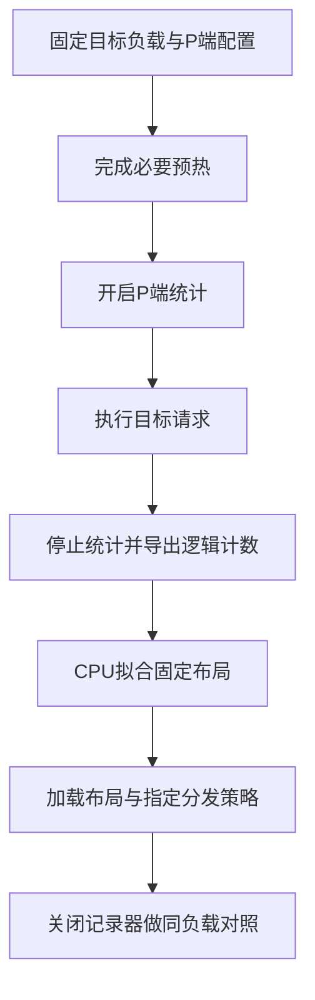

# Ascend 910C上的P端场景静态EPLB：从路由计数、专家布局到实测收益

这次实验想解决一个具体问题：Decode 端出字已经很快，整套服务为什么还是不够快？我们根据目标请求的专家访问次数，重新安排 Prefill 端的专家位置，并把副本分发改成 static。在相同的 16K 输入、零前缀缓存负载下，整轮输出吞吐从每卡 139.17 提高到 158.90 token/s，增加约 14.18%。

这里的“整轮”就是从正式请求开始到全部完成的测量区间，后文沿用原结果中的 whole 名称。布局和副本分发是在同一轮一起调整的，因此这 14.18% 对应的是两项调整的组合效果。

当时部署的是 DeepSeek-V4-Flash 的 PD 分离服务：Prefill 端简称 P，负责处理输入；Decode 端简称 D，负责后续生成。在这份复制场景数据上，投机解码平均每轮验证能产出约 5.5 个 token，这个数记作 AL。D 的平均出字间隔 TPOT 已经只有几毫秒，但 P 还在持续排队。于是我们把注意力转向输入处理：P 上最忙的专家，是否挤在了少数几个 rank 上？

下面按实际操作顺序展开：先记录专家被访问了多少次，再用 CPU 计算一份固定布局，最后让服务加载它做性能对照。实验数据来自 2026 年 10 月 18—21 日，采用的是离线生成、启动时加载的静态布局；运行期间没有动态迁移专家。

## 一、先把静态布局、副本分发和在线重排分开

EPLB 的全称是 Expert Parallelism Load Balancing，意思是专家并行负载均衡。理解这次实验，要先分清三个动作。

第一个动作是放置：某个专家有几份权重，分别放在哪个 rank。第二个动作是分发：Router 选中了这个专家之后，这枚 token 具体交给哪份副本。第三个动作才是在线更新：运行一段时间后，根据新计数重新安排位置，并把权重搬过去。

例如，专家 E0 在 rank0 和 rank1 上各有一份。放置文件已经确定了这两份的位置；每次来了一个选择 E0 的 token，分发策略再决定送给 rank0 还是 rank1。只改变这次选择，并不需要重新搬权重。

本轮的两组服务都设置了 `enable_eplb=false`，关闭的是第三个动作，也就是运行中的重排。候选组加载 CPU 事先算好的布局，同时将 `ep_dispatch_algorithm` 从 dynamic 改为 static。这两个名称描述的是第二个动作——如何选择已有副本。看到参数里有 dynamic，不能把它理解成服务开启了在线权重迁移。

`init_expert_location` 选初始布局，`ep_num_redundant_experts` 给冗余槽，`ep_dispatch_algorithm` 选分发，在线更新另有开关。执行状态从最终命令、日志确认。

这套 PD 服务的 P、D 各使用 8 张 Ascend 910C，合计 16 张物理卡。启动配置里的 EP16 表示参加专家并行的 16 个逻辑 rank，即通信进程编号；统计设备成本时，则按实际的 16 张物理卡计算。因此，本文的“每卡输出吞吐”统一用整套服务的输出吞吐除以 P+D 的 16 张卡。

P 的 256 个逻辑专家加 16 冗余，共 272 物理槽，16 个 EP Rank 各 17 槽。基线已有相同冗余预算，候选只改位置、分发，没有新增容量。

P 排队还可能来自分块、KV 交接、Attention、调度预算，所以专家倾斜只是候选解释，后面以同负载结果判断。

## 二、布局改变的是执行位置，不是Router想选哪个专家

Router 先给逻辑专家 ID，布局关联物理副本，分发再选执行位置。`physical_to_logical_map` 反向标出每槽属于谁。

布局文件可以理解成一张“槽位里放了谁”的表。它有 43 行，每行对应一层 MoE；每行的 272 个位置，对应这一层的 272 个物理专家槽。某个位置填了 7，就表示这里放的是逻辑专家 7 的权重。同一行里再次出现 7，表示又放了一份副本。

每连续 17 个位置属于一个 EP rank：前 17 槽归 rank0，再后面 17 槽归 rank1，依此类推。这样读文件，既能检查每个逻辑专家是否还在，也能检查各 rank 是否恰好装下 17 份专家。

先用教学例：四个逻辑专家负载 80、60、10、10，两个 Rank 各三槽，多两槽放副本。

副本给冷专家，估计为：

```text
rank0：[E0, E2, E3] → 80 + 5 + 5 = 90
rank1：[E1, E2, E3] → 60 + 5 + 5 = 70
```

改给热点、假设副本均分流量：

```text
rank0：[E0, E1, E2] → 40 + 30 + 10 = 80
rank1：[E0, E1, E3] → 40 + 30 + 10 = 80
```

总工作仍为 160，只改变最忙 Rank 的负担。80、90 都是算例计数，不是路由实测或毫秒。

估算依赖副本权重、量化状态正确，以及流量近似均分。分发不均时，单副本 40 的估计就会偏离真实工作。

Router 逻辑选择可以保持原样，输出仍要做正确性检查。本轮未做完整业务精度、逐 Token 等价验收。

## 三、采集P端分布，必须让计数对应目标场景

P 处理输入，D 处理草稿、验证，热点可能不同，同模型也要分别采集。

先用目标复制场景采集 P 的计数。这里的 N160 是总共发送 160 条请求，C128 是最多允许 128 条请求同时在途，r6 是每秒发送 6 条请求。后面的 N320 对照只把总请求数增加到 320，保留相同的并发上限和发送速率。

每条输入正文有 16384 个 token，加上 Chat 模板后实际为 16388；输出固定 1024，前缀缓存命中率为 0。P 的输入分块大小固定为 8192，关闭上下文并行 CP，保留 DP16 及当时的通信配置。这样采到的专家分布，才对应后面准备测试的输入处理方式。

只在采集轮开启记录器，正式比较关闭：



`logical_count` 形状 `[512, 43, 256]`，依次为记录槽、层、逻辑专家。一枚 Token 选择多专家，可贡献多次分配。

512 表示记录器最多保留 512 份统计，而不是有 512 条请求。它像一个循环使用的数组：写到末尾后，就从头覆盖旧记录。这次 16K 采集结束时只有 34 个槽里有非零计数；这些槽跟请求并非一一对应，因为服务会合批、分块，一条请求可能参与多次前向。导出时已经把各 rank 的计数求和，CPU 拟合直接读取这份全局结果即可。

原 dump 遇 HCCL 分配失败，保留映射后把计数复制 CPU，用同成员 Gloo 整数 SUM、rank0 保存。可用文件来自这条修复路径，失败文件没进拟合，正式 Token 生成也没因此提速。

128K warm90% 先完成各 DP 的 seed、独立 cache-check，再开统计，排除冷前缀准备。正式逐条 118784/131076=90.6222%。

## 四、怎样在16个冗余槽里生成候选布局

本次使用独立 CPU 脚本，逐层读取负载，先分副本，再放位置。

第一步决定“谁值得多放一份”。先给全部 256 个逻辑专家各保留一份，再分配 16 个额外槽。对某个专家，用访问次数 w_e 除以当前副本数 c_e，估计每份副本要承担的工作。每加一份副本，都重新比较这个值，把下一份给当前估计负担最大的专家。这里假设同一专家的流量能在副本间近似均分，副本数也限制在可放置的 rank 数以内。

第二步决定“这些副本放在哪里”。脚本先处理预计最忙的副本，优先放到当前累计负担最轻的 rank，同时检查两件事：该 rank 还有没有空槽，以及它是否已经有同一专家。在本次离线脚本中，同一专家的两份副本要放到不同 rank，才能分担卡间压力。遇到容量冲突时，脚本通过交换已有位置继续安排；整个过程中，所有逻辑专家都必须保留。

固定容量下再做有限成对交换，降低峰值，并用负载平方和辅助选择。输出逐层核 256 专家覆盖、272 值合法、各 Rank 内无重复逻辑 ID。

格式通过只是文件合格，服务还要核权重、布局、分发模式的实际加载。

34 个非零槽分成两份，每份 17 槽，脚本称 train、holdout，一份拟合、一份估算。环形槽不保证独立、时序，因而只作保留槽内部检查。

评分时，脚本把每份副本的估计工作量加到所属 rank，再用“最忙 rank 的工作量 ÷ 所有 rank 的平均工作量”得到一个分数。如果每个 rank 一样忙，分子和分母相等，分数就是 1；分数越大，说明预计有某个 rank 承担了明显更多的工作。这个分数衡量的是计数模型里的分配情况，真实执行还要付出通信和计算时间。

16K 的 43 层中位数 1.6132→1.0068，第 4 层 1.9175→1.0056。可据此筛放置，实际 Rank 耗时仍需另测。

计数没有完整的来源 Rank—目标专家联合分布、微批时序，副本流量也未必均分。shape、通信、重叠成本又非计数的线性函数，这些都在离线分数之外。

## 五、14.18%的收益究竟证明了什么

性能基线用正式轮，两组记录器关闭，相同复制数据、N320/C128/r6、1024 输出、零缓存。

P 固定 noCP/DP16、chunk 8192、接纳 1、16 冗余，D 布局、Compact、草稿 5/Verify 6、双方 IndexCache freq2 匹配。变化为：

| P端项目 | 基线 | 候选 |
| --- | --- | --- |
| 专家布局 | 原布局 | 当前复制场景拟合布局 |
| 副本分发策略 | dynamic | static |
| 在线动态EPLB | 关闭 | 关闭 |
| 每层物理槽 / 冗余槽 | 272 / 16 | 272 / 16 |

因此 14.18% 只能归到布局+static 分发，没有同布局切两种分发的独立配对。

按 16 物理卡归一，两轮 320 成功、0 失败：

表中的 AL 按整轮“实际输出 token 数 ÷ target verify 次数”计算，表示每次验证平均产出多少 token。它包含首 token 和输出截断的影响。严格的草稿接受率则需要单独记录提出、接受的草稿数，本次没有保留完整分母，因此没有把 AL 换算成接受率。

| 指标 | 基线 | 候选 |
| --- | ---: | ---: |
| 正式窗口(s) | 147.16 | 128.89 |
| 输出吞吐(token/s/卡) | 139.17 | 158.90 |
| TTFT均值(s) | 35.49 | 30.35 |
| TPOT均值(ms) | 9.2 | 8.7 |
| E2E均值(s) | 44.89 | 39.26 |
| whole AL | 5.5192 | 5.7645 |

whole 提高 14.18%，TTFT、E2E 也降，本轮据此保留。AL 也改变，说明生成过程随执行条件变化，系统结果还不能拆成 P 某个算子的时间，AL 也不评价质量。

native 159.35→188.75、约+18.45%，候选却仅 175 条、59.34 秒，少于 60 秒要求，没有按它认定充分稳态收益。

候选 N640 后，native 496 条、177.30 秒、179.04 token/s/卡，whole 166.24。较长运行确认了，但缺同 N640 旧方案，不能跨 N 算布局增益。

之后只把 P 接纳 1→2，同 N640 得到 native 236.83、whole 216.55。这属于合批上限，详见[整体复盘](ascend-910c-inference-tuning-effective-optimizations-and-costs.md)，不再加到静态布局收益。

## 六、128K的均衡分数更好，为什么端到端只提高0.81%

128K 高缓存另采 P、D：P 272 槽/16 冗余，D 256 槽/0 冗余，P 的 26 非零槽分 13、13，仍为环形内部划分。

P 第 4 层估计 2.4649→1.0176，43 层中位 1.3868→1.0134。同 N160/C64/r6、逐条 cache 90.6222%，whole 仅 147.91→149.11，约 0.81%，native 缺失。

这轮 P、D 布局一起改，基线已用 static。小变化评价两端组合，不能单独归 P，也不能证明 P 布局无效。

要从均衡分数走到吞吐，中间还有两步。首先，计数上的“少干一点活”要变成最慢 rank 确实提前结束。其次，这个提前必须让下一批请求更早开始。如果服务仍在等待 KV 交接、调度，或者长上下文 Attention 才是主要耗时，专家部分变快也不会等比例提高输出吞吐。

这份 128K 数据记录到了布局部署成功和约 0.81% 的整轮变化，但没有逐阶段时间线来区分上述原因。下一次应把最慢 rank 的执行时间和 P 向 D 交付的节奏一起采集，才能判断卡在哪一步。

0.81% 又缺重复波动范围，可以保留健康状态继续实验，再采集、冷启则需要新的失衡证据、部署价值。

## 七、怎样把场景静态布局做成可复用的工程能力

复用布局同时保存场景：模型、量化、P/D 角色、实际长度、缓存、chunk、并行几何、冗余、分发、N/C/r、窗口。角色或负载变化后先看统计是否仍代表目标。

部署核覆盖、实际加载身份、冗余、分发，完成必要预热、路由，再关闭统计做正式测量。权重、量化状态、业务质量分别需要正确性证据。

采集、CPU 拟合、切服务、预热、路由作为准备成本单列。已经拟合好以后，纯热 C 变化继续复用。

本轮保留 16K 高 AL 零缓存的 14.18% whole 配对，确认候选可较长运行；N640 旧方案、128K 显著收益仍缺相应证据。

后续优先补实际副本流量、最慢 Rank 时间、P 交付节奏、同布局两种分发。它们能解释估计何时成立，再决定下一候选。

**数据与实现范围**：[实验对照](../../assets/ascend-910c-prefill-static-eplb/measurements.csv)保留whole/native、N/C/r及缺失标记；[离线拟合数值](../../assets/ascend-910c-prefill-static-eplb/offline-fit-summary.json)保留两种场景的槽数、分割语义、逐层理想估计和拟合脚本指纹。教学布局不属于实测。严格proposal接受率及native接受计数未完整观测，均标`NOT_OBSERVED`；正文AL采用whole输出/verify定义，包含首token与输出截断影响。公开附件保留数值、配置和脚本指纹，正文按这些历史记录展开。

运行中迁移的权重与路由顺序，见[动态 EPLB 一文](../distributed/ascend-dynamic-eplb-weight-migration.md)。它沿固定版本解释迁移与生效，并单独报告动态方案的成本和验证范围。

[返回 EPLB 专题](../distributed/eplb-study-guide.md)。
