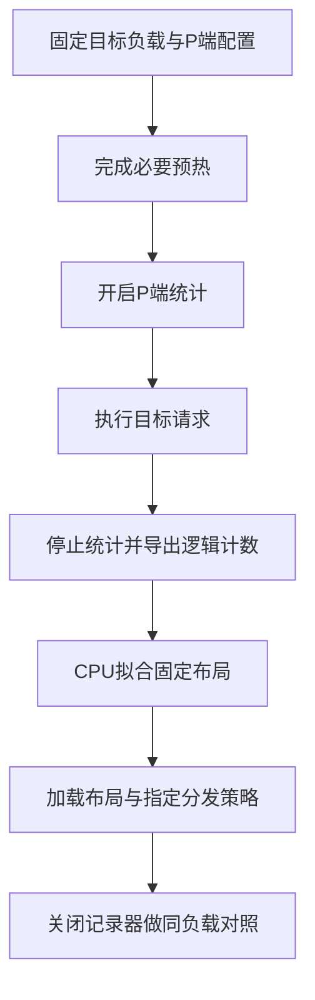

# Ascend 910C上的P端场景静态EPLB：从路由计数、专家布局到实测收益

P 端换场景布局、将副本分发改为 static，同 16K 零缓存、N320/C128/r6，whole 139.17→158.90 token/s/卡，约+14.18%。布局、副本分发一起改，收益也按组合保留。

这个方向来自当时的供给现象：DeepSeek-V4-Flash 的 D 已有几毫秒 TPOT，高 AL 复制集平均每轮约 5.5 Token，系统吞吐仍不够，P 持续排队、D 等待较少。于是继续检查 P 的专家放置是否匹配输入。

以下沿采集、拟合、测量说明 256 逻辑专家、272 物理槽怎样对应，以及离线分数能说明什么。数据为 2026 年 10 月 18—21 日快照，不含后续在线动态 EPLB。

## 一、先把静态布局、副本分发和在线重排分开

EPLB 为 Expert Parallelism Load Balancing，即专家并行负载均衡。这套静态方案分成放置、分发、在线更新三项。

放置决定副本数、位置；Router 选中逻辑专家后，分发决定用哪份副本；在线重排才会根据新计数更新布局、迁移权重。

本轮离线采集、CPU 拟合、加载固定文件，两组 `enable_eplb=false`。`ep_dispatch_algorithm` 由 dynamic 到 static，dynamic 在这里仅表示选择副本的方法。

`init_expert_location` 选初始布局，`ep_num_redundant_experts` 给冗余槽，`ep_dispatch_algorithm` 选分发，在线更新另有开关。执行状态从最终命令、日志确认。

真实 PD 中 P、D 各 8 张 Ascend 910C，共 16 张物理卡；P 的 EP16 数逻辑 Rank。所有每卡输出都除以 P+D 的 16 张。

P 的 256 个逻辑专家加 16 冗余，共 272 物理槽，16 个 EP Rank 各 17 槽。基线已有相同冗余预算，候选只改位置、分发，没有新增容量。

P 排队还可能来自分块、KV 交接、Attention、调度预算，所以专家倾斜只是候选解释，后面以同负载结果判断。

## 二、布局改变的是执行位置，不是Router想选哪个专家

Router 先给逻辑专家 ID，布局关联物理副本，分发再选执行位置。`physical_to_logical_map` 反向标出每槽属于谁。

文件 43 行、每行 272 个 0～255 整数：行是层，列是物理槽，重复 ID 代表副本。

连续 17 槽分给一个 EP Rank，首段 rank0、次段 rank1，可逐段核容量。

先用教学例：四个逻辑专家负载 80、60、10、10，两个 Rank 各三槽，多两槽放副本。

副本给冷专家，估计为：

```text
rank0：[E0, E2, E3] → 80 + 5 + 5 = 90
rank1：[E1, E2, E3] → 60 + 5 + 5 = 70
```

改给热点、假设副本均分流量：

```text
rank0：[E0, E1, E2] → 40 + 30 + 10 = 80
rank1：[E0, E1, E3] → 40 + 30 + 10 = 80
```

总工作仍为 160，只改变最忙 Rank 的负担。80、90 都是算例计数，不是路由实测或毫秒。

估算依赖副本权重、量化状态正确，以及流量近似均分。分发不均时，单副本 40 的估计就会偏离真实工作。

Router 逻辑选择可以保持原样，输出仍要做正确性检查。本轮未做完整业务精度、逐 Token 等价验收。

## 三、采集P端分布，必须让计数对应目标场景

P 处理输入，D 处理草稿、验证，热点可能不同，同模型也要分别采集。

16K 候选先采 P 的复制集，N160/C128/r6。正文 16384、Chat 16388、输出 1024、缓存 0，有效 chunk 8192、noCP/DP16、通信一并冻结，再扩大请求测性能。

只在采集轮开启记录器，正式比较关闭：



`logical_count` 形状 `[512, 43, 256]`，依次为记录槽、层、逻辑专家。一枚 Token 选择多专家，可贡献多次分配。

512 为环形容量，16K 仅留下 34 个非零槽，并不表示 34 请求或独立时段。导出前已跨 Rank 归约，拟合无需再乘 16。

原 dump 遇 HCCL 分配失败，保留映射后把计数复制 CPU，用同成员 Gloo 整数 SUM、rank0 保存。可用文件来自这条修复路径，失败文件没进拟合，正式 Token 生成也没因此提速。

128K warm90% 先完成各 DP 的 seed、独立 cache-check，再开统计，排除冷前缀准备。正式逐条 118784/131076=90.6222%。

## 四、怎样在16个冗余槽里生成候选布局

本次使用独立 CPU 脚本，逐层读取负载，先分副本，再放位置。

先保证每逻辑专家至少一份。负载 w_e、副本 c_e，以 `w_e / c_e` 估单副本负担，将 16 个额外槽逐个给当前最忙专家，副本数不超过可放置 Rank 数。

再按负担降序，将副本放到当前最轻 Rank，约束每 Rank 17 槽、同专家不在同 Rank 重复。容量局部冲突则交换已有放置，保持所有专家覆盖。这些约束属于本次离线脚本。

固定容量下再做有限成对交换，降低峰值，并用负载平方和辅助选择。输出逐层核 256 专家覆盖、272 值合法、各 Rank 内无重复逻辑 ID。

格式通过只是文件合格，服务还要核权重、布局、分发模式的实际加载。

34 个非零槽分成两份，每份 17 槽，脚本称 train、holdout，一份拟合、一份估算。环形槽不保证独立、时序，因而只作保留槽内部检查。

分数假设副本理想均分，汇总 Rank 负担后算最大/均值，接近 1 表示估计放置更均匀。

16K 的 43 层中位数 1.6132→1.0068，第 4 层 1.9175→1.0056。可据此筛放置，实际 Rank 耗时仍需另测。

计数没有完整的来源 Rank—目标专家联合分布、微批时序，副本流量也未必均分。shape、通信、重叠成本又非计数的线性函数，这些都在离线分数之外。

## 五、14.18%的收益究竟证明了什么

性能基线用正式轮，两组记录器关闭，相同复制数据、N320/C128/r6、1024 输出、零缓存。

P 固定 noCP/DP16、chunk 8192、接纳 1、16 冗余，D 布局、Compact、草稿 5/Verify 6、双方 IndexCache freq2 匹配。变化为：

| P端项目 | 基线 | 候选 |
| --- | --- | --- |
| 专家布局 | 原布局 | 当前复制场景拟合布局 |
| 副本分发策略 | dynamic | static |
| 在线动态EPLB | 关闭 | 关闭 |
| 每层物理槽 / 冗余槽 | 272 / 16 | 272 / 16 |

因此 14.18% 只能归到布局+static 分发，没有同布局切两种分发的独立配对。

按 16 物理卡归一，两轮 320 成功、0 失败：

AL 用 whole 输出/Verify，严格 proposal 接受率缺完整观测。

| 指标 | 基线 | 候选 |
| --- | ---: | ---: |
| 正式窗口(s) | 147.16 | 128.89 |
| 输出吞吐(token/s/卡) | 139.17 | 158.90 |
| TTFT均值(s) | 35.49 | 30.35 |
| TPOT均值(ms) | 9.2 | 8.7 |
| E2E均值(s) | 44.89 | 39.26 |
| whole AL | 5.5192 | 5.7645 |

whole 提高 14.18%，TTFT、E2E 也降，本轮据此保留。AL 也改变，说明生成过程随执行条件变化，系统结果还不能拆成 P 某个算子的时间，AL 也不评价质量。

native 159.35→188.75、约+18.45%，候选却仅 175 条、59.34 秒，少于 60 秒要求，没有按它认定充分稳态收益。

候选 N640 后，native 496 条、177.30 秒、179.04 token/s/卡，whole 166.24。较长运行确认了，但缺同 N640 旧方案，不能跨 N 算布局增益。

之后只把 P 接纳 1→2，同 N640 得到 native 236.83、whole 216.55。这属于合批上限，详见[整体复盘](ascend-910c-inference-tuning-effective-optimizations-and-costs.md)，不再加到静态布局收益。

## 六、128K的均衡分数更好，为什么端到端只提高0.81%

128K 高缓存另采 P、D：P 272 槽/16 冗余，D 256 槽/0 冗余，P 的 26 非零槽分 13、13，仍为环形内部划分。

P 第 4 层估计 2.4649→1.0176，43 层中位 1.3868→1.0134。同 N160/C64/r6、逐条 cache 90.6222%，whole 仅 147.91→149.11，约 0.81%，native 缺失。

这轮 P、D 布局一起改，基线已用 static。小变化评价两端组合，不能单独归 P，也不能证明 P 布局无效。

分数降低先要变成真实 Rank 耗时下降，下降还需落在 PD 关键路径。分发、通信覆盖了倾斜，或主要等待在调度、KV、长历史 Attention，分数就不会同比转成吞吐。

这些关系本轮尚未逐项证实。当前证据确认拟合、部署完成，没有支持大幅收益。

0.81% 又缺重复波动范围，可以保留健康状态继续实验，再采集、冷启则需要新的失衡证据、部署价值。

## 七、怎样把场景静态布局做成可复用的工程能力

复用布局同时保存场景：模型、量化、P/D 角色、实际长度、缓存、chunk、并行几何、冗余、分发、N/C/r、窗口。角色或负载变化后先看统计是否仍代表目标。

部署核覆盖、实际加载身份、冗余、分发，完成必要预热、路由，再关闭统计做正式测量。权重、量化状态、业务质量分别需要正确性证据。

采集、CPU 拟合、切服务、预热、路由作为准备成本单列。已经拟合好以后，纯热 C 变化继续复用。

本轮保留 16K 高 AL 零缓存的 14.18% whole 配对，确认候选可较长运行；N640 旧方案、128K 显著收益仍缺相应证据。

后续优先补实际副本流量、最慢 Rank 时间、P 交付节奏、同布局两种分发。它们能解释估计何时成立，再决定下一候选。

**数据与实现范围**：[实验对照](../../assets/ascend-910c-prefill-static-eplb/measurements.csv)保留whole/native、N/C/r及缺失标记；[离线拟合数值](../../assets/ascend-910c-prefill-static-eplb/offline-fit-summary.json)保留两种场景的槽数、分割语义、逐层理想估计和拟合脚本指纹。教学布局不属于实测。严格proposal接受率及native接受计数未完整观测，均标`NOT_OBSERVED`；正文AL采用whole输出/verify定义，包含首token与输出截断影响。本文没有重新压测、采集或修改服务，也不公开内部地址、账号、请求正文及原始计数文件。

运行中迁移的权重与路由顺序，见[动态 EPLB 一文](../distributed/ascend-dynamic-eplb-weight-migration.md)。它沿固定版本解释迁移与生效，并单独报告动态方案的成本和验证范围。
