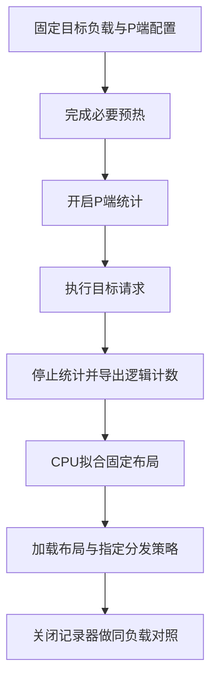

# Ascend 910C上的P端场景静态EPLB：从路由计数、专家布局到实测收益

在一次DeepSeek-V4-Flash的PD调优中，D端平均TPOT已经只有几毫秒，高AL复制负载每轮也能输出约5.5个token，系统吞吐却仍然没有达到目标。已有采样显示P端持续排队，D端等待队列较低，于是下一项候选转向P：输入经过MoE时，专家放置是否适合这组实际负载？

后来，同一组16K零缓存、N320/C128/r6测试中，P端场景静态方案让whole输出吞吐从139.17提高到158.90 token/s/卡，提升14.18%。但核对实际配置后，结论必须更精确：这一轮同时更换了P的专家布局和副本分发策略，后者由dynamic切为static，不能把全部收益只归于布局文件。

这篇沿着那次实验，把“场景静态EPLB”拆成可以解释的步骤：统计的究竟是什么，为什么256个逻辑专家对应272个物理槽，布局怎样拟合，离线均衡分数为何不是设备收益，以及怎样设计对照。它讨论2026年10月18日至21日的固定运行快照，不混入后续在线动态EPLB实验，也不把当时的补丁环境当成当前上游默认行为。

## 一、先把静态布局、副本分发和在线重排分开

EPLB通常指Expert Parallelism Load Balancing，即专家并行负载均衡。但“静态EPLB”容易把几件不同的事包在同一个名字里。

第一件是专家放置：某一层的逻辑专家有哪些物理副本，各自放在哪个执行位置。第二件是副本分发：Router选中逻辑专家以后，请求具体交给哪个副本。第三件是在线重排：是否持续收集运行计数，并在服务过程中改变布局、搬迁权重。

本轮采用离线采集、CPU拟合、加载固定布局的流程，性能测试时没有开启在线动态EPLB。实际记录中，前后两组的`enable_eplb`都是false；但`ep_dispatch_algorithm`从dynamic变成static。所以，看到“dynamic”并不能推出布局正在在线学习或权重正在迁移。

配置关系可以这样理解：`init_expert_location`指定初始布局，`ep_num_redundant_experts`决定冗余槽预算，`ep_dispatch_algorithm`控制副本分发；在线重排则是另一项开关。最终有效命令和运行记录，比基础脚本里的某个默认值更有证明力。

实验使用真实的Prefill / Decode分离部署，P、D各8张Ascend 910C，共16张物理卡。P侧这里的EP16描述逻辑执行rank，并不意味着P独占16张物理卡。本文每卡输出吞吐始终用系统输出除以全部P+D的16张卡。

当时P侧共有256个逻辑专家，保留16个冗余槽，得到272个物理专家槽；在16个EP rank上，每rank17槽。新旧P方案都已经有这16个冗余槽，这次并不是靠额外增加16个槽才取得收益，而是在既有预算里重新分配副本和位置，同时切换分发策略。

P持续排队只是选择该候选的线索，还不足以证明专家不均衡是唯一瓶颈。输入分块、KV交接、attention和调度预算都可能影响供给，后面仍需要同负载实测。

## 二、布局改变的是执行位置，不是Router想选哪个专家

以一层MoE为例，Router产生逻辑专家ID；固定布局把逻辑专家关联到一个或多个物理副本，再由分发策略选择具体执行位置。布局文件中使用的`physical_to_logical_map`，记录的就是每个物理槽装哪个逻辑专家。

本轮布局是43行，每行272个整数。行对应层，列对应物理槽，值位于0到255。同一个逻辑ID出现多次，表示它有多个副本，不表示创建了一个新的逻辑专家。

在这份布局里，一行按连续17槽划分给一个EP rank：前17个值描述rank0的本地专家，接下来17个值描述rank1，依此类推。这让文件中的物理位置与每rank容量约束对应起来。

为解释副本的作用，考虑一个缩小的教学例子。某层四个逻辑专家的路由工作量分别为80、60、10、10，两个rank各有三个物理槽，额外的两个槽可以容纳副本。

如果旧方案把副本给了两个冷专家，布局与理想负载可能是：

```text
rank0：[E0, E2, E3] → 80 + 5 + 5 = 90
rank1：[E1, E2, E3] → 60 + 5 + 5 = 70
```

把副本预算转给两个热点专家，并假设流量能在副本间均分：

```text
rank0：[E0, E1, E2] → 40 + 30 + 10 = 80
rank1：[E0, E1, E3] → 40 + 30 + 10 = 80
```

总逻辑工作量仍然是160，没有少处理token；变化的是最忙rank承担的估计工作量。这里的80、90是教学计数，不是毫秒，也不是本轮真实路由数据。

这个例子还有两个前提。首先，副本必须持有对应逻辑专家的正确权重及量化状态；只把ID映射改对，不等于整个执行就正确。其次，副本流量必须接近假设中的分配，否则“每份40”只是纸上的计算。

因此，固定布局理论上不需要改Router的逻辑选择，但不能据此自动宣布输出无损。本轮没有完整业务准确率或逐token等价认证，性能结果不能替代这些验证。

## 三、采集P端分布，必须让计数对应目标场景

P和D虽然运行同一个模型，统计对象却不同。P处理输入序列；D处理后续生成中的草稿与验证。相同模型不保证两种阶段拥有相同的专家热点，D布局也不能直接当作P的最优解。

16K候选先在P端采集高AL复制任务的路由分布，使用N160/C128/r6；随后用更大的请求集做性能验证。输入正文为16384 token，实际Chat长度16388，输出固定1024，前缀缓存为0。P的实际chunk8192、noCP/DP16和通信配置也一并记录，不能只把“16K”写进文件名。

这条链路的阶段边界如下。统计只围绕目标负载开启，最终性能轮则关闭记录器。



导出的`logical_count`形状为`[512, 43, 256]`，分别是记录槽、层、逻辑专家。它记录路由到逻辑专家的工作计数，不是请求数；一个token被分给多个专家时，可以贡献多个专家分配计数。

512是循环记录槽容量，不表示采到了512条请求，也不保证保留完整时间顺序。本轮16K数据中筛出34个非零槽，不能把它们改称34个独立请求或34段完整时间线。导出计数已经做过一次跨rank归约，拟合时不能再乘以16。

最初导出路径还遇到HCCL分配失败。后续将统计计数转到CPU，使用已有同成员Gloo组进行整数SUM，由rank0保存CPU tensor，才完成可靠导出。这项修改解决的是采集链路，不是每token推理提速；坏文件不能继续拟合，也不应通过重发原负载掩盖失败。

换成128K、90%warm缓存场景时，采集边界还要变化：先完成各DP的seed与独立cache check，再开始正式统计。冷前缀准备时的输入计算，不能混进希望优化的warm分布。该轮正式请求逐条实际命中118784/131076，即90.6222%，而非只看配置目标或全局平均值。

## 四、怎样在16个冗余槽里生成候选布局

这里使用的是当次独立CPU拟合脚本，不是把某个上游在线EPLB规划器直接套过来。它逐层读取逻辑专家计数，先决定副本数，再安排位置。

第一步，每个逻辑专家至少有一份。把专家e的计数记为w_e、副本数记为c_e，拟合暂时用`w_e / c_e`估计单副本负担。对额外16个槽，循环选择当前估计负担最大的专家增加副本，同时限制副本数量不超过可放置rank数。

第二步，把所有副本按估计负担从大到小放置，优先选择当前估计负载最低的rank，同时满足两个约束：每rank恰好17槽，同一逻辑专家的多个副本不能重复落到同一个rank里。遇到局部容量冲突时，脚本尝试交换已有放置来满足约束，不能为了让分数好看丢掉专家。

第三步，在固定容量下做有限次成对交换，继续降低估计峰值，并用负载平方和帮助选择候选。最后验证每层所有256个逻辑专家都被覆盖，272个值全部合法，各rank内部没有重复逻辑ID。

这些步骤解决的是一个带约束的离线放置问题。输出文件的结构正确，不代表可以省掉运行时准入：布局、权重加载、实际分发策略和服务有效配置仍要一致。

拟合还把34个非零槽分成前后两半，各17槽，用前半生成候选，在后半计算估计负载。程序字段叫train和holdout，但由于循环槽不保证时间顺序，也不保证统计独立，这只能算保留槽上的内部检查，不能宣传为独立时间段上的泛化验证。

估计分数的含义是：按副本理想均分，把每个rank的负担加起来，计算最大值除以均值。分数越接近1，表示在这个模型里越均衡。

16K这组43层分数的中位数，旧布局约1.6132，新布局约1.0068；例如第4层的估计值从1.9175到1.0056。它很适合筛掉明显放置不合理的候选，却不能被解释为真实rank时间也按同样比例下降。

原因不仅是“模型不精确”。逻辑计数没有保留来源rank与目标专家的完整联合分布，也没有保留所有微批时序；副本实际分发不一定均匀；每层不同shape下的计算、通信与重叠成本也不是简单的计数比例。拟合明确采用理想均分假设，设备实测必须另做。

## 五、14.18%的收益究竟证明了什么

性能对照不是直接拿统计轮当基线。统计轮开启observer，会改变执行成本；正式比较使用记录器关闭的服务，固定同一复制数据、N320/C128/r6、输出1024与零缓存。

两组P端均保留noCP/DP16、实际chunk8192、Prefill请求上限1、16个冗余槽。D端的静态布局、Compact、草稿5/验证6，以及双方IndexCache freq2等条件保持匹配。关键变化是：

| P端项目 | 基线 | 候选 |
| --- | --- | --- |
| 专家布局 | 原布局 | 当前复制场景拟合布局 |
| 副本分发策略 | dynamic | static |
| 在线动态EPLB | 关闭 | 关闭 |
| 每层物理槽 / 冗余槽 | 272 / 16 | 272 / 16 |

所以，这个实验支持的是P端“场景布局＋static分发”方案的组合收益。没有相同布局分别搭配两种分发策略的完整对照，不能把14.18%拆成布局贡献多少、分发贡献多少，也不能说static本身一定优于dynamic。

whole结果如下，吞吐按全部P8+D8的16张物理卡折算，两轮均320成功、0失败：

表中AL均为whole输出/verify计数；严格的实际proposal接受率两轮都未完整观测，不能用AL换算补齐。

| 指标 | 基线 | 候选 |
| --- | ---: | ---: |
| 正式窗口(s) | 147.16 | 128.89 |
| 输出吞吐(token/s/卡) | 139.17 | 158.90 |
| TTFT均值(s) | 35.49 | 30.35 |
| TPOT均值(ms) | 9.2 | 8.7 |
| E2E均值(s) | 44.89 | 39.26 |
| whole AL | 5.5192 | 5.7645 |

whole输出提升14.18%，首token与完成时间也缩短，说明该候选在这次有限负载下值得保留。AL的变化同时提醒我们：调度与执行状态变化后，观测到的生成过程也会变化，不能把结果解释成“只少做了P端某个算子”，更不能拿AL提升替代质量验证。

原AISBench选出的native吞吐从159.35到188.75，表面上涨18.45%，但候选只纳入175条、持续59.34秒，低于本项目约定的60秒门槛。这个更大的百分比没有被当成充分稳态结论。

随后同候选配置扩大到640条，取得496条、177.30秒的native窗口，输出179.04 token/s/卡，whole166.24。这证明候选可以得到更长的测量窗口，却不是“布局比基线提升多少”的同N确认，因为没有相同640条的旧方案对照；也不能用640与320直接计算配置收益。

再后来把P请求上限1改为2，才得到同640负载下native236.83、whole216.55的结果。那一轮的明确增益应归给合批上限变化，而不是再次算到静态EPLB头上。多个阶段得到的百分比不能直接相加。[整体复盘](ascend-910c-inference-tuning-effective-optimizations-and-costs.md)保留了这条演进关系。

## 六、128K的均衡分数更好，为什么端到端只提高0.81%

16K场景的成功不意味着一张布局能适用所有输入。128K高缓存场景重新采集P、D计数，并分别拟合：P仍是272槽/冗余16，D为256槽/冗余0。该次P侧26个非零槽分成13与13，性质仍是循环保留槽的内部划分。

离线结果看上去很漂亮。P侧第4层的理想负载比从约2.4649降到1.0176，43层中位数从约1.3868到1.0134；但同N160/C64/r6、每条cache90.6222%的正式whole，仅由147.91提高到149.11 token/s/卡，约0.81%。这一轮没有采native。

还有一个归因边界：128K试验同时换了P和D两端场景布局，原方案已经采用静态分发，所以0.81%是两端布局组合的观测，既不是P单端收益，也不能直接证明P单端无效。

离线分数与端到端吞吐之间至少隔着三步。计数不均衡要先转化成真实rank执行时间差；时间差要出现在当前关键路径上；减少的阶段时间还要影响整个PD流水线的完成速度。如果热点被副本分发、通信或其他阶段隐藏，或者主要等待来自Prefill调度、KV交接和长上下文attention，均衡分数就不会按比例变成吞吐。

本轮没有逐项建立这三步的完整因果链，所以不能指定某一段为唯一原因。能够确认的是：配置加载和离线拟合完成，与大幅性能收益是不同的验收条件。

这个0.81%的单次差异也没有重复运行的置信范围，保留健康状态作为后续实验起点是合理的，把它宣传为显著提升则不合理。继续投入采集或冷启动，需要新的失衡证据或明确部署价值，不能只为了得到一个更漂亮的拟合分数。

## 七、怎样把场景静态布局做成可复用的工程能力

这类优化真正需要固化的是一份完整场景，而不是一个布局文件名。至少要保留模型与量化、P/D角色、实际输入输出长度、缓存边界、chunk与并行几何、冗余槽预算、分发策略，以及N/C/r和统计窗口。换数据、缓存或角色时，先判断原分布还是否代表目标负载。

部署验收则分开看：布局格式与专家覆盖是否成立；实际运行记录是否加载正确文件、冗余数和分发模式；原预热与必要路由是否通过；正式测量是否关闭统计；失败数和输出长度是否满足约定。权重及量化状态正确、业务质量满足要求，还需要相应的正确性证据，不能由HTTP成功代替。

成本也要保留。统计、CPU拟合、必要的服务切换、预热和路由都在正式吞吐窗口之外，却会消耗调优时间。当前组合的热负载验证可以复用服务，改变布局所需的准备不能假装没发生。反过来，原计数和拟合已经成功，就不该每次改C都重新采集一遍。

对这次P端方案，最准确的结论是：在特定16K高AL零缓存场景里，固定冗余预算下的场景布局与static副本分发组合，取得了同320请求whole约14.18%的正向观测；更长窗口确认了候选可运行，但尚未完成同640旧方案的布局收益对照。128K的两端场景布局只得到小幅观测，不能沿用16K的收益预期。

后续若要继续学习或优化，最有价值的补充不是再生成一张布局，而是把缺少的联系补上：实际副本流量怎样分配，最慢rank时间是否下降，P完成供给怎样变化，以及同布局下两种分发策略各占多少影响。这样得到的资料，才能从“这个JSON测起来不错”走到“我知道它在哪个执行条件下起作用”。

---

**数据与实现范围**：[实验对照](../../assets/ascend-910c-prefill-static-eplb/measurements.csv)保留whole/native、N/C/r及缺失标记；[离线拟合数值](../../assets/ascend-910c-prefill-static-eplb/offline-fit-summary.json)保留两种场景的槽数、分割语义、逐层理想估计和拟合脚本指纹。教学布局不属于实测。严格proposal接受率及native接受计数未完整观测，均标`NOT_OBSERVED`；正文AL采用whole输出/verify定义，包含首token与输出截断影响。本文没有重新压测、采集或修改服务，也不公开内部地址、账号、请求正文及原始计数文件。

运行期间怎样安全地把专家放到新位置，见[《静态 EPLB 之后：动态专家负载均衡怎样安全地迁移权重？》](../distributed/ascend-dynamic-eplb-weight-migration.md)。它进一步区分布局规划、实际权重迁移和路由生效，并保留动态方案的验证与成本边界。
