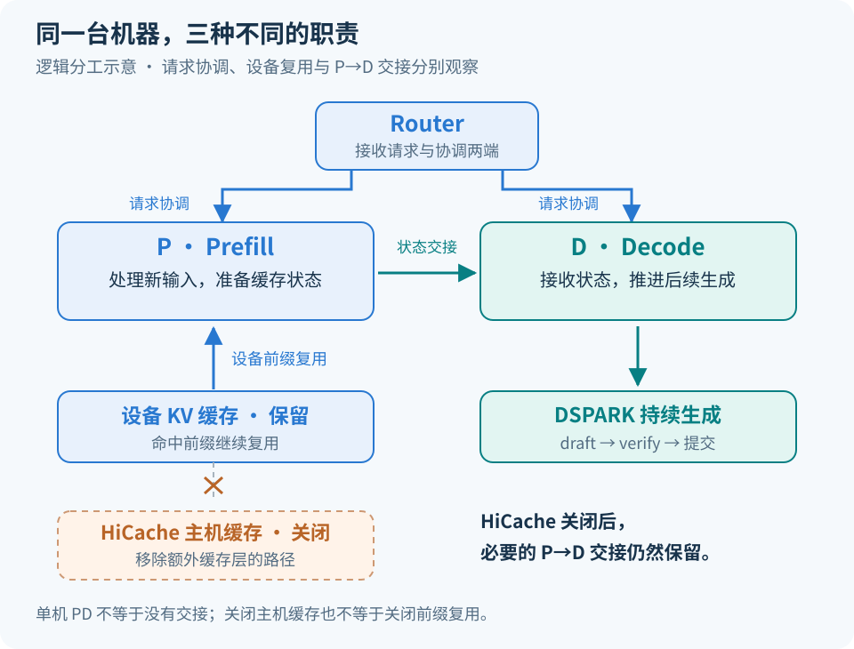
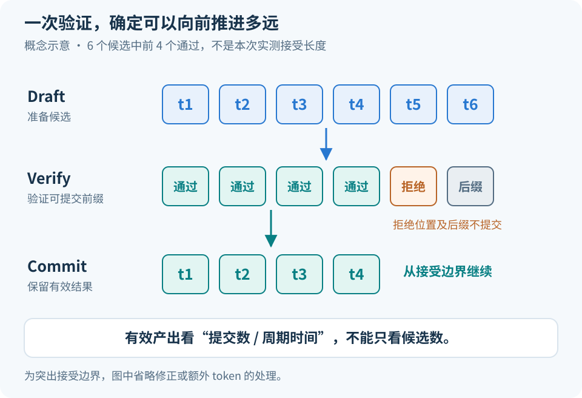
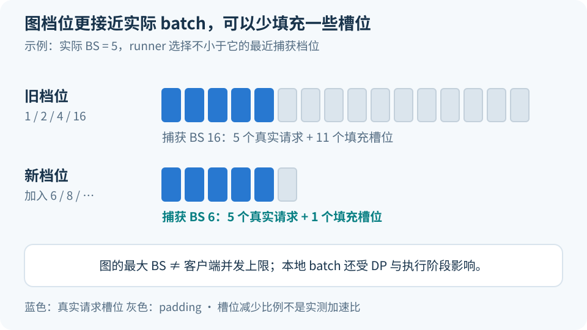
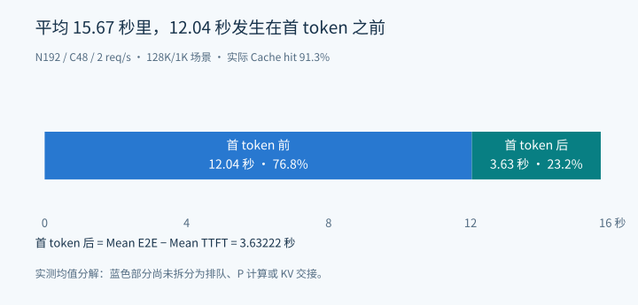

# Ascend 950DT 单机 PD 调优：128K/1K、90% Cache 场景下的配置与实测

这次调优运行在一台 Ascend 950DT 服务器上：输入约 128K Token，输出约 1K Token，约九成输入复用缓存；Prefill 和 Decode 分别由 P、D 服务处理。

P 端关闭 HiCache、多流和 WAR barrier，D 端启用 DSPARK，并调整通信容量与图捕获配置。代表性记录的输出吞吐从约 750 tok/s 提高到 1626 tok/s。两组记录的并发和实际缓存命中率也有变化，因此先交代比较条件，再解释配置变化，最后单独分析完整压测结果。

## 一、负载条件与结果口径

P、D 部署在同一台机器上，各自运行服务实例，由 Router 协调请求。P 计算输入、准备缓存状态，D 接收所需状态后继续生成。因此，单机 PD 仍然包含两端的调度和状态传输。

模型为 DeepSeek 系列 MoE，启动脚本基于本次使用的 SGLang Ascend 适配环境。文中保留参数写法，省略内部版本标识和部署地址等信息。

早期与调优后的一组代表性结果如下：

| 指标 | 早期记录 | 调优后记录 |
| --- | ---: | ---: |
| 客户端并发上限 | 160 | 48 |
| 实际缓存命中率 | 88.6% | 92.1% |
| 平均 TTFT | 50.8 s | 7.5 s |
| 平均 TPOT | 17.3 ms | 4.45 ms |
| 平均输出吞吐 | 约 750 tok/s | 1626 tok/s |

TTFT 是发出请求到收到首 token 的时间；TPOT 是首 token 之后平均每个输出 token 的耗时。表中的输出吞吐按整轮生成 token 总数除以测试时长计算。

这组结果体现了最终配置和压测条件共同带来的改善。并发上限从 160 降到 48，会改变排队情况；缓存命中率从 88.6% 提高到 92.1%，也会明显减少 P 端的新计算。按相同输入长度估算，未命中比例由 11.4% 降到 7.9%，对应的新 token 数减少了约 30.7%。因此，表中的时延和吞吐变化应与这些条件一起看。

脚本层面的变化可以归为三组：

| 调整位置 | 主要变化 | 调整目的 |
| --- | --- | --- |
| P 端 | 关闭 HiCache、多流和 WAR barrier | 调整缓存层级与执行方式 |
| D 端算法 | 启用 DSPARK，draft tokens 设为 7，block size 设为 6 | 让一次验证推进多个有效输出 token |
| D 端运行配置 | 扩大 dispatch 容量、增加图档位、调整通信缓冲 | 容纳更大的验证 batch，减少填充工作 |

原始脚本中的 `--quantization fp8`、`--kv-cache-dtype fp8_e4m3` 和 `expandable_segments:True` 继续沿用。接下来看新增和关闭的配置如何影响 P、D 两端。

## 二、P 端：关闭 HiCache，保留设备前缀复用

P 端最直接的现场观察是：**关闭 HiCache 后，性能有所提升。** 后续测试保留了这个设置，设备上的前缀缓存继续使用。

原始配置除了设备 KV 缓存，还开启了主机缓存层：

```bash
# 原始 P 配置；本次删除了这些 HiCache 参数
--enable-hierarchical-cache \
--hicache-io-backend kernel_ascend \
--hicache-ratio 1.5 \
--hicache-write-policy write_through
```

HiCache 的作用是扩大可复用缓存的容量。历史前缀被移出设备后，如果主机上仍保留着相应状态，后续请求就有机会将其恢复，避免重新计算。容量收益伴随着主机内存占用、缓存写入和搬运成本，具体取舍与前缀的复用方式有关。[HiCache 官方文档](https://docs.sglang.ai/advanced_features/hicache_best_practices.html)分别介绍了容量、I/O 后端与写入策略。

这次压测反复使用一个共享长前缀，该前缀能够在设备侧复用。结合关闭 HiCache 后的改善，一个合理解释是：主机缓存的额外容量收益较小，而维护、写入和搬运仍有成本。大量不同前缀轮换、设备缓存频繁淘汰时，主机缓存的价值会不同。

[](https://raw.githubusercontent.com/AkiYangDev/llm-inference-notes/main/assets/ascend-950dt-single-node-pd-optimization/pd-cache-paths.svg)

*图 1：关闭的是主机缓存支路；设备前缀复用和 P→D 状态传输继续保留。*

后续完整压测中，实际命中率为 91.3%，全部来自设备缓存，Host 命中为 0。也就是说，关闭 HiCache 后，九成左右的输入仍然得到了复用。`--enable-cache-report` 继续保留，用来观察这部分命中情况。PD 传输所需的运行环境也继续保留，它承担的是两端状态交接。

不过，九成命中并不意味着 P 已经没有多少工作。128K 输入中，10% 未命中仍约为 13K token；多个请求进入后，这些后缀需要组批、计算，并生成新的缓存状态。后缀的 Attention 还要结合已有长上下文，因此缓存复用后的请求仍有长上下文成本。

P 端另外一组调整是关闭多流和两项 WAR barrier：

| 配置 | 原始状态 | 调整后 |
| --- | --- | --- |
| `SGLANG_NPU_USE_MULTI_STREAM` | 开启 | 关闭 |
| `SGLANG_ENABLE_WAR_BARRIER` | 开启 | 关闭 |
| `SGLANG_FORCE_COARSE_WAR_BARRIER` | 开启 | 关闭 |

多流尝试让计算、通信等工作重叠，但也需要处理流间依赖。WAR 是 write-after-read，即写入需要等待已有读取完成。这次将多流与相关 barrier 一起关闭，改变了 P 的执行组织方式。它们作为一组配置保留下来，现有记录没有拆出每个开关的独立耗时收益。

P 的 `chunked-prefill-size` 仍为 `65536`，原有 DeepEP 长序列配置继续使用。P 端此次调整的重点，就是缓存层级和多流同步配置。

## 三、D 端：用 DSPARK 增加每轮有效输出

D 端的主要变化是启用投机解码。原始脚本虽然已有 Spec V2、overlap plan stream 相关环境变量，但启动参数没有指定投机算法。新版本加入了以下配置：

```bash
--speculative-algorithm DSPARK \
--speculative-draft-attention-backend ascend \
--speculative-num-draft-tokens 7 \
--speculative-dspark-block-size 6
```

普通自回归生成通常每轮为每条活跃请求推进一个 token。投机解码先准备多个候选，再交给目标模型验证；通过验证的部分可以一起提交。这样，一轮目标模型执行就有机会推进多个输出位置。

[](https://raw.githubusercontent.com/AkiYangDev/llm-inference-notes/main/assets/ascend-950dt-single-node-pd-optimization/speculative-cycle.svg)

*图 2：接受边界示意，假设 6 个候选中前 4 个通过；修正或额外 token 的处理省略。*

投机解码是否划算，要同时看周期耗时和有效产出。先固定 batch 配置，只看其中一条请求的生成进度：

```text
该请求每个有效输出 token 的时间成本
≈ 它经历的 draft/verify 周期耗时 ÷ 该周期为它提交的有效 token 数
```

举一个简单算例：一轮耗时 20 ms，为这条请求提交 5 个有效 token，平均成本是 4 ms/token；另一组配置一轮能提交 6 个，但耗时增加到 30 ms，平均成本就变成了 5 ms/token。增加候选数有机会提高产出，也会增加生成和验证候选的工作。若计算整个 batch 的吞吐，则要将各条请求的有效输出相加，再除以周期时间。

本次 `draft tokens=7`、`block size=6` 是执行配置，实际每轮接受多少，需要看运行统计。TPOT 和整轮输出吞吐则反映这部分收益最终是否兑现。关于接受长度与周期成本的关系，可参见[投机解码性能分析](deepseek-v4-speculative-performance-analysis.md)。

启用 DSPARK 后，D 内部处理的 token 数也发生了变化。一条活跃请求在普通 decode 中通常对应当前步一个 token，进入投机验证时则可能一次处理多个位置。这使得容量规划不能只盯着请求条数：Attention、MoE 和通信环节需要承接的是实际验证 batch。

## 四、通信容量与图捕获配置

### Dispatch 容量为什么要扩大

调试期间，图捕获阶段出现过下面的断言：`num_max_dispatch_tokens_per_rank >= x.size(0)`

左侧是配置的 dispatch token 容量，右侧是本次传入张量的 token 行数。投机验证会放大一次执行的 token 数，图捕获还可能包含 padding，容量需要覆盖这些实际形状。

例如，假设一个 rank 上有 8 条请求，每条一次验证 7 个位置，在这个简化布局下就有 `8 × 7 = 56` 行工作。客户端并发数和这一级张量行数并不是同一个量，后者还取决于请求如何分配、当前执行阶段以及填充方式。

原始公共环境将 `SGLANG_DEEPEP_NUM_MAX_DISPATCH_TOKENS_PER_RANK` 设为 35，P 分支覆盖为 128，D 分支继承 35。D 端中间试验用过 128，最终调整到 512 后，此次图捕获的容量断言通过。512 是本次采用的容量配置，并非由前面的简化算例推导而来。

D 端的相关变化如下：

| 配置 | 原始 D | 调整后 D |
| --- | --- | --- |
| Dispatch token 上限 | 35 | 512 |
| `DEEPEP_HCCL_BUFFSIZE` | 400 | 2600 |
| 图捕获 batch 档位 | 1、2、4、16 | 1、2、3、4、6、8、10、12、14、16 |
| `max-running-requests` | 64 | 196 |
| `chunked-prefill-size` | 16384 | -1 |

### 为什么补充中间图档位

原始 D 已经使用图执行，这次主要调整捕获档位，并将入口从 `--cuda-graph-bs` 改为适配分支使用的 `--cuda-graph-bs-decode`。CLI 保留了 CUDA 命名，实际运行硬件是 Ascend NPU。

图执行预先准备若干形状。当实际 batch 不在捕获列表中时，支持填充的执行路径会补齐到适用档位。原来 4 到 16 之间没有中间档位，加入 6、8、10、12、14 后，小 batch 有机会减少填充位置。

[](https://raw.githubusercontent.com/AkiYangDev/llm-inference-notes/main/assets/ascend-950dt-single-node-pd-optimization/graph-padding.svg)

*图 3：按向上选择最近档位的规则示意，5 条请求的填充槽位从 11 个减少到 1 个。*

少填充一些位置，就有机会减少无效工作，但耗时不会简单按槽位数同比下降；更多档位也会增加捕获时间和图资源占用。档位应围绕常见的执行 batch 来选。客户端并发上限 48 描述整条服务链路中的在途请求，分配到某个 worker、某个执行阶段时，batch 可以远小于 48。

### 其余容量与通信配置

通信缓冲从 400 调到 2600，同时在 D 端加入了原先 P 端使用的长序列配置：

```bash
export DEEPEP_NORMAL_LONG_SEQ_PER_ROUND_TOKENS=8192
export DEEPEP_NORMAL_LONG_SEQ_ROUND=8
export DEEPEP_NORMAL_COMBINE_ENABLE_LONG_SEQ=1
```

这组参数面向对应的 normal 长序列通信路径，是否影响某轮 D 执行取决于实际进入的路径。D 的 MoE dispatch 处理当前步或当前验证 batch 的 token；128K 历史上下文并不会在每一步全部重新经过 MoE。长上下文长度与本轮 dispatch token 数需要分开理解。

`max-running-requests` 从 64 增至 196，为更高负载预留容量。后面的完整压测报告峰值并发为 39，还没有触及旧上限。`chunked-prefill-size=-1` 则关闭 D 端的 chunked prefill。

日志改为 P、D 分别统一落盘。原始 P 已在启动命令末尾使用 `tee`，原始 D 没有对应的文件重定向；新版本在脚本入口统一记录输出，可以同时保存环境初始化和服务运行日志。代码与模型目录也做了切换，对照时需要记录实际加载的版本和权重。

## 五、完整压测的吞吐和时延

前面的历史对照用来说明调优过程的整体变化。下面单独展开后续一轮完整测试：总请求数 192，并发上限 48，到达速率 2 req/s。下文分别简写为 N192、C48、rate2。

这三个参数控制不同事情。N 决定一共发多少条，C 限制同时在途多少条，rate 控制发来的速度。因此，C48 不代表服务始终有 48 条请求在运行。此前只有几十条请求的短测试容易很快进入收尾，增加到 N192 后，可以观察更长一段持续运行。

本轮使用一组共享前缀，输出长度为 1024，预热 16 条，seed 为 100。具体构造参数保留在下面，方便核对：

<details markdown="1">
<summary>本轮压测参数摘录</summary>

```bash
--gsp-num-groups 1 \
--gsp-prompts-per-group 192 \
--gsp-system-prompt-len 117965 \
--gsp-question-len 9216 \
--gsp-output-len 1024 \
--gsp-range-ratio 1 \
--max-concurrency 48 \
--request-rate 2 \
--warmup-requests 16 \
--seed 100
```

日志记录 `flush_cache=False`，即没有通过 benchmark 的该开关清理缓存。重新对照时，还需要保持外部清理与预热流程一致。

</details>

全部 192 条请求完成，结果如下。这里的 12.04 s TTFT 与第一节的 7.5 s 属于不同测试，分别保留各自的整组指标。

| 指标 | N192 / C48 / rate2 |
| --- | ---: |
| 成功请求 | 192 / 192 |
| 测试时长 | 110.29 s |
| 实际缓存命中率 | 91.3% |
| 平均输出吞吐 | 1782.61 tok/s |
| 平均 TTFT | 12,037.73 ms |
| P95 TTFT | 14,698.48 ms |
| 平均 TPOT | 3.55 ms |
| 平均 E2E | 15,669.95 ms |
| 平均在途并发 / 报告峰值并发 | 27.28 / 39 |

### 输入究竟还有多少新工作

“128K/1K、90% Cache”是场景简称，实际工作量以 tokenizer 和缓存统计为准。本轮总输入 24,972,134 token，其中命中 22,788,096 token，全部来自设备缓存，Host 命中为 0。除以 192 条请求，可以得到：

| 平均每请求 | token 数 |
| --- | ---: |
| 输入 | 约 130,063 |
| 缓存命中 | 118,688 |
| 未命中 | 约 11,375 |

这意味着每条请求仍有约 11.4K token 需要新计算。后续对照其他配置时，这个数字比“都在 90% 左右”更有用。输入长度相同，命中率从 90% 到 95%，未命中 token 数就会减半，P 端收到的工作量已经明显不同。

缓存准备也会影响这个数字。同一个 seed 反复运行，可能复用上一轮留下的请求后缀；预热也可能覆盖正式输入的一部分。客户端复用生成数据的 `.pkl` 文件，决定的是输入数据，服务端命中则还取决于缓存状态。对比时固定数据、清理和预热流程，再核对实际未命中量。

### 首 token 之前占了多少时间

同一批请求的平均 E2E 为 15.67 s，平均 TTFT 为 12.04 s，两者之差约为 3.63 s。也就是说，开始输出后的生成阶段只占平均请求时长的约 23%，首 token 之前占约 77%。

[](https://raw.githubusercontent.com/AkiYangDev/llm-inference-notes/main/assets/ascend-950dt-single-node-pd-optimization/latency-budget.svg)

*图 4：同一轮测试中，平均 15.67 s 的请求时长分为首 token 前 12.04 s 和后续生成 3.63 s。*

这个结果把后续关注点落到了首 token 前的路径上。TTFT 包含客户端实际经历的入口处理、分词、排队、输入计算及相关交接时间，具体首 token 的产生和返回位置取决于实现。定位时需要两端日志或执行时间线，才能区分是哪一段等待较多。

### 到达速率如何影响平均吞吐

本轮总输出为 196,608 token，benchmark 报告的平均输出吞吐为 1782.61 tok/s。日志中的峰值为 5191 tok/s，它描述一个局部时间窗口，可能包含此前到达的请求集中输出。整轮平均覆盖起步、持续执行和收尾，配置比较主要看这一指标。

到达速率也限制了持续供给的规模。每秒发来 2 条请求，每条输出 1024 token，对应的长期输出供给量级为：`2 req/s × 1024 token/req = 2048 tok/s`

本轮平均输出吞吐约为这一量级的 87%。到达波动、起步和收尾都会影响这个比例，它不代表设备利用率。报告峰值并发为 39，平均在途并发为 27.28；这些统计表明本轮并未持续用满 C48。峰值的采样窗口应以该 benchmark 实现为准，不将它当作精确瞬时上限。

因此，在固定 rate2 的条件下继续压低 TPOT，吞吐增长可能受到请求供给限制。要进一步观察这组配置的承载能力，需要增加到达速率，同时检查新增请求带来的排队和时延。

## 六、配置选择与后续对照

这次保留的配置针对的是单机 PD、长输入和固定共享前缀的负载。P 端主要依靠设备缓存完成复用，关闭 HiCache 后仍保持了九成左右的命中；D 端通过 DSPARK 增加每轮有效输出，再用足够的 dispatch 容量和更细的图档位承接验证工作。

下一轮可以固定 N192/C48，将 rate 从 2 提高到 4，其余服务参数和缓存准备流程保持一致。首先看平均吞吐能否继续上升，再看平均与尾部 TTFT 是否明显恶化，并对齐 P、D 的队列状态：P 持续排队而 D 请求较少时，重点检查输入处理；P 已完成而 D 迟迟不能接入时，重点检查状态交接、接收调度与 KV 容量。

选择配置时，TPOT 可以有一定取舍。按单条请求的 `E2E ≈ TTFT + (输出 token 数 − 1) × TPOT` 估算：输出 1024 token，假设 TTFT 为 12 s、TPOT 为 3.55 ms，E2E 约为 15.63 s；若 TTFT 降到 7 s、TPOT 升到 5 ms，E2E 仍可降到约 12.12 s。更短的首字等待能够抵消一部分生成变慢的成本，最终再结合整轮吞吐与尾部时延决定是否采用。

当前测试中，首 token 返回后的平均耗时约为 3.63 s。下一轮提高到达速率时，需要同时观察吞吐和首 token 前的等待：吞吐上升且时延可接受，说明现有配置能承接更多请求；若排队明显增加，则沿 P 端处理、PD 交接和 D 端接入逐段定位。

延伸阅读：[SGLang PD 分离](https://docs.sglang.ai/advanced_features/pd_disaggregation.html)、[HiCache 配置](https://docs.sglang.ai/advanced_features/hicache_best_practices.html)、[PD 交接源码解析](../sglang/deepseek-v4-pd-disaggregation-source-analysis.md)。
