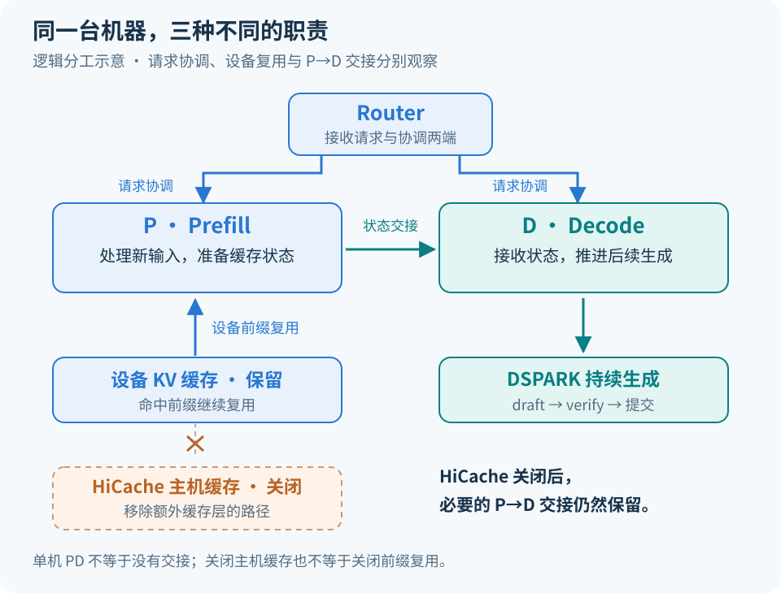
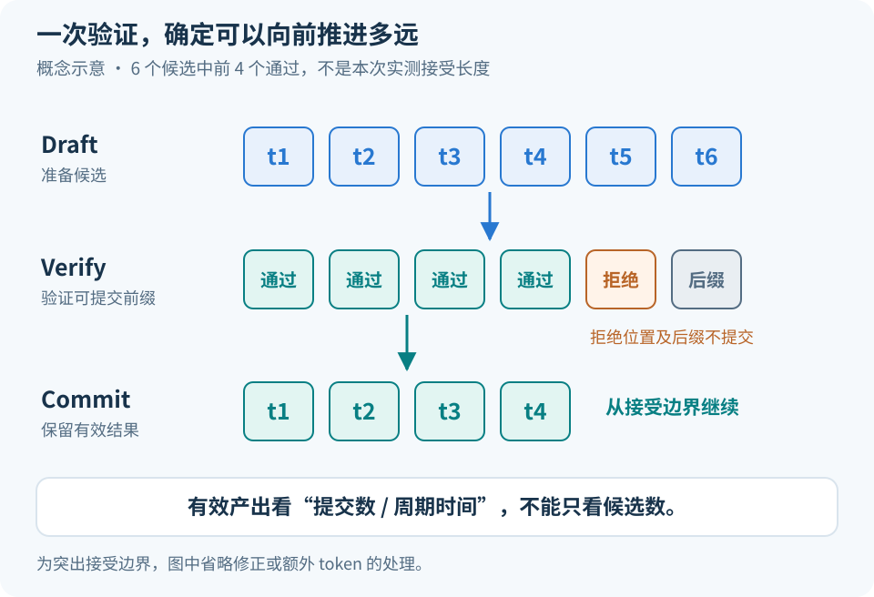
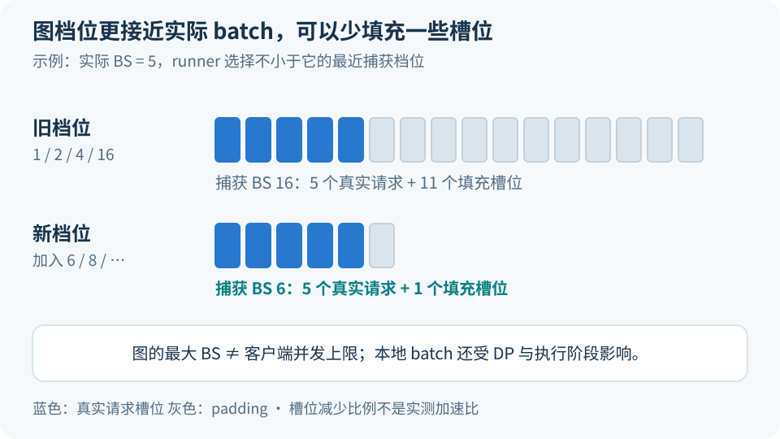
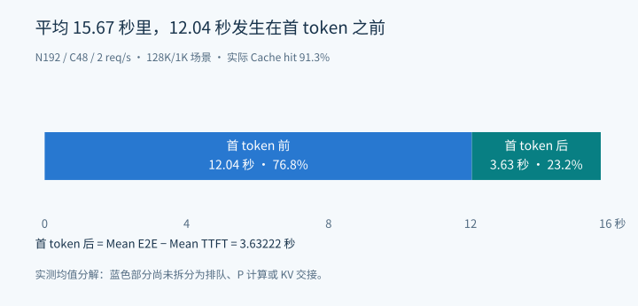

# Ascend 950DT 单机 PD 调优：128K/1K、90% Cache 场景下的配置与实测

Ascend 950DT 单机 PD 的代表记录，从约 750 tok/s 到 1626 tok/s。P 关闭 HiCache、多流、WAR barrier，D 开启 DSPARK，并补通信容量、Graph 档位；与此同时并发、缓存命中也变了。这个结果要连同整组条件看。

负载为约 128K 输入、1K 输出，九成左右复用缓存。下面先交代两端配置，再分析单独归档的一轮完整测试：它的吞吐更高，首 Token 前却占了大部分请求时间。

## 一、负载条件与结果口径

P、D 同机，但分别运行服务实例。Router 协调请求，P 准备输入和缓存，D 接收状态后继续生成，两端调度、交接都进入请求路径。

模型为 DeepSeek 系列 MoE，使用本次 SGLang Ascend 适配环境。参数写法保留，内部版本、部署地址已省略。

两条代表记录为：

| 指标 | 早期记录 | 调优后记录 |
| --- | ---: | ---: |
| 客户端并发上限 | 160 | 48 |
| 实际缓存命中率 | 88.6% | 92.1% |
| 平均 TTFT | 50.8 s | 7.5 s |
| 平均 TPOT | 17.3 ms | 4.45 ms |
| 平均输出吞吐 | 约 750 tok/s | 1626 tok/s |

TTFT 截到首 Token，TPOT 描述后续平均生成间隔，输出吞吐使用整轮完成量、耗时，时间范围各不相同。

并发由 160 降到 48，命中由 88.6% 升到 92.1%。非命中比例 11.4%→7.9%，已减少约 30.7%。因此这组吞吐变化无法拆成各开关的独立增益。

两端主要配置差异为：

| 调整位置 | 主要变化 | 调整目的 |
| --- | --- | --- |
| P 端 | 关闭 HiCache、多流和 WAR barrier | 调整缓存层级与执行方式 |
| D 端算法 | 启用 DSPARK，draft tokens 设为 7，block size 设为 6 | 让一次验证推进多个有效输出 token |
| D 端运行配置 | 扩大 dispatch 容量、增加图档位、调整通信缓冲 | 容纳更大的验证 batch，减少填充工作 |

`--quantization fp8`、`--kv-cache-dtype fp8_e4m3`、`expandable_segments:True` 继续沿用。

## 二、P 端：关闭 HiCache，保留设备前缀复用

P 尝试关闭 HiCache，观测改善后保留。设备前缀缓存继续工作。

移除的主机缓存配置为：

```bash
# 原始 P 配置；本次删除了这些 HiCache 参数
--enable-hierarchical-cache \
--hicache-io-backend kernel_ascend \
--hicache-ratio 1.5 \
--hicache-write-policy write_through
```

HiCache 扩大可复用容量。前缀离开设备后，主机若还保存状态，下次可以恢复，少算一次；同时增加主机内存、写入、搬运成本。[HiCache 官方文档](https://docs.sglang.ai/advanced_features/hicache_best_practices.html) 介绍了容量、I/O 后端、写入策略。

本负载反复使用单一共享前缀，设备足以容纳，关闭主机缓存可能少做维护、搬运。现有记录没有逐项计时。多前缀超出设备容量时，则需要重新比较恢复收益。

[](https://raw.githubusercontent.com/AkiYangDev/llm-inference-notes/main/assets/ascend-950dt-single-node-pd-optimization/pd-cache-paths.svg)

关闭的只是图中主机支路，设备复用、P→D 状态传输照常进行。

后面的完整测试命中 91.3%，全部来自 Device，Host 为 0。`--enable-cache-report` 和两端原有 PD 环境配置仍保留。

128K 输入命中九成，约 13K 非命中输入还要执行，也仍需访问历史状态。

P 同时关闭多流、WAR barrier：

| 配置 | 原始状态 | 调整后 |
| --- | --- | --- |
| `SGLANG_NPU_USE_MULTI_STREAM` | 开启 | 关闭 |
| `SGLANG_ENABLE_WAR_BARRIER` | 开启 | 关闭 |
| `SGLANG_FORCE_COARSE_WAR_BARRIER` | 开启 | 关闭 |

多流安排并发，也要处理流依赖；WAR 为 write-after-read，写入需等读取完成。这次成组关闭，未隔离两者收益，记录支持的是整组选择。

P 的 `chunked-prefill-size=65536`、DeepEP 长序列配置保持不变。

## 三、D 端：用 DSPARK 增加每轮有效输出

D 原有 SpecV2、overlap 环境设置，再补入本次投机算法参数：

```bash
--speculative-algorithm DSPARK \
--speculative-draft-attention-backend ascend \
--speculative-num-draft-tokens 7 \
--speculative-dspark-block-size 6
```

普通自回归通常一轮推进一个位置。DSPARK 先提候选，Target 再验，一轮可以推进多枚。收益取决于整轮成本与提交量。

[](https://raw.githubusercontent.com/AkiYangDev/llm-inference-notes/main/assets/ascend-950dt-single-node-pd-optimization/speculative-cycle.svg)

图只演示候选通过后形成有效输出，未通过的后续不进入确认历史。

单请求每输出平均成本，可以用它经历的 Draft/Verify 周期除以有效提交数估算。

例如 20 ms 提交 5 枚，为 4 ms/Token；30 ms 提交 6 枚，则为 5 ms/Token。batch 的全部工作也要放在同一周期中比较。

本次 `draft tokens=7`、`block size=6` 只规定执行宽度，实际接受量来自运行统计。TPOT、整轮吞吐再说明收益，详见[投机解码性能分析](deepseek-v4-speculative-performance-analysis.md)。

通信容量也必须容纳 Verify 展开的行，不能直接套客户端请求数。

## 四、通信容量与图捕获配置

### Dispatch 容量按实际输入行检查

运行触发 `num_max_dispatch_tokens_per_rank >= x.size(0)` 断言。

它比较当前 Rank 的容量、输入行数，输入可能已包含投机展开和 padding。

教学例中，8 条请求各 7 行，就是 `8 × 7 = 56` 行。这只解释单位。

`SGLANG_DEEPEP_NUM_MAX_DISPATCH_TOKENS_PER_RANK` 原为 35。调整中 P 取 128，D 先由 35 到 128，最终到 512，满足本次固定捕获图的要求。最终容量来自实际执行约束。

变化为：

| 配置 | 原始 D | 调整后 D |
| --- | --- | --- |
| Dispatch token 上限 | 35 | 512 |
| `DEEPEP_HCCL_BUFFSIZE` | 400 | 2600 |
| 图捕获 batch 档位 | 1、2、4、16 | 1、2、3、4、6、8、10、12、14、16 |
| `max-running-requests` | 64 | 196 |
| `chunked-prefill-size` | 16384 | -1 |

### 中间图档位减少请求槽位填充

D 原本已使用 Graph，这次将入口 `--cuda-graph-bs` 换为 `--cuda-graph-bs-decode`。参数虽保留 CUDA 名称，实际运行在 NPU。

原档位从 4 跳到 16，新增 6、8、10、12、14，让中间 batch 匹配更近的档位。

[](https://raw.githubusercontent.com/AkiYangDev/llm-inference-notes/main/assets/ascend-950dt-single-node-pd-optimization/graph-padding.svg)

图中 5 条请求，旧档位补到 16，新档位补到 6，padding 请求槽由 11 到 1。Verify 每请求若再展开多行，Token padding 还需乘相应宽度。

行数减少提供了省计算的机会，耗时还受算子效率影响；更多档位也增加捕获时间、内存。C48 是客户端在途上限，Worker 档位仍要按本地 batch 选。

### 其余容量与通信配置

通信 buffer 从 400 增到 2600，长序列配置继续保留，D 补上所需参数：

```bash
export DEEPEP_NORMAL_LONG_SEQ_PER_ROUND_TOKENS=8192
export DEEPEP_NORMAL_LONG_SEQ_ROUND=8
export DEEPEP_NORMAL_COMBINE_ENABLE_LONG_SEQ=1
```

它们是否生效由通信分支决定。128K 数历史长度，MoE 每步新增输入仍按本轮行数解释。

`max-running-requests` 从 64 到 196，但本轮报告峰值 39，未达原上限，无法据此归因收益。D 的 `chunked-prefill-size=-1` 关闭分块 Prefill。

原 P 用 tee、D 未同样留日志，调整后两端都保留初始化输出。代码、权重目录切换时，还需一起归档实际身份，避免只留下目录名。

## 五、完整压测的吞吐和时延

完整运行采用 N192、C48、请求速率 2。它与开头 TTFT 7.5 s 的代表记录分别归档。

N 数总请求，C 限最大在途，速率控制到达节奏。C 较大也可能因为供给不足而空闲。

使用共享前缀、目标输出 1,024、预热 16 条、seed 100：

<details markdown="1">
<summary>本轮压测参数摘录</summary>

```bash
--gsp-num-groups 1 \
--gsp-prompts-per-group 192 \
--gsp-system-prompt-len 117965 \
--gsp-question-len 9216 \
--gsp-output-len 1024 \
--gsp-range-ratio 1 \
--max-concurrency 48 \
--request-rate 2 \
--warmup-requests 16 \
--seed 100
```

记录中的 `flush_cache=False` 表示没开客户端清理选项；比较缓存状态还要核外部准备。

</details>

192 条全部成功，平均 TTFT 为 12.04 s。以下数据都属于这次完整运行。

| 指标 | N192 / C48 / rate2 |
| --- | ---: |
| 成功请求 | 192 / 192 |
| 测试时长 | 110.29 s |
| 实际缓存命中率 | 91.3% |
| 平均输出吞吐 | 1782.61 tok/s |
| 平均 TTFT | 12,037.73 ms |
| P95 TTFT | 14,698.48 ms |
| 平均 TPOT | 3.55 ms |
| 平均 E2E | 15,669.95 ms |
| 平均在途并发 / 报告峰值并发 | 27.28 / 39 |

### 输入究竟还有多少新工作

总输入 24,972,134 Token，缓存 22,788,096，命中全来自 Device，Host 为 0。按 192 条平均：

| 平均每请求 | token 数 |
| --- | ---: |
| 输入 | 约 130,063 |
| 缓存命中 | 118,688 |
| 未命中 | 约 11,375 |

每条仍约 11.4K 非命中。128K 场景从 90% 命中到 95%，非命中就减半，因此实际命中量是负载条件的一部分。

同 seed 重复时，独立后缀也可能命中。`.pkl` 恢复输入，却不能恢复同样缓存，需要连同清理、预热一起固定。

<a id="token"></a>

### TTFT 占据主要请求时间

平均 E2E 15.67 s，扣 TTFT 12.04 s，后续生成约 3.63 s，分别占 77%、23%。

[](https://raw.githubusercontent.com/AkiYangDev/llm-inference-notes/main/assets/ascend-950dt-single-node-pd-optimization/latency-budget.svg)

图按均值划分时间，还没有把 TTFT 再拆开。

继续定位需要两端日志或时间线，区分排队、P 计算、状态交接、返回，并核本分支首 Token 的返回时刻。

### 到达速率如何影响平均吞吐

共输出 196,608 Token，整轮均值 1782.61 tok/s。5191 的峰值来自局部窗口。

每秒到达 2 条、各输出 1,024，持续供给相当于 `2 × 1024 = 2048 tok/s`。

实测约为该量的 87%，并非设备利用率。平均在途 27.28、报告峰值 39，都没到 C48，峰值本身还受客户端时间桶统计影响。

到达速率因此可能限制本轮产出。提高速率后观察队列是否持续增长，才能判断剩余服务余量。

## 六、配置选择与后续对照

本次保留 P 的 HiCache 关闭、约九成设备缓存命中，D 的 DSPARK、通信容量、图档位。这套选择对应单机 PD、共享前缀负载。

后续方案为保持 N192、C48，将速率 2 改 4，对比平均、尾部 TTFT、P/D 队列、交接耗时。该组尚未执行。

配置也可以按完整请求衡量：`E2E ≈ TTFT + (输出长度 - 1) × TPOT`。输出 1,024，TTFT 12 s、TPOT 3.55 ms，约 15.63 s；TTFT 7 s、TPOT 5 ms，约 12.12 s。单 Token 稍慢的组，整条请求反而可能先结束。

已有记录首 Token 后约 3.63 s，下一步先补足到达供给、拆解 TTFT，再决定调整 P、D 或调度。

延伸阅读：[SGLang PD 分离](https://docs.sglang.ai/advanced_features/pd_disaggregation.html)、[HiCache 配置](https://docs.sglang.ai/advanced_features/hicache_best_practices.html)、[PD 交接源码解析](../sglang/deepseek-v4-pd-disaggregation-source-analysis.md)。
