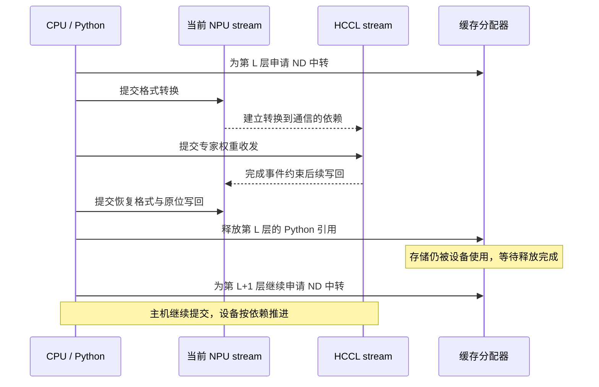

# 一次 Ascend EPLB 显存优化：为什么逐层处理，仍然堆出了多层临时张量？

动态 EPLB 在运行中重新安排专家位置，权重也要跟着搬。为了控制显存，我们已经按层处理：准备这一层的中转张量，迁移，写回，再进入下一层。代码里没有保存所有层中转结果的大列表，但跑完一次更新，分配器的缓存水位仍然抬高了几个 GiB。

这次排查最后落在一个容易被 Python 循环掩盖的事实：**CPU 已经进入下一层，设备未必用完上一层的临时张量。** 引用可以释放，跨 stream 的工作却还没结束；分配器必须保留这些存储，后面的层继续申请，就把逐层处理变成了多层积压。

最终的改动很小：保留原来的格式转换、通信和原位写回，只在 NPU 迁移路径中加入有限长度的完成事件队列。完整服务对照里，请求排空后、清理缓存之前的每芯片平均 reserved，Prefill 减少 **3.05 GiB**，Decode 减少 **3.32 GiB**。权重大小和 KV 容量保持不变。

本文使用 2026 年 10 月 29—30 日的实验。基线为 AkiYangDev/sglang @ f6ad2f4f922d0df111dc66153f543a453267455c，优化在该基线上替换 NPU staging 实现；部署文件校验值、数值结果和逐 rank 数据见[实验数据](../../assets/ascend-eplb-memory-bounded-staging/evidence.json)。对应的事件实现后来发布在 [`bf8fa563`](https://github.com/AkiYangDev/sglang/blob/bf8fa56315f86388f1941ff2358ea0fccec65741/python/sglang/srt/hardware_backend/npu/eplb.py#L196-L246)。下文沿用当时的类名和执行顺序。

## 一、先看减少的是哪一笔显存

模型是 DeepSeek-V4-Flash-0731 W8A8，采用 PD 分离。P、D 各使用 16 个 Ascend 910C 逻辑设备，下面称为“芯片”；它与物理卡数是两个口径。两组都开启动态 EPLB，区别是有没有限制迁移跨层排队。

| 指标 | P 优化前 | P 优化后 | D 优化前 | D 优化后 |
| --- | ---: | ---: | ---: | ---: |
| 请求排空后 reserved，GiB/芯片 | 45.215 | 42.167 | 48.781 | 45.457 |
| 迁移张量 active 峰值，GiB | 5.579 | 1.993 | 5.180 | 1.993 |
| reserved 减少，GiB/芯片 | — | **3.048** | — | **3.324** |

第一行取各端 16 个 rank 的平均值，测点在所有请求完成后、调用 `empty_cache` 之前。第二行只统计归因到迁移的张量，在每端 rank 0、8 的完整更新事件中取最大值；两行分别对应全 rank 的结束水位和采样 rank 的迁移峰值。1 GiB = 1024 MiB。

为什么同时列这两个指标？因为它们回答不同问题。迁移 active 峰值反映更新正在执行时，有多少相关存储仍处于占用状态；排空后的 reserved 反映这轮工作把分配器的池子撑到了什么水位。更新结束后，临时张量可以不再活跃，但池子不必立刻缩回去。

如果只盯设备总占用，很容易把权重、KV、通信资源和分配器缓存混在一起。这次的关键证据是：32 个 rank 的 160 条 rank-update 记录中，更新返回后的 allocated、active 相对更新前净增量全部为零；随后追踪到的 EPLB 分配块都完成释放。新旧两组在空闲时执行缓存回收后，reserved 又回到相同水平：P 为 40,264 MiB，D 为 44,448 MiB。

这些观察把问题指向了**执行期间的临时存储积压，以及它留下的缓存水位**。省下来的这几 GiB，来自更早的存储复用；模型本身的常驻数据没有变化。

## 二、一层权重的搬运，至少跨过两种生命周期

动态 EPLB 根据近期专家负载生成新布局，再把专家权重放到目标槽位。它发生在重平衡时，并非每次普通 forward 都完整搬一次权重。一次更新涉及多层 MoE 权重，同一专家的数据还包括主矩阵和量化辅助张量。

在这条 Ascend 实现中，模型权重使用的内部格式与迁移需要的普通连续布局不同。以 NZ 权重为例，先转换成 ND，在 ND 张量上复用已有的本地重排和 P2P 算法，最后恢复格式，复制回原来的模型存储。原地址需要保留，因为已经捕获的图依赖那些存储。

下面省略了层选择、空闲 rank 和 sender-only 分支，只表示参与迁移并需要写回的一层：

```text
模型原权重（NZ，地址固定）
        │ NZ → ND
        ▼
本层 ND 中转权重 ←→ 本地重排 / P2P / 接收缓冲区
        │ ND → 原格式
        ▼
恢复格式的临时张量
        │ copy_
        ▼
模型原权重（原地址，新内容）
```

接收缓冲区已经在一个迁移 chunk 内跨层复用；本次重点是 `load` 产生的 ND 转换结果及 `store` 的恢复格式结果。对于原本就满足要求的连续 ND 权重，代码直接使用原张量，不需要凭空多造一份中转。

站在 Python 一侧，上一层调用返回，局部引用离开作用域，似乎就可以开始复用内存。站在设备一侧，格式转换、通信、复制都按 stream 的执行依赖推进。Python 返回只说明主机完成了相应提交过程，不能单凭这一点认定设备已经读完那块存储。

这也是为什么通信中的 `work.wait()` 要看后端实现。所核对的 torch_npu 源码里，`WorkHCCL::wait()` 进入 `synchronizeInternal()`，通过 HCCL 完成事件让当前 stream 等待通信；启用 blocking wait 等分支时还会有主机侧等待。这里需要区分“后续设备工作排在通信之后”和“CPU 等到设备执行完毕”。[对应源码](https://github.com/Ascend/pytorch/blob/38e483ee79ec8a3286517808740a811c0f0ae66c/torch_npu/csrc/distributed/ProcessGroupHCCL.cpp#L1055-L1150)明确区分了这两件事。

原流程的依赖保证后面的写回不会越过通信。我们要补充的是另一种约束：主机不能无限领先设备，为后续层连续制造大块临时张量。

## 三、顺着地址看：释放请求已经发出，存储还在等待

为了判断是引用没删干净，还是设备还在使用，我们按张量地址及其分配代际重放 allocator 事件。观察器只保存地址、形状等标量，并用弱引用记录 Python 对象释放，避免采样工具自己把张量留住。

同一个地址可以被反复分配，所以不能只按地址累计字节。一次分配、一次释放请求、一次最终释放，才构成这一代存储的生命周期。记录中需要分清：

| 状态 | 在本次排查中的含义 |
| --- | --- |
| allocated | 当前仍由张量分配占用的部分 |
| active | 仍活跃的分配，包括已经申请释放、但设备尚未用完的部分 |
| reserved | 缓存分配器保留的内存池，包括可复用的空闲块 |
| 设备总占用 | 还包括分配器之外的通信和运行时资源 |

典型过程是：ND 张量参与跨 stream 通信，Python 随后释放引用，allocator 收到 `free_requested`；相关设备工作未完成时，这一块不能直接交给后面的分配，直到 `free_completed` 才结束这一代占用。CPU 在此期间继续执行后续层的转换，于是又申请了新块。



图中表示执行依赖，箭头间距不代表时长。它解释了为什么代码只有一个逐层循环，设备上却能同时存在多层临时存储。

两 rank 小实验给出了很直接的证据。每层两块主矩阵分别为 272 MiB、136 MiB，共 43 层。基线仍然每次只处理一层，但每种主矩阵的 43 次逻辑分配，在不同 rank 上用了 **12～14 个不同地址**。加入排队限制后，逻辑分配仍是 43 次，每种主矩阵只用了 **3 个地址**。

43 次转换照常执行，变化是之前的存储及时完成使用，后续转换能够拿到相同地址。缓存分配器终于有机会复用这些块。

## 四、用两个完成事件，约束主机领先的距离

最直接的办法是在每层结束后同步整个设备，但这样会把提交节奏收得过紧。另一条思路是预分配 ND buffer，把每次转换结果再复制进去；这会多一次大张量拷贝，转换临时结果本身也仍然存在。

我们也尝试过原位格式转换的缓冲区复用候选。它在完整服务验证中失败，随后撤回。最终保留功能式转换和已有写回，只约束跨层排队。

当时新增的核心逻辑如下。这里保留真实顺序，省略同一类中与本问题无关的方法：

```python
# staging 对象初始化时
self._pending_layers = deque(maxlen=2)

# 每次 load() 准备新一层之前
if len(self._pending_layers) == self._pending_layers.maxlen:
    self._pending_layers.popleft().synchronize()

done = torch.npu.Event()
done.record()
self._pending_layers.append(done)

# 后面继续原有的 NZ → ND 转换，不增加 ND → ND copy
```

事件记录在当前 stream 上。进入新一层 `load()` 时，上一层的通信依赖、恢复格式和写回已经提交到相应顺序中，所以此处记录的事件覆盖上一层。后续等待这个事件，就是等到那个完成位置，而不是要求所有 stream 的全部工作都清空。

一个容易看错的细节是：队列长度为 2，不等于任何时刻只存在两层中转。用从 0 开始的层编号看一下：

| 进入哪一层 | 等待什么 | 随后记录的事件 |
| --- | --- | --- |
| L0 | 无 | E0，位于 L0 工作之前 |
| L1 | 无 | E1，覆盖 L0 |
| L2 | E0 | E2，覆盖 L1 |
| L3 | E1，确保 L0 已到达完成点 | E3，覆盖 L2 |

到准备 L3 时，至少先等到 L0 的完成点。这样主机仍可以提前提交一些工作，却不能一路把几十层都压进去。小实验观察到每种 ND 主矩阵复用三个地址，正好与这个排队范围对应。

这里的 `Event.synchronize()` 会阻塞主机继续提交，设备仍在执行已经排入的任务。单纯调用 `record()` 不会限制 CPU，`deque(maxlen=2)` 自动丢弃旧元素也不会等待设备；真正形成约束的是在分配新一层之前，显式等待队首事件。

事件放置的位置依赖原有执行顺序：HCCL 完成事件先约束当前 stream 的后续工作，当前 stream 完成写回，再到下一层入口的事件。沿着这条链等待，才能同时管住通信中的中转数据与写回临时结果。

## 五、先验证复用，再放回完整服务

小实验固定 43 层、真实 NZ 权重和两 rank P2P，执行三轮迁移。下面的计时取后两轮，每轮取较慢 rank，再求平均；峰值为相对实验基线的 active 增量。

| 方案 | active 峰值增量，MiB | 后两轮平均更新耗时，ms | 每种主矩阵使用的地址数 |
| --- | ---: | ---: | ---: |
| 原始逐层提交 | 8568.02 | 358.48 | 12～14 |
| 两个历史完成事件 | 1632.00 | 357.73 | 3 |

两组都通过全部元素校验和模型权重地址检查。这一层验证回答了“是否真的复用、值有没有搬错”，完整服务随后回答“模型权重形态、图回放和实际更新一起运行时是否成立”。[小实验结果](../../assets/ascend-eplb-memory-bounded-staging/micro-results.json)保留了各 rank 的地址计数。

完整服务对照沿用相同输入文件、模型、实际 KV 上限、HCCL 配置和观察器口径。实验配置如下：

| 项目 | 配置 |
| --- | --- |
| 模型与并行 | DeepSeek-V4-Flash-0731 W8A8 / ModelSlim；P、D 各 TP16、EP16、attention DP16 |
| 设备 | P、D 各 16 个 Ascend 910C 逻辑设备 |
| 软件 | PyTorch 2.10.0+cpu、torch_npu 2.10.0.post6、CANN 9.1.0 B243 |
| 负载 | 512 请求、客户端并发 128；输入 16,388、输出 8,192 token |
| EPLB | P：I50/W50；D：I1000/W1000；各 16 个冗余专家 |
| 投机与缓存 | DSpark gamma5 / verify6；关闭 radix cache，D 保留图回放 |
| KV 容量 | P 369,024、D 524,288 token；静态内存比例均为 0.70 |
| 通信 | 两组均复用 TP HCCL 组，D 保持 `HCCL_BUFFSIZE=1200` |

其中 I 是更新间隔，W 是统计窗口。此次比较固定它们，没有通过降低更新频率、缩短窗口或减少冗余专家来省显存。基线来自 10 月 29 日，候选来自 10 月 30 日，复用的是已有同配置基线。

两组各完成 512/512 个请求，失败数为零；优化后 P 完成 3 轮更新，D 完成 7 轮，所有 16 个 rank 都参与完成。每端 rank 0、8 的快照合计覆盖 20 次完整更新，按分配地址和代际重放，得到开头的迁移 active 峰值。

D 端每轮更新后的平均 reserved 为：

```text
46528 → 46548 → 46548 → 46548 → 46548 → 46548 → 46548 MiB
```

第二轮之后不再增长。结合全部 rank-update 的活跃增量归零和分配块最终释放，这说明更新会建立一个可复用的缓存水位，而不是每更新一次就永久留下另一套张量。[32 个 rank 的缓存对照](../../assets/ascend-eplb-memory-bounded-staging/memory-per-rank.csv)和[逐轮记录](../../assets/ascend-eplb-memory-bounded-staging/update-per-rank.csv)随文提供。

## 六、主机多等了一下，更新会不会变慢？

会发生等待，因此必须量实际完成耗时，不能只凭“没有新增计算”认定没有代价。

我们采用 EPLBManager 的原生重平衡日志，每轮取 16 个 rank 中最慢的一个。第一轮包含首次运行成本，单独列出；后续轮取 P 的第 2～3 轮、D 的第 2～7 轮平均。

| 重平衡耗时，ms | P 优化前 | P 优化后 | D 优化前 | D 优化后 |
| --- | ---: | ---: | ---: | ---: |
| 第一轮 | 2259.0 | 2290.0 | 1711.0 | 1707.0 |
| 后续轮平均 | 885.50 | 851.50 | 906.83 | 899.83 |

本次后续轮均值没有上升，P 第一轮则增加了 31 ms。据此保留了显存优化。后续轮耗时的比较还要结合实际发送量：两组规划略有不同，P 平均每 rank 每轮约 15,139.51→14,973.69 MiB，D 约 16,287.46→16,279.30 MiB。

从执行机制看，主机在这里等，不代表设备同时空转。先前提交的设备任务仍在推进，事件完成后才放行后续分配，因而能够减少排队中的内存，同时保留一部分主机提前提交空间。提前量过小会损失重叠，过大又会重新抬高临时存储峰值，队列长度应当通过相同工作量的对照选择。

这轮实验的决策依据是：迁移峰值和缓存水位明显下降，后续重平衡的平均耗时保持在原来的范围。表里的时间单位是一整次 update；面向用户的生成速度，则要另用同负载的 TPOT 和稳态吞吐来衡量。

## 七、以后遇到类似显存上涨，先把账对齐

回头看，最容易走偏的一步，是直接把 ON 与 OFF 的某次设备读数相减，再把差值全部归给“通信缓冲区”或“迁移工作区”。为这个差额找到具体分配来源，还需要把各条生命周期接起来。

这次首先对齐了实际 KV 容量、模型权重、通信配置和采样阶段，再追踪迁移分配。通信资源如果 OFF 后续也会激活，只是 ON 提前激活，就不该全部算作稳态新增。执行中的 active 峰值也不能加到排空后的 reserved 上，它们既有包含关系，又来自不同时间点。

对张量生命周期，我们最后依靠三条相互连接的证据：引用释放之后是否仍有等待完成的块；后续层的分配是否不断使用新地址；限制主机领先距离后，相同逻辑分配是否开始复用地址。沿这三条证据追下去，修复位置就落到了下一层分配之前。

这也解释了为什么没有把缓存清理放进每轮更新。清理已经空闲的块处理的是池子驻留；我们真正要控制的是设备尚未用完时，主机继续申请的那些块。保留缓存复用，给排队设置边界，才同时对上了分配记录和最终结果。

这项实现继续保留原来的 NZ→ND 转换、共享迁移算法和原位写回。后续代码整理时，完成事件仍然留在 NPU staging 内部；它约束的是专家迁移的异步生命周期，不需要给普通 forward 加一轮同步。遇到下一次“循环明明逐个处理，内存却同时占了很多份”的问题，我会先把主机提交时间和设备完成时间摆在一起，再决定该复用什么、该在哪个完成点等待。

文中数据可从[汇总与来源校验值](../../assets/ascend-eplb-memory-bounded-staging/evidence.json)、[小实验](../../assets/ascend-eplb-memory-bounded-staging/micro-results.json)、[逐 rank 缓存](../../assets/ascend-eplb-memory-bounded-staging/memory-per-rank.csv)、[逐轮更新](../../assets/ascend-eplb-memory-bounded-staging/update-per-rank.csv)及[迁移峰值](../../assets/ascend-eplb-memory-bounded-staging/lifecycle-peaks.csv)复核。专家身份、物理槽位和迁移算法的背景，可以接着读[动态专家负载均衡怎样安全地迁移权重](../distributed/ascend-dynamic-eplb-weight-migration.md)；那篇固定的是更早版本，本文补充后续的显存生命周期优化。
