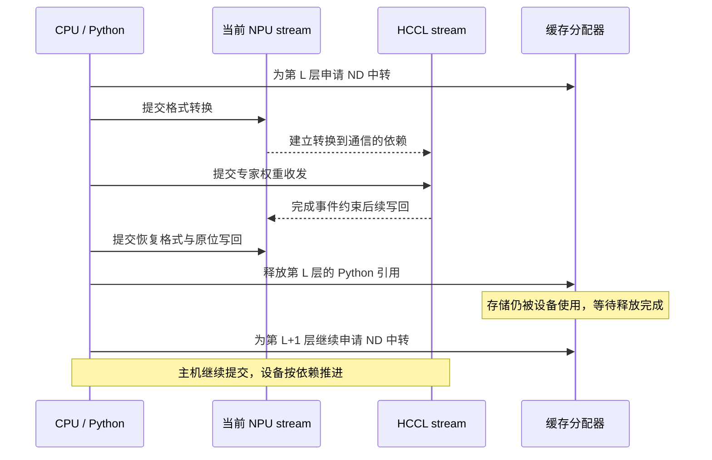

# 一次 Ascend EPLB 显存优化：为什么逐层处理，仍然堆出了多层临时张量？

动态 EPLB 调整专家位置时，需要将权重搬到新槽位。我们已按层执行转换、迁移和写回，处理完这一层再提交下一层，也没有用列表保留所有层的中转结果。但一次更新结束后，分配器 reserved 仍上涨几个 GiB。

按地址追踪临时张量后，原因逐渐清楚：Python 已经提交下一层，设备却可能还在使用上一层的存储。引用释放只发出了回收请求；跨 stream 的工作没有完成，分配器仍须保留那块内存。后续层继续申请，就会同时积压多层临时存储。

最终我们保留格式转换、通信和原位写回，在 NPU 迁移路径中增加有限长度的完成事件队列。完整服务对照中，请求排空后、清理缓存前，每芯片平均 reserved 在 Prefill 端减少 3.05 GiB，在 Decode 端减少 3.32 GiB；权重大小与 KV 容量未变。

本文数据来自 2026 年 10 月 29—30 日。基线为 AkiYangDev/sglang @ f6ad2f4f922d0df111dc66153f543a453267455c，候选在该基线上替换 NPU staging 实现，部署文件校验值及逐 rank 数值保存在[实验数据](../../assets/ascend-eplb-memory-bounded-staging/evidence.json)。后续发布的事件实现可见 [`bf8fa563`](https://github.com/AkiYangDev/sglang/blob/bf8fa56315f86388f1941ff2358ea0fccec65741/python/sglang/srt/hardware_backend/npu/eplb.py#L196-L246)，下文仍按实验当时的类名与顺序解释。

## 一、先看减少的是哪一笔显存

两组使用相同的 DeepSeek-V4-Flash-0731 W8A8 模型和 PD 分离部署，P、D 各有 16 个 Ascend 910C 逻辑设备。本文将逻辑设备称为“芯片”，与物理卡数区分。两组都开启动态 EPLB，只比较是否限制跨层迁移排队。

| 指标 | P 优化前 | P 优化后 | D 优化前 | D 优化后 |
| --- | ---: | ---: | ---: | ---: |
| 请求排空后 reserved，GiB/芯片 | 45.215 | 42.167 | 48.781 | 45.457 |
| 迁移张量 active 峰值，GiB | 5.579 | 1.993 | 5.180 | 1.993 |
| reserved 减少，GiB/芯片 | — | **3.048** | — | **3.324** |

第一行取每端 16 个 rank 的平均值，测于请求全部完成后、调用 `empty_cache` 前。第二行只统计迁移张量，在每端 rank 0、8 的完整更新事件中取峰值。因此，前者描述全 rank 的结束水位，后者描述采样 rank 的迁移峰值。单位换算为 1 GiB = 1024 MiB。

迁移 active 峰值说明更新执行时，还有多少相关存储未完成使用。排空后的 reserved 则说明这次工作将分配器内存池撑到了多大。临时张量用完后，内存块可能留在池中等待复用，所以 active 降下去，reserved 未必立即下降。

设备总占用还混有模型权重、KV 和通信资源，需要靠分配记录定位来源。32 个 rank 的 160 条 rank-update 记录显示，更新返回后 allocated、active 相对更新前的净增量全部归零，追踪到的 EPLB 分配块随后均完成释放。两组在空闲时回收缓存后，reserved 也回到相同水平：P 为 40,264 MiB，D 为 44,448 MiB。

因此，这次要控制的是更新执行期间未完成使用的临时存储，以及它撑高的缓存水位。更早复用这些块就能减少占用，无须改变模型常驻数据。

## 二、一层权重的搬运，至少跨过两种生命周期

重平衡时，动态 EPLB 根据近期专家负载规划新布局，再搬移专家权重。一次更新可能涉及多层 MoE，每个专家还包含主矩阵及量化辅助张量。普通 forward 并不会每次都执行这套完整迁移。

Ascend 模型权重的内部格式与迁移要求的连续布局不同。NZ 权重先转为 ND，在 ND 上执行已有的本地重排和 P2P，再恢复格式、复制回原模型存储。原地址需要保持，因为已捕获的图仍引用这些存储。

下面只展示需要迁移并写回的一层，省略层选择、空闲 rank 与 sender-only 分支：

```text
模型原权重（NZ，地址固定）
        │ NZ → ND
        ▼
本层 ND 中转权重 ←→ 本地重排 / P2P / 接收缓冲区
        │ ND → 原格式
        ▼
恢复格式的临时张量
        │ copy_
        ▼
模型原权重（原地址，新内容）
```

接收缓冲区已在一个迁移 chunk 内跨层复用。这次重点跟踪 `load` 生成的 ND 结果和 `store` 恢复格式的结果。若权重本身已是合适的连续 ND 张量，实现直接使用原张量，不再增加中转副本。

Python 调用返回后，局部引用可以离开作用域，设备工作却仍按 stream 依赖推进。格式转换、通信与复制可能尚未结束。主机完成提交，不能作为设备已读完存储的证据。

通信中的 `work.wait()` 也要结合后端阅读。核对的 torch_npu 源码中，`WorkHCCL::wait()` 调用 `synchronizeInternal()`，通过 HCCL 完成事件让当前 stream 等待通信；blocking wait 等分支还会等待主机。因此设备后续操作排在通信之后，不一定表示 CPU 已经等到通信执行完毕。[对应源码](https://github.com/Ascend/pytorch/blob/38e483ee79ec8a3286517808740a811c0f0ae66c/torch_npu/csrc/distributed/ProcessGroupHCCL.cpp#L1055-L1150)中可以核对这些分支。

原有依赖已经保证写回排在通信之后。这里缺少的是对主机提交速度的限制，避免设备尚未用完时，后续层又连续申请大块临时张量。

## 三、顺着地址看：释放请求已经发出，存储还在等待

我们按张量地址和分配代际重放 allocator 事件，以区分 Python 引用残留与设备尚未完成使用。观察器只保存地址、形状等标量，通过弱引用记录 Python 对象释放，避免工具本身延长张量生命周期。

同一地址可以重复分配，不能把所有事件按地址简单合计。每一代存储需单独关联分配、释放请求和最终释放，使用以下状态区分：

| 状态 | 在本次排查中的含义 |
| --- | --- |
| allocated | 当前仍由张量分配占用的部分 |
| active | 仍活跃的分配，包括已经申请释放、但设备尚未用完的部分 |
| reserved | 缓存分配器保留的内存池，包括可复用的空闲块 |
| 设备总占用 | 还包括分配器之外的通信和运行时资源 |

典型记录是：ND 张量进入跨 stream 通信，Python 随后释放引用，allocator 收到 `free_requested`。设备工作仍未结束，这块存储暂时无法交给下一次分配，直到 `free_completed` 才可复用。CPU 若继续提交后续层的转换，就只能申请其他块。



图中的箭头表示依赖关系，间距不表示时长。逐层 Python 循环只限制了主机提交顺序，并没有保证每层设备工作结束后才开始申请下一层。

两 rank 小实验对此做了地址核对。共 43 层，每层两块主矩阵分别为 272 MiB、136 MiB。原始逐层提交中，每种主矩阵的 43 次逻辑分配，在不同 rank 上使用了 12～14 个地址。限制排队后仍执行 43 次分配，每种矩阵只需 3 个地址。

转换次数没有减少。减少的是同时未完成使用的存储，分配器因而能将之前的地址交给后续转换。

## 四、用两个完成事件，约束主机领先的距离

每层结束就同步整个设备，可以限制积压，却会过度收紧提交节奏。预分配 ND buffer 并复制转换结果也有代价：除了原转换临时张量，还要额外拷贝一次大张量。

我们还试过原位格式转换的缓冲区复用候选，但完整服务验证失败后已撤回。最后保留功能式转换与原写回，只限制跨层排队的长度。

新增逻辑如下。片段按当时实现的真实顺序排列，同一类的其他方法已省略：

```python
# staging 对象初始化时
self._pending_layers = deque(maxlen=2)

# 每次 load() 准备新一层之前
if len(self._pending_layers) == self._pending_layers.maxlen:
    self._pending_layers.popleft().synchronize()

done = torch.npu.Event()
done.record()
self._pending_layers.append(done)

# 后面继续原有的 NZ → ND 转换，不增加 ND → ND copy
```

进入新一层 `load()` 前，上一层的通信依赖、格式恢复和写回已按序提交。此时在当前 stream 记录事件，便能覆盖上一层的完成位置。等待该事件，只需等到这个位置，无须清空所有 stream 的工作。

队列长度为 2，也不表示任何时刻只保留两层中转。以从 0 开始的层编号看，事件对应关系如下：

| 进入哪一层 | 等待什么 | 随后记录的事件 |
| --- | --- | --- |
| L0 | 无 | E0，位于 L0 工作之前 |
| L1 | 无 | E1，覆盖 L0 |
| L2 | E0 | E2，覆盖 L1 |
| L3 | E1，确保 L0 已到达完成点 | E3，覆盖 L2 |

准备 L3 时，会先等到 L0 完成点，因而给主机保留了一些提前提交空间，又阻止它连续积压几十层。小实验每种 ND 主矩阵使用三个地址，与这个排队范围相符。

形成限制的是分配新一层前显式等待队首事件。`Event.synchronize()` 阻塞主机提交时，设备仍可执行已入队任务；单独 `record()` 不会约束 CPU，`deque(maxlen=2)` 丢弃旧元素也不会等待设备。

这个事件位置依赖原流程已建立的顺序：HCCL 完成事件约束当前 stream，写回随后完成，下一层入口再记录事件。等待该位置，才能同时覆盖通信中转和写回临时结果的使用。

## 五、先验证复用，再放回完整服务

小实验固定 43 层、真实 NZ 权重与两 rank P2P，共执行三轮迁移。计时使用后两轮，每轮取较慢 rank 后求均值；active 峰值则取相对实验基线的增量。

| 方案 | active 峰值增量，MiB | 后两轮平均更新耗时，ms | 每种主矩阵使用的地址数 |
| --- | ---: | ---: | ---: |
| 原始逐层提交 | 8568.02 | 358.48 | 12～14 |
| 两个历史完成事件 | 1632.00 | 357.73 | 3 |

两组的全部元素与模型权重地址检查均通过，[小实验结果](../../assets/ascend-eplb-memory-bounded-staging/micro-results.json)中保存了逐 rank 地址计数。确认数值正确、地址开始复用后，再放进完整服务，检查实际权重形态、迁移与图回放一起运行时是否仍然成立。

完整服务沿用相同输入文件、模型、实际 KV 上限、HCCL 配置和观察器口径，配置如下：

| 项目 | 配置 |
| --- | --- |
| 模型与并行 | DeepSeek-V4-Flash-0731 W8A8 / ModelSlim；P、D 各 TP16、EP16、attention DP16 |
| 设备 | P、D 各 16 个 Ascend 910C 逻辑设备 |
| 软件 | PyTorch 2.10.0+cpu、torch_npu 2.10.0.post6、CANN 9.1.0 B243 |
| 负载 | 512 请求、客户端并发 128；输入 16,388、输出 8,192 token |
| EPLB | P：I50/W50；D：I1000/W1000；各 16 个冗余专家 |
| 投机与缓存 | DSpark gamma5 / verify6；关闭 radix cache，D 保留图回放 |
| KV 容量 | P 369,024、D 524,288 token；静态内存比例均为 0.70 |
| 通信 | 两组均复用 TP HCCL 组，D 保持 `HCCL_BUFFSIZE=1200` |

其中 I 为更新间隔，W 为统计窗口，两者在对照中固定。此次没有通过减少更新、缩短窗口或减少冗余专家节省显存。基线取自 10 月 29 日，候选取自 10 月 30 日，复用了已有的同配置结果。

两组均完成 512/512 请求，失败数为零。优化后 P 更新 3 轮、D 更新 7 轮，各端全部 16 个 rank 均完成参与。每端 rank 0、8 的快照共覆盖 20 次完整更新；按分配地址和代际重放后，得到开头列出的迁移 active 峰值。

D 端逐轮更新后的平均 reserved 如下：

```text
46528 → 46548 → 46548 → 46548 → 46548 → 46548 → 46548 MiB
```

第二轮以后，reserved 没有继续增长。再结合全部 rank-update 的活跃增量归零、分配块最终释放，可以判断这些更新建立了可复用的缓存池，并未每轮永久留下新张量。逐 rank 和逐轮数据分别见[缓存对照](../../assets/ascend-eplb-memory-bounded-staging/memory-per-rank.csv)与[更新记录](../../assets/ascend-eplb-memory-bounded-staging/update-per-rank.csv)。

## 六、主机多等了一下，更新会不会变慢？

主机确实增加了等待。是否影响更新速度，需要测到设备完成，不能由没有增加计算量直接推断。

计时使用 EPLBManager 原生重平衡日志，每轮取 16 个 rank 中的最大值。第一轮包含首次运行成本，单独报告；后续均值分别使用 P 第 2～3 轮、D 第 2～7 轮。

| 重平衡耗时，ms | P 优化前 | P 优化后 | D 优化前 | D 优化后 |
| --- | ---: | ---: | ---: | ---: |
| 第一轮 | 2259.0 | 2290.0 | 1711.0 | 1707.0 |
| 后续轮平均 | 885.50 | 851.50 | 906.83 | 899.83 |

本次后续轮均值未上升，P 首轮增加 31 ms，因此保留了显存优化。但后续均值也受发送量影响：两组规划略有不同，P 平均每 rank 每轮从约 15,139.51 变为 14,973.69 MiB，D 从约 16,287.46 变为 16,279.30 MiB，不能把全部耗时差都归给事件限制。

主机等待时，先前提交的设备任务仍在执行。等到事件完成才继续分配，能够降低排队内存，同时保留一部分提前提交空间。队列过短会损失重叠，过长又会抬高峰值，因此需要在相同工作量下比较长度。

这次保留方案的依据，是迁移峰值与缓存水位下降，后续重平衡平均耗时仍在原有范围。这里量的是整次 update；生成速度是否改善，仍要另外比较同负载 TPOT 和稳态吞吐。

## 七、以后遇到类似显存上涨，先把账对齐

类似显存上涨需要先确定测点。直接相减 ON、OFF 的一次设备读数，差额可能同时包含通信初始化、KV 分配和迁移缓存，尚不能归给某个工作区。

我们先对齐实际 KV 容量、权重、通信配置和采样阶段，再追踪迁移分配。如果 OFF 后续也会激活相同通信资源，ON 提前分配的占用就不应全部计为稳态新增。执行期 active 峰值与排空后 reserved 还来自不同时间点，且存在包含关系，也不能直接相加。

这次定位主要依靠地址记录：Python 释放引用后，内存块仍等待设备完成；后续层不断使用新地址；加入排队限制后，相同次数的分配开始复用旧地址。三项记录对应起来，才确定在下一层分配前等待完成事件。

所以没有在每轮更新中插入缓存清理。清理空闲块只能缩小池子驻留，无法解决设备仍在使用旧块、主机又继续申请新块的问题。保留缓存并限制排队，才能让存储及时复用。

实现仍沿用 NZ→ND、共享迁移算法和原位写回。后续整理也将完成事件保留在 NPU staging 内部，只约束专家迁移生命周期，普通 forward 无须增加同步。再遇到逐个提交却积压多份内存的情况，可以先比较主机提交与设备完成的时间，再选择复用对象和等待位置。

文中数据可从[汇总与来源校验值](../../assets/ascend-eplb-memory-bounded-staging/evidence.json)、[小实验](../../assets/ascend-eplb-memory-bounded-staging/micro-results.json)、[逐 rank 缓存](../../assets/ascend-eplb-memory-bounded-staging/memory-per-rank.csv)、[逐轮更新](../../assets/ascend-eplb-memory-bounded-staging/update-per-rank.csv)及[迁移峰值](../../assets/ascend-eplb-memory-bounded-staging/lifecycle-peaks.csv)复核。专家身份、物理槽位和迁移算法的背景，可以接着读[动态专家负载均衡怎样安全地迁移权重](../distributed/ascend-dynamic-eplb-weight-migration.md)；那篇固定的是更早版本，本文补充后续的显存生命周期优化。
