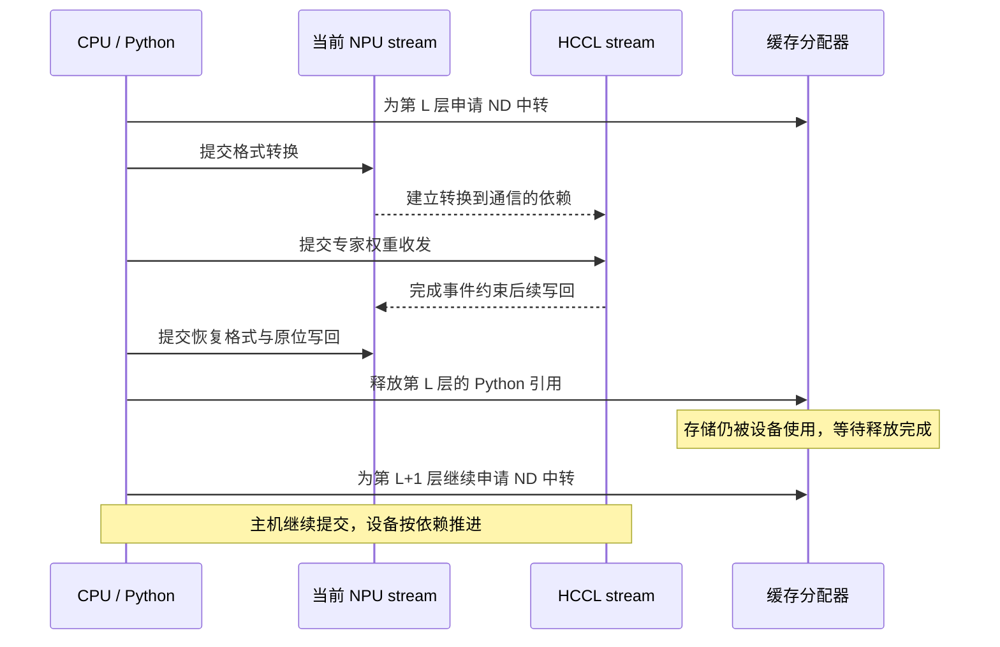

# 一次 Ascend EPLB 显存优化：为什么逐层处理，仍然堆出了多层临时张量？

> 版本提示：本文记录旧 ND 中转路径及其问题。后续实现改用[原权重物理字节视图](ascend-eplb-physical-storage-migration.md)，阅读当前方案请接着看该文。

动态 EPLB 搬专家权重，我们已经改成逐层转换、迁移、写回，也没有用列表存下所有层的中转结果。一次更新做完，分配器的 reserved 仍然上涨几个 GiB。

追到张量地址以后才看清，Python 已经在提交下一层，设备还在使用上一层的存储。局部引用离开作用域，allocator 收到了释放请求，但跨 stream 的工作没结束，旧块还不能复用。后面的层继续申请，没用完的临时存储就堆了起来。

最后保留了格式转换、通信和原位写回，只在 NPU staging 里加了一条有限长度的完成事件队列。完整服务对照中，请求排空后、清理缓存前，每芯片平均 reserved 在 P 端少了 3.05 GiB，D 端少了 3.32 GiB，权重大小和 KV 容量都没改。

实验在 2026 年 10 月 29 至 30 日完成，基线为 AkiYangDev/sglang @ f6ad2f4f922d0df111dc66153f543a453267455c，候选在其上替换 NPU staging 实现。部署文件校验值、逐 rank 数值在[实验数据](../../assets/ascend-eplb-memory-bounded-staging/evidence.json)里。后来发布的事件实现是 [`bf8fa563`](https://github.com/AkiYangDev/sglang/blob/bf8fa56315f86388f1941ff2358ea0fccec65741/python/sglang/srt/hardware_backend/npu/eplb.py#L196-L246)，下面按实验时的类名和顺序讲。

<a id="_1"></a>

## reserved 上涨了，张量却没有留下

两组都用 DeepSeek-V4-Flash-0731 W8A8、PD 分离，P、D 各 16 个 Ascend 910C 逻辑设备。这里把逻辑设备称为“芯片”，和物理卡数区分。动态 EPLB 均开启，只比较是否限制跨层迁移排队。

| 指标 | P 优化前 | P 优化后 | D 优化前 | D 优化后 |
| --- | ---: | ---: | ---: | ---: |
| 请求排空后 reserved，GiB/芯片 | 45.215 | 42.167 | 48.781 | 45.457 |
| 迁移张量 active 峰值，GiB | 5.579 | 1.993 | 5.180 | 1.993 |
| reserved 减少，GiB/芯片 | — | **3.048** | — | **3.324** |

第一行是每端 16 个 rank 的均值，测于请求全部完成、调用 `empty_cache` 之前。第二行只跟踪迁移张量，取每端 rank 0、8 的完整更新事件峰值。一项是全 rank 结束水位，一项是采样 rank 的执行期峰值，不能相加；单位按 1 GiB = 1024 MiB 换算。

active 里包含设备尚未用完的分配。它下降后，空闲块还可能留在缓存池里，reserved 不会立即跟着降。设备总占用又包括模型权重、KV 和分配器外的通信资源，单看一次设备读数分不出来源。

32 个 rank 的 160 条 rank-update 记录里，更新返回后 allocated、active 相对更新前的净增量都归零，追踪到的 EPLB 分配块也都最终释放了。空闲时回收缓存，两组 reserved 回到同样的水平，P 为 40,264 MiB，D 为 44,448 MiB。

所以常驻权重没有多出一份。更新期间来不及复用的临时存储，把分配器的池子撑大了。这次要缩小的正是这部分。

<a id="_7"></a>

ON、OFF 的设备占用对照也得放在同一阶段看。OFF 后续若还会激活同一组通信资源，ON 提前申请的那部分就不是稳态新增。这里先对齐实际 KV 容量、权重、通信配置和测点，再追踪迁移分配，才能把几笔账分开。

<a id="_2"></a>

## Python 提交完一层，NPU 未必用完一层

动态 EPLB 根据近期专家负载规划布局，再搬到新槽位。一轮更新可能处理多层 MoE，每个专家还有主矩阵和量化辅助张量；普通 forward 并不会每次都做一遍完整迁移。

Ascend 权重的内部格式不适合直接交给迁移。NZ 先转 ND，做已有的本地重排和 P2P，再恢复格式、复制回原模型存储。已捕获的图引用着原存储，地址要保持不变。

```text
模型原权重（NZ，地址固定）
        │ NZ → ND
        ▼
本层 ND 中转权重 ←→ 本地重排 / P2P / 接收缓冲区
        │ ND → 原格式
        ▼
恢复格式的临时张量
        │ copy_
        ▼
模型原权重（原地址，新内容）
```

图里只展开需要迁移、写回的一层，省略了层选择、空闲 rank 和 sender-only 分支。接收缓冲区已经在一个迁移 chunk 内跨层复用，这次追的是 `load` 的 ND 结果和 `store` 恢复格式的结果。权重本来就是合适的连续 ND 张量时，直接用原张量，不额外复制。

Python 调用返回，局部引用就可能释放，格式转换、通信和复制却仍按 stream 依赖在设备上排队。`work.wait()` 的名字也容易让人把主机返回与设备完成混在一起。

核对的 torch_npu 里，`WorkHCCL::wait()` 调用 `synchronizeInternal()`，用 HCCL 完成事件让当前 stream 等通信；blocking wait 等分支才还会等待主机。[对应源码](https://github.com/Ascend/pytorch/blob/38e483ee79ec8a3286517808740a811c0f0ae66c/torch_npu/csrc/distributed/ProcessGroupHCCL.cpp#L1055-L1150)能看到这些分支。后面的写回因此已经排在通信之后，但 CPU 不一定等到通信真正执行完才返回。

原流程的设备依赖没有缺，缺的是限制 CPU 继续申请后续层临时存储的时机。

<a id="_3"></a>

## free_requested 到 free_completed 之间

我们按地址和分配代际重放 allocator 事件。同一地址可以再次分配，每一代都得分别关联分配、释放请求和最终释放，否则不同生命周期会被混成一块。

| 状态 | 在本次排查中的含义 |
| --- | --- |
| allocated | 当前仍由张量分配占用的部分 |
| active | 仍活跃的分配，包括已经申请释放、但设备尚未用完的部分 |
| reserved | 缓存分配器保留的内存池，包括可复用的空闲块 |
| 设备总占用 | 还包括分配器之外的通信和运行时资源 |

观察器只保留地址、形状等标量，用弱引用记录 Python 对象释放，避免它自己把张量多留一会儿。典型记录里，ND 张量进入跨 stream 通信，Python 释放引用后出现 `free_requested`，设备继续使用存储，直到 `free_completed`，这块内存才可以再分配。



箭头表示依赖，间距不表示时长。逐层循环限制的是主机提交顺序，它没要求 L 层的设备工作完成后，才给 L+1 申请张量。

两 rank 小实验有 43 层，每层两块主矩阵分别为 272 MiB、136 MiB。原先每种主矩阵做 43 次逻辑分配，不同 rank 用了 12～14 个地址；限制排队后，仍做 43 次分配，每种矩阵只用了 3 个地址。

转换次数没变，旧存储开始及时复用了。在每轮结束插入缓存清理，至多回收已经空闲的池子，解决不了设备仍占着旧块、主机又继续申请新块的问题。

<a id="_4"></a>

## 两个 Event，限制下一层何时申请

每层都同步整个设备，可以把排队收住，但提交节奏也会被收得太紧。预分配 ND buffer 再复制转换结果，则多了一次大张量拷贝，原转换临时张量仍在。

我们试过原位格式转换、复用缓冲区的候选，完整服务验证失败后撤回了。最后保留功能式转换和原写回，给跨层排队加限制。下面省略同类其他方法，顺序与当时实现一致。

```python
# staging 对象初始化时
self._pending_layers = deque(maxlen=2)

# 每次 load() 准备新一层之前
if len(self._pending_layers) == self._pending_layers.maxlen:
    self._pending_layers.popleft().synchronize()

done = torch.npu.Event()
done.record()
self._pending_layers.append(done)

# 后面继续原有的 NZ → ND 转换，不增加 ND → ND copy
```

进入新一层 `load()` 前，上一层的通信依赖、格式恢复和写回已经按序提交。在当前 stream 记下事件，完成点就覆盖到上一层。等待这个位置即可，不必清空所有 stream。

`deque(maxlen=2)` 也不等于任何时刻只保留两层中转。层号从 0 开始，事件落点是这样的。

| 进入哪一层 | 等待什么 | 随后记录的事件 |
| --- | --- | --- |
| L0 | 无 | E0，位于 L0 工作之前 |
| L1 | 无 | E1，覆盖 L0 |
| L2 | E0 | E2，覆盖 L1 |
| L3 | E1，确保 L0 已到达完成点 | E3，覆盖 L2 |

到 L3 入口才等 E1，确保 L0 到达完成点。CPU 因而还能提前提交一些工作，又不能一口气把几十层的临时张量排进去。小实验观察到的每种主矩阵三个地址，与这个范围相符。

真正阻塞主机的是分配下一层前的 `Event.synchronize()`。设备仍能执行已经入队的任务；只 `record()` 不会限制 CPU，队列满了自动丢掉旧元素也不会等待。

这个位置还依赖原有顺序，HCCL 完成事件先约束当前 stream，写回在后，下一层入口再记事件。这样等到的完成点才覆盖通信中转和写回临时结果。

<a id="_5"></a>

## 从 43 层小实验放回完整 PD 服务

小实验使用真实 NZ 权重、两 rank P2P，43 层共做三轮迁移。计时取后两轮，每轮先取较慢 rank 再求均值；active 峰值取相对实验基线的增量。

| 方案 | active 峰值增量，MiB | 后两轮平均更新耗时，ms | 每种主矩阵使用的地址数 |
| --- | ---: | ---: | ---: |
| 原始逐层提交 | 8568.02 | 358.48 | 12～14 |
| 两个历史完成事件 | 1632.00 | 357.73 | 3 |

两组全部元素与模型权重地址检查通过，[小实验结果](../../assets/ascend-eplb-memory-bounded-staging/micro-results.json)保存了逐 rank 地址计数。随后放回完整服务，继续检查实际权重、迁移和图回放一起运行时的表现。

两组沿用同一输入文件、模型、实际 KV 上限、HCCL 配置和观察器口径。

| 项目 | 配置 |
| --- | --- |
| 模型与并行 | DeepSeek-V4-Flash-0731 W8A8 / ModelSlim；P、D 各 TP16、EP16、attention DP16 |
| 设备 | P、D 各 16 个 Ascend 910C 逻辑设备 |
| 软件 | PyTorch 2.10.0+cpu、torch_npu 2.10.0.post6、CANN 9.1.0 B243 |
| 负载 | 512 请求、客户端并发 128；输入 16,388、输出 8,192 token |
| EPLB | P：I50/W50；D：I1000/W1000；各 16 个冗余专家 |
| 投机与缓存 | DSpark gamma5 / verify6；关闭 radix cache，D 保留图回放 |
| KV 容量 | P 369,024、D 524,288 token；静态内存比例均为 0.70 |
| 通信 | 两组均复用 TP HCCL 组，D 保持 `HCCL_BUFFSIZE=1200` |

I 是更新间隔，W 是统计窗口，两组都固定，没有靠减少更新、缩短窗口或减少冗余专家省显存。基线复用 10 月 29 日的同配置结果，候选来自 10 月 30 日。

两组均完成 512/512 请求，零失败。优化后 P 更新 3 轮、D 更新 7 轮，各端全部 16 个 rank 都完成参与。每端 rank 0、8 的快照覆盖共 20 次完整更新，按地址与代际重放，得到了开头的迁移 active 峰值。

D 端逐轮更新后的平均 reserved 如下。

```text
46528 → 46548 → 46548 → 46548 → 46548 → 46548 → 46548 MiB
```

第二轮以后没有再涨。与全部 rank-update 的活跃增量归零、分配块最终释放对上，就能看出更新建立了可复用的缓存池，没有每轮永久留下一批张量。[缓存对照](../../assets/ascend-eplb-memory-bounded-staging/memory-per-rank.csv)与[更新记录](../../assets/ascend-eplb-memory-bounded-staging/update-per-rank.csv)保留了逐 rank、逐轮数据。

<a id="_6"></a>

## update 有没有因为等待而变慢

CPU 多等了一下，更新耗时需要实际量到设备完成。这里用 EPLBManager 原生重平衡日志，每轮取 16 个 rank 的最大值。首轮含首次运行成本，单列；后续均值用 P 第 2～3 轮、D 第 2～7 轮。

| 重平衡耗时，ms | P 优化前 | P 优化后 | D 优化前 | D 优化后 |
| --- | ---: | ---: | ---: | ---: |
| 第一轮 | 2259.0 | 2290.0 | 1711.0 | 1707.0 |
| 后续轮平均 | 885.50 | 851.50 | 906.83 | 899.83 |

后续轮均值没有上升，P 首轮多了 31 ms，结合显存下降，这次保留了候选。两组规划略有不同，发送量也变了，P 平均每 rank 每轮从约 15,139.51 到 14,973.69 MiB，D 从约 16,287.46 到 16,279.30 MiB，所以耗时差不能全记在事件限制上。

等待期间，设备仍在做已提交的工作；等完成点到了，再继续申请，能减少排队内存，也留住部分重叠。队列短了可能损失重叠，长了会抬峰值，长度得在相同工作量下比较。

这次量的是整次 update，保留依据是迁移峰值、缓存水位下降，后续更新均值仍在原有范围。生成速度有没有改善，还要用同负载 TPOT 和稳态吞吐回答。完成事件后来仍留在 NPU staging 内部，只约束专家迁移的生命周期，普通 forward 不加同步。

数据可从[汇总与来源校验值](../../assets/ascend-eplb-memory-bounded-staging/evidence.json)、[小实验](../../assets/ascend-eplb-memory-bounded-staging/micro-results.json)、[逐 rank 缓存](../../assets/ascend-eplb-memory-bounded-staging/memory-per-rank.csv)、[逐轮更新](../../assets/ascend-eplb-memory-bounded-staging/update-per-rank.csv)和[迁移峰值](../../assets/ascend-eplb-memory-bounded-staging/lifecycle-peaks.csv)复核。专家身份、物理槽位与迁移算法见[动态专家负载均衡怎样安全地迁移权重](../distributed/ascend-dynamic-eplb-weight-migration.md)，那篇固定了更早版本，这里记录其后的临时存储问题。

后续的[物理存储迁移重构](ascend-eplb-physical-storage-migration.md)进一步去掉了整层 NZ↔ND 中转：为原权重建立字节视图，保留迁移算法需要的 scratch。这两次优化分别处理临时张量的排队数量与临时存储本身，实验版本和结果也分别记录。

[返回 EPLB 专题](../distributed/eplb-study-guide.md)。
