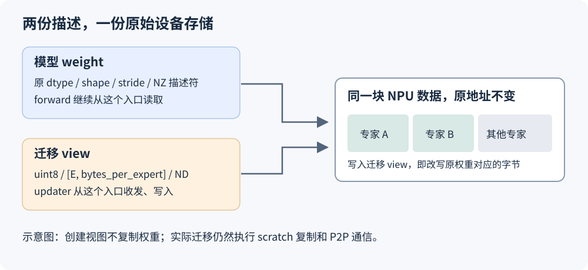
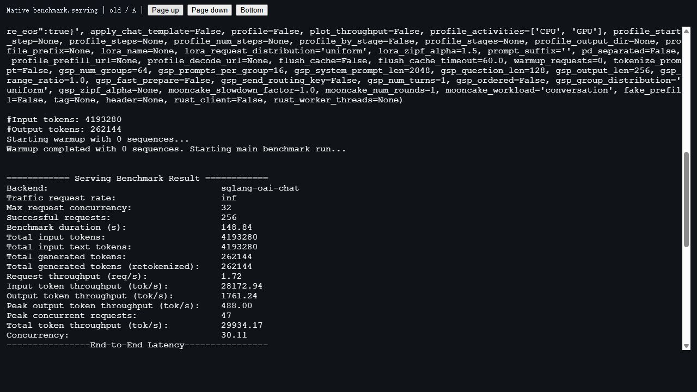

# 搬专家权重，还需要 NZ→ND 吗？一次 Ascend EPLB 存储路径重构

动态 EPLB 会根据运行中的专家负载，重新安排专家副本的位置。例如，某张卡上的热门专家忙不过来，就把它的副本放到另一张卡，让后续 token 有更多位置可以分发。重新安排布局之后，权重也要跟着搬动：有些专家留在原位，有些跨卡传输，有些只在本卡换一个槽位。

早期 Ascend 实现先把需要处理的 NZ 权重转换成连续 ND 张量，调用已有的专家迁移算法，搬完后再转回原格式，复制到模型权重里。这条路径把通信与内部存储格式分开了，也多出了一轮准备和写回。

后来我们把这段改成了直接搬专家的物理存储。在 Ascend 910C 的一轮完整服务对照中，两边都开启动态 EPLB，并固定实际 KV 容量：P 端完整重平衡耗时的三轮中位数从 696 ms 降到 611 ms，D 端一次观测从 730 ms 降到 658 ms；同芯片配对的采样显存差值，中位数分别减少 839.5 MiB、1,641.5 MiB。

本文 P 指处理输入的 prefill 端，D 指持续生成的 decode 端。两端模型权重的存储路径相同，更新频率和运行负载不同。

这次变化来自迁移时少做了权重转换和中转。模型推理仍然使用原来的 NZ 权重，通信仍然需要收发，交换专家仍然需要临时缓冲。下面从一次简单的专家交换讲起，说明这几件事怎样同时成立。

正文按 [SGLang PR #49701](https://github.com/sgl-project/sglang/pull/49701) 的固定提交 [`2914be608`](https://github.com/sgl-project/sglang/blob/2914be608009b65099c4c52ba118a597bf1b1421/python/sglang/srt/hardware_backend/npu/eplb.py) 解读。文末的新旧性能对照使用更早的两份已测提交，分别注明；文中的小矩阵用于解释机制，真实 NPU 元数据会单独标出。

## 一、搬一个专家，究竟要搬什么

先把模型缩小到四个逻辑专家 A、B、C、D。每张卡上有两个物理槽位，这次只交换 B 和 C：

| 物理位置 | 更新前 | 更新后 |
| --- | --- | --- |
| rank 0，槽位 0 | A | A |
| rank 0，槽位 1 | B | C |
| rank 1，槽位 0 | C | B |
| rank 1，槽位 1 | D | D |

Router 以后仍然选择逻辑专家 B，分发过程根据新映射找到 rank 1 的槽位 0。B 的数学含义和参数值没有改变，改变的是保存这份参数的位置。

一个专家又不只是一张矩阵。以 DeepSeek 的 MoE 层为例，迁移可能同时涉及上投影、下投影，以及量化执行需要的 scale 等辅助张量。已有 updater 接收一个张量列表：列表中每个张量的第 0 维是本卡专家槽位，取同一行，就得到同一位专家在这张权重或辅助张量中的数据。

因此，搬 B 要对列表里的每种数据使用同一套专家排列。只换主权重、不换它对应的 scale，得到的就不再是原来的 B。

这里还存在覆盖顺序。rank 0 需要把 B 发走，同时又要把 C 写进 B 原来占用的位置。如果先用 C 覆盖这个槽位，再发送 B，就会把 C 当作 B 发出去。本卡交换也一样：直接执行 `slot0 = slot1`、再执行 `slot1 = slot0`，最后两个槽位都会是旧的 slot1。

已有迁移算法因此先保全需要的数据：本卡来源复制进 scratch，远端数据接收到 scratch，发送使用尚未被覆盖的源权重；通信等待安排好以后，再把 scratch 中的数据复制到目标槽位。这个顺序是后面直接写原权重的基础。[单层 updater 源码](https://github.com/sgl-project/sglang/blob/2914be608009b65099c4c52ba118a597bf1b1421/python/sglang/srt/eplb/expert_location_updater.py#L232-L592)里，接收和本地暂存、发送、P2P 等待、目标复制依次组织。

本次重构保留这套算法，改变的是交给它的权重表示。

## 二、看懂 shape 之前，先区分张量和它背后的存储

模型代码看到的一个张量，包含地址、dtype、shape、stride 等信息。地址指向设备上的数据；shape 说明逻辑上有几个维度、每维多长；stride 说明沿一个维度走一步，需要跨过多少个元素。

这些信息描述了怎样访问数据，并不意味着每次改变 shape 或 stride 都要复制数据。

下面是一个普通 PyTorch 教学例子：

```python
import torch

x = torch.arange(24).reshape(2, 3, 4)
y = x.transpose(1, 2)

print(tuple(x.shape), x.stride())  # (2, 3, 4) (12, 4, 1)
print(tuple(y.shape), y.stride())  # (2, 4, 3) (12, 1, 4)
print(x.data_ptr() == y.data_ptr())  # True
```

把第 0 维看作两个专家：每个专家原来有一张 3×4 矩阵，转置后变成 4×3。访问顺序变了，但每个专家仍然独占连续的 12 个元素。`y` 不是默认意义下的连续张量，却没有在专家内部留下空洞。

这就是代码允许“专家内部转置”的原因。迁移只需要把这 12 个元素整体搬走，无须按转置后的访问顺序重新排一遍。接收端继续使用原来的矩阵描述，就能按同样的方式读取它。

### NZ 还多了一层设备存储描述

Ascend 的 FRACTAL_NZ 是供计算使用的分块存储格式。逻辑矩阵仍然可以表现为 `[M, N]`，设备里则按内部格式组织，未对齐的维度还会带来 padding。torch_npu 的 storage descriptor 保存着理解这份物理存储所需的元数据。

所以，对 NZ 张量只计算 `numel() * element_size()`，得到的是逻辑数据量，未必覆盖完整的物理存储。

这次真实设备小实验中，一张 BF16 NZ 权重的逻辑 shape 为 `[6, 17, 64]`，第 0 维是 6 个专家。每个专家逻辑上有：

```text
17 × 64 × 2 字节 = 2,176 字节
```

生产适配器实际得到的传输视图却是 `[6, 4096] uint8`：每个专家占 4,096 字节。把内部两维转置成 `[6, 64, 17]` 后，传输视图仍是 `[6, 4096]`。逻辑元素没增加，物理分块的 padding 也没有因为转置消失。

如果只搬 2,176 字节，相当于凭逻辑大小截取了一段 NZ 存储，并没有搬完这位专家的完整物理表示。新版要搬的是 4,096 字节这一整块。torch_npu 对 NZ 及其 C0 变体的存储格式定义，可对应其 [FormatHelper](https://github.com/Ascend/pytorch/blob/e945b7088a865036fbd06bc02c3097005526469a/torch_npu/csrc/framework/FormatHelper.cpp#L51-L75) 查看。

这也解释了本文的前提：发送和接收双方使用相容的专家权重布局。原始字节本身不携带一种“自动适配任意矩阵”的能力，不能把一种格式的专家字节写进另一种格式的目标，再期待计算算子替我们解释。

## 三、旧路径为什么先把 NZ 转成 ND

对已有 updater 来说，最直接的输入是普通、连续、能按专家行切片的张量。把内部格式先展开成 ND，迁移算法就不用理解 NZ 的物理分块和 padding。

旧版在需要中转的权重上执行：

```python
# 旧版 load() 中的关键表达式，省略列表与条件分支。
torch.ops.npu.npu_format_cast(weight, _FORMAT_ND).contiguous()
```

得到的新张量保存可直接按逻辑维度访问的数据。updater 在它上面完成收发和重排；随后还需要恢复推理使用的存储格式：

```python
# 旧版 store() 中的关键代码。
restored = torch.ops.npu.npu_format_cast(
    buffer, torch.ops.npu.get_npu_format(weight)
)
weight.copy_(restored)
```

最后一步写回原 `weight`，是为了保留模型权重地址。已经捕获的图引用的是原来的设备存储，把 Python 变量重新绑定到另一个张量，并不能让图自动改为使用新地址。上述代码来自旧对照版本的 [_ExpertWeightStaging](https://github.com/sgl-project/sglang/blob/ddc2a3ababd82db41cd097470fc51569577a0dff/python/sglang/srt/hardware_backend/npu/eplb.py#L192-L250)。

把这条路径展开，可以看到三类不同的空间：

```text
模型里的原 NZ 权重                 一直存在，供 forward 使用
    ↓ NZ→ND，必要时整理连续性
ND 中转权重                       updater 修改的对象
    ↔ scratch / P2P               保全来源、接收远端专家
    ↓ ND→NZ
恢复原格式的结果
    ↓ copy_
模型里的原 NZ 权重                 地址保持不变
```

这里的 ND 中转权重和 scratch 不是同一份缓冲。前者把整张权重准备成 updater 能处理的表示，后者负责迁移算法内部的安全交换。写回时，又会产生恢复原格式的结果。

设备异步执行还会延长这些临时分配的存活期：Python 已经准备下一层，不代表上一层的转换结果已经用完。之前那篇[逐层处理为何仍会堆积临时显存](ascend-eplb-memory-bounded-staging.md)，解决的是怎样限制这些临时张量同时排队的数量。当前这次重构继续往前走，把其中的整层转换中转去掉。

## 四、新路径：给同一块存储增加一个字节视图

迁移 B 时，我们并不需要计算 B 的矩阵乘法，只需要原样运走 B 的全部参数。只要每个专家的物理边界能够确定，就可以把它表示成一行字节：

```text
迁移张量：[本卡 routed 专家槽位数，每个专家的物理字节数]
dtype：uint8
```

假设某个专家占 8 MiB，迁移器就把它看成一行 8,388,608 个字节。接收端把这一行放进另一个同布局的专家槽位，计算端继续按原来的 NZ 方式解释这些数据。

这里的 `uint8` 是传输单位。BF16 的两个字节仍是原来的两个字节，INT8、FP4 打包数据也保留原来的位。代码没有调用 `.to(torch.uint8)` 把数值重新量化，更没有把 BF16 数值取整成 0～255。

对于已连续的基础格式权重，普通 dtype view 就够了：

```python
return weight.view(torch.uint8).view(layout.expert_byte_shape)
```

NZ 或专家内部转置的 ND 权重，需要另一种处理。原存储带着自己的描述符。构造接口会为传入的 storage 设置新元数据，直接把原 storage 传进去，原 NZ 描述符也会被修改。代码因此在同一数据指针上创建独立的 storage 包装，再给这个包装设置 ND 字节元数据：

```python
# 摘自 _expert_storage_view()，生命周期处理见下一节。
storage = torch_npu._C._construct_storage_from_data_pointer(
    weight.data_ptr(),
    weight.device,
    layout.storage_bytes,
)
_, bytes_per_expert = layout.expert_byte_shape
view = torch_npu._C._construct_NPU_Tensor_From_Storage_And_Metadata(
    {
        "dtype": torch.uint8,
        "size": layout.expert_byte_shape,
        "stride": (bytes_per_expert, 1),
        "storage_offset": 0,
        "npu_format": _FORMAT_ND,
    },
    storage,
)
```

这两次调用没有申请一整份权重副本。第一步用已有地址构造 storage，第二步在它上面创建张量及描述信息。Ascend 的 [storage 构造绑定](https://github.com/Ascend/pytorch/blob/e945b7088a865036fbd06bc02c3097005526469a/torch_npu/csrc/npu/Module.cpp#L708-L720)和[张量元数据构造绑定](https://github.com/Ascend/pytorch/blob/e945b7088a865036fbd06bc02c3097005526469a/torch_npu/csrc/npu/Module.cpp#L662-L690)能直接对应这两步。

此时有两种访问方式指向同一地址：



模型还是按原来的 NZ 方式计算。通信和复制通过字节视图访问整块物理数据。把接收到的某位专家字节复制进 view 的一行，就已经改写了模型对应槽位的权重。

因此，代码中的 `npu_format = ND` 并不意味着做了 NZ→ND 数据转换。这里设置的是新包装的字节解释方式，原数据没有重新排列，原权重的 NZ 描述符也没有改动。这个区别是整次重构最容易看错的地方。

新版的尾部由此变短了：updater 把 scratch 的内容复制到目标字节行，这个写操作已经落到原模型存储，无须再生成一张 NZ 结果并整层写回。[当前 _expert_storage_view()](https://github.com/sgl-project/sglang/blob/2914be608009b65099c4c52ba118a597bf1b1421/python/sglang/srt/hardware_backend/npu/eplb.py#L334-L365)保留了完整实现。

## 五、能否直接搬，取决于专家块的边界

把一块设备内存当作字节访问，最重要的问题是每行从哪里开始、到哪里结束。新版用 `_ExpertStorageLayout` 保存这些结果，再按它创建视图和 scratch。布局计算集中在 [_validated_full_storage_tensor() 与 _expert_storage_layout()](https://github.com/sgl-project/sglang/blob/2914be608009b65099c4c52ba118a597bf1b1421/python/sglang/srt/hardware_backend/npu/eplb.py#L238-L309) 中。

### 专家内部可以转置，不能掏掉一半元素

先看导出的权重。当前实现要求它从存储起点开始，即 `storage_offset() == 0`，并且每位专家独占一段没有空洞的数据。

前面的 `[2, 4, 3]` 转置例子满足这个要求：把内部两维按 stride 从小到大看，依次覆盖 3 个元素、再覆盖 4 组，总共仍是 12 个元素；第 0 维 stride 也是 12，正好跨过一个完整专家。

但 `weight[:, :, ::2]` 会在专家内部每隔一个元素取一个，留下空洞；`weight[::2]` 又会跳过中间专家。这样的视图不能直接按“每行一个完整专家块”交给当前 updater。检查会拒绝这些输入。

这也说明 `not weight.is_contiguous()` 不能单独作为拒绝条件。内部转置虽然不符合默认连续顺序，仍然能覆盖一个完整专家块；我们要确认的是完整性和边界。

### ND 按字节划分，不能把底层 dtype 当成唯一答案

量化加载器可能把同一段 ND 存储改成另一种 dtype view。一个具体例子是：

| 表示 | 单个专家的逻辑 shape | 元素大小 | 单个专家的字节数 |
| --- | --- | ---: | ---: |
| 底层 int8 数据 | `[17, 64]` | 1 字节 | 1,088 |
| 导出 int32 view | `[17, 16]` | 4 字节 | 1,088 |

两种表示的元素个数不同，但每个专家的字节范围相同。要求它们 `element_size()` 相等，会误拒绝这种合法打包。

ND 分支因此从导出张量计算：

```python
bytes_per_expert = weight.stride(0) * weight.element_size()
total_experts = storage_bytes // bytes_per_expert
```

实际代码先检查总容量能被单专家字节数整除，并要求基础格式存储没有额外 padding。这样，底层原先是 `[E*K, N]`，后来连续 reshape 为 `[E, K, N]`，也能按照导出后的专家边界处理；不要求最早分配时就必须有一个名为“专家”的第 0 维。

### NZ 用完整分配计算 padding，再只暴露 routed 前缀

NZ 不能直接套 ND 的字节 stride 算法，因为普通逻辑 stride 未必包含物理 padding。实现从底层 storage 重建完整张量的元数据，取得完整分配的专家数、格式和物理容量。这个操作恢复的是元数据，不复制权重。代码也没有依赖 Python 的 `weight._base`：完整参数的 `parameter.data` 同样可能没有 `_base`，只看这个属性会把合法的完整 NZ 参数误当作不完整切片。

NZ 分支仍保留严格约束：完整存储和导出权重均为三维；元素大小、专家轴 stride 一致；完整逻辑张量能按完整专家行划分；物理存储量能被完整专家数整除。检查通过后：

```text
每个专家的物理字节数 = 完整存储的物理字节数 ÷ 完整分配的专家数
迁移视图的行数       = 导出的 routed 专家数
```

两个“专家数”并不总相等。下面是 Ascend 950PR 上 FP4 权重的真实探针数据：

```text
导出 weight：
  shape  = (80, 2048, 4096)
  stride = (8388608, 1, 2048)
  dtype  = uint8
  format = 50，FRACTAL_NZ_C0_16

从完整 storage 恢复的张量：
  shape  = (81, 4096, 2048)
  stride = (8388608, 2048, 1)
  物理存储 = 679477248 字节
```

完整分配中有 81 行，前 80 行是此次导出的 routed 专家，最后一行是共享专家后缀。单专家大小应当计算为：

```text
679477248 ÷ 81 = 8388608 字节 = 8 MiB
```

所以通信视图是 `[80, 8388608] uint8`，覆盖 640 MiB；完整分配是 648 MiB，最后 8 MiB 留在原位。如果误用 80 去除完整容量，算出的每行边界就错了。

这组数据没有 padding 差额，却同时说明了内部转置、完整分配和导出前缀的区别。前面的 BF16 小实验则展示真实 padding：逻辑 2,176 字节对应物理 4,096 字节。两种情况使用同一套布局计算。

沿专家轴取前 80 行不会改变单行的 stride，也就不需要为共享专家后缀放宽 NZ 检查。该 FP4 问题最终只需补足格式接受列表：请求 NZ 格式后，设备实际可能返回 format 50，而旧列表只接受普通 NZ 29。当前接受的 NZ 家族为 29、50～54，仍然逐一执行上述专家块校验。格式 50 的设备复核在恢复原严格校验后完成 124 次重平衡，P 12 次、D 112 次，零异常；其余枚举的本轮依据是源码与 CPU 边界回归。

这些检查没有按设备型号各写一套。Ascend 910C 和 Ascend 950PR/950DT 进入同一条存储路径，分支依据是张量实际格式与布局。最初由某种量化权重暴露的问题，最终落实成对输入存储契约的检查。[NZ 专家块校验](https://github.com/sgl-project/sglang/blob/2914be608009b65099c4c52ba118a597bf1b1421/python/sglang/srt/hardware_backend/npu/eplb.py#L312-L331)和[格式常量](https://github.com/sgl-project/sglang/blob/2914be608009b65099c4c52ba118a597bf1b1421/python/sglang/srt/hardware_backend/npu/eplb.py#L33-L50)可逐项对照。

## 六、接回迁移流程：scratch、生命周期和图地址都要保住

布局确定之后，`_ExpertWeightAdapter` 做两件事：根据每种权重的字节行大小分配 scratch；为当前层生成指向原权重的可写视图。

`make_weight_views()` 没有执行旧版 `load()` 的整层复制。函数名也因此改了，避免调用者以为返回的是一份可以随意修改的独立副本。它返回的每一行都连着模型存储，写进去就会改模型。

一次交给迁移器处理的若干层，在代码里称为一个 chunk。这批层先统一校验：各层权重张量数量、对应位置的 shape、dtype、格式和容量布局要匹配。然后为这批层创建一套 scratch，逐层复用，避免给每层各留一份缓冲。[适配器实现](https://github.com/sgl-project/sglang/blob/2914be608009b65099c4c52ba118a597bf1b1421/python/sglang/srt/hardware_backend/npu/eplb.py#L368-L402)只有布局校验、缓冲分配和视图创建这几项职责。

恢复存储元数据、借用数据指针和按元数据构造张量，用到的是三个 `torch_npu._C` 内部接口。这是当前实现对后端的具体依赖，所以相关操作都集中在一个 NPU 文件里。升级 torch_npu 时，需要核对这些接口的参数和所有权行为，并复核 padding、dtype view、转置与前缀几个实际输入；公共 updater 不需要跟着理解这些后端细节。

### 本卡没变化，也可能要给别人发送

`migrate_expert_weights()` 先选出全局布局发生变化的层，再确定本 rank 是否参与。一层的全局布局完全没变，就没有必要为它创建搬运视图。

但不能仅以“本卡槽位没变”作为跳过依据。回到 B、C 的例子，如果另一个 rank 新增了 B 的副本，本卡 B 虽然原地保留，仍可能是发送来源。代码还会检查本卡是否持有其他变化目标所需的专家，保留这种仅发送的参与者。真正无事可做的 rank 会完成所选 chunk 的布局校验，再在分配 scratch 之前返回。[选择逻辑](https://github.com/sgl-project/sglang/blob/2914be608009b65099c4c52ba118a597bf1b1421/python/sglang/srt/hardware_backend/npu/eplb.py#L124-L178)处理了这个区别。

### 借来的指针不会自动拥有原权重

独立 storage 包装借用了 `weight.data_ptr()`，不能让原始分配在异步操作完成前被回收。代码显式做了两件事：

```python
view._eplb_weight_owner = weight
weight.record_stream(torch.npu.current_stream())
```

第一行让 view 持有原始 weight 的引用，在提交操作期间保活。第二行把原分配登记到当前 NPU stream，保护这条流上尚未完成的使用。

`record_stream` 管的是分配生命周期，不负责让旧 forward 停下来，也不会自动完成跨流读写同步。迁移仍然沿原有管理流程执行，单层 updater 仍然按既定顺序暂存、通信、等待和复制。新建一个别名本身并不赋予后台并发改权重的安全性。

### 写完权重，再让新映射生效

一轮权重迁移返回后，外层 `ExpertLocationUpdater.update()` 才更新相应层的专家位置元数据。源数据的保护在单层 updater 内，路由的提交顺序由外层保持。[外层更新顺序](https://github.com/sgl-project/sglang/blob/2914be608009b65099c4c52ba118a597bf1b1421/python/sglang/srt/eplb/expert_location_updater.py#L43-L83)可以看到先调用权重更新、再调用 metadata 更新。

模型张量的地址、dtype、shape、stride 和 NZ 格式都保留。已经捕获的图仍然引用原地址，下一次运行读到的是该地址上更新后的专家内容，无须为了换专家而换一份模型参数分配。

这条迁移实现当前校验 PP=1、TP=EP=EPLB group=WORLD，本文的服务实验也使用这个拓扑。TP 复用和通信预热是同一 PR 的另外两项相关实现，具体显存资源问题见[TP 与 WORLD 的显存追踪](ascend-eplb-tp-world-memory.md)。这里讨论的字节视图，解决的是权重表示和搬运中转。

## 七、少掉的空间和时间，在完整服务里怎样体现

先区分三笔账。模型的 NZ 存储仍然存在，物理 padding 仍然存在；scratch 也仍然需要。省掉的是旧路径为整层格式转换、整理和额外写回准备的中转分配。

因此，这次没有把模型权重量化得更小，也没有承诺迁移峰值为零。对没有 padding 的布局，字节传输量可以与原逻辑数据量相同；有 padding 时，物理字节路径还要携带 padding，传输量反而可能更大。选择它的依据是免去格式转换与整层中转后的整体成本。

### 同 KV 容量下的新旧服务对照

2026 年 11 月 11 日的两次服务实验，两边均开启动态 EPLB。旧版为 [`ddc2a3ababd8`](https://github.com/sgl-project/sglang/commit/ddc2a3ababd82db41cd097470fc51569577a0dff)，Ascend 910C 使用 NZ↔ND 中转；新版为 [`4eb587cad078`](https://github.com/sgl-project/sglang/commit/4eb587cad0780ef1cb69b0b32563bd2d364a375e)，使用物理字节视图。

| 对照条件 | 两个版本 |
| --- | --- |
| 模型 | DeepSeek-V4-Flash-0731，W8A8 / modelslim |
| 设备 | Ascend 910C；P、D 各 16 个逻辑芯片，共 16 张双芯物理卡 |
| 每端并行 | TP16、EP16、attention DP16、CP1、PP1，PD 分离 |
| 冗余专家 | 每层、每 EP 组 16 个；256 个逻辑专家对应 272 个物理槽位 |
| 更新间隔 / 统计窗口 | P 50/50，D 4000/1000 |
| 投机解码 | DSpark gamma 5，target verify width 6 |
| 实际 KV 容量 | P 911,104 token，D 514,304 token；BF16 |
| 缓存 | 前缀缓存关闭，实测命中率 0%；index cache 关闭 |
| 负载 | 相同 256 条输入；模板前输入 16,380 token，约 16K；输出 1,024 token |
| 客户端 | 原生 `sglang.benchmark.serving`，并发上限 32，不限速 |
| 软件 | Python 3.12.13、PyTorch 2.10、torch-npu 2.10.0.post6、CANN 9.1 |

固定的是实际 KV token 容量，而不只是一个相同的显存比例参数。这样可以避免新版少分了一些 KV，最后却把它当作权重搬运省下的空间。

服务均经过预热。新版长预热完成 63/64 条，最后一条在 profiling 后处理期间遭遇路由拒绝；刷新路由并完成四条短检查后才发正式测试。旧版长预热完成 64/64 条。两次正式运行都完成 256 条，失败数为 0。这里的 HBM 比较反映这两份预热后服务状态。

### 重平衡日志：P 三轮，D 一轮

计时使用 EPLBManager 原生日志，覆盖统计导出、布局计算、权重迁移和同步的完整重平衡。每轮取 16 个 rank 中最慢的耗时，保留并行执行的慢端，而不把 16 份时间相加。

| 端 | 各自运行中的轮次 | 旧版最慢 rank | 新版最慢 rank |
| --- | ---: | ---: | ---: |
| P | 1 | 696 ms | 576 ms |
| P | 2 | 711 ms | 621 ms |
| P | 3 | 689 ms | 611 ms |
| D | 1 | 730 ms | 658 ms |

P 的三轮中位数为 696→611 ms，减少 12.21%；D 的一次观测为 730→658 ms，减少 9.86%。这里的轮次按各自运行顺序排列，每次服务根据负载独立生成布局，不是把同一份迁移计划反复交给两个实现。它反映这一组完整服务对照，不能把全部时间差都拆算成格式转换算子耗时。

原始完成日志类似：

```text
old P: [EPLBManager] rebalance end time=0.696s
new P: [EPLBManager] rebalance end time=0.611s
old D: [EPLBManager] rebalance end time=0.730s
new D: [EPLBManager] rebalance end time=0.658s
```

以上摘掉了时间戳和 rank 前缀，保留原始耗时字段。完整 128 条 rank 完成记录在 [update_per_rank.csv](https://github.com/AkiYangDev/sglang/releases/download/eplb-pr49701-update-memory-20261111/update_per_rank.csv)，各轮汇总在 [update_per_round.csv](https://github.com/AkiYangDev/sglang/releases/download/eplb-pr49701-update-memory-20261111/update_per_round.csv)。这些数值都是完整重平衡时间，不能标作纯 P2P 通信时间。

### HBM：先在同一芯片内比较，再汇总

设备占用由 `npu-smi` 在 benchmark 进程窗口内采样，查询间隔中有五秒等待。先对每块芯片在每次运行中的样本取中位数，再算旧版减新版，最后汇总每端 16 块芯片的差值：

| 端 | 同芯片 HBM 减少量的中位数 | 16 个芯片差值范围 |
| --- | ---: | ---: |
| P | 839.5 MiB | 678～843 MiB |
| D | 1,641.5 MiB | 1,637～1,645 MiB |

例如 P 的 chip 0，从旧版 58,224 MiB 到新版 57,422 MiB，少了 802 MiB。P 旧版每芯片有 25 个选中样本，新版 26 个；D 两边都是 25 个。D 的取窗还应用了实际测得的主机时钟偏移。

这些是服务设备总占用的采样值，包含分配器缓存、scratch 和其他运行时资源；它们没有直接把每一个减少的字节标成“转换缓冲”。从代码可以确认转换中转被删除，从对照可以确认服务水位下降，两份证据各自保留自己的含义。五秒级采样也不能当作连续峰值测量。[逐芯片统计](https://github.com/AkiYangDev/sglang/releases/download/eplb-pr49701-update-memory-20261111/memory_per_chip.csv)和[全部选中样本](https://github.com/AkiYangDev/sglang/releases/download/eplb-pr49701-update-memory-20261111/memory_selected_samples.csv)都可下载。

### 整服务吞吐没有随 update 一起提高

同一轮实验的客户端结果也要放在这里：

| whole-run 指标 | 旧版 | 新版 |
| --- | ---: | ---: |
| 成功 / 失败请求数 | 256 / 0 | 256 / 0 |
| 输出吞吐，token/s | 1,761.24 | 1,721.98 |
| 平均 TTFT，ms | 7,678.71 | 7,547.08 |
| 平均 TPOT，ms | 9.61 | 9.50 |
| 平均 E2E，ms | 17,505.27 | 17,265.96 |

输出吞吐低了 2.23%，平均 TTFT、TPOT、E2E 则略降。该客户端统计包含起量和排空，不是 AISBench 原生稳态。只有这一组新旧完整运行，不能把几次 update 变快直接写成整服务吞吐提升。

DSpark 计数的来源也保留：两次结束时，D 端各 rank 最新原生窗口都报告 AL=6.0、接受率 gauge=1.0；正式全程实际 accepted/proposed 分母未采集，记为 `NOT_OBSERVED`。末尾窗口不能替代整轮严格接受率。

下面两张是 benchmark 原始 SSH PTY 的浏览器截图，分别对应旧、新版本的原生结果；没有重画终端数字。完整上下半屏和截图时间、校验值都保存在[公开实验附件](https://github.com/AkiYangDev/sglang/releases/tag/eplb-pr49701-update-memory-20261111)中。




### 验证回到最初的问题：搬完的还是不是那位专家

性能之前，先检查迁移有没有改坏数据。Ascend 910C 的设备小实验覆盖了基础 ND、int8→int32 打包 view、平面分配后 reshape、带 padding 的 format 29、内部转置 NZ；每类分别使用完整 `parameter.data` 和专家前缀，共十项。P、D 两端均通过字节重排及恢复，并核对权重地址、shape、stride、格式没有变化。逐项 shape、格式和字节视图结果保存在 [P 端原始探针输出](../../assets/ascend-eplb-physical-storage-migration/storage-smoke-P.jsonl)和 [D 端原始探针输出](../../assets/ascend-eplb-physical-storage-migration/storage-smoke-D.jsonl)。这些小尺寸实验核对存储与写入行为，完整模型精度另看下面的评测。

后续同一 PR 的完整模型验证在 `08865d168` 上跑了全量 GSM8K：1,319 题中答对 1,283 题，准确率 97.2707%，请求错误和截断为 0。使用 `sgl_eval 0.1.3`、thinking 关闭、temperature=0、seed=0、最大输出 4,096 token、并发 16；逐题预测与原生结果见[评测附件](https://github.com/AkiYangDev/sglang/releases/download/eplb-pr49701-validation-20261111/gsm8k-final-evidence.zip)。这份结果属于该提交，当前解读版本随后补上了 NZ 格式家族和 review 修正，不把不同版本的测试日期混在一起。

这次采用物理存储路径，保留依据是专家数据和模型地址能够正确维持，完整服务的采样显存更低，已测重平衡耗时更短。它没有取消 scratch，没有改写推理权重格式，也没有把原始字节当作无条件通用接口。省下那一轮 NZ↔ND 的前提，是先把完整专家的边界、原始存储的生命周期和覆盖顺序逐一确定。

后续如果继续优化 P2P 提交或本卡重排，可以从这份表示接着做：计算端继续读取原权重，迁移端处理完整字节行，两个入口共享同一份模型存储。

---

代码与数值来源集中列在[本文配套证据索引](../../assets/ascend-eplb-physical-storage-migration/evidence.json)。相关前置阅读：[动态专家怎样安全迁移](../distributed/ascend-dynamic-eplb-weight-migration.md)、[逐层迁移的临时显存](ascend-eplb-memory-bounded-staging.md)、[如何测 decode 的布局收益](dynamic-eplb-decode-benefit-measurement.md)。

关于原位更新如何与图回放配合，见[图捕获以后，为什么还能改权重，却不能随便换张量？](graph-capture-tensor-storage.md)。

[返回 EPLB 专题](../distributed/eplb-study-guide.md)。
