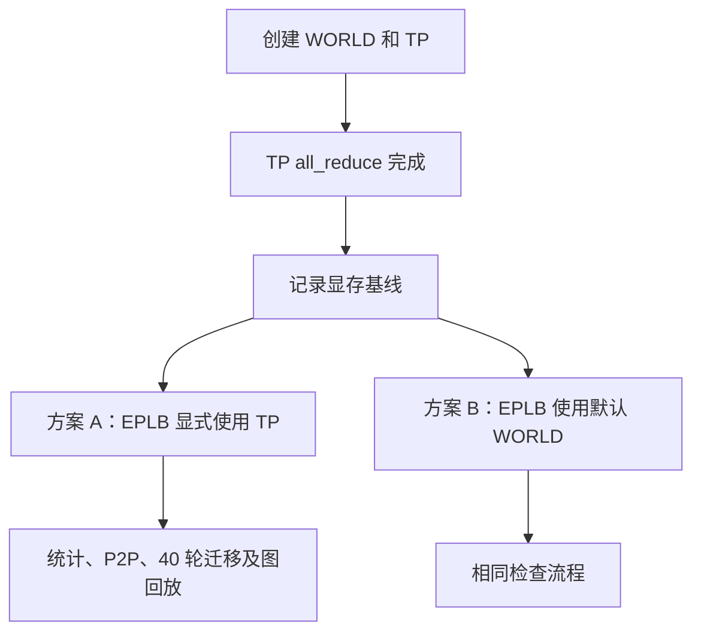

# 复用 TP 通信组到底省在哪里？一次 WORLD 与 HCCL 显存分配追踪

动态 EPLB 要做负载归约和权重迁移。接入 Ascend 时，默认 WORLD 已由 PyTorch 创建，直接传 `group=None` 就能使用；服务又有现成 TP 组，换成它会不会少占资源？

起因是一次很小的专家负载统计：执行后，设备占用突然多了几个 GiB。统计张量没有这么大，权重和 KV Cache 也没变。追到初始化过程才发现，WORLD 虽然创建了，却还没做过设备通信；第一次真正使用时，仍要分配通信资源。TP 之前做过的初始化不会自动替它完成。

我们先在完整服务里看 OFF 后续是否也会用到 TP，再开独立进程，让 TP 先完成通信，测 WORLD 额外带来的占用。40 轮迁移与图回放之后，复用 TP 比另用 WORLD 每芯片少占 P 4.04 GiB、D 2.39 GiB，主要差在第二套通信资源。

## 一、同一批 rank，可以有两个通信组

`dist.init_process_group()` 建立默认进程组，`group=None` 就使用它。SGLang 的并行组管理另外创建 TP、MoE 等组。WORLD 和 TP 即使都包含 rank 0～15，也可能是两个 ProcessGroup 对象。

进程组除了记录参与者，还持有通信上下文。框架收到 `group=None` 后，不会再搜索哪个同成员组已经有缓冲区；成员相同本身不能让两组共享资源。

实验比较的就是下面两种调用：

```python
# 两组实验都已经完成这些准备，以下是调用关系示意。
dist.init_process_group(backend="hccl", pg_options=world_options)
tp_group = dist.new_group(backend="hccl", pg_options=tp_options)
dist.all_reduce(warmup_tensor, group=tp_group)

# A：明确使用刚才已经参与通信的 TP 组。
dist.all_reduce(expert_counts, group=tp_group)

# B：选择默认 WORLD。
dist.all_reduce(expert_counts, group=None)
```

A、B 处理相同统计数据，rank 数也相同，区别只有最后的组参数。B 的计算结果可以完全正确，首次执行时却多激活一套设备通信资源。

这是延迟初始化带来的差别：创建进程组后，Python 对象和 rank 信息已有了，设备通信器、缓冲区及运行时资源可能等到实际通信才准备。WORLD “已存在”与“已完成设备初始化”因此是两个时刻。

## 二、先把 OFF 后面的流程看完

不过，要把这几个 GiB 归给 EPLB，得先选对比较时刻。

早期快照显示 ON 比 OFF 多占 P 约 524 MiB、D 约 2525 MiB。当时 ON 已做过 TP 通信，OFF 还没有。若在这里停下，就会把 ON 提前初始化的资源全部记成 EPLB 常驻开销。

该轮 DeepSeek-V4 服务使用 `f6ad2f4f`。[`Scheduler.maybe_init_hccl_dp_prewarm`](https://github.com/AkiYangDev/sglang/blob/f6ad2f4f922d0df111dc66153f543a453267455c/python/sglang/srt/managers/scheduler.py)会在 NPU、DeepSeek-V4 条件下对同一 TP 组做 `all_reduce`，无论是否开启 `enable_eplb`。OFF 的 P、D 两端各 16 个 rank 都记下了这次预热，时间在 READY 和正式请求之前。

也就是说，让 OFF 继续启动，它同样会分配那部分 TP 资源。早期两张快照比较的是不同初始化阶段。

我们等 OFF 完成 512 个请求，再在原进程中使用同一 TP 组通信。模型是 DeepSeek-V4-Flash-0731 W8A8，P、D 各 16 个 Ascend 910C 逻辑设备，并发 128，输入 16,388 token、输出 8,192 token，512 条全部成功。

| OFF 完成负载后执行的操作 | P 新增，MiB/芯片 | D 新增，MiB/芯片 |
| --- | ---: | ---: |
| 同一 TP 组再次 `all_reduce` | 0.00 | 0.00 |
| 随后首次批量 P2P | 32.31 | 32.13 |

表里是每端 16 个 rank 的平均值。再次 `all_reduce` 时，全部 32 个 rank 都没有增加占用，和启动日志相互对应：OFF 已经激活 TP 集合通信资源。ON 早期多出来的部分，不能据此当成稳态多占。

首次批量 P2P 仍增加了约 32 MiB。一个组做过集合通信，第一次走另一种收发路径时，还可能初始化其他资源。

这里的 32 MiB 来自设备占用实测，与 `hccl_buffer_size=32` 的设置没有关系，也没有恢复早期专用小缓冲组。两个数字恰好相同，来源却不同。

## 三、WORLD 的几个 GiB 从哪来

为了找出 WORLD 的额外开销，独立实验沿用服务的 P、D 环境参数，继续查两组实际收到的选项。

当时 `get_torch_distributed_pg_options` 有这段判断：

```python
# 摘录：省略平台检查及 Options 对象创建。
if group_name is not None and "moe" not in group_name:
    return None

hccl_buffer_size = int(
    os.environ.get("DEEPEP_HCCL_BUFFSIZE")
    or os.environ.get("HCCL_BUFFSIZE")
    or 200
)
options.hccl_config = {"hccl_buffer_size": hccl_buffer_size}
```

默认 WORLD 没有传组名，会继续读取缓冲区配置；TP 传入 `"tp"`，在这里提前返回 `None`。后者表示这个函数不覆盖选项，后端仍使用 HCCL 自身的环境配置和默认值。

| 实验配置 | P | D |
| --- | --- | --- |
| `DEEPEP_HCCL_BUFFSIZE` | 2048 | 未设置 |
| `HCCL_BUFFSIZE` | 未设置 | 1200 |
| WORLD 显式 `hccl_buffer_size` | 2048 MiB | 1200 MiB |
| TP 的 `pg_options` | `None` | `None` |
| 通信展开模式 | AIV | AIV |

`DEEPEP_HCCL_BUFFSIZE` 的名字容易让人只想到 DeepEP，这段默认 WORLD 代码却也读取它，P 端因此拿到了 2048 MiB 配置。变量名没有限定住它在实际代码中的用途。

首次用 WORLD 统计后，每芯片占用约增加 P 4098 MiB、D 2402 MiB，接近 `2 × 2048 MiB`、`2 × 1200 MiB` 再加少量运行时资源。配置解释了主要规模；实测是设备总占用，不能把每个字节都归为缓冲区本体。

PyTorch allocated、reserved 和设备 free memory 当时都记录了。统计张量在前一测点已经创建，首次统计前后 allocated、reserved 没变，设备空闲显存却少了几个 GiB。新增资源在 PyTorch 张量分配器之外，只看前两个指标就会漏掉它。

## 四、让 TP 先热起来，再比较 WORLD

既然 OFF 启动后也会使用 TP，正式对照就从 TP 已完成通信的时刻开始。

P、D 两套配置分别跑“复用 TP”和“使用 WORLD”，共四次独立的 16-rank 进程运行。每次先创建 WORLD、TP，执行 TP `all_reduce`，记下基线，再进行 EPLB 统计、P2P 和权重迁移。



TP 首次通信本身约占 P 479 MiB、D 2479 MiB，两边都付过这笔成本。下表只记此后新增的部分：

| 配置与测点 | 复用 TP | 使用 WORLD | WORLD 多占 |
| --- | ---: | ---: | ---: |
| P：首次统计完成 | 0.00 | 4097.94 | 4097.94 |
| P：全 peer P2P 预热完成 | 48.72 | 4186.23 | 4137.51 |
| P：全部迁移及图回放完成 | 140.18 | 4278.42 | 4138.24 |
| D：首次统计完成 | 0.00 | 2401.98 | 2401.98 |
| D：全 peer P2P 预热完成 | 49.08 | 2491.89 | 2442.81 |
| D：全部迁移及图回放完成 | 140.38 | 2582.83 | 2442.45 |

单位为 MiB/芯片，取 `torch.npu.mem_get_info()` 的空闲字节差，再对本次 16 个 rank 求均值。这里的“芯片”指逻辑设备，没有合并成物理卡或服务器总量。

首次统计时，复用 TP 的所有 rank 都没有新增占用；WORLD 则各自增加 P 4097.52～4099.48 MiB、D 2401.75～2402.49 MiB。迁移和图回放做完，方案间仍相差 P 4138.24 MiB、D 2442.45 MiB。

比较占用的同时也检查通信功能。`all_reduce`、`reduce`、`broadcast` 覆盖 int64、int32、float32；迁移包含不变布局、环形搬迁、两 rank 交换、卡内交换、冗余专家、重复目标。每 rank 做 40 轮布局检查，真实 NZ29 int8、bfloat16 主权重走过 NZ→ND、迁移、ND→NZ、原位回填，ND float32 辅助权重也一并搬移。

每轮都核对权重值、存储地址和格式，再回放读取原权重地址的 grouped matmul、TP `all_reduce` 图，比较输出。四次运行都是 16/16 rank 通过。两种方案均能完成这些功能，额外显存差异也一直存在。

独立实验的全 peer 预热约增加 49 MiB，完整服务首次批量 P2P 则约增加 32 MiB。测点和执行历史不同，不能用一个覆盖另一个；二者都说明复用之后，新通信路径仍有初始化成本。

## 五、真正接入时，不能随手拿一个 TP 组

接入通用代码还要检查 rank 的含义。迁移计划按 rank 找专家，部分统计有指定根节点，所选通信组必须保持这些编号可用。

例如 WORLD 有 32 个 rank，TP 分成两个 16-rank 子组。要把专家从全局 rank 3 搬到 rank 20，任一 TP 子组都覆盖不了。即使成员数相同，只要顺序变了，原映射也可能指错位置。

整理后的实现因此只在 TP 设备组与 WORLD 等价时复用：成员恰为 `0..world_size-1`，顺序、后端一致。弹性 EP 或 TP 子组沿用原 WORLD 路径，条件如下：

```python
if (
    elastic_ep_enabled
    or tp_group is None
    or tp_group.ranks != list(range(dist.get_world_size()))
    or dist.get_backend(tp_group.device_group) != dist.get_backend()
):
    return None
return tp_group.device_group
```

条件满足后，原根节点、peer ID、槽位映射都可继续使用，只把底层通信上下文换成现有 TP。固定代码见 [`communication.py`](https://github.com/AkiYangDev/sglang/blob/0c947c997d747b1fb1805fccdcdc093100dfde8d/python/sglang/srt/eplb/communication.py)。

首次批量 P2P 也被移到启动阶段统一预热。实际重平衡时，有些 rank 可能没有收发任务；若等到这时才初始化，参与者就由当次布局决定。启动时先做所有 peer 的小张量收发并等待完成，可以让各 rank 走完首次流程。

预热仍会花时间、占显存。它安排初始化的时机；方案省下的大块资源，则来自没有额外激活 WORLD。

权重读写的顺序继续由原迁移流程保证：旧 forward 用完，迁移和原位回填完成，后续图回放再读新值。复用组本身不会自动建立 stream 或事件依赖。

## 六、把两本账分开，结论就不矛盾了

回头看，这次有两份比较：OFF 最终是否也会激活 TP，以及 TP 激活后再用 WORLD 会增加多少占用。把时间点分开，早期快照与最终结果就能对上：

| 对照 | 已经确认的结果 |
| --- | --- |
| 同一服务的 OFF 与 ON，都使用 TP | OFF 在原生预热阶段也激活 TP；早期 524/2525 MiB 差值不能直接记成稳态 EPLB 新增 |
| TP 已经激活，再用 TP 或首次用 WORLD | WORLD 另外分配资源；完整小实验结束时相差 P 4.04 GiB、D 2.39 GiB/芯片 |
| 已用 TP 集合通信，再首次用 TP P2P | 完整服务实测仍新增约 32 MiB/芯片 |
| 权重迁移产生临时张量 | 属于 staging 和分配器生命周期，另行分析 |

专用小缓冲 HCCL 组也能单独设置缓冲区和展开模式，但需要再持有一份通信上下文。本次 TP 恰好覆盖全部参与者，OFF 启动又必然使用它，因此复用可以利用已经付出的资源。

这个前提换了，收益也会变。若应用本来就持续用 WORLD 通信，其大缓冲区早已计入基线，不能再套用这里的额外激活成本。需要沿实际首次通信时间和设备占用测量，单数创建了几个组算不出节省量。

此外，EPLB 统计张量、首次 P2P、权重中转、分配器缓存仍各占一部分显存。上一篇[逐层处理为何仍堆出多层临时张量](ascend-eplb-memory-bounded-staging.md)追踪的是临时张量生命周期，这篇追踪通信上下文，两处修改解决的开销各有来源。

## 实验版本与数据

完整服务记录来自 2026-10-29 的 `f6ad2f4f922d0df111dc66153f543a453267455c`，包含启动过程和 512 请求后的同进程通信。独立实验执行于 2026-10-30，使用 PyTorch 2.10.0+cpu、torch_npu 2.10.0.post6、Ascend 910C，提取了当时工作区的通信选项、单层迁移、staging 实现；冻结标识为 `f6d3a584ce239d4cbc713996663a7de181d3bfdc6f4862bf52a6dc1e75efee65`。工作区基于 `796ec868`，包含当时的 staging 优化，各源文件校验值随数据保留。

[证据说明](../../assets/ascend-eplb-tp-world-memory/evidence.json)交代测量口径和源码校验值，[通信实验 CSV](../../assets/ascend-eplb-tp-world-memory/memory-per-rank.csv)保留逐 rank、逐阶段读数，[OFF 后续激活记录](../../assets/ascend-eplb-tp-world-memory/off-late-results.json)记录完整服务后续通信。文中的均值和范围均可从各自测点重算。

[返回 EPLB 专题](../distributed/eplb-study-guide.md)。
