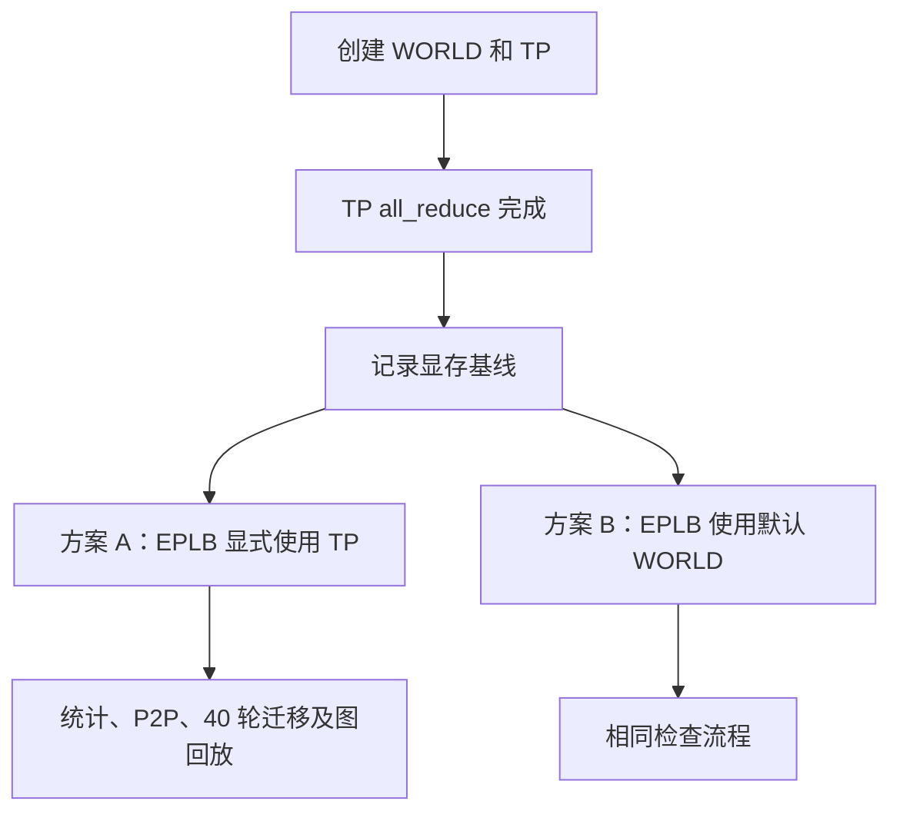

# 复用 TP 通信组到底省在哪里？一次 WORLD 与 HCCL 显存分配追踪

给 Ascend 动态 EPLB 接入通信时，默认 WORLD 已经由 PyTorch 创建，直接使用它看起来很方便。TP 组也存在，是否值得再把它传入统计和迁移代码，需要比较实际资源占用。

实验中，一次很小的专家负载统计让设备占用增加了几个 GiB。统计张量远没有这么大，权重和 KV Cache 也没有改变。继续追踪初始化过程后，我们发现 WORLD 虽已创建，却尚未实际执行设备通信；首次使用它时，仍需分配通信资源。先前由 TP 完成的初始化不会自动为另一个组复用。

我们分别检查了完整服务和独立通信进程。前者确认关闭 EPLB 后，服务是否仍会分配 TP 资源；后者让 TP 先完成通信，再测使用 WORLD 的额外占用。独立实验执行 40 轮迁移与图回放后，复用 TP 的方案每芯片少占 P 4.04 GiB、D 2.39 GiB，差值来自避免启用另一套通信资源。

## 一、同一批 rank，可以有两个通信组

PyTorch 的 `dist.init_process_group()` 创建默认进程组，通信接口中的 `group=None` 指向该组。SGLang 另通过并行组管理创建 TP、MoE 等组。因此，即使 WORLD 和 TP 都包含 rank 0～15，仍可能对应两个不同的 ProcessGroup 对象。

进程组既指定参与 rank，也承载通信上下文。传入 `group=None` 时，框架使用默认组，不会搜索其他已分配缓冲区的同成员组。仅凭 rank 名单相同，通信资源并不能自动共享。

实验中两种调用的差别如下：

```python
# 两组实验都已经完成这些准备，以下是调用关系示意。
dist.init_process_group(backend="hccl", pg_options=world_options)
tp_group = dist.new_group(backend="hccl", pg_options=tp_options)
dist.all_reduce(warmup_tensor, group=tp_group)

# A：明确使用刚才已经参与通信的 TP 组。
dist.all_reduce(expert_counts, group=tp_group)

# B：选择默认 WORLD。
dist.all_reduce(expert_counts, group=None)
```

A、B 的 rank 数和统计数据相同，只改变最后的组参数。B 的通信结果可以正确，但首次调用时会启用另一组设备通信资源。

初始化进程组后，Python 对象和 rank 信息已经可用，设备通信器、缓冲区及相关运行时资源却可能到实际通信时才初始化。这就是 WORLD 早已存在、首次通信仍增加显存占用的原因。

## 二、先把 OFF 后面的流程看完

要判断通信占用是否由 EPLB 额外引入，先把模型加载之后的启动流程看完。

早期快照中，ON 比 OFF 多占约 P 524 MiB、D 2525 MiB。ON 已经执行 TP 通信，OFF 尚未执行，很容易把差值全算成 EPLB 新增显存。然而 OFF 后面还有原生预热，也会使用 TP。

该次 DeepSeek-V4 服务使用 `f6ad2f4f`。[`Scheduler.maybe_init_hccl_dp_prewarm`](https://github.com/AkiYangDev/sglang/blob/f6ad2f4f922d0df111dc66153f543a453267455c/python/sglang/srt/managers/scheduler.py) 在 NPU、DeepSeek-V4 条件下对同一 TP 组执行 `all_reduce`，不依赖 `enable_eplb`。OFF 两端各 16 个 rank 的日志均记录了这次预热，发生在服务 READY 和正式请求之前。

因此，这两个早期读数处于不同初始化阶段。OFF 继续启动后，也会分配 ON 提前启用的那部分资源。

为核对 OFF 的最终状态，我们在它完成 512 个请求后，直接在原进程中再次使用同一 TP 组通信。模型为 DeepSeek-V4-Flash-0731 W8A8，P、D 各有 16 个 Ascend 910C 逻辑设备；并发 128，输入 16,388 token、输出 8,192 token，512 个请求全部成功。

| OFF 完成负载后执行的操作 | P 新增，MiB/芯片 | D 新增，MiB/芯片 |
| --- | ---: | ---: |
| 同一 TP 组再次 `all_reduce` | 0.00 | 0.00 |
| 随后首次批量 P2P | 32.31 | 32.13 |

表中为每端 16 个 rank 的平均值，再次 `all_reduce` 时，全部 32 个 rank 的占用增量均为零。结合启动日志，可以确认关闭 EPLB 的服务也会激活 TP 集合通信资源。ON 只是更早分配，早期差额不代表稳态多出一套大缓冲区。

不过，首次批量 P2P 仍增加约 32 MiB。已经用于集合通信的组，在首次执行另一种收发路径时，还可能初始化额外资源。复用通信组并不表示后续所有通信都没有初始化开销。

这里的 32 MiB 是设备占用的实测增量，与设置 `hccl_buffer_size=32` 无关，也没有恢复早期专用小缓冲组。观测值和配置值需要分别记录，才能区分不同实现。

## 三、WORLD 的几个 GiB 从哪来

独立实验沿用服务的 P、D 环境参数，但 WORLD 与 TP 接收到的显式组选项有差别。

当时 `get_torch_distributed_pg_options` 中的相关判断为：

```python
# 摘录：省略平台检查及 Options 对象创建。
if group_name is not None and "moe" not in group_name:
    return None

hccl_buffer_size = int(
    os.environ.get("DEEPEP_HCCL_BUFFSIZE")
    or os.environ.get("HCCL_BUFFSIZE")
    or 200
)
options.hccl_config = {"hccl_buffer_size": hccl_buffer_size}
```

默认 WORLD 初始化时不传组名，会继续读取缓冲区配置；TP 传入 `"tp"`，在这里提前返回 `None`。返回空选项只表示该函数没有覆盖后端配置，HCCL 仍会使用自身环境配置和默认值。

| 实验配置 | P | D |
| --- | --- | --- |
| `DEEPEP_HCCL_BUFFSIZE` | 2048 | 未设置 |
| `HCCL_BUFFSIZE` | 未设置 | 1200 |
| WORLD 显式 `hccl_buffer_size` | 2048 MiB | 1200 MiB |
| TP 的 `pg_options` | `None` | `None` |
| 通信展开模式 | AIV | AIV |

`DEEPEP_HCCL_BUFFSIZE` 虽然以 DEEPEP 命名，这段构造默认 WORLD 选项的代码同样读取它，因此 P 端 WORLD 得到了 2048 MiB 配置。只根据变量名判断作用范围，会漏掉这项实际设置。

首次通过 WORLD 统计后，设备占用每芯片增加约 P 4098 MiB、D 2402 MiB。其规模分别接近 `2 × 2048 MiB`、`2 × 1200 MiB`，再加少量运行时资源。这里测的是设备总占用，缓冲区配置能解释主要规模，不能把测量中的全部字节都当成缓冲区本体。

我们同时保存了 PyTorch allocated、reserved 和设备 free memory。统计张量已在前一个测点创建；首次统计前后，allocated 与 reserved 均未变化，设备空闲显存却减少几个 GiB。这次新增占用位于 PyTorch 张量分配器之外，仅查看 allocated、reserved 会漏掉它。

## 四、让 TP 先热起来，再比较 WORLD

既然 OFF 后续必然使用 TP，对照就从 TP 已完成通信时开始，避免再次混入启动阶段差异。

P、D 配置分别运行复用 TP 与使用 WORLD 两种方案，共四次独立的 16-rank 进程运行。每次依次创建 WORLD、创建 TP、执行 TP `all_reduce`，然后记录本次显存基线，之后再做 EPLB 统计、P2P 与权重迁移。



首次启用 TP 本身增加约 P 479 MiB、D 2479 MiB。两种方案都已完成这次初始化，费用计入各自基线。下表只比较基线以后的占用增量。

| 配置与测点 | 复用 TP | 使用 WORLD | WORLD 多占 |
| --- | ---: | ---: | ---: |
| P：首次统计完成 | 0.00 | 4097.94 | 4097.94 |
| P：全 peer P2P 预热完成 | 48.72 | 4186.23 | 4137.51 |
| P：全部迁移及图回放完成 | 140.18 | 4278.42 | 4138.24 |
| D：首次统计完成 | 0.00 | 2401.98 | 2401.98 |
| D：全 peer P2P 预热完成 | 49.08 | 2491.89 | 2442.81 |
| D：全部迁移及图回放完成 | 140.38 | 2582.83 | 2442.45 |

各行单位均为 MiB/芯片，使用 `torch.npu.mem_get_info()` 的空闲字节差，再取本次 16 个 rank 的均值。“芯片”在本文指逻辑设备，不是单台服务器或物理卡的合计。

首次统计时，复用 TP 的所有 rank 均没有新增占用。WORLD 的占用增量则为 P 4097.52～4099.48 MiB、D 2401.75～2402.49 MiB，各 rank 都出现了相近变化。完成迁移和图回放后，差值仍有 P 4138.24 MiB、D 2442.45 MiB。

实验还同时检查了功能。`all_reduce`、`reduce`、`broadcast` 覆盖 int64、int32、float32；迁移覆盖不变布局、环形搬迁、两 rank 交换、卡内交换、冗余专家和重复目标。每个 rank 执行 40 轮布局检查，真实 NZ29 int8、bfloat16 主权重经过 NZ→ND、迁移、ND→NZ 和原位写回，ND float32 辅助权重也一并验证。

每轮均检查权重数值、存储地址和格式，再回放读取原权重地址的 grouped matmul 与 TP `all_reduce` 图，核对输出。四次运行均有 16/16 rank 通过。因此两种组选择都能完成这项功能，显存差别仍真实存在。

独立小实验的全 peer 预热约增加 49 MiB，完整服务首次批量 P2P 约增加 32 MiB。两者的执行历史和测点不同，应分别使用原始读数；它们共同表明，复用后仍有新路径的初始化开销。

## 五、真正接入时，不能随手拿一个 TP 组

将复用接入通用代码时，还需保持 rank 含义不变。EPLB 的迁移计划按 rank 定位专家，部分统计通信指定根节点，所选组必须兼容这些编号。

例如 WORLD 有 32 个 rank，TP 分成两个 16-rank 子组。若计划将专家从全局 rank 3 移到 rank 20，任意一个 TP 子组都无法覆盖这次迁移。组成员数量相同也不充分；成员顺序改变后，原映射仍可能失效。

因此，整理后的实现只在 TP 设备组与 WORLD 等价时复用：成员恰为 `0..world_size-1`，顺序和后端一致。弹性 EP 或 TP 子组继续使用原 WORLD 路径。核心条件如下：

```python
if (
    elastic_ep_enabled
    or tp_group is None
    or tp_group.ranks != list(range(dist.get_world_size()))
    or dist.get_backend(tp_group.device_group) != dist.get_backend()
):
    return None
return tp_group.device_group
```

满足条件时，调用方的根节点、peer ID 与专家槽位映射可以沿用，底层通信上下文复用 TP。固定实现见 [`communication.py`](https://github.com/AkiYangDev/sglang/blob/0c947c997d747b1fb1805fccdcdc093100dfde8d/python/sglang/srt/eplb/communication.py)。

首次批量 P2P 还需要统一预热。实际重平衡中，部分 rank 可能没有收发任务而跳过搬运；若把首次初始化留在这里，参与 rank 就取决于当次布局。实现因此在启动阶段执行所有 peer 的小张量收发，等待完成后才进入服务。

预热把剩余初始化放到启动阶段，保证各 rank 走完首次通信流程，但仍会消耗显存和时间。显存节省来自没有激活另一套资源，不能归因于预热本身。

权重更新的执行顺序也仍由原流程保证：旧 forward 先用完权重，迁移并原位写回完成后，后续图回放才能读取新值。复用组不会自动建立这些 stream 和事件依赖。

## 六、把两本账分开，结论就不矛盾了

这次排查涉及两种不同的比较。OFF 与 ON 是否最终都启用 TP，决定早期占用差是否会持续；TP 已启用后再使用 WORLD，决定是否额外激活一套通信资源。主要结果如下：

| 对照 | 已经确认的结果 |
| --- | --- |
| 同一服务的 OFF 与 ON，都使用 TP | OFF 在原生预热阶段也激活 TP；早期 524/2525 MiB 差值不能直接记成稳态 EPLB 新增 |
| TP 已经激活，再用 TP 或首次用 WORLD | WORLD 另外分配资源；完整小实验结束时相差 P 4.04 GiB、D 2.39 GiB/芯片 |
| 已用 TP 集合通信，再首次用 TP P2P | 完整服务实测仍新增约 32 MiB/芯片 |
| 权重迁移产生临时张量 | 属于 staging 和分配器生命周期，另行分析 |

专用小缓冲 HCCL 组也可以独立设置缓冲区与展开模式，代价是再引入一份通信上下文。本次拓扑的 TP 已覆盖所有参与 rank，OFF 启动时又必须使用它，因而复用现有 TP 能利用这部分已有资源。

换到其他应用，应重新查首次使用的时间和比较基线。若 WORLD 原本就持续通信，其大缓冲区已计入基线，本文的额外激活成本便不能直接套用。需要跟踪实际设备通信及占用，组名相同或创建次数相同都不足以推算收益。

本次节省来自避免额外激活 WORLD。EPLB 统计张量、首次 P2P 资源、权重中转和分配器缓存仍各自占用显存，其中临时张量的生命周期见上一篇[逐层处理为何仍堆出多层临时张量](ascend-eplb-memory-bounded-staging.md)。区分这些来源，才能确定某处修改减少了哪部分占用。

## 实验版本与数据

完整服务证据来自 2026-10-29 的 `f6ad2f4f922d0df111dc66153f543a453267455c`，包括启动阶段、512 请求完成后的同进程通信检查。独立通信实验执行于 2026-10-30，使用 PyTorch 2.10.0+cpu、torch_npu 2.10.0.post6、Ascend 910C；提取当时工作区的通信选项、单层迁移和 staging 实现，冻结源码标识为 `f6d3a584ce239d4cbc713996663a7de181d3bfdc6f4862bf52a6dc1e75efee65`。工作区基于 `796ec868` 并包含当时的 staging 优化，具体源文件校验值随数据保存。

数值、源文件校验值和测量口径见[证据说明](../../assets/ascend-eplb-tp-world-memory/evidence.json)，逐 rank、逐阶段数据见[通信实验 CSV](../../assets/ascend-eplb-tp-world-memory/memory-per-rank.csv)，完整服务后续通信结果见[OFF 后续激活记录](../../assets/ascend-eplb-tp-world-memory/off-late-results.json)。两份数据保留各自的基线和测点，可从逐 rank 结果重新计算文中的均值与范围。
